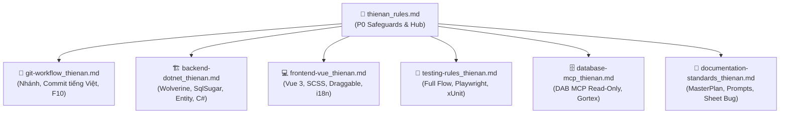

# 📌 Quy Định Chung Phòng Phần Mềm: Thiên Ân (Single Source of Truth)

> 🔴 **NGUỒN SỰ THẬT DUY NHẤT (SSOT): `.agents/rules/`**  
> Toàn bộ quy tắc kiến trúc, quy chuẩn code, quy trình Git và an toàn vận hành AI được chuẩn hóa tại đây.
> Các quy tắc trong file này có độ ưu tiên **CAO HƠN (P0)** so với `universal-rules.md` và mọi rule generic khác của AG-Kit.

---

## 🛑 BẢNG QUY TẮC CỐT LÕI BẮT BUỘC (P0 SAFEGUARDS)

Mọi AI Agent (Antigravity, Claude Code, Cursor, Codex...) **BẮT BUỘC** tuân thủ tuyệt đối 21 quy tắc sống còn sau:

| STT | Quy Tắc Cốt Lõi (P0) | Yêu Cầu Chi Tiết |
| :---: | :--- | :--- |
| **1** | **Gortex-First Protocol** (Rule 19.62) | Mọi thao tác tìm kiếm, đọc, phân tích đồ thị và sửa mã nguồn (C#, Vue, TS, SQL) **BẮT BUỘC dùng Gortex MCP** (`call_mcp_tool` server `gortex`). Chỉ dùng công cụ mặc định khi Gortex không khả dụng hoặc khi sửa file Markdown. |
| **2** | **Bộ Test Hợp Nhất** (Rule 19.63) | Test Frontend **BẮT BUỘC** viết bằng Playwright tại `tests/FE/` (`pnpm test:e2e`). Test Backend **BẮT BUỘC** viết bằng xUnit tại `tests/BE/` (`dotnet test tests/BE/test.csproj`). ⛔ **CẤM** tạo script test ad-hoc rải rác ngoài 2 thư mục này. |
| **3** | **Cấm Tự Ý Git Stage / Commit** (Mục 4.2, Rule 19.58) | ⛔ **TUYỆT ĐỐI CẤM** tự ý chạy `git add`, `git reset`, `git commit`, `git push`. Mọi thay đổi mã nguồn BẮT BUỘC để nguyên ở trạng thái Working Tree (Unstaged) để lập trình viên tự review qua Git Diff. |
| **4** | **Cấm Auto-Build Frontend** (Rule 19.13) | Phía Frontend đã có Vite Dev Server chạy nền tích hợp sẵn Hot-Reload (HMR). Sau khi sửa code FE, AI ⛔ **CẤM tự ý chạy `npm run build` / `pnpm build`**. |
| **5** | **CSDL Test Local Bắt Buộc** (Mục 11) | Mọi bài test Backend BẮT BUỘC chạy trên SQL Server Local (`localhost` / `127.0.0.1`). `Host.GuardAllConnectionsLocal` chặn cứng kết nối ra ngoài. ⛔ **CẤM** dùng cờ `--no-build` khi chạy `dotnet test`. |
| **6** | **Cấm Dùng Thư Viện Mock Ngoài** (Mục 15, Rule 19.18) | ⛔ **CẤM** dùng Moq, NSubstitute hoặc tự tạo class fake mock nội bộ cho service nghiệp vụ và NATS. BẮT BUỘC lấy service thật từ `host.Services` và test trên CSDL test local. Ngoại lệ duy nhất: giả lập server HTTP ngoài bằng `HttpListener` trên `127.0.0.1`. |
| **7** | **Strict AAA — Cấm Try-Catch Trong Test** (Rule 19.43) | ⛔ **CẤM** bọc `try-catch` hoặc `try-finally` quanh các khối Act và Assert trong test method. Luồng test phải phẳng và tuần tự theo AAA để test fail tự nhiên khi có lỗi. |
| **8** | **Không Tự Xóa DB Trong Test Method** (Rule 19.45) | ⛔ **CẤM** tự viết câu lệnh xóa bảng DB trong từng test method. Dọn dẹp tập trung tại `Host.ClearAllData()` và mỗi test method tự cô lập dữ liệu bằng **Unique ID**. |
| **9** | **Cấm Lạm Dụng `!important` Trong CSS** (Rule 20.6) | ⛔ **CẤM** dùng `!important` trong CSS/SCSS. Nâng cao độ ưu tiên tự nhiên (specificity) bằng lồng selector hoặc class định danh. |
| **10** | **CSS-First Cho Mọi Sửa Đổi Giao Diện** (Rule 20.7, 19.27) | Mọi lỗi hiển thị, responsive BẮT BUỘC xử lý bằng CSS/SCSS. ⛔ **CẤM** tự ý xóa props/thuộc tính của Element Plus (`show-word-limit`, `clearable`, `filterable`...) để "né" căn chỉnh CSS. |
| **11** | **Cấm Toán Tử Phủ Định Kép `!!`** (Rule 20.8) | ⛔ **CẤM** viết toán tử `!!` trong TypeScript/JavaScript. BẮT BUỘC dùng `Boolean(val)` hoặc so sánh tường minh (`val != null && val !== ''`). |
| **12** | **Quy Tắc Sinh ID SnowFlake** (Rule 19.44) | WebAPI được AOP tự động sinh Snowflake ID khi Insert (⛔ CẤM gán tay `entity.ID`). Background Worker BẮT BUỘC gán thủ công `entity.ID = YitIdHelper.NextId()`. |
| **13** | **Can Thiệp Tối Thiểu & Cấm Sửa Code Ngoài Phạm Vi** (Rule 19.6, 19.35) | ⛔ **TUYỆT ĐỐI CẤM** sửa bất kỳ file, class, hàm hoặc dòng code nào **KHÔNG LIÊN QUAN TRỰC TIẾP** đến yêu cầu hiện tại để tránh làm biến động (change) mã nguồn quá nhiều không cần thiết. Chỉ sửa đúng dòng code tối thiểu cần thiết để đạt mục tiêu. Giữ nguyên 100% logic, định dạng, chú thích và code xung quanh đang chạy ổn định. Cấm tự ý tiện tay refactor, format lại cả file, đổi namespace, đổi kiểu dữ liệu hay sửa file ngoài phạm vi. |
| **14** | **Duy Nhất 1 MasterPlan Nghiệp Vụ & Giữ Lại Prompt** (Rule 19.52, Mục 13) | Mỗi phân hệ CHỈ CÓ DUY NHẤT 1 file MasterPlan sống (`<PhânHệ>_MasterPlan.md`) để báo cáo **luồng nghiệp vụ chính (Đã làm / Chưa làm)**. ⛔ **TUYỆT ĐỐI CẤM** đưa vào MasterPlan các quy chuẩn coding/i18n (Rule 20.14, 20.15...) hay nhật ký fix CSS/bug lặt vặt (toàn bộ quy chuẩn code đưa vào `.agents/rules/` và đối chiếu qua git/test). ⛔ **CẤM** tự động xóa file prompt sau khi hoàn thành task. |
| **15** | **Tự Động Dọn Dẹp Test Artifacts** (Rule 19.64) | Sau khi test pass 100%, AI **BẮT BUỘC tự động dọn dẹp các tệp/thư mục tạm** sinh ra do test runner (như `test-results/`, `playwright-report/`, traces, screenshots, log tạm) để giữ sạch Working Tree. Chỉ giữ lại khi test fail để chẩn đoán. |
| **16** | **Prompt-First Khi Cần Sửa & Ngoại Lệ Cho File `.sql`** (cập nhật 13/10/2026) | Khi user yêu cầu "sửa thì viết prompt", hoặc khi một đợt review/đối chiếu phát hiện chỗ cần sửa trên mã nguồn/tài liệu Markdown (Spec, Q&A): AI ⛔ **KHÔNG tự sửa** mà viết **prompt sửa** trong khung chat, chỉ sửa trực tiếp khi user nói rõ "sửa luôn". **Ngoại lệ cho các tệp kịch bản `.sql` (`DocBusinessThienAn/**/sql/*.sql`)**: AI **ĐƯỢC QUYỀN sửa/cập nhật trực tiếp vào tệp `.sql`** (bổ sung `USE [<TênDB>];`, đối chiếu đúng tên cột/quy ước dữ liệu từ MCP Staging như `SysTerminology.Name = 'lz.<nhóm>'`) để lập trình viên là người kiểm tra và chạy cuối cùng trên DB (AI tuyệt đối không tự thực thi lệnh ghi lên CSDL). |
| **17** | **Repo Cha `ThienAn` Chỉ Dùng `main`** (bổ sung 12/10/2026) | ThienAn gồm **3 repository**: repo cha `ThienAn` (docs, `.agents`, `.claude`, `tests/`) và 2 repo con `TA-ITS015-WEBAPI-V1.0`, `TA-ITS015-WEBVUE-V1.0`. **Chỉ repo cha**: mọi fix (kể cả fix chạy từ prompt/agent) làm thẳng trên `main` rồi push `origin main`; ⛔ **CẤM** tạo nhánh `fix/*`, `feature/*`, `agents/*` hoặc git worktree riêng; nhánh/worktree lỡ tạo thì merge vào `main` rồi xoá cả local lẫn remote. **Hai repo con WEBAPI và WEBVUE KHÔNG bị ảnh hưởng**: vẫn tạo nhánh theo quy chuẩn Git của Thiên Ân (`git-workflow_thienan.md`). Rule 3 vẫn giữ nguyên: AI chỉ `git add`/`commit`/`push` khi user ra lệnh rõ. |
| **18** | **Bắt Buộc Viết Test Cho Mọi Fix Frontend Lặt Vặt** (Rule 19.67 - bổ sung 13/10/2026) | Mọi yêu cầu sửa/chỉnh lỗi dù là lặt vặt nhất ở Frontend (UI, CSS, font chữ, căn chỉnh khoảng cách, chống giật modal/tab, placeholder, i18n, form validation...) **BẮT BUỘC viết/bổ sung ngay bài test Playwright tương ứng** tại `tests/FE/` (`tests/FE/views/<module>/<feature>.test.ts`) để verify và bảo đảm không bị hồi quy (Zero Regression). |
| **19** | **Cấm Viết Nhãn Giao Diện Song Ngữ Lai** (Rule 20.13 - bổ sung 13/10/2026) | ⛔ **CẤM** viết nhãn, tiêu đề, nút bấm, placeholder trên giao diện người dùng (HTML/Vue/Element Plus) theo kiểu lai song ngữ nửa nạc nửa mỡ tiếng Việt kèm tiếng Anh trong ngoặc (như `Trực quan (Builder)`, `Mã nguồn SQL (Raw)`, `Cột trích xuất (SELECT)`, `Sắp xếp (ORDER BY)`). Quy tắc ghi chú giải thuật ngữ tiếng Anh trong ngoặc `[Tiếng Việt] ([English])` **CHỈ ÁP DỤNG cho tài liệu kỹ thuật Markdown (`.md`)**. Trên HTML/UI, ngôn ngữ nào ra ngôn ngữ đó qua hệ thống đa ngôn ngữ i18n (`vi-vn.json`: tiếng Việt thuần túy, `en-us.json`: tiếng Anh thuần túy). |
| **20** | **Quy Chuẩn Đặt Tên Tệp Component (`camelCase` Bắt Buộc)** (Rule 20.14 - bổ sung 14/10/2026) | Tên tất cả các tệp component `.vue` trong `component/` **BẮT BUỘC viết theo chuẩn `camelCase` (chữ cái đầu viết thường)** (như `visualQueryBuilder.vue`, `editPacket.vue`, `alertDetailDrawer.vue`). ⛔ **CẤM** đặt tên tệp kiểu PascalCase viết hoa chữ cái đầu (như `VisualQueryBuilder.vue`, `EditPacket.vue`). Thuộc tính `name` trong `<script lang="ts" setup name="...">` cũng đồng bộ viết theo `camelCase`. |
| **21** | **Cấm Hardcode Text Mẫu & Giao Diện FE Vào Code — 100% Đưa Vào i18n** (Rule 20.15 - bổ sung 14/10/2026) | ⛔ **CẤM** viết text cứng, nhãn mẫu mặc định (như `Mẫu mặc định`), tooltip, placeholder, chuỗi `ElMessage` trực tiếp trong component/script Vue. BẮT BUỘC khai báo qua `$t(...)` và đồng bộ 100% vào cả `vi-vn.json` (thuần Việt) và `en-us.json` (thuần Anh). |

---

## 🗺️ BẢNG ĐIỀU HƯỚNG QUY CHUẨN THEO MIỀN (DOMAIN MODULES)

Để tránh phình to ngữ cảnh, các quy định kỹ thuật chuyên sâu được phân tách thành các module độc lập bên dưới. AI hãy tra cứu trực tiếp theo đúng nghiệp vụ đang xử lý:

### 1. [🌿 Quy Chuẩn Git Workflow & Commit](file:///Users/hoangquydat/ThienAn/.agents/rules/git-workflow_thienan.md)
- **Tên nhánh:** `feat/20260922-XD1.2.2.5_map-location`, `fix/20261007-sharedata-issue`. CẤM lặp `fix-`, `feat-` trong slug.
- **Commit Message:** Dòng 1 `[type]([scope]): [nội dung tiếng Việt có dấu]`. Dòng 2 lặp lại Dòng 1. Dòng 3 gạch đầu dòng chi tiết.
- **Pre-commit Checklist:** 10 bước tự kiểm tra bắt buộc trước khi commit.

### 2. [🏗️ Quy Chuẩn Backend .NET & Clean Architecture](file:///Users/hoangquydat/ThienAn/.agents/rules/backend-dotnet_thienan.md)
- **Wolverine CQRS:** Thin Controller (`MessBus.InvokeAsync()`), CommandHandler `IWolverineHandler`, FluentValidation, Mapster.
- **SqlSugar & Entity:** Kế thừa `EntityTenant`, `EntityConst.Length*` (cấm gán Length vào kiểu số), cấm raw SQL DML, worker dùng `baseClient.CopyNew()`.
- **C# Conventions:** Zero unnecessary usings (IDE0005), using luôn đứng trước namespace, đồng nhất block-scoped namespace trong partial class (Rule 19.65), cấm hậu tố `-Async`, ưu tiên `var`, auto-properties `{ get; set; }`.

### 3. [💻 Quy Chuẩn Frontend Vue 3 / TypeScript](file:///Users/hoangquydat/ThienAn/.agents/rules/frontend-vue_thienan.md)
- **CSS / SCSS:** CẤM hardcode mã màu (dùng CSS vars Element Plus), block comment `/* */`, CẤM `!important`.
- **Draggable Dialog:** Dùng `dialogRef.value?.resetPosition?.()`, CẤM sửa tay `style.transform` (tránh giật toạ độ).
- **TypeScript:** CẤM toán tử `!!`, ngắt dòng thuộc tính template, cấm sửa tay `src/api-services/`.
- **i18n & Tooltip (Rule 20.12):** Thông báo/tooltip có $\ge 2$ câu (ngăn cách bởi dấu '.') BẮT BUỘC chèn `\n` sau dấu '.'; trong `el-tooltip` dùng slot `<template #content>
...
</template>` để hiển thị đa dòng sạch đẹp.
- **Chuẩn Hóa Ngôn Ngữ UI (Rule 20.13):** CẤM viết nhãn UI song ngữ lai tiếng Anh trong ngoặc (như `Trực quan (Builder)`, `Mã nguồn SQL (Raw)`). Quy tắc chú giải tiếng Anh trong ngoặc CHỈ áp dụng cho tài liệu kỹ thuật `.md`. Trên HTML/UI, ngôn ngữ nào ra ngôn ngữ đó qua hệ thống i18n (`vi-vn.json`: thuần Việt, `en-us.json`: thuần Anh).
- **Tên Component (`camelCase` Bắt Buộc - Rule 20.14):** Tên tệp component `.vue` trong `component/` BẮT BUỘC bắt đầu bằng chữ cái thường (ví dụ `visualQueryBuilder.vue`, `editPacket.vue`). ⛔ CẤM viết hoa chữ cái đầu (PascalCase như `VisualQueryBuilder.vue`). Thuộc tính `name` trong `<script lang="ts" setup name="...">` cũng đồng bộ viết theo `camelCase`.
- **100% i18n & Cấm Hardcode Text Mẫu (Rule 20.15 - bổ sung 14/10/2026):** ⛔ CẤM hardcode text cứng, nhãn mẫu mặc định (`Mẫu mặc định`), tooltip, placeholder hay ElMessage trong template/script Vue. 100% text phải đưa vào i18n (`vi-vn.json` và `en-us.json`).
- **Bắt Buộc Viết Test Sau Khi Fix Lặt Vặt (Rule 18 / 19.67):** Mọi sửa đổi FE (kể cả căn chỉnh CSS, font, layout, modal, tab, i18n...) BẮT BUỘC viết/bổ sung ngay bài test Playwright tại `tests/FE/` để bảo đảm Zero Regression.

### 4. [🧪 Quy Chuẩn Kiểm Thử (Testing Suite)](file:///Users/hoangquydat/ThienAn/.agents/rules/testing-rules_thienan.md)
- **Triết lý:** Test toàn trình nghiệp vụ (Full Business Flow), cấm micro unit test rời rạc, tái hiện bug bằng test fail trước (TDD).
- **Frontend Test:** Playwright E2E tại `tests/FE/`, timeout mặc định $\le$ 5s. Bắt buộc bổ sung test case Playwright cho mọi fix Frontend lặt vặt (Rule 18 / 19.67).
- **Backend Test:** Chạy xUnit trên CSDL local, cấm Moq, cấm mock service nội bộ & NATS, cấm bọc `try-catch` quanh Act/Assert.
- **Test Kết Nối Server Thật (Rule 19.66):** Tách riêng vào thư mục `tests/BE/RealServer/`, dùng `[Collection("real-server")]` riêng biệt (không phụ thuộc `Host` / DB / nghiệp vụ) và bắt buộc gắn `[Fact(Skip = "...")]` để ưu tiên luồng test local pass trước.
- **Dọn dẹp Artifacts (Rule 19.64):** Sau khi test pass 100%, BẮT BUỘC tự động dọn dẹp xóa bỏ `test-results/` và các file artifacts tạm.

### 5. [🗄️ Quy Chuẩn Database & MCP Tooling](file:///Users/hoangquydat/ThienAn/.agents/rules/database-mcp_thienan.md)
- **Dual Source of Truth:** Gortex MCP cho code, DAB MCP Staging (`10.10.8.30/DEV_ITS10`) read-only cho DB schema/dữ liệu thực tế.
- **An toàn CSDL & Quyền sửa file `.sql`:** CẤM tự ý chạy DDL/DML trực tiếp trên DB, cấm hàm tạo bảng `EnsureTablesCreated()`. AI **có quyền sửa/cập nhật trực tiếp các file script `.sql`** (`DocBusinessThienAn/**/sql/*.sql`, luôn có `USE [<TênDB>];` và khớp schema thật trên Staging), lập trình viên là người kiểm tra và chạy cuối cùng.

### 6. [📄 Quy Chuẩn Tài Liệu, Plan & Báo Cáo Nghiệp Vụ](file:///Users/hoangquydat/ThienAn/.agents/rules/documentation-standards_thienan.md)
- **MasterPlan & Prompt:** Duy nhất 1 MasterPlan sống per phân hệ, **CHỈ ghi nhận luồng nghiệp vụ chính (hiện trạng, Đã làm / Chưa làm)**; ⛔ **CẤM** đưa vào MasterPlan các quy chuẩn coding/i18n/CSS hay nhật ký fix bug lặt vặt. File prompt đặt tại `Prompt/`, có mục cuối cập nhật tài liệu gốc.
- **Báo cáo rà soát (Loại 1):** Tài liệu Markdown phân tích kỹ thuật theo khung 4 trục (Hiện trạng → Đã làm → Chưa làm → Rủi ro & Đề xuất), hướng về người đọc, cấm phụ lục, trạng thái chỉ có "Đã làm" hoặc "Chưa làm".
- **Mô tả công việc trên Task Portal (Loại 2):** Nêu phạm vi và danh sách đầu mục tính năng sẽ làm (`1.`, `2.`... kèm phạm vi `Service / BE / FE` và gạch đầu dòng `- ` 1 câu ngắn gọn); **luôn đặt các tính năng quan trọng (`Service / BE`) ở đầu, các việc `FE` giao diện & đa ngôn ngữ ở cuối**; **KHÔNG** chia ngày `dd/MM/yyyy`, **KHÔNG** dùng `==============================`; ⛔ CẤM ghi mã nội bộ (`R1`, `R2`...) và ⛔ CẤM đưa việc dọn dẹp code.
- **Kết quả công việc trên Task Portal (Loại 3):** Nhật ký kết quả tách bạch theo **mốc ngày hoàn thành (`dd/MM/yyyy` trên dòng đầu, ngăn cách giữa các ngày bằng `==============================`)**, đánh số đầu mục liên tiếp xuyên suốt các ngày kèm phạm vi và gạch đầu dòng `- ` 1 câu ngắn gọn; **luôn ưu tiên đặt các tính năng quan trọng (`Service / BE`) lên đầu và đẩy các việc `FE` giao diện, đa ngôn ngữ, Support/Verify xuống cuối**; ⛔ CẤM ghi mã nội bộ (`R1`, `R2`, `R5`, `R7`, `BE-7`...) và ⛔ CẤM đưa việc dọn dẹp code.
- **Phản hồi Sheet Bug:** Cú pháp `[ddMMyyyy]-[TênDev]: [Bị gì / Fix như nào cụ thể]`, cấm từ ngữ mơ hồ, cấm gộp issue.
- **Transcript Cuộc Họp:** Tách riêng từng phân hệ vào `doc/transcript/`. Trong `participants` chỉ giữ vai trò **Tech Lead** (ví dụ `Anh Sơn (Tech Lead)`), còn lại các lập trình viên chỉ ghi **`(Dev)`** (ví dụ `Hiếu (Dev)`, `Đạt (Dev)`) vì Dev cover làm full hết — ⛔ CẤM chia nhỏ kiểu `Dev Backend / Service Worker & Frontend` hay `Dev Backend / WebAPI & Database`. Nội dung chỉ gồm Mục 1 (Tóm tắt cốt lõi) và Mục 2 (Kịch bản đối thoại chi tiết); ⛔ CẤM/KHÔNG CẦN tạo bảng "Ma trận phân công công việc (Action Items)". Khi nghe file ghi âm dài ($> 15$ phút): **BẮT BUỘC cắt nhỏ thành các đoạn 10–15 phút** (`ffmpeg` / `AVAssetExportSession`) để nghe chi tiết từng giây (xóa file tạm sau khi xong), lọc bỏ tiếng nói chuyện nền ở bàn bên cạnh, và cấm tự suy diễn thuật ngữ theo quán tính tài liệu cũ (ví dụ cấm tự đổi `Kafka` thành `NATS`).

