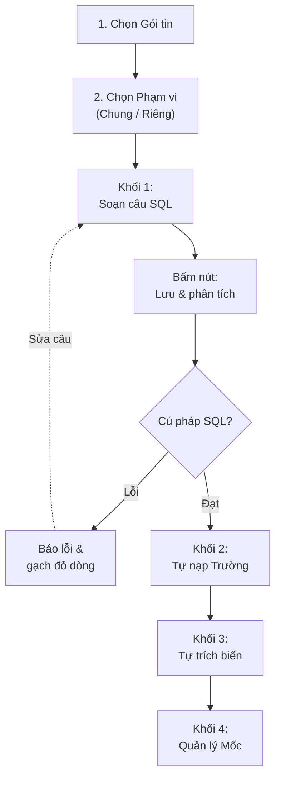

# ĐẶC TẢ CHỨC NĂNG: TAB CẤU HÌNH GÓI TIN (SHAREDATA)

---

## 1. Tổng quan & Điểm thay đổi cốt lõi

Tab **Cấu hình gói tin** mới được thiết kế lại theo hướng **lấy câu truy vấn SQL làm trung tâm**. Thay vì phải khai báo thủ công từng trường dữ liệu và từng biến như trước, người dùng chỉ cần viết câu lệnh SQL và bấm **`Lưu & phân tích`**, hệ thống sẽ tự động bóc tách toàn bộ cấu hình liên quan.



### Tóm tắt 5 điểm mới quan trọng

1. **Tự động bóc Trường dữ liệu & Tham số điều kiện khi bấm `Lưu & phân tích`:**
   - Không còn nút thêm/xóa trường thủ công hay thêm/xóa biến thủ công.
   - Mọi cột trong mệnh đề `SELECT ... AS <TênTrường>` (trừ cột hệ thống bắt đầu bằng `__` như `__lastKey`) sẽ tự động sinh thành **Trường dữ liệu** ở Khối 2.
   - Mọi biến `@tênBiến` xuất hiện trong câu SQL sẽ tự động sinh thành dòng cấu hình ở **Khối 3. Tham số điều kiện**.
2. **Đơn giản hóa nguồn tham số điều kiện còn đúng 2 loại:**
   - **`Theo Mốc đang chạy`**: tự động áp dụng cho biến `@lastKey` (hoặc `@lastKey_<nhóm>`). Lượt đầu chưa có mốc sẽ lấy từ ô **Mốc bắt đầu**; từ lượt thứ 2 trở đi tự động lấy giá trị cột `__lastKey` của dòng cuối cùng đã gửi thành công ở lượt trước.
   - **`Giá trị nhập`**: tự động áp dụng cho biến `@pageSize` (số bản ghi mỗi lượt, `1..100000`) và các biến lọc cố định khác (`@stationId`, `@laneCode`...).
3. **Kiểm tra chặt Quy chuẩn nối đuôi (3/3 tiêu chí) kèm nút `Sửa câu` tự động:**
   - Trình soạn thảo kiểm tra trực tiếp 3 tiêu chí nối đuôi (`__lastKey` dùng `COALESCE(UpdateTime, CreateTime) + '_' + ID`, lọc `WHERE ... > @lastKey`, sắp xếp `ORDER BY __lastKey ASC`) và hỗ trợ nút **`Sửa câu`** để tự động chuẩn hóa câu SQL chỉ với 1 cú nhấp chuột.
4. **Quản lý `Mốc đang chạy` trực quan ngay trên màn gói tin (Khối 4):**
   - Hiển thị rõ mốc hiện tại của từng đối tác đang dùng gói tin; cho phép **`✎ Đặt mốc`** tới một ngày giờ cụ thể (có cảnh báo tự động việc gửi trùng khi lùi mốc hoặc bỏ sót dữ liệu khi tiến mốc) và **`↺ Đặt lại`** mốc về đầu.
5. **Hỗ trợ cấu hình SQL riêng cho từng đối tác ngay trên cùng gói tin:**
   - Bên cạnh **`Mẫu chung`**, cho phép bấm **`Tạo cấu hình riêng +`** để soạn câu SQL riêng cho một đối tác cụ thể mà không cần nhân bản thành gói tin mới; chuyển giữa Mẫu chung và các đối tác bằng ô **`Chọn đối tác:`**.
   - Hỗ trợ **`So sánh với mẫu chung`**, **`⇄ So sánh tất cả`** và **`Dùng lại mẫu chung`**.

---

## 2. Khung trái: Danh sách & Quản lý Gói tin

Khung bên trái hiển thị danh mục toàn bộ gói tin trong hệ thống (có thể kéo thanh ngăn giữa hai khung để điều chỉnh độ rộng).

### 2.1. Bộ lọc & Cột hiển thị trên lưới

| Thành phần | Mô tả & Hành vi hệ thống |
| :--- | :--- |
| **Ô lọc `Mã`, `Tên`** | Tìm kiếm nhanh gói tin theo mã hoặc tên (không phân biệt hoa thường). |
| **Ô lọc `Đối tác`** *(chỉ SuperAdmin)* | Khi chọn một đối tác, danh sách chỉ lọc các gói tin mà đối tác đó đang có đăng ký sử dụng, đồng thời xuất hiện thêm cột **`Nguồn SQL`** gắn nhãn: <br>• **`Cấu hình riêng`** (màu cam): đối tác đang dùng câu SQL riêng.<br>• **`Dùng chung`** (màu xám): đối tác đang dùng câu SQL của Mẫu chung. |
| **Cột `Mã`** | Hiển thị mã gói tin (`101_commonData`, `102_cctvData`...). Nếu gói tin đang tắt (`Status = 0`), bên dưới mã sẽ hiện nhãn đỏ **`Ngừng hoạt động`**. |
| **Cột `Đối tác`** | Hiển thị số đối tác đang đăng ký gói (`{N} đối tác` hoặc `Chưa gán`). Khi rê chuột vào sẽ hiện tooltip liệt kê tên các đối tác. |
| **Cột `Gửi / Nhận`** | • Hiện **`{N} bảng`** (nhãn xanh, ví dụ `2 bảng`): gói tin đã khai báo câu SQL ghi dữ liệu ở tab Nhận về.<br>• Hiện **`Chỉ gửi`** (nhãn xám): gói tin chưa khai báo câu SQL chiều nhận. |
| **Cột `Thao tác`** *(chỉ SuperAdmin)* | Gồm 3 nút biểu tượng: **Sao chép** (tạo gói mới từ gói sẵn có), **Sửa** (sửa thông tin gói), **Xóa** (xóa gói tin). |

### 2.2. Thêm mới, Sửa và Sao chép Gói tin

Khi bấm **Thêm mới**, **Sửa** hoặc **Sao chép**, hộp thoại thông tin gói tin gồm các trường:
- **`Mã`** *(bắt buộc, tối đa 128 ký tự)*: Mã định danh gói tin.
- **`Tên`** *(bắt buộc, tối đa 128 ký tự)*: Tên hiển thị của gói tin.
- **`Loại gói (thứ tự)`** *(từ `101` đến `111`)*: Khi tạo mới và chọn loại gói, hệ thống tự động điền sẵn câu SQL mẫu chuẩn của loại gói đó. Khi ở chế độ **Sửa**, trường này bị khóa không cho đổi.
- **`Trạng thái`**: **Hoạt động** (`1`) hoặc **Ngừng hoạt động** (`0`). Khi gói tin ở trạng thái *Ngừng hoạt động*, tiến trình nền (Worker) sẽ bỏ qua không quét gửi gói tin này.
- **`Ghi chú`** *(tối đa 256 ký tự)*.

---

## 3. Khung phải — Tab 1: `Gửi đi · lấy dữ liệu gửi đối tác`

Khi chọn một gói tin ở khung trái, phần đầu khung phải hiển thị:
- **Tên gói tin** và **Mã gói tin**.
- Dòng **`{N} đối tác đang dùng gói:`** kèm tóm tắt **`{X} cấu hình riêng · {Y} dùng chung`** và các thẻ `<Mã đối tác> · Cấu hình riêng` (màu cam) / `<Mã đối tác> · Dùng chung` (màu xám). Nhãn thẻ đã đủ nghĩa nên không có tooltip.
  - Gói nhiều đối tác: mặc định chỉ hiện **10 thẻ đầu** (đối tác cấu hình riêng xếp trước), bấm **`Xem tất cả ({N})`** để hiện đủ, **`Thu gọn`** để trở lại. Đổi sang gói khác thì dòng này tự thu gọn lại.

Bên dưới là 2 tab lớn: **`Gửi đi · lấy dữ liệu gửi đối tác`** và **`Nhận về · ghi vào {N} bảng`**.

---

### 3.1. Thanh phạm vi SQL (`Mẫu chung` & `Cấu hình riêng` của từng đối tác)

Một gói tin có thể dùng chung một câu truy vấn cho mọi đối tác (**`Mẫu chung`**), hoặc tách riêng câu truy vấn/tham số cho từng đối tác có yêu cầu đặc thù.

| Thao tác trên thanh phạm vi | Hành vi chi tiết |
| :--- | :--- |
| **Ô chọn `Chọn đối tác:`** | Phạm vi SQL chọn bằng một ô chọn (không còn dải tab), nhãn **`Chọn đối tác:`** đứng trước, ô rộng 180px:<br>• Danh sách gồm **`Mẫu chung`** và các đối tác đã có **Cấu hình riêng** (`<Mã> — <Tên đối tác>`); gõ để tìm nhanh khi gói có nhiều đối tác.<br>• Ô hẹp nên tên dài bị cắt: rê chuột vào ô hiện tooltip tên đầy đủ của phạm vi đang chọn.<br>• Đang sửa câu SQL / tham số chưa lưu mà chọn phạm vi khác: hệ thống hỏi xác nhận, bấm Hủy thì ở lại phạm vi cũ. |
| **`Mẫu chung`** | Cấu hình SQL mặc định của gói tin. Mọi đối tác không tạo cấu hình riêng sẽ chạy theo Mẫu chung. |
| **Nút `Tạo cấu hình riêng +`** | Mở hộp thoại **Thiết lập cấu hình riêng cho đối tác**:<br>1. Chọn **Đối tác** cần tách cấu hình riêng.<br>2. Chọn **Sao chép từ**: `Mẫu chung` hoặc sao chép từ `Cấu hình riêng của đối tác` khác.<br>3. Bấm **`Tạo & mở tab`**: tạo cấu hình riêng, đối tác đó xuất hiện trong ô **`Chọn đối tác:`** và được chọn ngay để soạn. |
| **Chip phiên bản khi chọn một đối tác** | Khi đang chọn cấu hình riêng của một đối tác, thanh công cụ hiện trạng thái đồng bộ so với Mẫu chung:<br>• **`Dựa trên mẫu v{X} · đã đồng bộ`** (màu xanh): Mẫu chung chưa thay đổi kể từ lúc đối tác tách riêng.<br>• **`Dựa trên mẫu v{X} · mẫu hiện tại v{Y}`** (màu vàng): Mẫu chung đã được sửa lên bản mới hơn, gợi ý bấm *So sánh với mẫu chung* để kiểm tra. |
| **Nút `So sánh với mẫu chung`** *(khi chọn một đối tác)* | Mở hộp thoại đối chiếu song song 2 cột (**Mẫu chung hiện tại** ↔ **Cấu hình riêng của đối tác**), cho phép chọn giữ từng đoạn của mẫu chung hoặc của đối tác rồi bấm **`Lưu bản đã trộn`**. |
| **Nút `Dùng lại mẫu chung`** *(khi chọn một đối tác)* | Hỏi xác nhận xóa cấu hình riêng của đối tác đó để quay về dùng chung câu SQL và tham số của `Mẫu chung`. |
| **Nút `⇄ So sánh tất cả ({N})`** *(khi chọn Mẫu chung)* | Hiển thị khi gói tin có ít nhất 1 đối tác dùng cấu hình riêng. Mở bảng tổng hợp đối chiếu **Câu truy vấn**, **Trường dữ liệu**, **Tham số điều kiện** của tất cả đối tác so với Mẫu chung; hỗ trợ tích chọn nhiều đối tác để bấm **`Đưa đã chọn về mẫu chung`**. |

---

### 3.2. Khối 1: Câu truy vấn (`Câu truy vấn mẫu chung` / `Câu truy vấn riêng của <Đối tác>`)

Khối 1 là trình soạn thảo **Monaco SQL Editor** chuyên dụng cho SQL Server (T-SQL).

#### A. Tính năng hỗ trợ soạn thảo & Gợi ý tự động (Autocomplete)
1. **Gợi ý tên bảng & cột thật từ CSDL nguồn:**
   - Khi gõ tên bảng hoặc bí danh bảng kèm dấu chấm (ví dụ `zs.`), trình soạn tự động xổ danh sách các cột thực tế của bảng đó kèm kiểu dữ liệu (`varchar`, `datetime`, `decimal`...).
2. **Gợi ý khóa trường sau từ khóa `AS `:**
   - Khi gõ `AS `, trình soạn gợi ý danh sách các khóa trường chuẩn của gói tin kèm tên tiếng Việt.
3. **Gợi ý biến tham số khi gõ `@`:**
   - Tự động gợi ý `@pageSize`, `@lastKey` và các biến đã khai báo.
4. **5 mẫu câu lệnh dựng sẵn (gõ `select-...` hoặc `where-...`):**
   - `select-incremental`: Chèn khung câu truy vấn **nối đuôi chuẩn** (có `TOP (@pageSize)`, cột `__lastKey`, `WHERE ... > @lastKey`, `ORDER BY __lastKey ASC`).
   - `select-snapshot`: Chèn khung câu truy vấn **lấy toàn bộ (Snapshot)** không dùng mốc.
   - `where-incremental`: Chèn nhanh cụm điều kiện `WHERE` nối đuôi chuẩn.
   - `left-join-on`: Chèn mẫu nối bảng `LEFT JOIN ... WITH (NOLOCK)`.
   - `with-nolock`: Chèn gợi ý đọc không khóa `WITH (NOLOCK)`.
5. **Báo lỗi trực tiếp theo dòng/cột:**
   - Nếu câu SQL sai cú pháp hoặc vi phạm quy tắc an toàn, khi bấm **`Lưu & phân tích`**, trình soạn sẽ tự động **gạch chân đỏ ngay tại dòng/cột bị lỗi** và cuộn con trỏ tới đúng vị trí đó.

#### B. Hai chế độ truy vấn dữ liệu chiều gửi

| Chế độ | Dấu hiệu nhận biết trong câu SQL | Cách Worker chạy thực tế |
| :--- | :--- | :--- |
| **1. Gửi toàn bộ (Snapshot)** | Câu SQL **không** có cột `__lastKey` và **không** có biến `@lastKey` (mẫu chuẩn hiện tại: `102` hình ảnh CCTV, `105` nhận dạng phương tiện, `108` nội dung VMS, `110` thông tin công cộng). | Mỗi chu kỳ lập lịch, Worker chạy câu `SELECT` lấy toàn bộ các dòng hiện có và gửi sang đối tác. Khối **4. Mốc đang chạy** sẽ tự động ẩn đi. |
| **2. Gửi nối đuôi (Incremental)** | Câu SQL có cột mốc `__lastKey` (hoặc `__lastKey_<nhóm>`) và điều kiện lọc `> @lastKey` (mẫu chuẩn hiện tại: `101`, `103`, `104`, `106`, `107`, `109`, `111`). | Mỗi chu kỳ lấy tối đa `@pageSize` dòng có mốc lớn hơn `@lastKey`. Gửi thành công tới đâu, Worker lưu giá trị `__lastKey` của dòng cuối cùng làm mốc cho lượt kế tiếp. |

#### C. Công thức chuẩn bắt buộc của câu SQL nối đuôi

Mọi câu SQL nối đuôi trên một bảng nguồn phải tuân thủ **công thức mốc kết hợp Thời gian + Khóa chính (`ID`)** để đảm bảo không bao giờ bỏ sót hoặc gửi trùng bản ghi (kể cả khi nhiều bản ghi có cùng thời điểm cập nhật tới từng mili-giây):

```sql
SELECT TOP (@pageSize)
    t.ID AS recordId,
    -- Các cột dữ liệu nghiệp vụ khác...
    CONVERT(varchar(23), COALESCE(t.UpdateTime, t.CreateTime), 121) + '_' + t.ID AS __lastKey
FROM dbo.TenBangNguon t WITH (NOLOCK)
WHERE CONVERT(varchar(23), COALESCE(t.UpdateTime, t.CreateTime), 121) + '_' + t.ID > @lastKey
ORDER BY __lastKey ASC
```

- **Trường hợp câu SQL ghép nhiều nhánh bằng `UNION ALL`:** Mỗi nhánh `SELECT` phải dùng một cặp cột mốc và biến mốc riêng theo hậu tố nhóm: `__lastKey_<nhóm>` và `@lastKey_<nhóm>` (ví dụ nhánh 1 dùng `__lastKey_a` / `@lastKey_a`, nhánh 2 dùng `__lastKey_b` / `@lastKey_b`).

---

### 3.3. Khối 2: Trường dữ liệu (`Trường dữ liệu — phân tích từ câu truy vấn khi Lưu`)

Khối này hiển thị danh sách các trường dữ liệu đầu ra của gói tin (sẽ được dùng để ánh xạ sang trường nhận của đối tác ở tab *Hồ sơ ánh xạ*).

1. **Cơ chế tự động cập nhật khi bấm `Lưu & phân tích`:**
   - Hệ thống chạy phân tích cấu trúc kết quả của câu `SELECT` trên máy chủ:
     - Cột mới xuất hiện trong câu `SELECT` → **tự động thêm** vào danh sách trường và tự đoán kiểu dữ liệu (`string`, `int`, `decimal`, `datetime`, `boolean`) theo kiểu cột CSDL.
     - Cột đã có từ trước → **giữ nguyên** các thiết lập mô tả mà người dùng đã chỉnh (Tên hiển thị tiếng Việt, Nhóm, cờ Bắt buộc, Ghi chú).
     - Cột bị xóa khỏi câu `SELECT` → **tự động loại bỏ** khỏi danh sách trường.
   - Các cột kỹ thuật bắt đầu bằng 2 dấu gạch dưới (`__lastKey`, `__lastKey_upd`...) chỉ phục vụ lấy mốc ngầm của hệ thống, **không** đưa vào danh sách trường dữ liệu nghiệp vụ.
2. **Chỉnh sửa thông tin trường (`✎ Chỉnh sửa`):**
   - Bấm biểu tượng cây bút ở cuối dòng để mở hộp thoại **Chỉnh sửa trường gói tin**:
     - `Trường dữ liệu`: khóa kỹ thuật lấy từ bí danh `AS` trong câu SQL (chỉ đọc; muốn đổi tên khóa thì sửa chữ sau `AS` trong câu SQL rồi bấm *Lưu & phân tích*).
     - `Tên hiển thị`: tên tiếng Việt dễ hiểu của trường.
     - `Nhóm`: chọn nhóm có sẵn hoặc bấm nút thư mục `+` để tạo nhóm mới gom các trường liên quan.
     - `Kiểu`: `string`, `number`, `int`, `decimal`, `datetime`, `boolean`...
     - `Bắt buộc`: đánh dấu trường bắt buộc phải có khi kiểm tra ánh xạ.
     - `Ghi chú`: mô tả ý nghĩa hoặc đơn vị tính của trường.
3. **Cột `So mẫu chung` khi chọn một đối tác:**
   - Giúp người vận hành nhìn ngay sự khác biệt giữa danh sách trường của câu SQL riêng so với Mẫu chung:
     - Nhãn **`=` (Giống mẫu)**: cùng tên trường, cùng kiểu dữ liệu và cờ bắt buộc.
     - Nhãn **`+` (Mới — màu xanh)**: trường mới chỉ có trong câu SQL riêng của đối tác này.
     - Nhãn **`-` (Thiếu — màu đỏ, gạch ngang dòng)**: Mẫu chung có trường này nhưng câu SQL riêng của đối tác đã bỏ cột đó đi (khi gửi cho đối tác, trường này sẽ nhận giá trị `null`).
     - Nhãn **`≠` (Khác — màu vàng)**: cùng tên trường nhưng khác kiểu dữ liệu hoặc khác cờ bắt buộc so với Mẫu chung.
4. **Cảnh báo bảo vệ khi xóa cột đang được ánh xạ:**
   - Nếu người dùng sửa câu SQL làm mất một hoặc nhiều cột đang được gắn trong *Hồ sơ ánh xạ* và bấm **`Lưu & phân tích`**, hệ thống sẽ bật hộp thoại cảnh báo:
     > *"Câu truy vấn mới làm thiếu {N} trường đang dùng trong hồ sơ ánh xạ: `<danh sách trường>`. Khi gửi dữ liệu, các trường bị thiếu sẽ nhận giá trị rỗng (null). Bạn vẫn muốn lưu?"*

---

### 3.4. Khối 3: Tham số điều kiện

Mọi biến `@tênBiến` viết trong câu SQL ở Khối 1 sẽ tự động xuất hiện tại bảng **3. Tham số điều kiện** sau khi bấm **`Lưu & phân tích`**.

#### A. Quy tắc phân loại Nguồn giá trị (Tự động & Khóa cố định)

Hệ thống tự động nhận diện loại biến theo tên và vị trí trong câu SQL, người dùng chỉ cần nhập giá trị cấu hình:

| Tên biến trong SQL | Cột `Nguồn giá trị` | Cột `Giá trị cấu hình` & Ý nghĩa |
| :--- | :--- | :--- |
| **`@pageSize`** *(hoặc biến đặt trong `TOP (@biến)`)* | **`Giá trị nhập`** | Ô nhập số nguyên dương từ **`1` đến `100.000`** (mặc định `100`). Quy định số bản ghi tối đa lấy ra trong mỗi lượt truy vấn. |
| **`@lastKey`** *(hoặc `@lastKey_<nhóm>`)* | **`Theo Mốc đang chạy`** | Ô chọn ngày giờ **`Mốc bắt đầu`** (có các phím tắt: *Đầu ngày hôm nay*, *Đầu ngày hôm qua*, *7 ngày gần nhất*, *Đầu tháng này*):<br>• **Nếu để trống:** Đối tác chưa có mốc sẽ lấy **toàn bộ dữ liệu** từ bản ghi cũ nhất trong bảng.<br>• **Nếu chọn ngày giờ (ví dụ `2026-11-01 00:00:00`):** hệ thống tự lưu mốc gốc dạng `2026-11-01 00:00:00.000_`. Ở lượt gửi đầu tiên (khi chưa có Mốc đang chạy), Worker chỉ lấy các bản ghi phát sinh từ thời điểm này trở đi.<br>• **Lưu ý khi chọn một đối tác:** Nếu đối tác **đã có Mốc đang chạy** ở Khối 4, ô Mốc bắt đầu sẽ khóa và hiển thị **`Đã có mốc, gửi tiếp`** (muốn dùng lại Mốc bắt đầu thì bấm *Đặt lại* ở Khối 4). |
| **Biến tùy chỉnh khác** *(ví dụ `@stationId`, `@status`)* | **`Giá trị nhập`** | Ô nhập chuỗi hoặc số cố định (tối đa 256 ký tự, không chứa ký tự điều khiển) để truyền vào điều kiện lọc `WHERE` của câu SQL. |

#### B. Dải kiểm tra `Quy chuẩn mốc: (X/3) 💡` và nút `Sửa câu` tự động

Khi câu SQL có sử dụng biến mốc (`@lastKey`) hoặc cột `__lastKey`, góc phải tiêu đề Khối 3 sẽ hiện huy hiệu **`Quy chuẩn mốc: (3/3) 💡`** (màu xanh nếu đạt chuẩn, hoặc màu vàng `1/3`, `2/3` nếu chưa đạt).

Khi rê chuột vào huy hiệu này, bảng **Quy chuẩn SQL nối mốc** sẽ hiện rõ trạng thái của 3 tiêu chí:
1. **`Có cột mốc __lastKey`**: có cột `CONVERT(varchar(23), COALESCE(UpdateTime, CreateTime), 121) + '_' + ID AS __lastKey` trong `SELECT`.
2. **`Chỉ lọc mốc theo @lastKey`**: mệnh đề `WHERE` so sánh đúng công thức cột mốc với `> @lastKey` (không dùng biến thời gian rời rạc kiểu `@lastTime`).
3. **`Sắp tăng dần theo cột mốc, không DESC`**: cuối câu có `ORDER BY __lastKey ASC`.

> [!TIP]
> **Tính năng tự động sửa câu SQL (`Sửa câu`):**
> Nếu người dùng viết thiếu cột `__lastKey`, viết thiếu `WHERE` hoặc quên `ORDER BY __lastKey ASC` (huy hiệu báo vàng `< 3/3`), chỉ cần rê chuột vào huy hiệu và bấm nút **`Sửa câu`** — hệ thống sẽ tự động điền/sửa cả 3 phần `SELECT`, `WHERE`, `ORDER BY` trong trình soạn thảo về chuẩn `3/3`.

---

### 3.5. Khối 4: Mốc đang chạy (`Mốc đang chạy của đối tác dùng mẫu chung` / `Mốc đang chạy của <Đối tác>`)

Khối này chỉ hiển thị đối với các gói tin **nối đuôi** (có biến `@lastKey` / `@lastKey_<nhóm>`), giúp người vận hành kiểm soát chính xác từng đối tác đã gửi dữ liệu tới bản ghi nào.

- **Khi chọn `Mẫu chung`**: Liệt kê tất cả các đối tác đang dùng Mẫu chung của gói tin. (Đối tác nào đã có *Cấu hình riêng* thì mốc của đối tác đó xem khi chọn đúng đối tác đó).
- **Khi chọn `<Đối tác>`**: Chỉ hiển thị đúng dòng mốc của đối tác đó.

#### Các thông tin & thao tác trên từng dòng đối tác:

1. **Cột `Mốc đang chạy`:**
   - **Khi chưa gửi lượt nào (hoặc vừa bấm Đặt lại):**
     - Nếu `Mốc bắt đầu` ở Khối 3 để trống → hiển thị: *"Chưa có, lượt gửi tới lấy toàn bộ dữ liệu"*.
     - Nếu `Mốc bắt đầu` ở Khối 3 có chọn ngày giờ → hiển thị: *"Chưa có, lượt gửi tới lấy từ Mốc bắt đầu `<ngày giờ>`"*.
   - **Khi đã gửi thành công ít nhất 1 lượt:**
     - Hiển thị nguyên vẹn chuỗi khóa mốc đang lưu trong CSDL, ví dụ: `2026-11-11 09:15:30.450_01931a2b-3c4d-7e8f-9a0b-1c2d3e4f5a6b` (gồm thời gian tới mili-giây ghép với `_ID` của bản ghi cuối cùng đã gửi).
2. **Nút `✎ Đặt mốc` (Chuyển mốc tới một ngày giờ bất kỳ):**
   - Mở hộp thoại **Đặt Mốc đang chạy — \<Tên đối tác\>**:
     - Hiển thị rõ `Mốc đang chạy` hiện tại để đối chiếu.
     - Cho phép chọn ngày giờ mới (hoặc bấm phím tắt *Đầu ngày hôm nay*, *Đầu ngày hôm qua*, *7 ngày gần nhất*, *Đầu tháng này*).
     - **Tự động phân tích & cảnh báo hệ quả ngay khi chọn giờ mới:**
       - **Nếu chọn giờ SỚM HƠN mốc hiện tại (Lùi mốc):** hiện cảnh báo vàng *"Gửi lại dữ liệu từ `<giờ mới>` tới `<mốc hiện tại>`: đối tác nhận trùng phần này."*
       - **Nếu chọn giờ MUỘN HƠN mốc hiện tại (Tiến mốc):** hiện cảnh báo vàng *"Bỏ qua dữ liệu từ `<mốc hiện tại>` tới `<giờ mới>`: phần này không bao giờ được gửi."*
     - Bấm **`Áp dụng mốc mới`**: cập nhật ngay mốc trong CSDL thành `<yyyy-MM-dd HH:mm:ss.000>_`.
3. **Nút `↺ Đặt lại` (Xóa mốc đang chạy):**
   - Bật hộp thoại xác nhận: *"Bỏ Mốc đang chạy của \<Đối tác\>? Lượt gửi tới gửi lại từ Mốc bắt đầu (hoặc toàn bộ dữ liệu), phần đã gửi sẽ bị gửi trùng."*
   - Khi đồng ý, hệ thống xóa mốc đang chạy của đối tác đó về trống (`NULL`).
4. **Tự động bảo vệ khi đổi công thức cột mốc hoặc đổi bảng nguồn:**
   - Nếu đối tác đang có mốc chạy mà người dùng sửa câu SQL làm thay đổi công thức tính `__lastKey` hoặc đổi sang bảng nguồn khác, khi bấm **`Lưu & phân tích`**, hệ thống sẽ hỏi xác nhận xóa mốc cũ (vì mốc cũ không còn tương thích với công thức mới).

---

## 4. Khung phải — Tab 2: `Nhận về · ghi vào {N} bảng`

Tab này dùng cho chiều **Nhận dữ liệu (Inbound)**: khi đối tác đẩy gói tin JSON sang API nhận của hệ thống (`/api/sharedata/sharedatainbound/receive`), hệ thống sẽ thực thi khối câu lệnh SQL tại đây để ghi dữ liệu vào **CSDL nhận (`*_Inbound`)** trong một giao dịch (Transaction).

### 4.1. Các thành phần trên giao diện Tab Nhận về

| Thành phần | Chức năng & Hành vi hệ thống |
| :--- | :--- |
| **Ô chọn `Chọn đối tác:`** | Giống hệt chiều gửi: nhãn **`Chọn đối tác:`**, ô rộng 180px gồm **`Mẫu chung`** và các đối tác có câu ghi riêng, gõ để tìm, rê chuột hiện tooltip tên đầy đủ, đang sửa dở thì hỏi trước khi đổi. Bấm **`Tạo cấu hình riêng +`** để viết câu SQL ghi riêng cho một đối tác cụ thể. |
| **Nút `Chèn mẫu MERGE`** | Dựa trên danh sách **Trường dữ liệu** đã phân tích ở chiều gửi, tự động sinh khung câu lệnh `MERGE dbo.<Bảng> WITH (HOLDLOCK) AS t USING (SELECT ... FROM OPENJSON(@records) WITH (...)) AS s ON t.ID = s.<khóa> WHEN MATCHED THEN UPDATE ... WHEN NOT MATCHED THEN INSERT ... OUTPUT $action;`. |
| **Nút `Kiểm an toàn câu ghi`** | Kiểm tra cú pháp, quyền bảng đích, và **chạy thử (Dry-run) câu lệnh với `@records = N'[]'` trong giao dịch rồi quay lui (Rollback) ngay trên CSDL nhận `*_Inbound`**:<br>• Nếu hợp lệ: hiện thông báo xanh *"Câu ghi hợp lệ, không có cảnh báo"* và cập nhật danh sách bảng.<br>• Nếu có lỗi: hiện khung lỗi màu đỏ kèm vị trí `dòng X, cột Y` và gạch đỏ trong trình soạn SQL. |
| **Nút `Lưu`** | Tự động chạy kiểm tra an toàn trước khi lưu. Nếu có lỗi (`Error`) sẽ chặn không cho lưu; nếu chỉ có cảnh báo (`Warning`) sẽ bật hộp thoại hỏi xác nhận trước khi lưu. |
| **Dải `Bảng bị ảnh hưởng` & `Khoá bản ghi`** | Tự động phân tích câu SQL ghi để hiển thị các thẻ tên bảng đích (ví dụ `dbo.TmsZone`, `dbo.TmsZoneStatus`) và cột khóa dùng để đối sánh bản ghi (ví dụ `dbo.TmsZone: ID`). Đồng thời cập nhật nhãn **`Nhận về · ghi vào {N} bảng`** trên tiêu đề tab. |

### 4.2. Danh sách 9 tham số hệ thống truyền sẵn cho câu SQL chiều nhận

Khi viết câu SQL ở tab Nhận về, người dùng có thể gõ `@` để sử dụng 9 biến hệ thống được máy chủ tự động truyền vào ở mỗi lượt nhận gói tin:

| Tham số | Kiểu | Ý nghĩa |
| :--- | :--- | :--- |
| **`@records`** | `nvarchar(max)` | **Bắt buộc sử dụng.** Chuỗi mảng JSON chứa danh sách các bản ghi nhận được từ đối tác (sau khi đã qua bước ánh xạ trường chiều nhận). Đọc bằng `OPENJSON(@records) WITH (...)`. |
| **`@now`** | `datetime2` | Thời điểm hệ thống xử lý gói tin nhận. |
| **`@tenantId`** | `varchar(64)` | Mã đơn vị (`TenantId`) ghi vào bản ghi thêm mới, mặc định `Default`. |
| **`@operator`** | `varchar(64)` | Định danh tiến trình ghi bản ghi, luôn là `SHAREDATA_INBOUND` (ghi vào `CreateUId` / `UpdateUId`). |
| **`@partnerId`** | `varchar(64)` | `ID` của đối tác gửi gói tin. |
| **`@partnerCode`** | `varchar(64)` | Mã đối tác gửi gói tin (`PartnerCode`). |
| **`@datatypeId`** | `varchar(64)` | Mã gói tin đầy đủ do đối tác gửi ở header (`PacketCode`, ví dụ `101_commonData`). |
| **`@serialNbr`** | `int` | Số thứ tự gói tin (`SerialNbr`) do đối tác gửi sang. |
| **`@packetId`** | `varchar(64)` | `ID` cấu hình gói tin trong hệ thống. |
