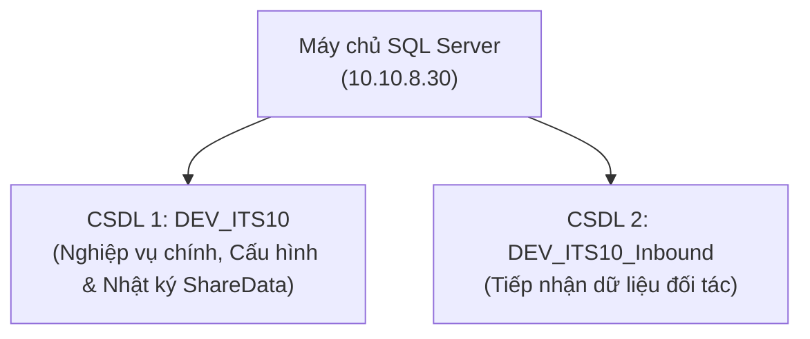
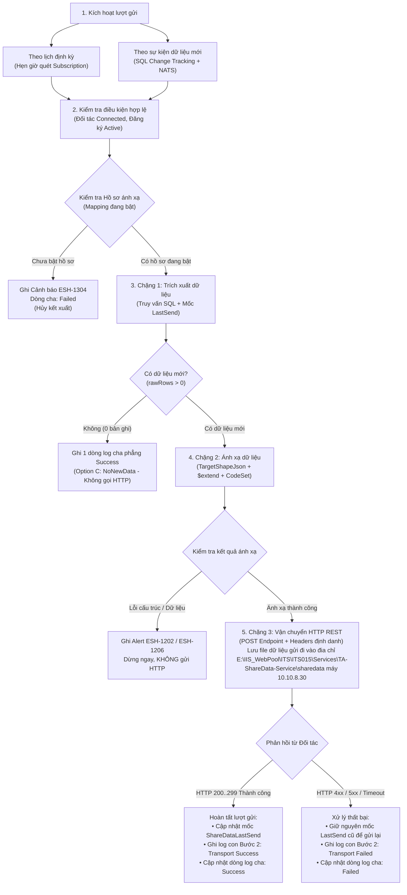
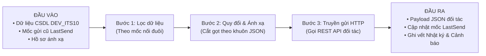
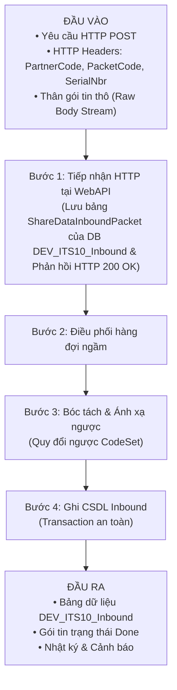

# Đặc tả Kỹ thuật & Nghiệp vụ: Luồng Gửi và Nhận Dữ liệu (ShareData / ESHARE)

> **Quyết định hiện hành đã chốt 14/10/2026:** **105 mặc định Snapshot** theo [mapping 105 `All/update`](../doc/02-mapping-goi-tin-101-111.md), có setting chọn Snapshot/Incremental và Worker dùng setting đã lưu. Không có trần TOP cứng. **110 được tạo/cấu hình bình thường**, triển khai bảng/dữ liệu mô phỏng để thông luồng. Viết sẵn code Kafka producer, CSV/FTP, mã hóa, cleanup theo cấu hình; Playwright phải chạy sau sửa FE. Phần rà soát ngày 12/10 phía cuối là ảnh chụp lịch sử, không dùng mô tả trần 100 dòng/NotReady ở đó làm yêu cầu hiện tại. Yêu cầu mới chưa đồng nghĩa đã triển khai; tiến độ ở [MasterPlan](../Plan/Sharedata_MasterPlan.md).

> **Phiên bản:** 1.0 · **Ngày lập:** 06/10/2026  
> **Phân hệ:** Chia sẻ Dữ liệu — Dự án Cao tốc Hữu Nghị – Chi Lăng  
> **Dịch vụ & Ứng dụng thực thi:**  
> - **Backend WebAPI:** Tiếp nhận gói tin từ đối tác qua giao thức HTTP và cung cấp các API quản trị cấu hình hệ thống.  
> - **Background Worker:** Dịch vụ xử lý ngầm (`ShareDataWorker`) chịu trách nhiệm trích xuất dữ liệu, ánh xạ, truyền gửi HTTP (chiều gửi) và bóc tách ghi CSDL đích (chiều nhận).  
> - **Máy chủ Cơ sở Dữ liệu:** SQL Server tại địa chỉ `10.10.8.30` (gồm 2 CSDL nghiệp vụ: `DEV_ITS10` và `DEV_ITS10_Inbound`).  

---

## Mục lục

1. [Tổng quan & Mục tiêu tính năng](#1-tổng-quan--mục-tiêu-tính-năng)
   - 1.1 [Danh mục Cơ sở Dữ liệu & Bảng sử dụng (Database & Tables)](#11-danh-mục-cơ-sở-dữ-liệu--bảng-sử-dụng-database--tables)
2. [Kiến trúc luồng tổng thể](#2-kiến-trúc-luồng-tổng-thể)
   - 2.1 [Luồng Gửi dữ liệu (Outbound Pipeline)](#21-luồng-gửi-dữ-liệu-outbound-pipeline)
   - 2.2 [Luồng Nhận dữ liệu (Inbound Pipeline)](#22-luồng-nhận-dữ-liệu-inbound-pipeline)
3. [Đặc tả Luồng Gửi (Outbound Business Flow)](#3-đặc-tả-luồng-gửi-outbound-business-flow)
   - 3.1 [Điều kiện tiên quyết (Prerequisites)](#31-điều-kiện-tiên-quyết-prerequisites)
   - 3.2 [Đầu vào (Inputs)](#32-đầu-vào-inputs)
   - 3.3 [Quá trình xử lý (Processing & Business Logic)](#33-quá-trình-xử-lý-processing--business-logic)
   - 3.4 [Đầu ra (Outputs & Results)](#34-đầu-ra-outputs--results)
4. [Đặc tả Luồng Nhận (Inbound Business Flow)](#4-đặc-tả-luồng-nhận-inbound-business-flow)
   - 4.1 [Điều kiện tiên quyết (Prerequisites)](#41-điều-kiện-tiên-quyết-prerequisites)
   - 4.2 [Đầu vào (Inputs)](#42-đầu-vào-inputs)
   - 4.3 [Quá trình xử lý (Processing & Business Logic)](#43-quá-trình-xử-lý-processing--business-logic)
   - 4.4 [Đầu ra (Results)](#44-đầu-ra-results)
5. [Tiêu chí Nghiệm thu & Ma trận Kiểm thử (Acceptance Criteria)](#5-tiêu-chí-nghiệm-thu--ma-trận-kiểm-thử-acceptance-criteria)
   - 5.1 [Tiêu chí nghiệm thu Luồng Gửi (Outbound)](#51-tiêu-chí-nghiệm-thu-luồng-gửi-outbound)
   - 5.2 [Tiêu chí nghiệm thu Luồng Nhận (Inbound)](#52-tiêu-chí-nghiệm-thu-luồng-nhận-inbound)
6. [Phụ lục: Kết quả đối chiếu với mã nguồn & test BE (12/10/2026)](#6-phụ-lục-kết-quả-đối-chiếu-với-mã-nguồn--test-be-12102026)

---

## 1. Tổng quan & Mục tiêu tính năng

Phân hệ **Chia sẻ Dữ liệu (ShareData)** chịu trách nhiệm giao tiếp, tích hợp và trao đổi thông tin giao thông thông minh (ITS) giữa trung tâm điều hành tuyến Cao tốc Hữu Nghị – Chi Lăng với các đối tác bên ngoài (Cục Đường bộ, Đơn vị vận hành lân cận, CSGT, Nhà cung cấp dịch vụ thu phí/thời tiết/cứu hộ...).

Hệ thống hoạt động theo hai luồng nghiệp vụ độc lập nhưng đối xứng:

1. **Chiều Gửi (Outbound / Publication):**
   - Định kỳ theo lịch hoặc ngay khi phát sinh sự kiện mới trong CSDL nội bộ (`DEV_ITS10`).
   - Tự động trích xuất dữ liệu của 10 nhóm gói tin (101–110).
   - Biến đổi (mapping) hình dạng dữ liệu theo đúng khuôn JSON đối tác yêu cầu thông qua hồ sơ ánh xạ.
   - Đẩy trực tiếp qua giao thức HTTP REST API tới máy chủ đối tác, đồng thời lưu bản sao tệp cục bộ (đối với môi trường dev/kiểm thử).
2. **Chiều Nhận (Inbound / Tiếp nhận qua HTTP POST):**
   - Tiếp nhận gói tin trực tiếp từ đối tác thông qua giao thức **HTTP POST**.
   - Nhận diện định danh đối tác, mã loại gói tin và số thứ tự thông qua các **HTTP Request Headers** (`PartnerCode`, `PacketCode`, `SerialNbr`).
   - Đọc luồng thân gói tin HTTP (Raw Body Stream), lưu nguyên văn chuỗi JSON vào bảng đệm `ShareDataInboundPacket` (CSDL `DEV_ITS10_Inbound`) với trạng thái chờ xử lý (`Pending`) và phản hồi `HTTP 200 OK` ngay lập tức cho đối tác.
   - Dịch vụ ngầm (`DataInboundWorker` trong `ShareDataWorker`) định kỳ quét bảng đệm theo thứ tự `SerialNbr ASC`, thực hiện ánh xạ ngược và ghi dữ liệu an toàn vào các bảng nghiệp vụ trong CSDL `DEV_ITS10_Inbound`.

---

### 1.1 Danh mục Cơ sở Dữ liệu & Bảng sử dụng (Database & Tables)

Để phục vụ công tác kiểm tra, đối soát dữ liệu của QC và BA, toàn bộ các bảng CSDL được phân định rõ ràng trên máy chủ SQL Server `10.10.8.30`:

#### 1. CSDL `DEV_ITS10` (Nghiệp vụ chính, Cấu hình, Nhật ký & Nguồn chiều Gửi)
- **Nhóm bảng cấu hình phân hệ ShareData:**
  - `ShareDataPartner`: Danh mục đối tác kết nối, địa chỉ IP, cổng, URL nhận, trạng thái phiên kết nối.
  - `ShareDataSubscription`: Đăng ký chia sẻ dữ liệu (gói tin nào, chiều nào, chu kỳ lịch gửi, cờ gửi theo sự kiện).
  - `ShareDataMapping`: Hồ sơ ánh xạ cấu trúc JSON đối tác (`TargetShapeJson`).
  - `ShareDataCodeSet`: Bảng mã quy đổi giá trị nội bộ ⇄ đối tác.
  - `ShareDataPacket`: Danh mục 10 loại gói tin (101–110).
  - `ShareDataPacketField`: Danh mục các trường dữ liệu của từng gói tin.
  - `ShareDataPacketSql`: Danh mục bí danh và câu truy vấn mẫu.
- **Nhóm bảng nhật ký & giám sát (Lưu trực tiếp trong `DEV_ITS10`):**
  - `ShareDataActivityLog`: Nhật ký truyền nhận (dòng cha và các bước con).
  - `ShareDataAlertLog`: Cảnh báo sự cố (mã lỗi ESH).
  - `ShareDataLastSend`: Lưu mốc thời gian và ID gửi gần nhất của từng đối tác và gói tin (cursor nối đuôi).
  - `ShareDataTrackVersion`: Giám sát nhịp sống và trạng thái bắt biến động Change Tracking.
- **Nhóm bảng dữ liệu nguồn trích xuất (chiều Gửi đi):**
  - **Gói 101** (Giao thông chung): `TmsZoneStatus`, `TmsZone`, `TmsTrafficStatistic`
  - **Gói 102** (Camera CCTV): `CctvDevice`, `TmsEquipment` *(Hiện tại gói này không có data: Bảng CctvDevice chỉ có 1 camera mẫu, không có hình ảnh snapshot thực tế)*
  - **Gói 103** (Thiết bị dò xe VDS): `TmsTrafficData`, `TmsEquipment`
  - **Gói 104** (Trạm thời tiết Campbell): `TmsWeather`
  - **Gói 105** (Nhận dạng xe RFID): `TollTransactionIn`, `TmsVehicleRegistration` *(Hiện tại gói này không có data: Bảng nguồn có dữ liệu nhưng cấu hình danh mục trường đang bị lệch ID)*
  - **Gói 106** (Cân tải trọng động WIM): `TmsTrafficData` *(Hiện tại gói này không có data về tải trọng cân xe do chưa có bảng cân chuyên biệt)*
  - **Gói 107** (Sự cố giao thông): `TmsIncident`, `TmsEventType`
  - **Gói 108** (Biển báo điện tử VMS): `VmsCurrent`, `TmsEquipment`
  - **Gói 109** (Thu phí không dừng ETC): `TollTransactionOut`, `TollLane`, `TollStation` *(Có xe và trạm, nhưng không có data về giá cước tollPrice)*
  - **Gói 110** (Cảnh báo phát hành WP): `TmsIncident`, `VmsCurrent`, `TmsEquipment` *(Chưa triển khai: handler QueryPacket110 trả về rỗng theo policy NotReady, nên gói này không gửi dữ liệu. Tạo sự cố mới đang mở không làm gói có dữ liệu)*

#### 2. CSDL `DEV_ITS10_Inbound` (Tiếp nhận dữ liệu đối tác - CSDL độc lập)
- **Nhóm bảng điều phối tiếp nhận:**
  - `ShareDataInboundPacket`: Hàng đợi lưu trữ nguyên văn chuỗi JSON thô do đối tác gửi lên, trạng thái xử lý (`Pending`, `Done`, `Failed`), kèm `ReceiveLogId` liên kết dòng log cha.
  - `ShareDataPacketSql` (cột `WriteSql`): Cấu hình danh sách các câu lệnh SQL `MERGE` / `OPENJSON` ghi vào bảng đích, chạy theo `OrderNo`.
- **Nhóm bảng lưu trữ dữ liệu nhận nghiệp vụ:**
  - `TmsZone`, `TmsTrafficStatistic`, `TmsZoneStatus` (Dữ liệu giao thông nhận về)
  - `TmsEquipment`, `CctvDevice` (Dữ liệu camera nhận về)
  - `TmsEquipment`, `TmsTrafficData` (Dữ liệu dò xe và cân xe nhận về)
  - `TmsVehicleRegistration`, `TollTransactionOut` (Dữ liệu RFID và ETC nhận về)
  - `TmsWeather` (Dữ liệu thời tiết nhận về)
  - `TmsEventType`, `TmsIncident` (Dữ liệu sự cố nhận về)
  - `TmsEquipment`, `VmsCurrent` (Dữ liệu biển báo nhận về)

---

## 2. Kiến trúc luồng tổng thể

Nhằm bảo đảm tính trực quan, luồng kiến trúc được tách thành 2 sơ đồ tuần tự theo chiều dọc:

### 2.1 Luồng Gửi dữ liệu (Outbound Pipeline)

---

## 3. Đặc tả Luồng Gửi (Outbound Business Flow)

### 3.1 Điều kiện tiên quyết (Prerequisites)
Để một lượt gửi được diễn ra, hệ thống kiểm tra 4 điều kiện nghiệp vụ:
1. **Đối tác (Partner):** Trạng thái `Kích hoạt` (Enable) và phiên kết nối đang mở (`Connected`).
2. **Hồ sơ ánh xạ (Mapping):** Bắt buộc phải có **đúng 1 hồ sơ đang BẬT (`Đang dùng`)** cho cặp `(Đối tác × Gói tin × Chiều Gửi)`. *(Nếu chưa có hoặc chưa bật, hệ thống sẽ chặn không gửi và ghi mã cảnh báo ESH-1304)*.
3. **Đăng ký chia sẻ (Subscription):** Đang ở trạng thái `Hoạt động` (Active).
4. **Điều kiện kích hoạt:**
   - **Kỳ lịch đến hạn:** Đến thời điểm gửi đã cấu hình (ví dụ: mỗi 60 giây, hoặc 09:00 hàng ngày).
   - **HOẶC Phát sinh dữ liệu mới (Theo sự kiện):** Bật cờ *Theo sự kiện* (`SendOnNewData`) và có dữ liệu mới phát sinh trong các bảng nghiệp vụ.

---

### 3.2 Đầu vào (Inputs)

| Thành phần đầu vào | Ý nghĩa nghiệp vụ | Nguồn cung cấp |
|---|---|---|
| **Dữ liệu nguồn nghiệp vụ** | Các bảng dữ liệu ITS nội bộ tương ứng 10 loại gói tin (vận tốc, sự cố, camera, thời tiết...). | CSDL `DEV_ITS10` |
| **Mốc gửi gần nhất (LastSend)** | Thời điểm và ID của bản ghi đã gửi thành công lần trước (dành cho 5 gói dữ liệu biến động). | Bảng `ShareDataLastSend` |
| **Hồ sơ ánh xạ (`TargetShapeJson`)** | Khuôn mẫu JSON đối tác yêu cầu, danh sách trường cần lấy, luật quy đổi mã và phép tính tổng hợp. | Bảng `ShareDataMapping` |
| **Bộ mã quy đổi (CodeSet)** | Danh mục đối chiếu giá trị nội bộ sang giá trị đối tác (ví dụ: `1` ⇄ `"CONGESTION"`). | Bảng `ShareDataCodeSet` |
| **Địa chỉ nhận của đối tác** | IP/Domain, Port, Endpoint URL tiếp nhận của đối tác. | Bảng `ShareDataPartner` |

---

### 3.3 Quá trình xử lý (Processing & Business Logic)

#### Bước 1: Lọc & Trích xuất dữ liệu (Extraction)
- Hệ thống truy vấn CSDL nội bộ `DEV_ITS10` để lấy dữ liệu theo từng loại gói tin:
  - **Với 5 gói biến động (103, 104, 106, 107, 109):** Trích xuất theo cơ chế nối đuôi tăng dần dựa trên mốc `ShareDataLastSend`: lấy bản ghi có `Watermark > LastTime` **hoặc** (`Watermark = LastTime` **và** `ID > LastKey`), sắp xếp `Watermark ASC, ID ASC`, trong đó `Watermark = COALESCE(UpdateTime, CreateTime, thời điểm nghiệp vụ)`. Nhờ đó **không gửi lại bản ghi đã gửi thành công trước đó** nhưng cũng không bỏ sót bản ghi cùng thời điểm khác ID. Phân trang tối đa 100 bản ghi/lô.
  - **Mặc định Snapshot cho 101, 102, 105, 108; 110 sử dụng nguồn mô phỏng theo yêu cầu mới:** mỗi lượt lấy toàn bộ theo SQL cấu hình, không ép TOP cứng. **105 mặc định Snapshot đã chốt** theo mapping `All/update`. Setting gói cho chọn Snapshot/Incremental và Worker dùng setting: Snapshot không dùng LastSend để lọc; Incremental dùng cursor hợp lệ. Gói 110 được tạo/cấu hình bình thường, cần triển khai bảng/dữ liệu giả và nghiệm thu thông luồng, không giữ quy tắc trả rỗng vì NotReady cố định.
- 🛑 **Quy tắc kiểm tra rỗng:** Nếu CSDL **không có dữ liệu mới (0 bản ghi)** $\rightarrow$ Dừng xử lý ngay tại Bước 1, **không** gọi gửi API đối tác để chống spam mạng. Hệ thống ghi 1 dòng nhật ký Thành công phẳng (0 bản ghi, thông điệp `NoNewData`) để báo hiệu phiên quét bình thường.

#### Bước 2: Quy đổi giá trị & Đóng gói khuôn JSON (Mapping)
- **Điền 4 giá trị hệ thống tự động vào JSON:** Thời điểm gửi (`Now`), Số thứ tự gói (`Serial`), Mã gói tin (`PacketCode`), Mã đối tác (`PartnerCode`).
- **Quy đổi mã (CodeSet):** Đổi giá trị nội bộ sang mã của đối tác (ví dụ: trạng thái `1` $\rightarrow$ `"ON"`). Nếu giá trị nguồn rỗng thì áp dụng giá trị mặc định (`defaultPartnerValue`).
- **Định dạng dữ liệu:** Ép kiểu chuỗi, số thập phân, định dạng ngày giờ theo đúng mẫu đối tác yêu cầu.
- 🛑 **Chốt chặn an toàn:**
  - Thiếu trường bắt buộc (`IsRequired`) $\rightarrow$ Dừng ngay, **không** gửi, ghi cảnh báo lỗi `ESH-1202`.
  - `TargetShapeJson` rỗng hoặc sai cú pháp $\rightarrow$ Dừng ngay, **không** gửi, ghi cảnh báo lỗi `ESH-1206`.
  - Biểu thức (`expression`) sai hoặc lỗi khi tính $\rightarrow$ **không dừng**: giữ giá trị gốc, ghi cảnh báo `ESH-1203` (mức warning) và vẫn gửi.

#### Bước 3: Truyền gửi dữ liệu (Transport)
- Đóng gói thành HTTP POST Request với Body là JSON đối tác.
- Đính kèm các HTTP Headers định danh: `PartnerCode`, `PacketCode`, `SerialNbr`.
- Gửi tới Endpoint của đối tác qua mạng. *(Đồng thời lưu 1 bản sao file backup tại thư mục máy chủ để kiểm toán)*. E:\IIS_WebPool\ITS\ITS015\Services\TA-ShareData-Service\sharedata

---

### 3.4 Đầu ra (Outputs & Results)

| Thành phần đầu ra | Kết quả mong đợi | Nơi kiểm tra cho QC & BA |
|---|---|---|
| **Gói tin gửi đối tác** | HTTP Request gửi thành công, máy chủ đối tác phản hồi mã HTTP `200..299`. | Log mạng / Phần mềm Mock Receiver |
| **Mốc gửi nối đuôi (`LastSend`)** | Cập nhật thời gian và ID mới nhất vào bảng `ShareDataLastSend`. Các lượt gửi sau sẽ nối tiếp từ mốc này. | Bảng CSDL `ShareDataLastSend` |
| **Nhật ký truyền nhận** | Xuất hiện 1 phiên gửi thành công gồm: Dòng Cha tổng quan + 2 dòng Con chi tiết (Bước 1: Trích xuất & Ánh xạ, Bước 2: Vận chuyển HTTP). | Màn hình **Nhật ký** (Tab *Truyền nhận*) |
| **Cảnh báo lỗi (khi thất bại)** | Nếu đối tác trả về HTTP 4xx/5xx hoặc mạng Timeout: Hệ thống đánh dấu phiên Thất bại, **giữ nguyên mốc LastSend cũ** (để gửi lại ở kỳ sau), và bắn mã cảnh báo `ESH-1402` (mọi lỗi gửi HTTP: 4xx/5xx/timeout/ngoại lệ). File JSON kết xuất vẫn được ghi. | Màn hình **Cảnh báo lỗi** |

---

## 4. Đặc tả Luồng Nhận (Inbound Business Flow)

Dành cho BA và QC kiểm tra toàn bộ vòng đời khi đối tác bên ngoài đẩy dữ liệu vào hệ thống ITS.

### 4.1 Điều kiện tiên quyết (Prerequisites)
1. **Đối tác (Partner):** Đã khai báo mã định danh `PartnerCode` trong hệ thống.
2. **Hồ sơ ánh xạ (Mapping):** Nên có **1 hồ sơ chiều Nhận về (`Inbound`) hoặc Hai chiều (`Both`) đang BẬT (`Đang dùng`)** để bóc tách theo khuôn. *Không bắt buộc:* nếu thiếu, Worker vẫn xử lý bằng cách đọc mảng đối tượng phẳng trong JSON.
3. **Cấu hình câu ghi (`ShareDataPacketSql.WriteSql`):** Bắt buộc đã khai báo ít nhất 1 câu ghi (đang bật) cho gói tin tương ứng; thiếu thì gói `Failed` với `ESH-1509`.

---

### 4.2 Đầu vào (Inputs)

| Thành phần đầu vào | Ý nghĩa nghiệp vụ | Quy chuẩn bắt buộc |
|---|---|---|
| **Yêu cầu HTTP POST từ Đối tác** | Tiếp nhận gói tin gửi lên qua giao thức HTTP POST. | Giao thức HTTP (POST) |
| **HTTP Headers định danh** | Đọc trực tiếp từ `HttpRequest.Headers` để xác định đối tác và gói tin. | • `PartnerCode`: Mã đối tác (vd: `DRVN`) • `PacketCode`: Mã gói (vd: `107_incidentData`) • `SerialNbr`: Số thứ tự gói tin |
| **HTTP Body (Dữ liệu)** | Luồng dữ liệu thô (Raw Body Stream) chứa chuỗi JSON bản tin đối tác gửi lên. | Chuỗi văn bản UTF-8 (JSON hợp lệ) |

---

### 4.3 Quá trình xử lý (Processing & Business Logic)

#### Bước 1: Tiếp nhận qua giao thức HTTP tại WebAPI
- **Đọc Header thủ công:** WebAPI đọc trực tiếp từ `HttpRequest.Headers` gồm:
  - `PartnerCode`: Mã định danh đối tác (bắt buộc).
  - `PacketCode`: Mã loại gói tin (bắt buộc).
  - `SerialNbr`: Số thứ tự gói tin (dạng số nguyên, tùy chọn).
- **Đọc luồng dữ liệu thô (HTTP Body Stream):** Đọc toàn bộ nội dung body qua `StreamReader` dạng chuỗi UTF-8 (`RawContent`) và tính kích thước `ByteSize`.
- **Kiểm tra Đối tác (`ShareDataPartner`):**
  - Tìm đối tác theo `PartnerCode`. Nếu không tìm thấy $\rightarrow$ Ném ngoại lệ `DataNotExist` (báo lỗi HTTP).
  - Nếu đối tác đang bị khóa (`Status != Enable`) $\rightarrow$ Ném ngoại lệ `PartnerDisabled` (báo lỗi HTTP).
- **Kiểm tra Đăng ký (`ShareDataSubscription`):**
  - Tìm gói tin trong `ShareDataPacket` và tra cứu đăng ký nhận (`Direction = Inbound`).
  - Nếu có đăng ký hợp lệ $\rightarrow$ Gán trạng thái gói `ProcessState = Pending`.
  - Nếu chưa có đăng ký hoặc mã gói tin chưa khai báo $\rightarrow$ Gán `ProcessState = NoSubscription` kèm lý do lỗi.
- **Lưu CSDL đệm:** Lưu nguyên văn bản ghi vào bảng `ShareDataInboundPacket` trên CSDL `DEV_ITS10_Inbound` cùng mã `ReceiveLogId`.
- **Ghi nhật ký Bước 1:** Ghi dòng log Cha (`Queued`) và dòng con Bước 1 (`ReceiveRaw`) vào `ShareDataActivityLog` trên CSDL `DEV_ITS10`.
- ⚡ **Phản hồi tức thì `HTTP 200 OK` cho đối tác:** Xác nhận máy chủ đã tiếp nhận và lưu đệm an toàn. Dịch vụ WebAPI giải phóng kết nối HTTP ngay lập tức, chuyển giao toàn bộ công đoạn bóc tách, mapping và nạp dữ liệu cho Background Worker xử lý bất đồng bộ.

#### Bước 2: Bóc tách cấu trúc & Quy đổi ngược (Reverse Mapping)
- Tra cứu hồ sơ ánh xạ chiều nhận đang bật. *(Nếu không có hồ sơ $\rightarrow$ vẫn xử lý bằng mảng đối tượng phẳng trong JSON; chiều Nhận **không** báo `ESH-1304`. JSON hỏng hoặc là XML $\rightarrow$ gói `Failed`, `ESH-1503`)*.
- Phân tích cú pháp JSON đối tác, trích xuất từng trường dữ liệu và map ngược về đúng tên cột nội bộ (`FieldKey`).
- **Quy đổi mã ngược (CodeSet):** Chuyển đổi mã đối tác sang giá trị nội bộ (ví dụ: `"CONGESTION"` $\rightarrow$ `1`). Nếu đối tác không gửi giá trị thì điền giá trị nội bộ mặc định (`defaultSourceValue`).

#### Bước 3: Thực thi ghi dữ liệu vào CSDL Inbound
- Chạy các câu lệnh ghi tương ứng theo thứ tự `OrderNo` khai báo trong `ShareDataPacketSql` (cột `WriteSql`).
- 🔒 **Nguyên tắc an toàn dữ liệu:** Toàn bộ dữ liệu nhận về **chỉ được ghi vào CSDL riêng biệt `DEV_ITS10_Inbound`**, tuyệt đối **không** ghi trực tiếp vào CSDL vận hành chính `DEV_ITS10`.
- **Giao dịch toàn vẹn (Transaction):** Mọi thao tác ghi của một gói tin được bọc trong 1 Transaction duy nhất:
  - Nếu thành công: Xác nhận lưu dữ liệu vào các bảng đích, chuyển trạng thái gói tin sang `Done`.
  - Nếu lỗi SQL hoặc sai kiểu dữ liệu: Rollback toàn bộ, chuyển trạng thái gói tin sang `Failed`, ghi nhận cảnh báo lỗi `ESH-1505`.

---

### 4.4 Đầu ra (Results)

| Thành phần đầu ra | Kết quả mong đợi | Nơi kiểm tra cho QC & BA |
|---|---|---|
| **Dữ liệu được lưu trữ** | Dữ liệu hoàn chỉnh xuất hiện tại các bảng nghiệp vụ tương ứng (sự cố, đo đếm xe, thời tiết...) & lưu file trên máy thư mục server. | CSDL `DEV_ITS10_Inbound` & `E:\IIS_WebPool\ITS\ITS015\Services\TA-ShareData-Service\sharedata` |
| **Trạng thái gói tin** | Bản ghi trong hàng đợi chuyển từ `Pending` $\rightarrow$ `Done` (hoặc `Failed` nếu lỗi). | Bảng CSDL `ShareDataInboundPacket` |
| **Nhật ký truyền nhận** | Cập nhật dòng Cha sang Thành công + ghi nhận dòng Con Bước 2 (Bóc tách & Lưu trữ CSDL). | Màn hình **Nhật ký** (Tab *Truyền nhận*) |
| **Cảnh báo lỗi (khi thất bại)** | Nếu JSON sai cấu trúc, thiếu hồ sơ ánh xạ hoặc lỗi câu lệnh SQL: Gói tin đánh dấu `Failed` và xuất hiện dòng cảnh báo tương ứng. | Màn hình **Cảnh báo lỗi** |

---

## 5. Tiêu chí Nghiệm thu & Ma trận Kiểm thử (Acceptance Criteria)

Tài liệu này cung cấp bộ tiêu chí nghiệm thu toàn trình (End-to-End Acceptance Criteria) và ma trận kiểm thử chuẩn hóa cho đội ngũ QA/QC (chị Như) thực hiện kiểm thử và nghiệm thu phân hệ Chia sẻ dữ liệu (ShareData) trên môi trường kiểm thử/Staging.

---

### 5.1 Tiêu chí nghiệm thu Luồng Gửi (Outbound Acceptance Criteria)

#### Ma trận kiểm thử Luồng Gửi (Outbound Test Matrix)

| Mã AC | Tên kịch bản | Điều kiện kích hoạt | Kết quả mong đợi (Pass Criteria) | Nơi kiểm tra & Bằng chứng |
| :--- | :--- | :--- | :--- | :--- |
| **AC-OUT-01** | **Gửi định kỳ thành công (Happy Path)** | - Đối tác trạng thái Kích hoạt & đã bấm Kết nối. - Đăng ký gửi (`Direction = Outbound`) trạng thái Hoạt động, lịch định kỳ chu kỳ $N$ giây. - Hồ sơ ánh xạ tương ứng đang Bật (`isActive = true`). - CSDL nguồn có dữ liệu mới. | 1. Đến kỳ lịch, Worker tự động trích xuất đúng số bản ghi. 2. Dữ liệu được map theo đúng `TargetShapeJson` và quy đổi `CodeSet`. 3. Gửi HTTP POST thành công (`HTTP 200 OK`) tới đối tác. 4. Lưu bản sao tệp JSON backup vào thư mục cấu hình trên server. 5. Cột `LastTimeRun` cập nhật, `SerialNbr` tăng 1. 6. Cursor `LastTime`, `LastKey` tiến mốc mới. 7. Log cha `Send` thành công (`Result = 1`) kèm 2 log con Step 1 & Step 2. 8. **Không** phát sinh cảnh báo lỗi `ESH-*`. | - Màn hình **Nhật ký** (tab Truyền nhận). - Màn hình **Chia sẻ dữ liệu** (cột Lần gửi gần nhất, Số serial). - Bảng `ShareDataSubscription` (kiểm tra `LastTime`, `LastKey`, `SerialNbr`). - Thư mục backup trên máy chủ. |
| **AC-OUT-02** | **Gửi tức thì khi có dữ liệu mới (Event Trigger)** | - Đăng ký có bật công tắc *Theo sự kiện* (`SendOnNewData = true`). - Phát sinh bản ghi mới trong bảng nghiệp vụ tương ứng (ví dụ sự cố giao thông mới). | 1. Hệ thống phát hiện sự kiện và kích hoạt gửi ngay lập tức (trong khung debounce, không chờ hết chu kỳ lịch). 2. Dữ liệu mới được gửi thành công tới đối tác. 3. Tiến mốc thời gian và tăng `SerialNbr` đúng quy tắc. | - Màn hình **Nhật ký** (kiểm tra thời điểm gửi trùng khớp thời điểm phát sinh sự kiện). |
| **AC-OUT-03** | **Chặn an toàn khi chưa có Hồ sơ ánh xạ** | - Đăng ký gửi bật Hoạt động nhưng **chưa có hồ sơ ánh xạ nào đang Bật** cho cặp (Đối tác × Gói tin × Chiều gửi). | 1. Worker phát hiện thiếu hồ sơ, **hủy kết xuất** an toàn (không gửi rác sang đối tác). 2. Ghi nhận cảnh báo lỗi mã **`ESH-1304`** (`MappingNotFound`). 3. Không tăng `SerialNbr`, **không** tiến mốc cursor (để khi bật hồ sơ sẽ gửi bù đủ). | - Màn hình **Cảnh báo lỗi** (tìm mã `ESH-1304`). - Màn hình **Nhật ký** (không có lượt gửi thành công). |
| **AC-OUT-04** | **Chặn an toàn khi thiếu trường bắt buộc** | - CSDL nguồn có dữ liệu nhưng trường được đánh dấu bắt buộc (`required = true`) bị NULL và không có giá trị mặc định. | 1. Worker dừng kết xuất ngay tại bước Transform. 2. Ghi nhận cảnh báo lỗi mã **`ESH-1202`** (`RequiredFieldMissing`). 3. Giữ nguyên mốc cursor và `SerialNbr`. | - Màn hình **Cảnh báo lỗi** (mã `ESH-1202` kèm tên trường thiếu). |
| **AC-OUT-05** | **Quy đổi bảng mã CodeSet chính xác** | - Hồ sơ ánh xạ có khai `codeSet`. - CSDL nguồn có giá trị mã nội bộ (ví dụ: `1`). | 1. Payload gửi sang đối tác mang đúng giá trị đối tác tương ứng (ví dụ: `"CONGESTION"`). 2. Nếu giá trị nội bộ không khớp dòng nào trong bảng quy đổi: lấy đúng giá trị mặc định của bộ mã hoặc `defaultPartnerValue`. | - Kiểm tra chi tiết JSON payload gửi đi tại màn hình **Nhật ký** (hộp thoại Chi tiết). |
| **AC-OUT-06** | **Xử lý khi máy chủ đối tác sập (HTTP 4xx / 5xx / Timeout)** | - Cấu hình URL đối tác không tồn tại, trả về lỗi 500 hoặc ngắt kết nối. | 1. Worker cố gắng gửi HTTP thất bại. 2. Bản sao tệp JSON backup **vẫn được lưu** an toàn trên đĩa server. 3. Ghi cảnh báo lỗi mã **`ESH-1402`** (`HttpSendFailed`). 4. Trạng thái phiên gửi đánh dấu Thất bại (`Result = 0`). 5. 🔒 **Cursor `LastTime`, `LastKey` và `SerialNbr` giữ nguyên không đổi** để kỳ kế tiếp tự động gửi lại dữ liệu này. | - Màn hình **Cảnh báo lỗi** (mã `ESH-1402`). - Cột `SerialNbr` và `LastTime` trên bảng `ShareDataSubscription` không bị nhảy mốc. |
| **AC-OUT-07** | **Khóa phân tán chống gửi trùng (Multi-Worker Concurrency)** | - Môi trường chạy song song từ 2 Background Worker trở lên. | 1. Khóa phân tán (Distributed Lock / Lease) đảm bảo chỉ **duy nhất 1 Worker** được quyền xử lý đăng ký trong 1 kỳ. 2. Đối tác **không bị nhận trùng lặp** gói tin (không bị trùng `SerialNbr`). 3. Worker mất khóa nhả đăng ký an toàn (`ESH-1303 LeaseLost` ở mức warning). | - Kiểm tra log hệ thống không có 2 tiến trình cùng gửi 1 gói tin tại cùng 1 giây. |

---

### 5.2 Tiêu chí nghiệm thu Luồng Nhận (Inbound Acceptance Criteria)

#### Ma trận kiểm thử Luồng Nhận (Inbound Test Matrix)

| Mã AC | Tên kịch bản | Điều kiện kích hoạt | Kết quả mong đợi (Pass Criteria) | Nơi kiểm tra & Bằng chứng |
| :--- | :--- | :--- | :--- | :--- |
| **AC-IN-01** | **Tiếp nhận gói tin qua HTTP POST (Phản hồi tức thì)** | - Đối tác gửi HTTP POST tới endpoint WebAPI (`/api/sharedata/inbound`). - Header mang đủ: `PartnerCode`, `PacketCode`, `SerialNbr`. - Body là chuỗi JSON hợp lệ. | 1. WebAPI phản hồi tức thì **`HTTP 200 OK`** (thời gian đáp ứng $\le$ 500ms). 2. Gói tin được lưu nguyên văn vào bảng `ShareDataInboundPacket` (CSDL `DEV_ITS10_Inbound`) với `ProcessState = Pending`. 3. Bảng `ShareDataActivityLog` ghi nhận dòng log cha ở trạng thái `Queued`. | - Công cụ test API (Postman / cURL). - Bảng `ShareDataInboundPacket` trên CSDL `DEV_ITS10_Inbound`. |
| **AC-IN-02** | **Worker bóc tách & nạp CSDL an toàn (Happy Path)** | - Có bản ghi `Pending` trong bảng đệm `ShareDataInboundPacket`. - Đăng ký nhận đang Hoạt động. - Đã có câu lệnh ghi `WriteSql` trong bảng `ShareDataPacketSql`. | 1. Background Worker tự động quét gói tin theo thứ tự `SerialNbr ASC`. 2. Bóc tách JSON theo hồ sơ ánh xạ (hoặc mảng phẳng nếu không có hồ sơ). 3. Quy đổi ngược bộ mã (ví dụ `"CONGESTION"` $\rightarrow$ `1`). 4. Thực thi nạp dữ liệu thành công vào đúng bảng nghiệp vụ trên CSDL `DEV_ITS10_Inbound`. 5. Trạng thái bản ghi đệm chuyển sang `ProcessState = Done`. 6. Log cha cập nhật `Result = 1` (Thành công) kèm log con Step 2 hoàn thành. | - Bảng dữ liệu nghiệp vụ trên `DEV_ITS10_Inbound` (ví dụ `TmsWeather`, `TmsTrafficData`...). - Bảng `ShareDataInboundPacket` (`ProcessState = Done`). - Màn hình **Nhật ký** (tab Truyền nhận). |
| **AC-IN-03** | **Từ chối gói tin chưa có Đăng ký nhận** | - Đối tác gửi gói tin hợp lệ nhưng hệ thống **chưa khai báo Đăng ký nhận** cho gói tin đó. | 1. WebAPI tiếp nhận đệm an toàn và trả 200 OK. 2. Worker kiểm tra không thấy đăng ký nhận $\rightarrow$ cập nhật `ProcessState = NoSubscription`. 3. Ghi cảnh báo mã **`ESH-1508`** (`SubscriptionNotFound`). 4. **Không** ghi dữ liệu vào các bảng nghiệp vụ. | - Bảng `ShareDataInboundPacket` (`ProcessState = NoSubscription`). - Màn hình **Cảnh báo lỗi** (mã `ESH-1508`). |
| **AC-IN-04** | **Xử lý gói tin hỏng định dạng (Invalid JSON)** | - Body HTTP POST không phải JSON (chuỗi rỗng, HTML hoặc ký tự lỗi). | 1. Worker phát hiện lỗi cú pháp, đánh dấu `ProcessState = Failed`. 2. Ghi cảnh báo mã **`ESH-1503`** (`PayloadInvalid`). 3. Tiến trình Worker không bị crash, tiếp tục xử lý các gói tin kế tiếp bình thường. | - Màn hình **Cảnh báo lỗi** (mã `ESH-1503`). - Bảng `ShareDataInboundPacket` (`ProcessState = Failed`). |
| **AC-IN-05** | **Giao dịch toàn vẹn khi lỗi SQL (Transaction Rollback)** | - Dữ liệu trong gói tin vi phạm ràng buộc dữ liệu (sai kiểu, chuỗi vượt quá độ dài cột SQL). | 1. Câu lệnh `WriteSql` phát sinh lỗi $\rightarrow$ Transaction tự động Rollback 100%. 2. **Không** có dữ liệu rác dở dang trong bảng nghiệp vụ. 3. Gói tin đánh dấu `ProcessState = Failed`. 4. Ghi cảnh báo lỗi mã **`ESH-1505`** (`DatabaseWriteFailed`). | - Bảng nghiệp vụ trên `DEV_ITS10_Inbound` không có dòng dở dang. - Màn hình **Cảnh báo lỗi** (mã `ESH-1505`). |
| **AC-IN-06** | **Cô lập CSDL tuyệt đối (Database Isolation Guard)** | - Thực hiện nạp bất kỳ gói tin chiều Nhận nào. | 1. 100% dữ liệu chiều Nhận **chỉ ghi vào CSDL `DEV_ITS10_Inbound`**. 2. ⛔ **Tuyệt đối không ghi, không sửa, không làm xáo trộn CSDL vận hành chính `DEV_ITS10`**. | - Kiểm tra dữ liệu trên 2 CSDL độc lập tại SQL Server `10.10.8.30`. |

---

### 5.3 Danh mục tiêu chí nghiệm thu chung (System-wide Safeguards)

1. **Chuẩn mã cảnh báo thống nhất (`ESH-xxxx`):** Toàn bộ lỗi nghiệp vụ và hạ tầng phân hệ ShareData phải xuất hiện chính xác theo danh mục mã chuẩn tại màn hình Cảnh báo lỗi (không dùng mã tuỳ tiện).
2. **Bảo toàn dữ liệu khi khởi động lại (Zero Data Loss):** Khi restart Background Worker hoặc WebAPI, các gói tin đang chờ gửi hoặc đang ở hàng đợi đệm `Pending` phải tiếp tục được xử lý bình thường, không bị mất mát hay nhảy cóc `SerialNbr`.
3. **Đa ngôn ngữ (i18n):** Mọi thông báo lỗi, tooltip, tiêu đề màn hình phải hiển thị đúng chuẩn cả tiếng Việt (`vi-VN`) và tiếng Anh (`en-US`).
4. **Phòng vệ giao diện (Client-side Protection):** Không cho phép thao tác sửa, xóa, tắt các cấu hình đang được sử dụng bởi các luồng đang hoạt động (ví dụ: hồ sơ ánh xạ đang liên kết đăng ký hoạt động).

---

## 6. Phụ lục: Kết quả đối chiếu với mã nguồn & test BE (12/10/2026)

> Đối chiếu tài liệu này và `BO-CAU-HOI-PM-LUONG-GUI-SHAREDATA.md` (gọi tắt **Q&A**) với mã `TA-ITS015-WEBAPI-V1.0/src/Services/ShareData/…` và test `tests/BE/ITS/ShareData/…`.
> **Giới hạn:** chưa chạy test, chưa đối chiếu DB staging; chiều Nhận và gói 102/108/109 mới xác minh ở mức hằng số và tên test. Mục chưa xác minh được ghi **[Chưa xác minh]**.
> **Kết luận chung:** sai chủ yếu ở **tài liệu**; mã và test BE nhất quán với nhau. Test không mâu thuẫn logic, chỉ thiếu assert ở vài kịch bản (§6.5).

### 6.1 Đối chiếu đã xác minh

| # | Nội dung | Tài liệu nói | Mã / test thực tế | Kết luận |
|---|---|---|---|---|
| A1 | Điều kiện nối đuôi | §3.3: `UpdateTime > LastTime` **và** `ID > LastKey`. Q10: `> OR (= AND ID >)` | `QueryPacket103` (`DataOutboundExtractionProcess.cs:288-320`): `Watermark > @lastTime OR (Watermark = @lastTime AND ID > @lastKey)` | **§3.3 sai, Q10 đúng** |
| A2 | Snapshot gói 101 | §3.3: "toàn bộ". Q9: "tối đa 100" | `QueryPacket101` (`:231-254`) **không có TOP**. `DefaultSnapshotTop = 100` (`:26`) chỉ dùng ở gói **105** (`:391`) | **Q9 sai với 101.** 102/108: [Chưa xác minh] |
| A3 | Gói 110 | §1.1 và Q17: tạo sự cố `State='1'` là test được. Q8: NotReady, trả rỗng | `QueryPacket110` (`:560-561`) trả `[]`; `Extract` (`:76-192`) thoát sớm với policy `NotReady`/`Disabled` | **Q8 đúng; §1.1 và Q17 sai.** Q2 gọi 110 là "near real-time" cũng sai |
| A4 | Mã ESH | §3.3, §4.3, Q15 | `ShareDataAlertCode.cs:8-102` | **Sai nhiều chỗ**, xem §6.2 |
| A5 | Map lỗi biểu thức | §3.3: dừng, không gửi, `ESH-1305/1306` | Biểu thức lỗi → `ESH-1203` (warning), **giữ giá trị gốc, vẫn gửi** (test `:100`, `:275`, `:348`, `:3526`). Thiếu trường bắt buộc → `ESH-1202` (hủy). Shape rỗng/sai → `ESH-1206` (hủy) (test `:3706`, `:3734`) | **§3.3 sai** |
| A6 | HTTP 4xx/5xx/timeout | Q13: `ESH-1302/1303`, giữ mốc | Một mã `ESH-1402` (warning). Phiên = `Fail`, file **vẫn được xuất** (test `:823`, `:878`, `:926`) | **Mã sai.** "Giữ mốc" đúng nhưng test `:823` không assert |
| A7 | File + HTTP | Q1/§1: file chỉ là bản sao đối soát | Ghi file lỗi + HTTP OK → **Success, tiến mốc** (`:1048`). File lỗi + HTTP lỗi → hủy, **không tiến mốc** (`:1118`, `:1183`) | **Thiếu quy tắc này** |
| A8 | Kích hoạt | Q2: lịch hoặc sự kiện | Thêm: trigger bỏ qua lịch chưa đến hạn (`:1931`); ngoài khung giờ không xuất (`:2002`); `SendOnNewData=false` thì trigger không xuất (`:2109`); debounce gói 103 (`:1860`; test "trong cửa sổ" bị comment `:1780`) | **Thiếu debounce, khung giờ** |
| A9 | Nhiều Worker | Chưa nêu | Có lease (`ESH-1303 LeaseLost`) và test `ReleaseLock` (`:1456`) | Đã có cơ chế, cần ghi vào tài liệu |
| A10 | Retry và `SerialNbr` | Chưa nêu | Test `:1118`: lỗi thì `SerialNbr`, `LastTimeRun` không đổi | Bổ sung: retry giữ nguyên `SerialNbr` |

### 6.2 Bảng mã ESH đúng theo mã nguồn

| Mã | Hằng | Ý nghĩa | Mức | Tài liệu đang ghi |
|---|---|---|---|---|
| ESH-1201 | CodeSetNotFound | Bộ mã khai trong metadata không có trong CSDL | warning | không có |
| ESH-1202 | RequiredFieldMissing | Thiếu/null trường bắt buộc → hủy kết xuất | error | §3.3 ghi 1305/1306 |
| ESH-1203 | ExpressionFailed | Biểu thức lỗi → giữ giá trị gốc, vẫn gửi | warning | §3.3 ghi dừng |
| ESH-1204 | IntegerPromoted | Số nguyên bị nâng thành decimal sau quy đổi đơn vị | warning | không có |
| ESH-1205 | ShapeFieldNotInRawRow | **Không còn dùng từ 18/09** | — | không có |
| ESH-1206 | ShapeInvalid | `TargetShapeJson` rỗng/sai cú pháp → hủy | error | Q15 ghi 1305 |
| ESH-1301 | PacketNotFound | Không có cấu hình gói tin cho DatatypeId | error | Q15 ghi "chưa đăng ký/khóa đối tác" |
| ESH-1302 | QueryFailed | Lỗi truy vấn dữ liệu nguồn | error | Q15 ghi "lỗi mạng" |
| ESH-1303 | LeaseLost | Mất lease, node khác nhận đăng ký | warning | Q15 ghi "đối tác trả HTTP lỗi" |
| ESH-1304 | MappingNotFound | Không có mapping chiều gửi đang bật → hủy | error | **khớp** |
| ESH-1305 | CursorKeyTooLong | `__rowid` dài hơn cột `LastKey` → hủy trước khi gửi | error | Q15 ghi "JSON sai cú pháp" |
| ESH-1401 | FileWriteFailed | Lỗi ghi file kết xuất | error | không có |
| ESH-1402 | HttpSendFailed | **Mọi lỗi gửi HTTP** (4xx/5xx/timeout/exception) | warning | Q15 ghi 1302/1303 |
| ESH-1501…1509 | Inbound.* | 1501 chưa cấu hình URL API nhận; 1502 gọi API hộp gửi đối tác lỗi; 1503 không đọc được nội dung; 1504 không xác định khóa đối chiếu; **1505 lỗi ghi CSDL nhận**; 1506 không có cấu hình gói; 1507 đối tác không tồn tại/tắt; 1508 chưa có đăng ký nhận; 1509 chưa khai câu ghi | — | §4.3 ghi lỗi ghi là **ESH-1307** (không tồn tại) |
| ESH-1601…1604 | Tracking.* | Hạ tầng Change Tracking (tự hồi phục, truy vấn lỗi, chưa bật, đặt lại mốc) | — | không có |

### 6.3 Lỗi biên tập cần sửa ngay trong tài liệu

- Sơ đồ §2.1 node T8: nháy kép không cân và đường dẫn `E:\…` lẫn trong label → mermaid không render. Tách đường dẫn ra ghi chú.
- §4.3: sơ đồ có 4 bước, văn bản có 3 bước; §4.4 gọi "Bước 2". Đánh số lại.
- Q17 mục 2: nguồn gói 105 phải là `TollTransactionIn` (đang ghi `TollTransactionOut`).
- Ví dụ `PartnerCode`: Spec dùng `DRVN`, Q12 dùng `DOITAC_HNCL`.

### 6.4 Điểm cần dev xác nhận ý đồ (chưa kết luận sai)

| # | Vấn đề | Vì sao nghi ngờ |
|---|---|---|
| B1 | Comment `ESH-1402` ghi "file đã ghi vẫn coi là thành công", test `:855` assert phiên = `Fail` khi HTTP 500 | Hai mô tả trái nhau; test là hành vi đang được bảo vệ, comment có thể đã cũ |
| B2 | Hằng chiều Nhận `ESH-1501/1502` mô tả "gọi API hộp gửi của đối tác" (kiểu **kéo**), §4 chỉ mô tả **đẩy** | Mã chết còn sót, hoặc chiều Nhận có thêm chế độ kéo chưa được mô tả |
| B3 | `NoSubscription`: §4.3 nói WebAPI lưu rồi trả 200; test `:403` kiểm tra worker đánh cha `Fail`, không có Step 2 | Cần chốt đối tác có nên nhận 200 trong trường hợp này |
| B4 | Sub bị tạm dừng: test `:711` giữ gói ở `Pending` | Chưa nêu gói chờ vô hạn hay hết hạn |

### 6.5 Khoảng trống bộ test

Trong 86/124 test outbound đã liệt kê và 17 test inbound, **chưa thấy** (38 test outbound còn lại chưa rà):

| # | Kịch bản thiếu | Mức |
|---|---|---|
| C1 | HTTP 500/exception: assert **mốc không tiến** và lượt sau gửi lại đúng các bản ghi đó | Cao |
| C2 | 0 bản ghi mới: không gọi HTTP, đúng 1 log phẳng thành công | Cao |
| C3 | Nối đuôi: cùng thời điểm khác ID; thời điểm mới hơn nhưng ID nhỏ hơn mốc (ca bắt lỗi AND/OR) | Cao |
| C4 | Snapshot gói 101 > 100 dòng: gửi đủ; mỗi lượt đều gửi dù dữ liệu không đổi | Cao |
| C5 | Gói 110: không gọi HTTP, không lỗi, kể cả khi có sự cố đang mở | Trung bình |
| C6 | Snapshot gói 105 bị giới hạn 100 dòng | Trung bình |
| C7 | Thiếu trường bắt buộc → `ESH-1202`, không gửi, không tiến mốc | Trung bình |
| C8 | `ESH-1305` khóa quá dài | Thấp |
| C9 | Header HTTP đầy đủ `PartnerCode`, `PacketCode`, `SerialNbr`, `Content-Type` (test `:1085` mới kiểm `PartnerCode`) | Trung bình |
| C10 | Chiều Nhận: 200 ngay + `Pending`; lỗi ghi → rollback toàn bộ + `Failed` + `ESH-1505`; thứ tự `SerialNbr`; `SerialNbr` null/trùng; không ghi vào `DEV_ITS10` | Cao |

### 6.6 Khoảng trống đặc tả còn mở

1. Cam kết "không bao giờ gửi trùng" (Q10) là nói quá: thực tế là at-least-once nếu ghi mốc lỗi sau khi HTTP thành công.
2. Bản ghi "độc" (đối tác trả 4xx vĩnh viễn) chặn con trỏ của gói đó mãi; chưa có giới hạn retry/bỏ qua.
3. Bản ghi commit muộn có `Watermark` nhỏ hơn con trỏ sẽ bị bỏ sót.
4. Chiều Nhận chưa nêu: xác thực ngoài `PartnerCode`, giới hạn kích thước body, trùng/lệch `SerialNbr`, retry gói `Failed`, thời gian lưu bảng đệm.
5. Đối tác chưa `Connected`: chưa rõ có ghi log/cảnh báo hay không.
6. Gói 105 (biển số, chủ xe) ghi file JSON plaintext; Q18 hướng dẫn demo qua Webhook.site công cộng.
7. Thiếu yêu cầu phi chức năng (timeout, SLA, retention log).

### 6.7 Việc cần làm trên tài liệu

| Ưu tiên | Việc | Vị trí |
|---|---|---|
| P1 | ✅ Đã sửa (12/10/2026): Sửa điều kiện nối đuôi thành OR (A1) | §3.3 |
| P1 | ✅ Đã sửa (12/10/2026): Sửa mô tả snapshot: 101 không giới hạn, 105 giới hạn 100; xác minh 102/108 (A2) | §3.3, Q9 |
| P1 | ✅ Đã sửa (12/10/2026): Gói 110: ghi rõ chưa triển khai, bỏ hướng dẫn tạo sự cố để test (A3) | §1.1, Q2, Q3, Q17 |
| P1 | ✅ Đã sửa (12/10/2026): Thay bảng mã ESH bằng §6.2 (A4–A6) | §3.3, §3.4, §4.3, Q15 |
| P2 | Thêm quy tắc file + HTTP, debounce, khung giờ, lease (A7–A9) | §3.1, §3.3 |
| P2 | Sửa lỗi biên tập §6.3; chốt B1–B4 với dev | Spec, Q&A |
| P3 | Viết §5 Tiêu chí nghiệm thu từ §6.5 | §5 |

---
