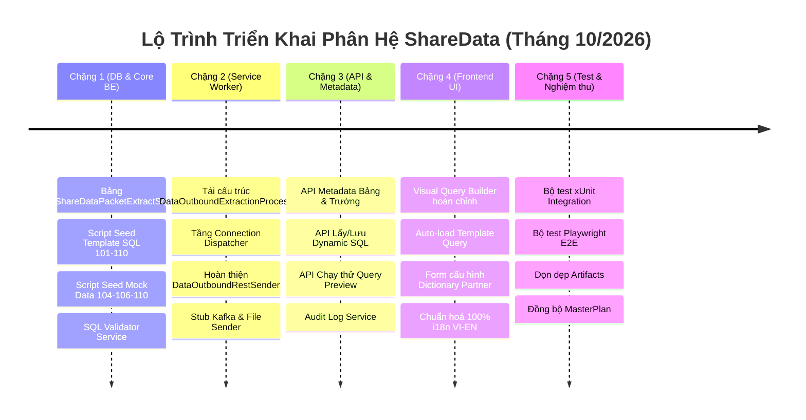

# Kế Hoạch Tổng Thể: Phân Hệ ShareData (ESHARE) — Kiến Trúc Truy Vấn Động, Cơ Chế Quét Nối Đuôi & Tách Tầng Kết Nối Độc Lập

> 📅 **Ngày lập kế hoạch:** 14/10/2026  
> 📌 **Tài liệu nguồn & Căn cứ kỹ thuật:**  
> - Biên bản & Kịch bản cuộc họp âm thanh: [`14-10-2026-sharedata-dynamic-query-va-connection.md`](file:///Users/hoangquydat/ThienAn/DocBusinessThienAn/HữuNghị-ChiLăng/ShareData/doc/transcript/14-10-2026-sharedata-dynamic-query-va-connection.md) (từ file ghi âm `14-10-2026.m4a`).  
> - Ghi chú kỹ thuật Tech Lead: [`shareData-1014.md`](file:///Users/hoangquydat/ThienAn/DocBusinessThienAn/HữuNghị-ChiLăng/ShareData/doc/shareData-1014.md).  
> - Đặc tả ánh xạ dữ liệu gói 101–111: [`02-mapping-goi-tin-101-111.md`](file:///Users/hoangquydat/ThienAn/DocBusinessThienAn/HữuNghị-ChiLăng/ShareData/doc/02-mapping-goi-tin-101-111.md).  
> - Tài liệu quy hoạch kiến trúc SSOT: [`Sharedata_MasterPlan.md`](file:///Users/hoangquydat/ThienAn/DocBusinessThienAn/HữuNghị-ChiLăng/ShareData/Plan/Sharedata_MasterPlan.md).  
> - Tham chiếu mẫu cấu hình kết nối Dictionary: [`IntgVmsManager.cs`](file:///Users/hoangquydat/ThienAn/TA-ITS015-WEBAPI-V1.0/src/Modules/Integration/Modules.Integration.VMS/Infrastructure/Services/IntgVmsManager.cs).

---

## 🎯 I. Mục Tiêu & Định Hướng Kỹ Thuật Cốt Lõi (14/10/2026)

1. **Xóa bỏ triệt để việc Hardcode SQL trích xuất:** Chuyển đổi toàn bộ câu lệnh lấy dữ liệu của 11 gói tin (101–110) từ mã nguồn C# sang CSDL. Cung cấp **Gói tin mẫu (Template Query)** tự động nạp khi tạo mới đối tác để người dùng không phải cấu hình lại từ đầu.
2. **Cung cấp Visual Query Builder & Bộ API hỗ trợ UI:** Xây dựng WebAPI trả về danh sách bảng nguồn cho phép và danh mục trường dữ liệu dựa trên bảng đối chiếu `02-mapping-goi-tin-101-111.md`. Tích hợp giao diện soạn thảo trực quan, kiểm tra an toàn cú pháp (SQL Validator - chỉ `SELECT`, cấm DML/DDL) và ghi nhận Audit Log chi tiết.
3. **Cấu hình Động Cơ Chế Đồng Bộ (Snapshot vs Nối đuôi):**
   - **Gói Snapshot (Hiện trạng / Toàn bộ):** Gửi toàn bộ dữ liệu, **không tự ý áp mức trần (TOP) cứng** trong Backend. Người quản trị có toàn quyền đặt `TOP` trực tiếp trong câu SQL nếu cần.
   - **Gói Nối đuôi (Incremental):** Cấu hình động trên UI trường mốc nối đuôi (`@LastKey` là thời gian hoặc khóa tổng hợp Composite Key) và cửa sổ thời gian (Window Constraint).
4. **Tách Tầng Kết Nối Độc Lập (`Connection Layer`) & Cấu Hình `Dictionary`:**
   - Bóc tách riêng 3 bước: (1) Trích xuất $\rightarrow$ (2) Xử lý ánh xạ ra **Object chung (JSON)** $\rightarrow$ (3) Tầng kết nối vận chuyển.
   - Quản lý thông tin kết nối qua `Dictionary<string, string>` (tham khảo mô hình `IntgVmsManager.cs`), không phình to cột bảng CSDL.
   - **Trọng tâm số 1:** Hoàn thiện và chuẩn hóa 100% kênh kết nối **HTTPS REST API** (Timeout, Retry, bóc tách lỗi tiếng Việt, `BypassSsl`).
   - Kênh Kafka, FTP/File: Xây dựng sẵn khung code xử lý (Stub/Handler) tiếp nhận Object JSON chuẩn hóa để sẵn sàng kích hoạt khi cần.
5. **Tính Đối Xứng (Symmetry) Giữa Luồng Gửi & Nhận:** Chuẩn hóa cấu trúc dữ liệu JSON để luồng Outbound gửi đi có thể được Inbound của hệ thống tiếp nhận và parse ngược lại chính xác theo quy trình 2 chặng.
6. **Mã Hóa & Dọn Log:**
   - **Mã hóa (Public/Private Key, Protobuf, ASN.1):** Tạm thời chưa triển khai, chỉ chừa sẵn Interface mở rộng.
   - **Dọn Log / File tạm:** Tạm thời giữ nguyên 100% log kiểm toán, không kích hoạt cơ chế xóa định kỳ để tập trung thông luồng nghiệp vụ.
   - **Dữ liệu kiểm thử (Mock Data):** Cung cấp script `.sql` seed dữ liệu mẫu cho các gói hiện chưa có dữ liệu thật trong CSDL.

---

## 🏗️ II. Kiến Trúc Luồng Xử Lý & Tính Đối Xứng (Data Flow)

### 1. Luồng Gửi Đi (Outbound Pipeline) — 3 Chặng Độc Lập
```mermaid
flowchart TD
    subgraph Step1["Chặng 1: Trích Xuất Dữ Liệu Thô (Extraction)"]
        Sub["Đăng ký chia sẻ (Subscription)"] --> DynamicSQL["Nạp Dynamic Query từ DB<br/>(Kèm Template Query mẫu)"]
        DynamicSQL --> ParamInject["Gán tham số SugarParameter<br/>(@LastKey, @FromDate, @ToDate)"]
        ParamInject --> DBQuery[("CSDL Nghiệp Vụ TMS / Toll / VMS")]
        DBQuery --> RawData["Dữ liệu thô (DataTable / List dynamic)"]
    end

    subgraph Step2["Chặng 2: Xử Lý Ánh Xạ & Chuẩn Hóa (Mapping Engine)"]
        RawData --> MapEngine["Bộ máy ánh xạ ShareDataMapping<br/>(TargetShapeJson, Biến đổi kiểu)"]
        MapEngine --> BufferFile["Lưu đệm File/DB Buffer<br/>(Bằng chứng kiểm toán & Retry)"]
        BufferFile --> CommonPayload["Object Chung Chuẩn Hóa<br/>(JSON Data + Metadata + PartnerInfo)"]
    end

    subgraph Step3["Chặng 3: Tầng Điều Phối Kết Nối (Connection Dispatcher)"]
        CommonPayload --> Dispatcher{"Điều Phối Giao Thức<br/>(Đọc Partner.ConnectionConfig Dictionary)"}
        Dispatcher -->|Giao thức HTTP/HTTPS (Ưu tiên P0)| RestSender["DataOutboundRestSender<br/>(Bearer, ApiKey, BypassSsl, Lỗi tiếng Việt)"]
        Dispatcher -->|Giao thức Kafka (Code sẵn)| KafkaSender["DataOutboundKafkaSender<br/>(byte[] payload, Topic, Key)"]
        Dispatcher -->|Giao thức FTP / File (Code sẵn)| FileSender["DataOutboundFileSender<br/>(CSV / JSON File Export)"]
    end

    RestSender --> PartnerRest["Máy chủ Đối tác REST API"]
    KafkaSender --> PartnerKafka["Hạ tầng Kafka Cluster"]
    FileSender --> PartnerStorage["Kho lưu trữ FTP / Share Folder"]
```

### 2. Tính Đối Xứng Chiều Nhận (Inbound Pipeline)
- Dữ liệu nhận từ Đối tác qua WebAPI được thiết kế tương thích hoàn toàn với Object JSON phát ra từ Outbound:
  - **Chặng 1 (Tiếp nhận & Kiểm tra định danh):** WebAPI đọc `partnerCode` từ Header hoặc trong Payload $\rightarrow$ Lưu nguyên vẹn chuỗi JSON thô vào bảng trung gian `ShareDataInboundPacket` kèm trạng thái `Pending` và `ReceiveLogId`.
  - **Chặng 2 (Ánh xạ & Ghi CSDL đích):** Worker nạp cấu hình ánh xạ chiều nhận $\rightarrow$ Parse JSON $\rightarrow$ Thực thi `WriteSql` / SqlSugar an toàn ghi vào các bảng nghiệp vụ.

---

## 📊 III. Quy Hoạch 11 Gói Tin (101–110): Phân Loại & Nguồn Dữ Liệu

Dựa trên tài liệu đặc tả [`02-mapping-goi-tin-101-111.md`](file:///Users/hoangquydat/ThienAn/DocBusinessThienAn/HữuNghị-ChiLăng/ShareData/doc/02-mapping-goi-tin-101-111.md):

| Mã Gói | Tên Gói Tin Nghiệp Vụ | Chế Độ Đồng Bộ (`SyncKind`) | Bảng Nguồn CSDL Chính | Trường Mốc Nối Đuôi (`@LastKey`) | Trạng Thái Dữ Liệu Thật |
|:---:|:---|:---:|:---|:---|:---:|
| **101** | Thông tin chung / Luồng giao thông | **Snapshot (Full)** | `TmsZoneStatus`, `TmsZone`, `TmsTrafficStatistic` | Không dùng (Lấy full hiện trạng) | Có sẵn |
| **102** | Dữ liệu hình ảnh giao thông (CCTV) | **Snapshot (Full)** | `CctvDevice`, `TmsEquipment` | Không dùng (Lấy full hiện trạng) | Có sẵn |
| **103** | Dữ liệu dò xe (VDS) | **Incremental (Nối đuôi)** | `TmsTrafficData`, `TmsEquipment` | `COALESCE(UpdateTime, DetectTime)` | Có sẵn |
| **104** | Dữ liệu thời tiết | **Incremental (Nối đuôi)** | `TmsWeather` | `COALESCE(UpdateTime, TimeDetect)` | Cần Seed Mock |
| **105** | Dữ liệu định danh phương tiện (RFID) | **Snapshot (Full)** | `TollTransactionIn/Out`, `TmsVehicleRegistration` | Không dùng (Lấy full danh mục) | Có sẵn |
| **106** | Kiểm tra tải trọng xe (WIM) | **Incremental (Nối đuôi)** | `TmsTrafficData` (hoặc bảng WIM riêng) | `DetectTime` | Cần Seed Mock |
| **107** | Thông tin sự kiện giao thông (Sự cố) | **Incremental (Nối đuôi)** | `TmsIncident`, `TmsEventType` | `COALESCE(UpdateTime, StartDate)` | Có sẵn |
| **108** | Thông tin hiển thị biển báo (VMS) | **Snapshot (Full)** | `VmsCurrent`, `TmsEquipment`, `TmsSignalLog` | Không dùng (Lấy full hiện trạng) | Có sẵn |
| **109** | Thông tin thu phí (ETC) | **Incremental (Nối đuôi)** | `TollTransactionIn`, `TollTransactionOut`, `TollLane`, `TollStation` | `COALESCE(SyncTime, TransactionDateTime)` | Có sẵn |
| **110** | Trao đổi người tham gia giao thông | **Snapshot (Full / Tổng hợp)** | Ghép tổng hợp `TmsIncident`, `TmsWeather`, `VmsCurrent` | Không dùng | Cần Seed Mock |
| **111** | Trao đổi với TT QLĐHGT tuyến | **Envelope / Gộp** | Gói bao thư chứa 101–109 | Theo gói con | Tạm hoãn (Skip) |

---

## 🛠️ IV. Kế Hoạch Triển Khai Kỹ Thuật Chi Tiết (WBS)

### Giai Đoạn 1: Cấu Trúc Dữ Liệu CSDL & Quản Lý SQL Mẫu (Database & Model)
- [ ] **DB-1: Bổ sung Bảng Lưu Trữ Truy Vấn Động (`ShareDataPacketExtractSql`):**
  - Tạo bảng lưu trữ câu lệnh SQL trích xuất theo từng gói tin và đối tác:
    - `PacketCode` (varchar, bắt buộc): Mã gói tin (101..110).
    - `PartnerCode` (varchar, null = Áp dụng làm **Template Mẫu mặc định** cho toàn hệ thống).
    - `ExtractSql` (nvarchar(max), bắt buộc): Chuỗi câu lệnh `SELECT` trích xuất.
    - `SyncKind` (int): 1 = Snapshot (Full), 2 = Incremental (Nối đuôi).
    - `CursorColumn` (varchar): Tên cột dùng cho `@LastKey` (ví dụ `UpdateTime`).
    - `WindowDays` (int, nullable): Giới hạn cửa sổ quét lùi tối đa (ví dụ 7 ngày, 30 ngày).
- [ ] **DB-2: Cập Nhật Trường `ConnectionConfig` Trong `ShareDataPartner`:**
  - Đảm bảo cột `ConnectionConfig` (nvarchar(max)) lưu trữ JSON của `Dictionary<string, string>`.
- [ ] **DB-3: Soạn Thảo Kịch Bản Seed SQL Mẫu Chuẩn Cho 11 Gói Tin:**
  - Viết file `DocBusinessThienAn/HữuNghị-ChiLăng/ShareData/sql/seed_packet_template_sql_101_110.sql` nạp sẵn câu query chuẩn mực cho cả 11 gói.
- [ ] **DB-4: Soạn Thảo Kịch Bản Seed Dữ Liệu Giả Lập (Mock Data):**
  - Viết file `DocBusinessThienAn/HữuNghị-ChiLăng/ShareData/sql/seed_mock_data_104_106_110.sql` tạo dữ liệu mẫu cho thời tiết (104), tải trọng (106) và thông điệp (110) để phục vụ test thông luồng.

---

### Giai Đoạn 2: Backend WebAPI — API Truy Vấn Động, Metadata & An Toàn SQL
- [ ] **BE-1: Xây Dựng Metadata Service (`ShareDataMetadataService`):**
  - Cung cấp API trả về danh mục bảng nguồn cho phép trích xuất (`GET /api/sharedata/metadata/tables`).
  - Cung cấp API trả về danh mục trường dữ liệu (`GET /api/sharedata/metadata/fields?tableName=...`) kèm kiểu dữ liệu, gợi ý alias và mô tả tiếng Việt trích xuất từ `02-mapping-goi-tin-101-111.md`.
- [ ] **BE-2: Xây Dựng API Quản Lý SQL Động Theo Gói Tin & Đối Tác:**
  - `GET /api/sharedata/packet-sql/{packetCode}`: Lấy câu SQL trích xuất. Nếu đối tác chưa có câu riêng, tự động trả về **Template Mẫu mặc định** của gói tin.
  - `POST /api/sharedata/packet-sql`: Lưu/Cập nhật câu SQL trích xuất của đối tác.
- [ ] **BE-3: Kiểm Tra An Toàn Cú Pháp SQL (`ShareDataSqlValidator`):**
  - Thẩm định bắt buộc trước khi lưu hoặc chạy thử:
    - Chỉ cho phép mệnh đề `SELECT`.
    - ⛔ Chặn đứng hoàn toàn các từ khóa DML/DDL: `INSERT`, `UPDATE`, `DELETE`, `DROP`, `ALTER`, `TRUNCATE`, `EXEC`, `EXECUTE`, `MERGE`, `GRANT`, `REVOKE`.
    - Kiểm tra tính hợp lệ của các tham số SugarParameter (`@LastKey`, `@FromDate`, `@ToDate`).
- [ ] **BE-4: API Chạy Thử Query (Query Preview Test):**
  - `POST /api/sharedata/packet-sql/preview`: Chạy câu query thử nghiệm với giới hạn `TOP 10` trên CSDL thật, trả về danh sách cột và 10 dòng dữ liệu mẫu để người dùng kiểm tra ngay trên Visual Query Builder.
- [ ] **BE-5: Tích Hợp Audit Log Cho Thao Tác Chỉnh Sửa SQL:**
  - Mọi thao tác thêm/sửa câu lệnh SQL trích xuất bắt buộc ghi vết qua `ActivityLoggerService` (ghi nhận `UserId`, `OldSql`, `NewSql`, `Timestamp`, `IP`).

---

### Giai Đoạn 3: Backend Worker — Tầng Kết Nối Độc Lập & Dispatcher
- [ ] **SV-1: Tái Cấu Trúc Tầng Trích Xuất Dữ Liệu (`DataOutboundExtractionProcess`):**
  - Thay thế khối code trích xuất hardcode bằng việc gọi `ShareDataPacketExtractSql`.
  - Nạp câu SQL theo cặp `(PartnerCode, PacketCode)`, nếu không có thì nạp Template theo `PacketCode`.
  - Truyền các tham số động:
    - Nếu là gói **Snapshot**: Thực thi nguyên văn câu SQL (không ép TOP).
    - Nếu là gói **Nối đuôi**: Gán `SugarParameter("@LastKey", lastKeyVal)` và tham số cửa sổ thời gian.
- [ ] **SV-2: Chuẩn Hóa Cấu Trúc Dữ Liệu Bộ Đệm (Buffer Archive File):**
  - Trước khi gửi đi, xuất chuỗi JSON chuẩn hóa ra thư mục đệm:  
    `D:/ShareData/Out/{PartnerCode}/yyyyMM/ddHH/{PacketCode}/{PacketCode}_yyyyMMddHHmmss.json`.
- [ ] **SV-3: Xây Dựng Tầng Kết Nối Độc Lập (`IShareDataConnectionDispatcher`):**
  - Nhận `ShareDataConnectionRequest` chứa: `PartnerCode`, `PacketCode`, `Protocol` (REST / Kafka / File), `PayloadJson`, và `ConnectionConfig` dạng `Dictionary<string, string>`.
  - Tham khảo mô hình `IntgVmsManager.cs`:
    ```csharp
    public class ShareDataConnectionDispatcher : IShareDataConnectionDispatcher
    {
        public async Task<ConnectionResult> SendAsync(ShareDataConnectionRequest request)
        {
            var config = request.ConnectionConfig; // Dictionary<string, string>
            switch (request.Protocol)
            {
                case TransportProtocol.RestApi:
                    return await _restSender.SendAsync(request.PayloadJson, config);
                case TransportProtocol.Kafka:
                    return await _kafkaSender.SendAsync(request.PayloadJson, config);
                case TransportProtocol.File:
                    return await _fileSender.SendAsync(request.PayloadJson, config);
                default:
                    throw new NotSupportedException($"Giao thức {request.Protocol} chưa được hỗ trợ");
            }
        }
    }
    ```
- [ ] **SV-4: Tập Trung Chuẩn Hóa Kênh HTTPS REST API (Ưu Tiên P0):**
  - Trích xuất cấu hình từ Dictionary: `BaseUrl = config.GetValueOrDefault("BaseUrl")`, `Port = config.GetValueOrDefault("Port")`, `ApiKey = config.GetValueOrDefault("ApiKey")`, `BypassSsl = config.GetValueOrDefault("BypassSsl") == "true"`.
  - Tích hợp bộ bóc tách lỗi tiếng Việt chi tiết (`FormatDetailedHttpException`) đã xây dựng.
- [ ] **SV-5: Xây Dựng Khung Sẵn Cho Kafka & File Export (Ưu Tiên P1):**
  - Viết sẵn logic cho `DataOutboundKafkaSender` (chuyển JSON thành `byte[]` đẩy vào topic theo cấu hình Dictionary).
  - Viết sẵn logic cho `DataOutboundFileSender` (xuất file CSV/JSON vào đường dẫn cấu hình).
- [ ] **SV-6: Giữ Nguyên Log & Hoãn Mã Hóa:**
  - Giữ lại 100% nhật ký `ShareDataActivityLog`, không kích hoạt tác vụ xóa tự động.
  - Chừa sẵn Interface `IDataEncryptor` nhưng chưa triển khai thuật toán mã hóa trong giai đoạn này.

---

### Giai Đoạn 4: Frontend — Nâng Cấp Visual Query Builder & Cấu Hình Đối Tác
- [ ] **FE-1: Hoàn Thiện Component Visual Query Builder (`visualQueryBuilder.vue`):**
  - Tích hợp dropdown chọn Bảng nguồn từ API `metadata/tables`.
  - Hiển thị danh sách Cột nguồn từ API `metadata/fields` (cho phép tích chọn cột trích xuất và đặt Alias).
  - Khung Điều kiện lọc (`WHERE`): Hỗ trợ chọn cột, phép so sánh (`=`, `>`, `<`, `LIKE`, `BETWEEN`), và chèn các biến tham số hệ thống (`@LastKey`, `@FromDate`, `@ToDate`).
  - Hỗ trợ nút **"Tải lại mẫu mặc định"** để khôi phục nhanh câu query template chuẩn của gói tin.
  - Tab xem trước câu lệnh SQL hoàn chỉnh (kèm tính năng Copy SQL và Chạy thử nghiệm).
- [ ] **FE-2: Tự Động Nạp SQL Mẫu Khi Chọn Gói Tin:**
  - Trên màn hình Cấu hình Gói tin (`dataSource/component/editPacket.vue`) và Cấu hình Đăng ký (`sharing/component/editSubscription.vue`): Khi người dùng chọn mã gói tin, tự động gọi API lấy câu SQL mẫu và điền sẵn vào Query Builder.
- [ ] **FE-3: Cấu Hình Động Chế Độ Snapshot vs Nối Đuôi:**
  - Bổ sung nhóm nút chọn Radio trên UI: `Chế độ đồng bộ: [ Toàn bộ (Snapshot) | Nối đuôi (Incremental) ]`.
  - Khi chọn Nối đuôi: Cho phép chọn trường làm `@LastKey` (mặc định gợi ý `UpdateTime`) và số ngày giới hạn quét lùi.
- [ ] **FE-4: Nâng Cấp Form Cấu Hình Kết Nối Đối Tác Dạng Dictionary:**
  - Trong `editPartner.vue`: Tùy theo Kênh kết nối được chọn (REST API / Kafka / File):
    - **REST API:** Nhập Base URL, Port, Timeout, Loại xác thực (None / ApiKey / Bearer Token), và Switch `Bỏ qua lỗi chứng chỉ SSL (Bypass SSL)`.
    - **Kafka:** Nhập Bootstrap Servers, Topic, Client ID.
    - **File/FTP:** Nhập Thư mục lưu trữ, IP/Port FTP, Username, Password.
  - Tự động đóng gói toàn bộ các trường này thành `Dictionary<string, string>` khi gửi lên Backend.
- [ ] **FE-5: Tuân Thủ Tuyệt Đối Bộ Quy Tắc Frontend (P0 Safeguards):**
  - Tên component viết đúng chuẩn `camelCase` (Rule 20.14).
  - 100% text, nhãn, tooltip, thông báo đưa vào i18n (`vi-vn.json` và `en-us.json`), cấm hardcode (Rule 20.15).
  - Không viết nhãn song ngữ lai tiếng Anh trong ngoặc (Rule 20.13).
  - Không sử dụng `!important` và toán tử `!!` (Rule 20.6, 20.8).

---

### Giai Đoạn 5: Kiểm Thử Toàn Trình (Testing Suite) & Nghiệm Thu
- [ ] **TEST-1: Backend xUnit Integration Tests (`tests/BE/`):**
  - Viết test case nạp Template Query tự động khi đối tác chưa có SQL riêng.
  - Viết test case thẩm định an toàn SQL (Validator chặn đứng `DELETE`, `DROP`, chỉ cho phép `SELECT`).
  - Viết test case thực thi Dynamic Query trích xuất dữ liệu thành công cho gói 101 (Snapshot) và gói 103 (Nối đuôi `@LastKey`).
  - Viết test case bộ điều phối `ConnectionDispatcher` đọc cấu hình `Dictionary` và gửi REST API thành công.
- [ ] **TEST-2: Frontend Playwright E2E Tests (`tests/FE/`):**
  - Viết test E2E thao tác chọn gói tin $\rightarrow$ Tự động hiển thị câu SQL mẫu.
  - Viết test E2E cấu hình Dictionary kết nối đối tác và chuyển đổi các kênh REST / Kafka.
  - Viết test E2E thao tác Visual Query Builder (chọn cột, thêm điều kiện, xem trước SQL).
- [ ] **TEST-3: Cập Nhật Tài Liệu SSOT:**
  - Sau khi kiểm thử nghiệm thu pass 100%, đồng bộ tiến độ các hạng mục đã hoàn thành vào [`Sharedata_MasterPlan.md`](file:///Users/hoangquydat/ThienAn/DocBusinessThienAn/HữuNghị-ChiLăng/ShareData/Plan/Sharedata_MasterPlan.md).

---

## 📅 V. Kế Hoạch Phân Bổ Tiến Độ Thực Hiện (Roadmap)



---

## 🏁 VI. Tiêu Chí Nghiệm Thu Cấp Hệ Thống (Definition of Done)

1. **Về Tính Năng:**
   - 100% các gói tin từ 101 đến 110 đều có câu SQL trích xuất lưu bền vững trong CSDL (hoặc nạp template mẫu mặc định), không còn bất kỳ dòng code SQL trích xuất nào bị hardcode cứng trong Service Worker C#.
   - SuperAdmin có thể xem, chỉnh sửa câu truy vấn và chạy thử xem trước kết quả trực tiếp trên Visual Query Builder.
   - Thẩm định SQL chặn đứng 100% câu lệnh nguy hiểm (DDL/DML).
   - Tầng kết nối vận hành trơn tru qua cấu hình `Dictionary`, gửi dữ liệu HTTPS ổn định tới đối tác kèm thông báo lỗi tiếng Việt chi tiết khi gặp sự cố mạng/chứng chỉ SSL.
2. **Về Kiểm Thử & An Toàn Mã Nguồn:**
   - 100% bài test Backend xUnit chạy pass trên CSDL local.
   - 100% bài test Frontend Playwright chạy pass trên Chromium.
   - Không vi phạm bất kỳ quy tắc P0 nào của dự án (Clean code, zero `!important`, no `!!`, camelCase component, 100% i18n).

