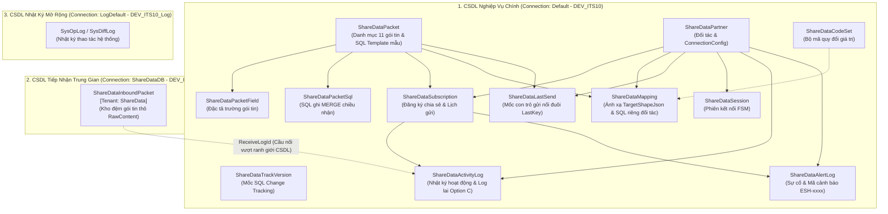

# 📊 Báo Cáo Tổng Thể Các Entity & Bảng CSDL Phân Hệ ShareData (TMC-PM-ITS-ESHARE)

> 📅 **Ngày cập nhật:** 14/10/2026  
> 📌 **Tài liệu tham chiếu & SSOT:**  
> - Bảng đặc tả gói tin 101–111: [`02-mapping-goi-tin-101-111.md`](02-mapping-goi-tin-101-111.md)  
> - Kế hoạch tổng thể MasterPlan: [`Sharedata_MasterPlan.md`](../Plan/Sharedata_MasterPlan.md)  
> - Kế hoạch Truy vấn động & Tách tầng kết nối: [PHẦN VII của `Sharedata_MasterPlan.md`](../Plan/Sharedata_MasterPlan.md#phần-vii--các-hạng-mục-từ-cuộc-họp-14102026-truy-vấn-động-nối-đuôi--tầng-kết-nối-r8--r18)  
> - Mã nguồn C# Entity: [`TA-ITS015-WEBAPI-V1.0/src/Modules/ShareData/Module.ShareData.Core/Entities/`](../../../../TA-ITS015-WEBAPI-V1.0/src/Modules/ShareData/Module.ShareData.Core/Entities/)  

---

## 🏛️ I. Bức Tranh Tổng Thể Kiến Trúc CSDL ShareData

Phân hệ Chia sẻ Dữ liệu (**ShareData / ESHARE**) vận hành trên mô hình **Đa CSDL (Multi-Database / Multi-Tenant)** nhằm phân tách rạch ròi trách nhiệm giữa dữ liệu cấu hình nghiệp vụ chính, kho đệm tiếp nhận dữ liệu thô và kho lưu trữ nhật ký kiểm toán.

### 1. Phân Tách 3 Kết Nối CSDL (DbConnection Configuration)
1. **Kết nối Chính (`Default` / `DEV_ITS10`):** Lưu trữ 13/14 entity của phân hệ, bao gồm danh mục cấu hình, đăng ký chia sẻ, bộ máy ánh xạ, mốc con trỏ đồng bộ, nhật ký hoạt động và cảnh báo lỗi.
2. **Kết nối Nhận Trung Gian (`ShareDataDB` / `DEV_ITS10_Inbound`):** Chứa duy nhất bảng `ShareDataInboundPacket` được gắn thuộc tính `[Tenant(Its015Const.ConnectionConst.ShareData)]`. Bảng này đóng vai trò kho đệm tiếp nhận tức thời các chuỗi JSON/XML thô khổng lồ gửi từ đối tác qua WebAPI, cách ly hoàn toàn nguy cơ quá tải ghi và phình đĩa của CSDL chính.
3. **Kết nối Log Hệ Thống (`LogDefault` / `DEV_ITS10_Log`):** Ghi vết lịch sử khác biệt dữ liệu (`DiffLog`) và nhật ký vận hành quản trị cấp framework.

### 2. Quy Chuẩn Kế Thừa Cốt Lõi
- **100% Entity** đều kế thừa từ lớp cơ sở [`EntityTenant`](file:///Users/hoangquydat/ThienAn/TA-ITS015-WEBAPI-V1.0/src/Shared/Shared.Core/Domain/EntityTenant.cs), được trang bị sẵn bộ trường kiểm toán chuẩn mực:
  - `ID` (varchar/snowflake): Khóa chính bản ghi.
  - `TenantId` (long): Mã phân vùng đơn vị/tuyến.
  - `CreateTime` / `UpdateTime` (datetime): Thời điểm tạo và cập nhật gần nhất.
  - `CreateUserId` / `UpdateUserId` (varchar): Định danh người dùng tạo/sửa.
  - `IsDelete` (bool): Cờ xóa mềm (Soft Delete).

---

## 📑 II. Bảng Đối Chiếu Tổng Thể: Entity Cũ vs. Entity Mới / Cải Tiến

| STT | Tên Entity C# | Tên Bảng SQL Server | Phân Loại | Thời Điểm | Vai Trò & Bản Chất Nâng Cấp Kỹ Thuật |
| :---: | :--- | :--- | :---: | :---: | :--- |
| **1** | `ShareDataPacket` | `ShareDataPacket` | **Cũ (Cải tiến)** | 08/2026 $\rightarrow$ 14/10/2026 | Danh mục 11 gói tin chuẩn (101–111). Lưu **SQL Template mẫu mặc định** (`ExtractSql`), chế độ đồng bộ (`SyncKind`), cột con trỏ (`CursorColumn`) và số ngày quét lùi (`LookbackDays`). |
| **2** | `ShareDataPacketField` | `ShareDataPacketField` | **Cũ** | 08/2026 | Khai báo từ điển danh mục các trường dữ liệu của từng gói tin (`DatatypeId`, `AliasFieldKey`, `Type`, `GroupName`). |
| **3** | `ShareDataPacketSql` | `ShareDataPacketSql` | **Cũ** | 15/09/2026 | Câu lệnh SQL ghi (`WriteSql`) chiều **NHẬN** của gói tin (chạy `MERGE` sử dụng `OPENJSON(@records)` trên CSDL Inbound). |
| **4** | `ShareDataPartner` | `ShareDataPartner` | **Cũ (Cải tiến)** | 08/2026 $\rightarrow$ 13/10/2026 | Danh mục đối tác tích hợp. Mới bổ sung `ConnectionType` và `ConnectionConfig` dạng `Dictionary<string, string>` JSON linh hoạt. |
| **5** | `ShareDataSubscription` | `ShareDataSubscription` | **Cũ (Cải tiến)** | 08/2026 $\rightarrow$ 12/10/2026 | Hồ sơ đăng ký chia sẻ 2 chiều. Chứa lịch gửi `ScheduleJson`, `NextTimeRun`, `ProcessingUntil`, `LastTimeRun`, cờ `SendOnNewData`. Đã bỏ `MappingId` cứng để phân giải sống. |
| **6** | `ShareDataMapping` | `ShareDataMapping` | **Cũ (Cải tiến)** | 08/2026 $\rightarrow$ 14/10/2026 | Hồ sơ ánh xạ cấu trúc dữ liệu (`PartnerSchemaJson`, `TargetShapeJson`) kết hợp lưu **SQL trích xuất riêng của đối tác** (`ExtractSql`, `SyncKind`, `CursorColumn`, `LookbackDays`) khi cần override template gói. |
| **7** | `ShareDataCodeSet` | `ShareDataCodeSet` | **Cũ** | 08/2026 | Bộ mã quy đổi giá trị danh mục nội bộ $\leftrightarrow$ giá trị chuẩn của đối tác qua cấu trúc JSON `ValuesJson`. |
| **8** | `ShareDataLastSend` | `ShareDataLastSend` | **Mới** | 21/09/2026 | Lưu mốc con trỏ kép (`LastTime`, `LastKey`) cho từng cặp `(PartnerCode, PacketCode)` để gửi dữ liệu nối đuôi liên tục không trùng lặp. |
| **9** | `ShareDataTrackVersion` | `ShareDataTrackVersion` | **Mới** | 27/09/2026 | Bảng trạng thái worker giám sát SQL Server Change Tracking. Toàn hệ thống duy trì đúng 1 dòng lưu `LastVersion`. |
| **10** | `ShareDataInboundPacket` | `ShareDataInboundPacket` | **Mới (Cải tiến)** | 15/09/2026 $\rightarrow$ 02/10/2026 | Kho đệm nhận gói tin thô ở CSDL `DEV_ITS10_Inbound` (`[Tenant]`). Bổ sung `ReceiveLogId` làm cầu nối ngữ cảnh sang `ShareDataActivityLog`. |
| **11** | `ShareDataActivityLog` | `ShareDataActivityLog` | **Cũ (Cải tiến)** | 08/2026 $\rightarrow$ 04/10/2026 | Nhật ký cấu hình và truyền nhận. Bổ sung `ParentId` và `StepNbr` phục vụ mô hình log lai Option C (2 bước cha–con khi có dữ liệu, 1 dòng phẳng khi polling rỗng). |
| **12** | `ShareDataAlertLog` | `ShareDataAlertLog` | **Cũ (Cải tiến)** | 08/2026 $\rightarrow$ 13/10/2026 | Nhật ký cảnh báo và lỗi hệ thống. Chuẩn hóa 22 mã lỗi liên tục dạng `ESH-xxxx`, hỗ trợ chi tiết `DetailJson` và xác nhận `Acknowledged`. |
| **13** | `ShareDataSession` | `ShareDataSession` | **Cũ** | 08/2026 | Quản lý phiên kết nối của đối tác theo máy trạng thái FSM (IDLE, CONNECTING, ACTIVE...), đếm gói tin và theo dõi Heartbeat. |

> 📌 **Gọn bảng CSDL (14/10/2026):** Giữ **13 bảng** (12 bảng chính + 1 bảng Inbound), xóa **2 bảng thừa** (`ShareDataTable` mồ côi và `ShareDataPacketExtractSql` chưa deploy). Toàn bộ SQL trích xuất lưu tập trung tại `ShareDataPacket` (mẫu chung) và `ShareDataMapping` (riêng đối tác).

---

## 🔍 III. Phân Tích Chi Tiết 13 Entity / Bảng CSDL Cốt Lõi

---

### KHỐI 1: DANH MỤC & ĐẶC TẢ GÓI TIN (PACKET CATALOG & METADATA)

#### 1. Entity `ShareDataPacket` — Bảng `ShareDataPacket`
* **Vị trí tệp:** [`TA-ITS015-WEBAPI-V1.0/src/Modules/ShareData/Module.ShareData.Core/Entities/ShareDataPacket.cs`](file:///Users/hoangquydat/ThienAn/TA-ITS015-WEBAPI-V1.0/src/Modules/ShareData/Module.ShareData.Core/Entities/ShareDataPacket.cs)
* **Kết nối CSDL:** `Default` (`DEV_ITS10`)
* **Vai trò nghiệp vụ:**  
  Bảng danh mục gốc khai báo 11 gói tin chia sẻ dữ liệu chuẩn (từ gói 101_commonData đến 111_regionalCommand). Là thực thể tham chiếu trung tâm cho toàn bộ các màn hình cấu hình, đăng ký chia sẻ, bộ máy ánh xạ và worker xử lý.
* **Cấu trúc trường cốt lõi:**
  | Tên trường C# | Kiểu CSDL | Ràng buộc | Mô tả chức năng |
  | :--- | :--- | :---: | :--- |
  | `Code` | `nvarchar(128)` | Not Null | Mã định danh gói tin (`101_commonData`, `102_cctvData`...). |
  | `Name` | `nvarchar(128)` | Nullable | Tên tiếng Việt hiển thị trên giao diện. |
  | `PacketVersion`| `nvarchar(16)` | Nullable | Phiên bản định dạng gói tin (ví dụ `1.0`). |
  | `Description`  | `nvarchar(256)` | Nullable | Mô tả chi tiết phạm vi nghiệp vụ gói tin. |
  | `OrderNo`      | `int` | Nullable | Thứ tự sắp xếp trên danh sách và cây menu. |
  | `ExtractSql`   | `nvarchar(max)` | Nullable | *(Mới 14/10/2026)* Câu lệnh SQL trích xuất dữ liệu nguồn động cấp gói tin dành cho SuperAdmin. |
  | `Status`       | `int` | Nullable | Trạng thái sử dụng (`Enable` = 1, `Disable` = 2). |
* **Lưu ý kỹ thuật:**  
  Chặn đứng thao tác Sửa/Xóa gói tin khi gói tin đang có đăng ký chia sẻ ở trạng thái hoạt động (`Active`).

---

#### 2. Entity `ShareDataPacketField` — Bảng `ShareDataPacketField`
* **Vị trí tệp:** [`TA-ITS015-WEBAPI-V1.0/src/Modules/ShareData/Module.ShareData.Core/Entities/ShareDataPacketField.cs`](file:///Users/hoangquydat/ThienAn/TA-ITS015-WEBAPI-V1.0/src/Modules/ShareData/Module.ShareData.Core/Entities/ShareDataPacketField.cs)
* **Kết nối CSDL:** `Default` (`DEV_ITS10`)
* **Vai trò nghiệp vụ:**  
  Khai báo từ điển chi tiết từng trường dữ liệu chuẩn thuộc về một gói tin. Được sử dụng để hiển thị danh sách trường nguồn trên màn hình Ánh xạ (`editMapping.vue`) và Query Builder (`queryBuilder.vue`).
* **Cấu trúc trường cốt lõi:**
  | Tên trường C# | Kiểu CSDL | Ràng buộc | Mô tả chức năng |
  | :--- | :--- | :---: | :--- |
  | `DatatypeId`     | `nvarchar(128)` | Not Null | Mã gói tin sở hữu trường (`ShareDataPacket.Code`). |
  | `AliasFieldKey`  | `nvarchar(128)` | Not Null | Khóa định danh trường dạng camelCase dùng trong biến đổi JSON (`stationId`, `vehicleSpeed`...). |
  | `Name`           | `nvarchar(128)` | Nullable | Tên nhãn tiếng Việt của trường. |
  | `Type`           | `nvarchar(128)` | Nullable | Kiểu dữ liệu gốc (`string`, `int`, `decimal`, `datetime`). |
  | `GroupName`      | `nvarchar(128)` | Nullable | Tên nhóm trường để gom cụm hiển thị trên giao diện người dùng. |
  | `IsRequired`     | `int`           | Nullable | Bắt buộc có dữ liệu trong payload hay không (`1` = Bắt buộc). |
  | `Status`         | `int`           | Nullable | Trạng thái hiệu lực (`1` = Bật, `2` = Tắt). |

---

#### 3. Entity `ShareDataPacketSql` — Bảng `ShareDataPacketSql`
* **Vị trí tệp:** [`TA-ITS015-WEBAPI-V1.0/src/Modules/ShareData/Module.ShareData.Core/Entities/ShareDataPacketSql.cs`](file:///Users/hoangquydat/ThienAn/TA-ITS015-WEBAPI-V1.0/src/Modules/ShareData/Module.ShareData.Core/Entities/ShareDataPacketSql.cs)
* **Kết nối CSDL:** `Default` (`DEV_ITS10`) *(chứa cấu hình, thực thi trên Inbound)*
* **Vai trò nghiệp vụ:**  
  Lưu trữ câu lệnh SQL ghi chiều **NHẬN (Inbound)** cho từng gói tin. Khi Worker xử lý gói tin nhận từ đối tác, nó sẽ nạp các câu lệnh này theo `OrderNo` tăng dần và thực thi câu lệnh `MERGE` an toàn trên CSDL Inbound.
* **Cấu trúc trường cốt lõi:**
  | Tên trường C# | Kiểu CSDL | Ràng buộc | Mô tả chức năng |
  | :--- | :--- | :---: | :--- |
  | `PacketCode` | `nvarchar(128)` | Not Null | Mã gói tin (`ShareDataPacket.Code`). |
  | `OrderNo`    | `int`           | Nullable | Thứ tự thực thi (bảng phụ ghi trước, bảng chính ghi sau). |
  | `TableName`  | `nvarchar(128)` | Nullable | Tên bảng đích tiếp nhận dữ liệu (ví dụ `dbo.TmsZone`). |
  | `WriteSql`   | `nvarchar(max)` | Not Null | Câu lệnh `MERGE` SQL nhận tham số `@records` (dạng JSON qua `OPENJSON`). |
  | `Status`     | `int`           | Nullable | Trạng thái áp dụng (`1` = Enable). |
* **Lưu ý kỹ thuật:**  
  `WriteSql` sử dụng kiểu dữ liệu `CodeFirst_BigString` (`nvarchar(max)`). Mọi câu lệnh bắt buộc sử dụng `SugarParameter` an toàn và trả về `$action` để đếm chính xác số bản ghi thêm mới / cập nhật.

---

### KHỐI 2: QUẢN LÝ ĐỐI TÁC & PHIÊN KẾT NỐI (PARTNERSHIP & SESSIONS)

#### 4. Entity `ShareDataPartner` — Bảng `ShareDataPartner`
* **Vị trí tệp:** [`TA-ITS015-WEBAPI-V1.0/src/Modules/ShareData/Module.ShareData.Core/Entities/ShareDataPartner.cs`](file:///Users/hoangquydat/ThienAn/TA-ITS015-WEBAPI-V1.0/src/Modules/ShareData/Module.ShareData.Core/Entities/ShareDataPartner.cs)
* **Kết nối CSDL:** `Default` (`DEV_ITS10`)
* **Vai trò nghiệp vụ:**  
  Quản lý danh sách các đối tác tích hợp ngoài (Trung tâm Điều hành Vùng, Cục Đường bộ, Đơn vị thu phí, Đối tác dịch vụ GT...).
* **Cấu trúc trường cốt lõi:**
  | Tên trường C# | Kiểu CSDL | Ràng buộc | Mô tả chức năng |
  | :--- | :--- | :---: | :--- |
  | `Code`             | `nvarchar(128)` | Not Null | Mã đối tác duy nhất (ví dụ `PARTNER_CSGT`, `PARTNER_VEC`). Khóa khi sửa. |
  | `Name`             | `nvarchar(128)` | Nullable | Tên đơn vị / đối tác hiển thị. |
  | `Address`          | `nvarchar(128)` | Nullable | Địa chỉ IP / Hostname máy chủ đối tác. |
  | `Port`             | `int`           | Nullable | Cổng dịch vụ mạng đối tác. |
  | `EndPointApiUrl`   | `nvarchar(256)` | Nullable | Đường dẫn URL API nhận dữ liệu của đối tác. |
  | `ConnectionType`   | `nvarchar(64)`  | Nullable | *(Mới 13/10/2026)* Kênh kết nối: `API` (REST), `Kafka`, `File`. Mặc định `API`. |
  | `ConnectionConfig` | `nvarchar(max)` | Nullable | *(Cập nhật 14/10/2026 theo mẫu VMS)* Cấu hình kết nối JSON động dạng `Dictionary<string, string>` chỉ chứa tham số riêng theo kênh (AuthType, Token, ApiKey, TimeoutSeconds, BypassSsl, Topic, DirectoryPath...), tuyệt đối **không** chứa địa chỉ/cổng (địa chỉ và cổng chỉ lấy từ các cột `Address`, `Port`, `EndPointApiUrl`). |
  | `Status`           | `int`           | Nullable | Trạng thái hoạt động (`1` = Bật, `2` = Tắt). |
  | `SessionState`     | `int`           | Nullable | Trạng thái phiên kết nối hiện thời. |
* **Lưu ý kỹ thuật:**  
  Áp dụng thiết kế cấu hình `Dictionary` linh hoạt tham chiếu từ `IntgVmsManager.cs` theo đúng mẫu VMS (`TmsEquipment`): Địa chỉ và cổng chỉ có một nguồn duy nhất là các cột của bảng đối tác; toàn bộ các thông số nhạy cảm và tham số kết nối riêng theo từng kênh được đóng gói trong `ConnectionConfig`, không làm phình to cột vật lý của bảng CSDL.

---

#### 6. Entity `ShareDataSession` — Bảng `ShareDataSession`
* **Vị trí tệp:** [`TA-ITS015-WEBAPI-V1.0/src/Modules/ShareData/Module.ShareData.Core/Entities/ShareDataSession.cs`](file:///Users/hoangquydat/ThienAn/TA-ITS015-WEBAPI-V1.0/src/Modules/ShareData/Module.ShareData.Core/Entities/ShareDataSession.cs)
* **Kết nối CSDL:** `Default` (`DEV_ITS10`)
* **Vai trò nghiệp vụ:**  
  Theo dõi vòng đời phiên kết nối giữa hệ thống với đối tác theo mô hình máy trạng thái hữu hạn (**FSM - Finite State Machine**).
* **Cấu trúc trường cốt lõi:**
  | Tên trường C# | Kiểu CSDL | Ràng buộc | Mô tả chức năng |
  | :--- | :--- | :---: | :--- |
  | `PartnerId`       | `varchar(64)`   | Not Null | Mã ID đối tác sở hữu phiên (`ShareDataPartner.ID`). |
  | `Direction`       | `int`           | Nullable | Chiều phiên: `0` = Outbound (Gửi), `1` = Inbound (Nhận). |
  | `State`           | `int`           | Nullable | Trạng thái FSM: 0=IDLE, 1=CONNECTING, 3=ACTIVE, 5=CLOSED, 7=REJECTED... |
  | `StartedAt`       | `datetime`      | Nullable | Thời điểm mở phiên. |
  | `AcceptedAt`      | `datetime`      | Nullable | Thời điểm đối tác xác nhận bắt tay (Handshake). |
  | `EndedAt`         | `datetime`      | Nullable | Thời điểm kết thúc / đóng phiên. |
  | `PacketsSent`     | `bigint`        | Nullable | Tổng số lượng gói tin đã truyền đi trong phiên. |
  | `PacketsRecv`     | `bigint`        | Nullable | Tổng số lượng gói tin đã tiếp nhận trong phiên. |
  | `LastHeartbeatAt` | `datetime`      | Nullable | Thời điểm nhận nhịp tim duy trì kết nối (Heartbeat) gần nhất. |

---

### KHỐI 3: CẤU HÌNH ĐĂNG KÝ & LẬP LỊCH CHIA SẺ (SUBSCRIPTIONS & SCHEDULING)

#### 7. Entity `ShareDataSubscription` — Bảng `ShareDataSubscription`
* **Vị trí tệp:** [`TA-ITS015-WEBAPI-V1.0/src/Modules/ShareData/Module.ShareData.Core/Entities/ShareDataSubscription.cs`](file:///Users/hoangquydat/ThienAn/TA-ITS015-WEBAPI-V1.0/src/Modules/ShareData/Module.ShareData.Core/Entities/ShareDataSubscription.cs)
* **Kết nối CSDL:** `Default` (`DEV_ITS10`)
* **Vai trò nghiệp vụ:**  
  Hồ sơ đăng ký chia sẻ dữ liệu kết nối một Đối tác (`PartnerId`) với một Gói tin (`DatatypeId`) theo một Chiều truyền nhận (`Direction`). Chứa toàn bộ cấu hình lập lịch thực thi cho Worker.
* **Cấu trúc trường cốt lõi:**
  | Tên trường C# | Kiểu CSDL | Ràng buộc | Mô tả chức năng |
  | :--- | :--- | :---: | :--- |
  | `PartnerId`       | `varchar(64)`   | Not Null | ID đối tác (`ShareDataPartner.ID`). |
  | `DatatypeId`      | `nvarchar(128)` | Not Null | Mã gói tin chia sẻ (`ShareDataPacket.Code`). |
  | `Direction`       | `int`           | Not Null | Chiều truyền nhận: `0` = Gửi (Outbound), `1` = Nhận (Inbound). |
  | `Mode`            | `int`           | Nullable | Chế độ chạy: `Continuous` (liên tục), `Daily`, `Weekly`, `Interval`, `Single`. |
  | `ScheduleJson`    | `nvarchar(max)` | Nullable | Cấu hình lịch biểu định dạng JSON (các ngày trong tuần, giờ bắt đầu/kết thúc). |
  | `IntervalSeconds` | `int`           | Nullable | Khoảng thời gian giãn cách quét định kỳ (giây). |
  | `SendOnNewData`   | `bit`           | Nullable | Cờ kích hoạt gửi ngay lập tức khi phát hiện có dữ liệu mới phát sinh. |
  | `NextTimeRun`     | `datetime`      | Nullable | Thời điểm dự kiến thực hiện lượt quét kế tiếp. |
  | `ProcessingUntil` | `datetime`      | Nullable | Mốc khóa tương tranh đa worker (Lease Lock): `null` = đang rảnh rỗi. |
  | `LastTimeRun`     | `datetime`      | Nullable | Thời điểm thực tế đã thực hiện lượt chạy gần nhất. |
  | `State`           | `int`           | Nullable | Trạng thái đăng ký: 0=DRAFT, 1=ACTIVE, 2=PAUSED, 3=EXPIRED... |
* **Lưu ý kỹ thuật:**  
  **Loại bỏ triệt để cột `MappingId` cứng**: Hồ sơ ánh xạ được phân giải **động (Runtime Resolver)** tại thời điểm thực thi dựa trên bộ ba `(PartnerId, DatatypeId, Direction)`. Tránh hiện tượng lệch cấu hình khi hồ sơ ánh xạ bị sửa đổi độc lập.

---

### KHỐI 4: BỘ MÁY ÁNH XẠ & QUY ĐỔI DỮ LIỆU (MAPPING ENGINE & CODESET)

#### 8. Entity `ShareDataMapping` — Bảng `ShareDataMapping`
* **Vị trí tệp:** [`TA-ITS015-WEBAPI-V1.0/src/Modules/ShareData/Module.ShareData.Core/Entities/ShareDataMapping.cs`](file:///Users/hoangquydat/ThienAn/TA-ITS015-WEBAPI-V1.0/src/Modules/ShareData/Module.ShareData.Core/Entities/ShareDataMapping.cs)
* **Kết nối CSDL:** `Default` (`DEV_ITS10`)
* **Vai trò nghiệp vụ:**  
  Trái tim của bộ máy biến đổi dữ liệu (**Mapping Engine**): Định nghĩa luật chuyển đổi giữa dữ liệu nguồn nội bộ và cấu trúc JSON chuẩn của đối tác.
* **Cấu trúc trường cốt lõi:**
  | Tên trường C# | Kiểu CSDL | Ràng buộc | Mô tả chức năng |
  | :--- | :--- | :---: | :--- |
  | `PartnerId`         | `varchar(64)`   | Not Null | Mã đối tác sở hữu hồ sơ ánh xạ. |
  | `DatatypeId`        | `nvarchar(128)` | Not Null | Mã gói tin (`ShareDataPacket.Code`). |
  | `Direction`         | `int`           | Not Null | Chiều ánh xạ: `0` = Gửi (Outbound), `1` = Nhận (Inbound). |
  | `PartnerSchemaJson` | `nvarchar(max)` | Nullable | Nguyên văn chuỗi JSON mẫu do đối tác cung cấp để đối soát. |
  | `TargetShapeJson`   | `nvarchar(max)` | Not Null | Bộ khung đầu ra dạng JSON chứa các ký hiệu định vị `$field`, `$meta`, `$extend`. |
  | `IsActive`          | `bit`           | Nullable | Cờ kích hoạt hồ sơ ánh xạ (`true` = Đang áp dụng). |
* **Cơ chế hoạt động của `TargetShapeJson`:**
  - `{"$field": "stationId"}`: Điền giá trị trường nguồn `stationId` vào vị trí tương ứng.
  - `{"$field": "speed", "$extend": {"numberFormat": "0.0", "targetType": "float"}}`: Ép khuôn số và kiểu dữ liệu.
  - `{"$field": "status", "$extend": {"codeSet": "CS_VMS_STATUS"}}`: Quy đổi giá trị qua bảng `ShareDataCodeSet`.
  - `{"$meta": "Now"}`: Tự động phát sinh thời gian hiện tại của hệ thống.

---

#### 9. Entity `ShareDataCodeSet` — Bảng `ShareDataCodeSet`
* **Vị trí tệp:** [`TA-ITS015-WEBAPI-V1.0/src/Modules/ShareData/Module.ShareData.Core/Entities/ShareDataCodeSet.cs`](file:///Users/hoangquydat/ThienAn/TA-ITS015-WEBAPI-V1.0/src/Modules/ShareData/Module.ShareData.Core/Entities/ShareDataCodeSet.cs)
* **Kết nối CSDL:** `Default` (`DEV_ITS10`)
* **Vai trò nghiệp vụ:**  
  Quản lý các bộ từ điển quy đổi giá trị mã hóa danh mục giữa CSDL nội bộ và đối tác (ví dụ: Trạng thái thiết bị `1 -> "NORMAL"`, `2 -> "FAULT"`).
* **Cấu trúc trường cốt lõi:**
  | Tên trường C# | Kiểu CSDL | Ràng buộc | Mô tả chức năng |
  | :--- | :--- | :---: | :--- |
  | `Code`       | `nvarchar(128)` | Not Null | Mã bộ từ điển (ví dụ `CS_LANE_STATUS`, `CS_VEHICLE_TYPE`). |
  | `Name`       | `nvarchar(128)` | Nullable | Tên mô tả bộ mã quy đổi. |
  | `ValuesJson` | `nvarchar(max)` | Not Null | Danh sách các cặp giá trị ánh xạ `(SourceValue <-> TargetValue)` kèm giá trị mặc định dạng JSON. |
  | `Status`     | `int`           | Nullable | Trạng thái sử dụng (`1` = Bật). |

---

### KHỐI 5: ĐIỀU PHỐI VẬN HÀNH, MỐC ĐỒNG BỘ & HÀNG ĐỢI (EXECUTION, CURSOR & BUFFER)

#### 10. Entity `ShareDataLastSend` — Bảng `ShareDataLastSend` *(Mới 21/09/2026)*
* **Vị trí tệp:** [`TA-ITS015-WEBAPI-V1.0/src/Modules/ShareData/Module.ShareData.Core/Entities/ShareDataLastSend.cs`](file:///Users/hoangquydat/ThienAn/TA-ITS015-WEBAPI-V1.0/src/Modules/ShareData/Module.ShareData.Core/Entities/ShareDataLastSend.cs)
* **Kết nối CSDL:** `Default` (`DEV_ITS10`)
* **Vai trò nghiệp vụ:**  
  Lưu trữ **Mốc Con Trỏ Kép (Composite Cursor)** của bản ghi cuối cùng đã truyền thành công cho từng cặp `(PartnerCode, PacketCode)`. Giúp Worker quét nối đuôi chính xác tuyệt đối mà không bỏ sót và không gửi lặp dữ liệu cũ.
* **Cấu trúc trường cốt lõi:**
  | Tên trường C# | Kiểu CSDL | Ràng buộc | Mô tả chức năng |
  | :--- | :--- | :---: | :--- |
  | `PartnerCode` | `nvarchar(128)` | Not Null | Mã đối tác nhận dữ liệu (`ShareDataPartner.Code`). |
  | `PacketCode`  | `nvarchar(128)` | Not Null | Mã gói tin chia sẻ (`ShareDataPacket.Code`). |
  | `LastTime`    | `datetime`      | Nullable | Mốc thời gian (`UpdateTime`/`DetectTime`) của bản ghi cuối cùng đã gửi thành công. |
  | `LastKey`     | `varchar(64)`   | Nullable | Khóa chính ID của bản ghi cuối cùng tại mốc `LastTime` (chống trùng lặp khi nhiều bản ghi cùng mili-giây). |
* **Lưu ý kỹ thuật:**  
  Có Unique Index bắt buộc: `index_ShareDataLastSend_Partner_Packet (PartnerCode ASC, PacketCode ASC, UNIQUE)`. Chỉ cập nhật mốc khi gói tin được gửi thành công qua đối tác.

---

#### 11. Entity `ShareDataTrackVersion` — Bảng `ShareDataTrackVersion` *(Mới 27/09/2026)*
* **Vị trí tệp:** [`TA-ITS015-WEBAPI-V1.0/src/Modules/ShareData/Module.ShareData.Core/Entities/ShareDataTrackVersion.cs`](file:///Users/hoangquydat/ThienAn/TA-ITS015-WEBAPI-V1.0/src/Modules/ShareData/Module.ShareData.Core/Entities/ShareDataTrackVersion.cs)
* **Kết nối CSDL:** `Default` (`DEV_ITS10`)
* **Vai trò nghiệp vụ:**  
  Lưu trữ trạng thái tiến trình làm việc của Background Worker lắng nghe cơ chế **SQL Server Change Tracking**. Toàn hệ thống duy trì **đúng 1 dòng bản ghi duy nhất** lưu mốc `LastVersion` đã xử lý.
* **Cấu trúc trường cốt lõi:**
  | Tên trường C# | Kiểu CSDL | Ràng buộc | Mô tả chức năng |
  | :--- | :--- | :---: | :--- |
  | `LastVersion` | `bigint` | Nullable | Mốc số phiên bản Change Tracking lớn nhất đã được quét và phân phối. Giá trị âm = chưa khởi tạo. |
* **Lưu ý kỹ thuật:**  
  Đây là bảng trạng thái vận hành máy móc, **tuyệt đối không ghi log hay lỗi** vào bảng này để tránh phình to CSDL (mọi lỗi hạ tầng chuyển sang `ShareDataActivityLog` nhóm `ESH-16xx`).

---

#### 12. Entity `ShareDataInboundPacket` — Bảng `ShareDataInboundPacket` *(Mới 15/09/2026)*
* **Vị trí tệp:** [`TA-ITS015-WEBAPI-V1.0/src/Modules/ShareData/Module.ShareData.Core/Entities/ShareDataInboundPacket.cs`](file:///Users/hoangquydat/ThienAn/TA-ITS015-WEBAPI-V1.0/src/Modules/ShareData/Module.ShareData.Core/Entities/ShareDataInboundPacket.cs)
* **Kết nối CSDL:** `ShareDataDB` (`DEV_ITS10_Inbound`) qua `[Tenant(Its015Const.ConnectionConst.ShareData)]`
* **Vai trò nghiệp vụ:**  
  Kho đệm lưu trữ nguyên văn gói tin thô mà WebAPI tiếp nhận từ các đối tác gửi đến. Tách rời tiến trình WebAPI (ghi nhận siêu tốc, trả mã `200 OK`) khỏi tiến trình Worker (bóc tách JSON và thực thi SQL phức tạp).
* **Cấu trúc trường cốt lõi:**
  | Tên trường C# | Kiểu CSDL | Ràng buộc | Mô tả chức năng |
  | :--- | :--- | :---: | :--- |
  | `PartnerCode`   | `nvarchar(64)`  | Not Null | Mã đối tác gửi đến. |
  | `PacketCode`    | `nvarchar(128)` | Not Null | Mã loại gói tin nhận được. |
  | `RawContent`    | `nvarchar(max)` | Not Null | Toàn bộ chuỗi JSON/XML thô nhận được từ đối tác (`CodeFirst_BigString`). |
  | `ByteSize`      | `bigint`        | Nullable | Kích thước gói tin tính theo byte. |
  | `ProcessState`  | `int`           | Not Null | Trạng thái xử lý: 0=PENDING, 1=PROCESSING, 2=DONE, 3=FAILED. |
  | `ProcessedAt`   | `datetime`      | Nullable | Thời điểm Worker hoàn tất xử lý gói tin. |
  | `ErrorMessage`  | `nvarchar(512)` | Nullable | Nội dung lỗi chi tiết nếu quá trình ánh xạ/ghi thất bại. |
  | `ReceiveLogId`  | `nvarchar(64)`  | Nullable | *(Mới 02/10/2026)* Khóa ngoại logic lưu `ID` của dòng log cha trong `ShareDataActivityLog` (CSDL chính). |
  | `SenderProcessedAt` | `datetime`  | Nullable | *(Mới 14/10/2026)* Mốc thời gian bên gửi trích xuất/gửi dữ liệu (đọc từ HTTP header hoặc Kafka header `ProcessedAt`). |
* **Lưu ý kỹ thuật:**  
  Cột `ReceiveLogId` là cây cầu nối xuyên 2 CSDL vật lý độc lập, cho phép Worker khi xử lý xong ở CSDL Inbound có thể quay ngược lại CSDL chính để cập nhật trạng thái và số lượng bản ghi cho dòng log cha.

---

### KHỐI 6: KIỂM TOÁN, GIÁM SÁT TIẾN TRÌNH & CẢNH BÁO (AUDIT LOGGING & ALERTING)

#### 13. Entity `ShareDataActivityLog` — Bảng `ShareDataActivityLog`
* **Vị trí tệp:** [`TA-ITS015-WEBAPI-V1.0/src/Modules/ShareData/Module.ShareData.Core/Entities/ShareDataActivityLog.cs`](file:///Users/hoangquydat/ThienAn/TA-ITS015-WEBAPI-V1.0/src/Modules/ShareData/Module.ShareData.Core/Entities/ShareDataActivityLog.cs)
* **Kết nối CSDL:** `Default` (`DEV_ITS10`)
* **Vai trò nghiệp vụ:**  
  Nhật ký toàn diện ghi lại mọi hoạt động cấu hình người dùng (`LogType = CONFIG`) và tiến trình truyền nhận dữ liệu tự động của Worker (`LogType = TRANSFER`).
* **Cấu trúc trường cốt lõi:**
  | Tên trường C# | Kiểu CSDL | Ràng buộc | Mô tả chức năng |
  | :--- | :--- | :---: | :--- |
  | `LogType`           | `nvarchar(16)`  | Not Null | Loại log: `CONFIG` (thao tác người dùng) hoặc `TRANSFER` (worker truyền nhận). |
  | `Action`            | `int`           | Nullable | Hành động: CREATE, UPDATE, DELETE, SEND, RECEIVE, EXPORT... |
  | `OccurredAt`        | `datetime`      | Not Null | Thời điểm phát sinh sự kiện. |
  | `Success`           | `int`           | Not Null | Kết quả thực thi (`1` = Thành công, `2` = Thất bại). |
  | `PartnerId` / `Name`| `varchar(64)`   | Nullable | Mã và tên đối tác liên quan. |
  | `SubscriptionId`    | `varchar(64)`   | Nullable | Mã đăng ký chia sẻ liên quan. |
  | `DatatypeId`        | `nvarchar(128)` | Nullable | Mã gói tin chia sẻ (`ShareDataPacket.Code`). |
  | `RecordCount`       | `int`           | Nullable | Số lượng bản ghi dữ liệu truyền nhận thành công. |
  | `ByteSize`          | `bigint`        | Nullable | Dung lượng dữ liệu truyền nhận (bytes). |
  | `ParentId`          | `varchar(64)`   | Nullable | *(Mới 02/10/2026)* ID dòng log cha. `null` = Chính nó là dòng cha cấp cao nhất. |
  | `StepNbr`           | `int`           | Nullable | *(Mới 02/10/2026)* Thứ tự bước thực thi con (Bước 1: Trích xuất / Tiếp nhận, Bước 2: Ánh xạ & Gửi/Lưu). |
  | `Children`          | `List<Entity>`  | `IsIgnore`| Thuộc tính ánh xạ cây phân cấp (`ToTreeAsync`) phục vụ hiển thị `el-steps`. |
* **Lưu ý kỹ thuật chuẩn hóa Option C (04/10/2026):**  
  - Khi có dữ liệu gửi đi (`RecordCount > 0`): Ghi đủ **1 dòng cha + 2 dòng con** (`StepNbr` 1 và 2) để modal `el-steps` hiển thị trực quan tiến trình.
  - Khi quét định kỳ không có dữ liệu mới (`NoNewData`): Chỉ ghi **1 dòng phẳng duy nhất** trạng thái `Success = true`, `RecordCount = 0` (không sinh dòng con), triệt tiêu nguy cơ phình to CSDL.
  - `ParentId` và `StepNbr` có chỉ mục: `index_ShareDataActivityLog_ParentId (ParentId ASC, StepNbr ASC)`. Ba API truy vấn danh sách (`Page`, `GetList`, `Summary`) bắt buộc lọc `.Where(u => u.ParentId == null)` để dòng con không làm sai lệch số liệu thống kê.

---

#### 14. Entity `ShareDataAlertLog` — Bảng `ShareDataAlertLog`
* **Vị trí tệp:** [`TA-ITS015-WEBAPI-V1.0/src/Modules/ShareData/Module.ShareData.Core/Entities/ShareDataAlertLog.cs`](file:///Users/hoangquydat/ThienAn/TA-ITS015-WEBAPI-V1.0/src/Modules/ShareData/Module.ShareData.Core/Entities/ShareDataAlertLog.cs)
* **Kết nối CSDL:** `Default` (`DEV_ITS10`)
* **Vai trò nghiệp vụ:**  
  Chuyên trách ghi nhận các sự cố, lỗi kết nối mạng, lỗi giải mã cấu trúc hoặc cảnh báo bất thường trong quá trình truyền nhận dữ liệu.
* **Cấu trúc trường cốt lõi:**
  | Tên trường C# | Kiểu CSDL | Ràng buộc | Mô tả chức năng |
  | :--- | :--- | :---: | :--- |
  | `OccurredAt`     | `datetime`      | Not Null | Thời điểm phát sinh cảnh báo / sự cố. |
  | `Severity`       | `int`           | Not Null | Mức độ nghiêm trọng: `0` = Warning (Cảnh báo), `1` = Error (Lỗi). |
  | `AlertSource`    | `int`           | Nullable | Nguồn phát: 0=Session, 1=Packet, 2=Subscription, 3=Protocol, 4=Funnel. |
  | `AlertCode`      | `nvarchar(32)`  | Not Null | Mã lỗi chuẩn hóa hệ thống dạng `ESH-xxxx` (thuộc 19 mã chuẩn). |
  | `PartnerId`      | `varchar(64)`   | Nullable | ID đối tác liên quan đến sự cố. |
  | `SubscriptionId` | `varchar(64)`   | Nullable | ID đăng ký chia sẻ liên quan. |
  | `Message`        | `nvarchar(1024)`| Not Null | Nội dung thông báo lỗi tiếng Việt hiển thị trực tiếp lên UI. |
  | `DetailJson`     | `nvarchar(max)` | Nullable | Toàn bộ ngữ cảnh lỗi (Exception stack trace, HTTP status, request body) dạng JSON. |
  | `Acknowledged`   | `bit`           | Nullable | Trạng thái quản trị viên đã xác nhận xử lý lỗi hay chưa. |
  | `AckBy` / `AckAt`| `varchar` / `dt`| Nullable | Người dùng và thời điểm xác nhận xử lý. |

---

## 🧩 IV. Bảng Danh Mục & Bảng Nguồn Nghiệp Vụ Liên Quan

Bên cạnh 14 entity cốt lõi trực thuộc phân hệ, ShareData còn tương tác mật thiết với các bảng hệ thống và bảng dữ liệu nghiệp vụ nguồn sau:

### 1. Bảng Cấu Hình Danh Mục Hệ Thống (`SysConfigData` / `SysConfigType`)
- **`sharedata_error_code` (Chuẩn hóa 19 mã liên tục):**
  - **9 Mã Outbound (Chiều Gửi):** `ESH-1201` (Không tìm thấy đối tác), `ESH-1202` (Không tìm thấy gói tin), `ESH-1203` (Lỗi trích xuất SQL), `ESH-1204` (Lỗi thẩm định SQL), `ESH-1301` (Lỗi ánh xạ JSON), `ESH-1302` (Lỗi quy đổi CodeSet), `ESH-1303` (Lỗi ghi file đệm), `ESH-1304` (Sai định dạng TargetShape), `ESH-1401` (Gửi REST API thất bại).
  - **6 Mã Inbound (Chiều Nhận):** `ESH-1501` (Gói tin thô rỗng), `ESH-1502` (JSON không hợp lệ), `ESH-1503` (Không tìm thấy đăng ký nhận), `ESH-1504` (Lỗi bóc tách JSON), `ESH-1505` (Lỗi thực thi WriteSql), `ESH-1506` (Lỗi lưu gói thô).
  - **4 Mã Change Tracking:** `ESH-1601` (Lỗi đọc phiên bản), `ESH-1602` (Phiên bản ngoài cửa sổ lưu trữ), `ESH-1603` (Lỗi quét bảng thay đổi), `ESH-1604` (Lỗi phân phối NATS).
- **`shareData_type`:** Phân loại 11 nhóm gói tin chia sẻ dữ liệu.

### 2. Bảng Thuật Ngữ Đa Ngôn Ngữ (`SysTerminology`)
- Chứa toàn bộ các nhãn hiển thị đa ngôn ngữ tiếng Việt (`vi-vn`) và tiếng Anh (`en-us`) phục vụ giao diện người dùng ShareData theo nhóm `lz.label.sharedata*` và `lz.status.*`.

### 3. Bảng CSDL Nguồn Trích Xuất Dữ Liệu (Source Tables 101–110)
Các câu truy vấn SQL trích xuất động trong `ShareDataPacket.ExtractSql` / `ShareDataMapping.ExtractSql` đọc trực tiếp từ các bảng nghiệp vụ sau:
- **Gói 101 (Luồng giao thông):** `TmsZoneStatus`, `TmsZone`, `TmsTrafficStatistic`
- **Gói 102 (Camera CCTV):** `CctvDevice`, `TmsEquipment`
- **Gói 103 (Dò xe VDS):** `TmsTrafficData`, `TmsEquipment`
- **Gói 104 (Thời tiết):** `TmsWeather`
- **Gói 105 (Định danh RFID):** `TollTransactionIn/Out`, `TmsVehicleRegistration`
- **Gói 106 (Tải trọng WIM):** `TmsTrafficData` (hoặc phân hệ WIM)
- **Gói 107 (Sự cố giao thông):** `TmsIncident`, `TmsEventType`
- **Gói 108 (Biển báo VMS):** `VmsCurrent`, `TmsEquipment`, `TmsSignalLog`
- **Gói 109 (Thu phí ETC):** `TollTransactionIn`, `TollTransactionOut`, `TollLane`, `TollStation`
- **Gói 110 (Người tham gia giao thông):** Ghép tổng hợp `TmsIncident`, `TmsWeather`, `VmsCurrent`

---

## ⚠️ V. Các Quy Tắc Sống Còn Khi Thao Tác Với Entity ShareData

1. **Quy tắc sinh Snowflake ID (Rule P0.12):**  
   - Tại WebAPI: Framework AOP tự động sinh Snowflake ID khi insert (`entity.ID` được gán tự động, cấm gán tay).
   - Tại Service Worker: **Bắt buộc gán thủ công** `entity.ID = YitIdHelper.NextId()` trước khi gọi SqlSugar `Insertable()`.
2. **Quy tắc Ranh Giới 2 CSDL & Khóa Ngoại Logic:**  
   - `ShareDataInboundPacket` nằm ở CSDL Inbound riêng, các bảng còn lại nằm ở CSDL chính.  
   - Tuyệt đối không viết câu lệnh JOIN SQL trực tiếp giữa bảng Inbound với bảng chính.  
   - Bắt buộc dùng `ReceiveLogId` làm cầu nối định danh logic vượt ranh giới CSDL.
3. **Quy tắc Kiểu Dữ Liệu & Chống Lỗi SQL 2716:**  
   - Cột lưu trữ chuỗi dài (`ExtractSql`, `WriteSql`, `ConnectionConfig`, `TargetShapeJson`, `RawContent`, `DetailJson`) bắt buộc dùng `CodeFirst_BigString` (`nvarchar(max)`).  
   - Cột kiểu số nguyên như `ParentId` (string) và `StepNbr` (`int?`): **Cấm gán thuộc tính `Length`** để tránh văng lỗi SQL Server 2716 ("Column, parameter, or variable cannot have a length").
4. **Quy tắc Can Thiệp Tối Thiểu (Rule P0.13):**  
   - Mọi thao tác thêm/sửa câu SQL hoặc trường dữ liệu phải đảm bảo tính tương thích ngược, không làm biến động các cột nghiệp vụ đang vận hành ổn định.
