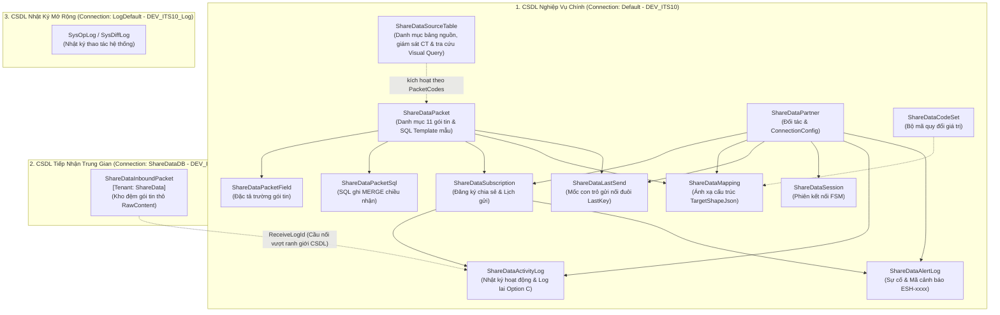

# 📊 Báo Cáo Tổng Thể Các Entity & Bảng CSDL Phân Hệ ShareData (TMC-PM-ITS-ESHARE)

> 📅 **Ngày cập nhật:** 19/10/2026  
> 📌 **Tài liệu tham chiếu & SSOT:**  
> - Bảng đặc tả gói tin 101–111: [`02-mapping-goi-tin-101-111.md`](02-mapping-goi-tin-101-111.md)  
> - Báo cáo bảng `Sys*`: [`04-bao-cao-bang-sys-csdl-staging.md`](04-bao-cao-bang-sys-csdl-staging.md)  
> - Script nạp cấu hình mã lỗi ESH, danh mục bảng nguồn và tham số vận hành: [`03-sharedata-seed-cau-hinh.sql`](../sql/03-sharedata-seed-cau-hinh.sql) (nạp 25 mã cảnh báo lỗi `ESH-xxxx` vào `SysConfigData`, 15 bảng nguồn vào `ShareDataSourceTable` và 48 tham số vận hành vào `SysOpConfig` nhóm `sharedata_config`)  
> - Kế hoạch tổng thể MasterPlan: [`Sharedata_MasterPlan.md`](../Plan/Sharedata_MasterPlan.md)  
> - Kế hoạch Truy vấn động & Tách tầng kết nối: [PHẦN VII của `Sharedata_MasterPlan.md`](../Plan/Sharedata_MasterPlan.md#phần-vii--các-hạng-mục-từ-cuộc-họp-14102026-truy-vấn-động-nối-đuôi--tầng-kết-nối-r8--r18)  
> - Mã nguồn C# Entity: [`TA-ITS015-WEBAPI-V1.0/src/Modules/ShareData/Module.ShareData.Core/Entities/`](../../../../TA-ITS015-WEBAPI-V1.0/src/Modules/ShareData/Module.ShareData.Core/Entities/)  

---

## 🏛️ I. Bức Tranh Tổng Thể Kiến Trúc CSDL ShareData

Phân hệ Chia sẻ Dữ liệu (**ShareData / ESHARE**) vận hành trên mô hình **Đa CSDL (Multi-Database / Multi-Tenant)** nhằm phân tách rạch ròi trách nhiệm giữa dữ liệu cấu hình nghiệp vụ chính, kho đệm tiếp nhận dữ liệu thô và kho lưu trữ nhật ký kiểm toán.



### 1. Phân Tách 3 Kết Nối CSDL (DbConnection Configuration)
1. **Kết nối Chính (`Default` / `DEV_ITS10`):** Lưu trữ 12 trong 13 entity của phân hệ (trừ `ShareDataInboundPacket`), bao gồm danh mục cấu hình, đăng ký chia sẻ, bộ máy ánh xạ, mốc con trỏ đồng bộ, danh mục bảng nguồn, nhật ký hoạt động và cảnh báo lỗi.
2. **Kết nối Nhận Trung Gian (`ShareDataDB` / `DEV_ITS10_Inbound`):** Chứa duy nhất bảng `ShareDataInboundPacket` được gắn thuộc tính `[Tenant(Its015Const.ConnectionConst.ShareData)]`. Bảng này đóng vai trò kho đệm tiếp nhận tức thời các chuỗi JSON/XML thô khổng lồ gửi từ đối tác qua WebAPI, cách ly hoàn toàn nguy cơ quá tải ghi và phình đĩa của CSDL chính.
3. **Kết nối Log Hệ Thống (`LogDefault` / `DEV_ITS10_Log`):** Ghi vết lịch sử khác biệt dữ liệu (`DiffLog`) và nhật ký vận hành quản trị cấp framework.

### 2. Quy Chuẩn Kế Thừa Cốt Lõi
- **100% Entity** đều kế thừa từ lớp cơ sở [`EntityTenant`](../../../../TA-ITS015-WEBAPI-V1.0/src/Shared/Shared.Core/Domain/EntityTenant.cs), được trang bị sẵn bộ cột nền (tên cột thực tế trong CSDL):
  - `ID` (varchar/snowflake): Khóa chính bản ghi.
  - `Code`: Mã nghiệp vụ; độ dài do từng bảng khai (ví dụ `ShareDataPacket.Code` dài 128).
  - `TenantId`: Mã phân vùng đơn vị/tuyến.
  - `CreateTime` / `UpdateTime` (datetime): Thời điểm tạo và cập nhật gần nhất.
  - `CreateUId` / `UpdateUId` (varchar): Định danh người dùng tạo/sửa.
  - `RowStatus`: Trạng thái dòng của lớp nền.
  - `IsDelete`: Cờ xóa mềm (Soft Delete); dòng còn hiệu lực có `IsDelete IS NULL`.

---

## 📑 II. Bảng Đối Chiếu Tổng Thể: Entity Cũ vs. Entity Mới / Cải Tiến

| STT | Tên Entity C# | Tên Bảng SQL Server | Phân Loại | Cách Nạp Dữ Liệu | Thời Điểm | Vai Trò & Bản Chất Nâng Cấp Kỹ Thuật |
| :---: | :--- | :--- | :---: | :---: | :--- | :--- |
| **1** | `ShareDataPacket` | `ShareDataPacket` | **Cũ (Cải tiến)** | **Giao diện / Script** | 08/2026 $\rightarrow$ 14/10/2026 | Danh mục 11 gói tin chuẩn (101–111). Lưu **SQL Template mẫu mặc định** (`ExtractSql`), chế độ đồng bộ (`SyncMode`), cột con trỏ (`CursorTimeColumn`) và số ngày quét lùi (`MaxLookBackDays`). Màn hình `views/sharedata/dataSource/index.vue` hoặc Script `02`. |
| **2** | `ShareDataPacketField` | `ShareDataPacketField` | **Cũ** | **Giao diện** | 08/2026 | Khai báo từ điển danh mục các trường dữ liệu của từng gói tin (`DatatypeId`, `AliasFieldKey`, `Type`, `GroupName`). Màn hình `views/sharedata/dataSource/component/fieldConfig.vue`. |
| **3** | `ShareDataPacketSql` | `ShareDataPacketSql` | **Cũ** | **Script (bắt buộc)** | 15/09/2026 | Câu lệnh SQL ghi (`WriteSql`) chiều **NHẬN** của gói tin (chạy `MERGE` sử dụng `OPENJSON(@records)` trên CSDL Inbound). Chưa có màn hình quản trị; nạp qua Script `05` (gói test) hoặc script riêng. |
| **4** | `ShareDataPartner` | `ShareDataPartner` | **Cũ (Cải tiến)** | **Giao diện** | 08/2026 $\rightarrow$ 13/10/2026 | Danh mục đối tác tích hợp. Bổ sung `ConnectionType` (lưu số nguyên theo enum `ConnectionType` tại `Modules.Integration.Delivery.Base/Enums`: 1-API, 2-File, 3-FTP, 4-FTPS, 5-Kafka) và `ConnectionConfig` dạng `Dictionary<string, string>` JSON linh hoạt. Màn hình `views/sharedata/sharing/index.vue`. |
| **5** | `ShareDataSubscription` | `ShareDataSubscription` | **Cũ (Cải tiến)** | **Giao diện** | 08/2026 $\rightarrow$ 12/10/2026 | Hồ sơ đăng ký chia sẻ 2 chiều. Chứa lịch gửi `ScheduleJson`, `NextTimeRun`, `ProcessingUntil`, `LastTimeRun`, cờ `SendOnNewData`. Đã bỏ `MappingId` cứng để phân giải sống. Màn hình `views/sharedata/sharing/index.vue`. |
| **6** | `ShareDataMapping` | `ShareDataMapping` | **Cũ (Cải tiến)** | **Giao diện** | 08/2026 $\rightarrow$ 14/10/2026 | Hồ sơ ánh xạ cấu trúc dữ liệu (`PartnerSchemaJson`, `TargetShapeJson`) chuyển đổi giữa dữ liệu nguồn nội bộ và cấu trúc JSON chuẩn của đối tác cho cả 2 chiều Gửi/Nhận. Màn hình `views/sharedata/mapping/index.vue`. |
| **7** | `ShareDataCodeSet` | `ShareDataCodeSet` | **Cũ** | **Giao diện** | 08/2026 | Bộ mã quy đổi giá trị danh mục nội bộ $\leftrightarrow$ giá trị chuẩn của đối tác qua cấu trúc JSON `ValuesJson`. Màn hình `views/sharedata/codeSet/index.vue`. |
| **8** | `ShareDataLastSend` | `ShareDataLastSend` | **Mới** | **Hệ thống tự ghi** | 21/09/2026 | Lưu mốc con trỏ kép (`LastTime`, `LastKey`) cho từng cặp `(PartnerCode, PacketCode)` để gửi dữ liệu nối đuôi liên tục không trùng lặp. Worker gửi tự động cập nhật mốc. |
| **9** | `ShareDataSourceTable` | `ShareDataSourceTable` | **Cũ (Cải tiến)** | **Script (bắt buộc)** | 27/09/2026 $\rightarrow$ 17/10/2026 | Danh mục bảng nguồn của phân hệ ShareData: kết hợp giám sát SQL Server Change Tracking (`IsTracked`, `LastVersion`, `LastChangeTime`, `LastIssue`) và tra cứu trên bộ dựng truy vấn Visual Query Builder (`IsQueryable`, `DefaultAlias`). Chưa có màn hình quản trị; nạp qua Script `03` (DB cũ thêm `00`). |
| **10** | `ShareDataInboundPacket` | `ShareDataInboundPacket` | **Mới (Cải tiến)** | **Hệ thống tự ghi** | 15/09/2026 $\rightarrow$ 02/10/2026 | Kho đệm nhận gói tin thô ở CSDL `DEV_ITS10_Inbound` (`[Tenant]`). Bổ sung `ReceiveLogId` làm cầu nối ngữ cảnh sang `ShareDataActivityLog`. Không có màn hình (tra bằng SQL trên DEV_ITS10_Inbound). |
| **11** | `ShareDataActivityLog` | `ShareDataActivityLog` | **Cũ (Cải tiến)** | **Hệ thống tự ghi** | 08/2026 $\rightarrow$ 04/10/2026 | Nhật ký cấu hình và truyền nhận. Bổ sung `ParentId` và `StepNbr` phục vụ mô hình log lai Option C (2 bước cha–con khi có dữ liệu, 1 dòng phẳng khi polling rỗng). Màn hình tra cứu `views/sharedata/history/index.vue`. |
| **12** | `ShareDataAlertLog` | `ShareDataAlertLog` | **Cũ (Cải tiến)** | **Hệ thống tự ghi** | 08/2026 $\rightarrow$ 17/10/2026 | Nhật ký cảnh báo và lỗi hệ thống. Chuẩn hóa 25 mã lỗi dạng `ESH-xxxx` (xem mục IV.1), hỗ trợ chi tiết `DetailJson` và xác nhận `Acknowledged`. Màn hình tra cứu `views/sharedata/errorLog/index.vue`. |
| **13** | `ShareDataSession` | `ShareDataSession` | **Cũ** | **Hệ thống tự ghi** | 08/2026 | Quản lý phiên kết nối của đối tác theo máy trạng thái FSM (IDLE, CONNECTING, ACTIVE...), đếm gói tin và theo dõi Heartbeat. Tự động ghi nhận khi đối tác kết nối / xác thực. |

> 📌 **Gọn bảng CSDL (14/10/2026):** Giữ **13 bảng** (12 bảng chính + 1 bảng Inbound), script 00 xóa ShareDataTable khi bảng rỗng; CSDL còn dữ liệu thì giữ, không ảnh hưởng chạy, không phát sinh bảng riêng cho truy vấn động mà lưu trữ trực tiếp câu truy vấn trích xuất và tham số đồng bộ tại `ShareDataPacket` (`ExtractSql`, `SyncMode`, `CursorTimeColumn`, `MaxLookBackDays`).

> 📌 **Danh mục bảng nguồn ShareDataSourceTable (17/10/2026):** Quyết định ngày 17/10/2026 hợp nhất danh sách bảng nguồn theo dõi Change Tracking từ `SysOpConfig` (nhóm `sharedata_tracker`) và bảng trạng thái `ShareDataTrackVersion` cũ về bảng danh mục nguồn tập trung `ShareDataSourceTable` của ShareData (di trú qua script [`00-sharedata-migration-mot-lan.sql`](../sql/00-sharedata-migration-mot-lan.sql)). Mỗi dòng đại diện cho 1 bảng nguồn có mốc `LastVersion`, `LastChangeTime`, `LastIssue` riêng, hai công tắc độc lập `IsTracked` (bật/tắt quét Change Tracking) và `IsQueryable` (cho phép dùng trên bộ dựng truy vấn Visual Query Builder), cùng `DefaultAlias`. Sửa trực tiếp bằng `.sql`, Worker tự nạp lại định kỳ. Chi tiết ở mục [IV.4](#4-danh-mục-bảng-nguồn--bảng-sharedatasourcetable).

---

## 🔍 III. Phân Tích Chi Tiết 13 Entity / Bảng CSDL Cốt Lõi

---

### KHỐI 1: DANH MỤC & ĐẶC TẢ GÓI TIN (PACKET CATALOG & METADATA)

#### 1. Entity `ShareDataPacket` — Bảng `ShareDataPacket`
* **Vị trí tệp:** [`TA-ITS015-WEBAPI-V1.0/src/Modules/ShareData/Module.ShareData.Core/Entities/ShareDataPacket.cs`](file:///Users/hoangquydat/ThienAn/TA-ITS015-WEBAPI-V1.0/src/Modules/ShareData/Module.ShareData.Core/Entities/ShareDataPacket.cs)
* **Kết nối CSDL:** `Default` (`DEV_ITS10`)
* **Vai trò nghiệp vụ:**  
  Bảng danh mục gốc khai báo 11 gói tin chia sẻ dữ liệu chuẩn (từ gói 101_commonData đến 111_regionalCommand). Là thực thể tham chiếu trung tâm cho toàn bộ các màn hình cấu hình, đăng ký chia sẻ, bộ máy ánh xạ và worker xử lý.
* **Cấu trúc trường cốt lõi:**
  | Tên trường C# | Kiểu CSDL | Ràng buộc | Mô tả chức năng |
  | :--- | :--- | :---: | :--- |
  | `Code`             | `nvarchar(128)` | Nullable | Mã định danh gói tin (`101_commonData`, `102_cctvData`...). |
  | `Name`             | `nvarchar(128)` | Nullable | Tên tiếng Việt hiển thị trên giao diện. |
  | `PacketVersion`    | `nvarchar(16)`  | Nullable | Phiên bản định dạng gói tin (ví dụ `1.0`). |
  | `Description`      | `nvarchar(256)` | Nullable | Mô tả chi tiết phạm vi nghiệp vụ gói tin. |
  | `OrderNo`          | `int`           | Nullable | Thứ tự sắp xếp trên danh sách và cây menu. |
  | `Status`           | `int` (`BaseEnums.StatusEnum?`) | Nullable | Trạng thái sử dụng (`Enable` = 1, `Disable` = 0). |
  | `Remark`           | `nvarchar(256)` | Nullable | Ghi chú gói tin. |
  | `ExtractSql`       | `nvarchar(max)` | Nullable | *(Mới 14/10/2026)* Câu truy vấn SQL trích xuất dữ liệu nguồn động mẫu chuẩn (chiều Gửi - Outbound) dành cho SuperAdmin. |
  | `SyncMode`         | `int` (`SyncMode?`) | Nullable | *(Mới 14/10/2026)* Chế độ đồng bộ dữ liệu (enum `SyncMode` tại `Shared.DTO.Enums.BaseEnums`): `1` = Snapshot (gửi toàn bộ), `2` = Incremental (gửi nối đuôi). |
  | `CursorTimeColumn` | `nvarchar(128)` | Nullable | *(Mới 14/10/2026)* Tên cột hoặc biểu thức cursor thời gian mẫu (ví dụ `UpdateTime`). |
  | `MaxLookBackDays`  | `int`           | Nullable | *(Mới 14/10/2026)* Số ngày quét lùi tối đa (`1–365`, `null` = không giới hạn). |
* **Lưu ý kỹ thuật:**  
  Chặn đứng thao tác Sửa/Xóa gói tin khi gói tin đang có đăng ký chia sẻ ở trạng thái hoạt động (`Active`).

---

#### 2. Entity `ShareDataPacketField` — Bảng `ShareDataPacketField`
* **Vị trí tệp:** [`TA-ITS015-WEBAPI-V1.0/src/Modules/ShareData/Module.ShareData.Core/Entities/ShareDataPacketField.cs`](file:///Users/hoangquydat/ThienAn/TA-ITS015-WEBAPI-V1.0/src/Modules/ShareData/Module.ShareData.Core/Entities/ShareDataPacketField.cs)
* **Kết nối CSDL:** `Default` (`DEV_ITS10`)
* **Vai trò nghiệp vụ:**  
  Khai báo từ điển chi tiết từng trường dữ liệu chuẩn thuộc về một gói tin. Được sử dụng để hiển thị danh sách trường nguồn trên màn hình Ánh xạ (`editMapping.vue`) và Query Builder (`queryBuilder.vue`).
* **Cấu trúc trường cốt lõi:**
  | Tên trường C# | Kiểu CSDL | Ràng buộc | Mô tả chức năng |
  | :--- | :--- | :---: | :--- |
  | `DatatypeId`     | `nvarchar(128)` | Not Null | Mã gói tin sở hữu trường (`ShareDataPacket.Code`). |
  | `AliasFieldKey`  | `nvarchar(128)` | Not Null | Khóa định danh trường dạng camelCase dùng trong biến đổi JSON (`stationId`, `vehicleSpeed`...). |
  | `Name`           | `nvarchar(128)` | Nullable | Tên nhãn tiếng Việt của trường. |
  | `Type`           | `nvarchar(128)` | Nullable | Kiểu dữ liệu gốc (`string`, `int`, `decimal`, `datetime`). |
  | `GroupName`      | `nvarchar(128)` | Nullable | Tên nhóm trường để gom cụm hiển thị trên giao diện người dùng. |
  | `IsRequired`     | `int`           | Nullable | Bắt buộc có dữ liệu trong payload hay không (`1` = Bắt buộc). |
  | `Status`         | `int`           | Nullable | Trạng thái hiệu lực (`1` = Bật, `0` = Tắt). |

---

#### 3. Entity `ShareDataPacketSql` — Bảng `ShareDataPacketSql`
* **Vị trí tệp:** [`TA-ITS015-WEBAPI-V1.0/src/Modules/ShareData/Module.ShareData.Core/Entities/ShareDataPacketSql.cs`](file:///Users/hoangquydat/ThienAn/TA-ITS015-WEBAPI-V1.0/src/Modules/ShareData/Module.ShareData.Core/Entities/ShareDataPacketSql.cs)
* **Kết nối CSDL:** `Default` (`DEV_ITS10`) *(chứa cấu hình, thực thi trên Inbound)*
* **Vai trò nghiệp vụ:**  
  Lưu trữ câu lệnh SQL ghi chiều **NHẬN (Inbound)** cho từng gói tin. Khi Worker xử lý gói tin nhận từ đối tác, nó sẽ nạp các câu lệnh này theo `OrderNo` tăng dần và thực thi câu lệnh `MERGE` an toàn trên CSDL Inbound. Hiện tại chưa có màn hình quản trị trên giao diện người dùng; câu lệnh ghi chiều nhận bắt buộc phải nạp và quản lý bằng script SQL (ví dụ script `05-sharedata-du-lieu-gia-lap.sql` cho gói test `E2E_INBOUND_TEST`; các gói nhận thật phải viết câu lệnh `INSERT` riêng vào bảng này).
* **Cấu trúc trường cốt lõi:**
  | Tên trường C# | Kiểu CSDL | Ràng buộc | Mô tả chức năng |
  | :--- | :--- | :---: | :--- |
  | `PacketCode` | `nvarchar(128)` | Not Null | Mã gói tin (`ShareDataPacket.Code`). |
  | `OrderNo`    | `int`           | Nullable | Thứ tự thực thi (bảng phụ ghi trước, bảng chính ghi sau). |
  | `TableName`  | `nvarchar(128)` | Nullable | Tên bảng đích tiếp nhận dữ liệu (ví dụ `dbo.TmsZone`). |
  | `WriteSql`   | `nvarchar(max)` | Not Null | Câu lệnh `MERGE` SQL nhận tham số `@records` (dạng JSON qua `OPENJSON`). |
  | `Status`     | `int`           | Nullable | Trạng thái áp dụng (`1` = Enable). |
* **Lưu ý kỹ thuật:**  
  `WriteSql` sử dụng kiểu dữ liệu `CodeFirst_BigString` (`nvarchar(max)`). Mọi câu lệnh bắt buộc sử dụng `SugarParameter` an toàn và trả về `$action` để đếm chính xác số bản ghi thêm mới / cập nhật.

---

### KHỐI 2: QUẢN LÝ ĐỐI TÁC & PHIÊN KẾT NỐI (PARTNERSHIP & SESSIONS)

#### 4. Entity `ShareDataPartner` — Bảng `ShareDataPartner`
* **Vị trí tệp:** [`TA-ITS015-WEBAPI-V1.0/src/Modules/ShareData/Module.ShareData.Core/Entities/ShareDataPartner.cs`](file:///Users/hoangquydat/ThienAn/TA-ITS015-WEBAPI-V1.0/src/Modules/ShareData/Module.ShareData.Core/Entities/ShareDataPartner.cs)
* **Kết nối CSDL:** `Default` (`DEV_ITS10`)
* **Vai trò nghiệp vụ:**  
  Quản lý danh sách các đối tác tích hợp ngoài (Trung tâm Điều hành Vùng, Cục Đường bộ, Đơn vị thu phí, Đối tác dịch vụ GT...).
* **Cấu trúc trường cốt lõi:**
  | Tên trường C# | Kiểu CSDL | Ràng buộc | Mô tả chức năng |
  | :--- | :--- | :---: | :--- |
  | `Code`             | `nvarchar(128)` | Not Null | Mã đối tác duy nhất (ví dụ `PARTNER_CSGT`, `PARTNER_VEC`). Khóa khi sửa. |
  | `Name`             | `nvarchar(128)` | Nullable | Tên đơn vị / đối tác hiển thị. |
  | `Address`          | `nvarchar(128)` | Nullable | Địa chỉ IP / Hostname máy chủ đối tác. |
  | `Port`             | `int`           | Nullable | Cổng dịch vụ mạng đối tác. |
  | `EndPointApiUrl`   | `nvarchar(256)` | Nullable | Đường dẫn URL API nhận dữ liệu của đối tác. |
  | `ConnectionType`   | `int`           | Nullable | *(Mới 13/10/2026, chuyển enum INT 17/10/2026)* Loại kênh kết nối lưu số nguyên theo enum `ConnectionType` (`Modules.Integration.Delivery.Base/Enums`): 1-API (mặc định), 2-File, 3-FTP, 4-FTPS, 5-Kafka. |
  | `ConnectionConfig` | `nvarchar(max)` | Nullable | *(Cập nhật 14/10/2026 theo mẫu VMS)* Cấu hình kết nối JSON động dạng `Dictionary<string, string>` chỉ chứa tham số riêng theo kênh (AuthType, Token, ApiKey, TimeoutSeconds, BypassSsl, Topic, DirectoryPath...), tuyệt đối **không** chứa địa chỉ/cổng (địa chỉ và cổng chỉ lấy từ các cột `Address`, `Port`, `EndPointApiUrl`). |
  | `Status`           | `int`           | Nullable | Trạng thái hoạt động (`1` = Bật, `0` = Tắt). |
  | `SessionState`     | `int`           | Nullable | Trạng thái phiên kết nối hiện thời. |
* **Lưu ý kỹ thuật:**  
  Áp dụng thiết kế cấu hình `Dictionary` linh hoạt tham chiếu từ `IntgVmsManager.cs` theo đúng mẫu VMS (`TmsEquipment`): Địa chỉ và cổng chỉ có một nguồn duy nhất là các cột của bảng đối tác; toàn bộ các thông số nhạy cảm và tham số kết nối riêng theo từng kênh được đóng gói trong `ConnectionConfig`, không làm phình to cột vật lý của bảng CSDL.

---

#### 5. Entity `ShareDataSession` — Bảng `ShareDataSession`
* **Vị trí tệp:** [`TA-ITS015-WEBAPI-V1.0/src/Modules/ShareData/Module.ShareData.Core/Entities/ShareDataSession.cs`](file:///Users/hoangquydat/ThienAn/TA-ITS015-WEBAPI-V1.0/src/Modules/ShareData/Module.ShareData.Core/Entities/ShareDataSession.cs)
* **Kết nối CSDL:** `Default` (`DEV_ITS10`)
* **Vai trò nghiệp vụ:**  
  Theo dõi vòng đời phiên kết nối giữa hệ thống với đối tác theo mô hình máy trạng thái hữu hạn (**FSM - Finite State Machine**).
* **Cấu trúc trường cốt lõi:**
  | Tên trường C# | Kiểu CSDL | Ràng buộc | Mô tả chức năng |
  | :--- | :--- | :---: | :--- |
  | `PartnerId`       | `varchar(64)`   | Not Null | Mã ID đối tác sở hữu phiên (`ShareDataPartner.ID`). |
  | `Direction`       | `int`           | Nullable | Chiều phiên: `0` = Outbound (Gửi), `1` = Inbound (Nhận). |
  | `State`           | `int`           | Nullable | Trạng thái FSM: 0=IDLE, 1=CONNECTING, 3=ACTIVE, 5=CLOSED, 7=REJECTED... |
  | `StartedAt`       | `datetime`      | Nullable | Thời điểm mở phiên. |
  | `AcceptedAt`      | `datetime`      | Nullable | Thời điểm đối tác xác nhận bắt tay (Handshake). |
  | `EndedAt`         | `datetime`      | Nullable | Thời điểm kết thúc / đóng phiên. |
  | `PacketsSent`     | `bigint`        | Nullable | Tổng số lượng gói tin đã truyền đi trong phiên. |
  | `PacketsRecv`     | `bigint`        | Nullable | Tổng số lượng gói tin đã tiếp nhận trong phiên. |
  | `LastHeartbeatAt` | `datetime`      | Nullable | Thời điểm nhận nhịp tim duy trì kết nối (Heartbeat) gần nhất. |

---

### KHỐI 3: CẤU HÌNH ĐĂNG KÝ & LẬP LỊCH CHIA SẺ (SUBSCRIPTIONS & SCHEDULING)

#### 6. Entity `ShareDataSubscription` — Bảng `ShareDataSubscription`
* **Vị trí tệp:** [`TA-ITS015-WEBAPI-V1.0/src/Modules/ShareData/Module.ShareData.Core/Entities/ShareDataSubscription.cs`](file:///Users/hoangquydat/ThienAn/TA-ITS015-WEBAPI-V1.0/src/Modules/ShareData/Module.ShareData.Core/Entities/ShareDataSubscription.cs)
* **Kết nối CSDL:** `Default` (`DEV_ITS10`)
* **Vai trò nghiệp vụ:**  
  Hồ sơ đăng ký chia sẻ dữ liệu kết nối một Đối tác (`PartnerId`) với một Gói tin (`DatatypeId`) theo một Chiều truyền nhận (`Direction`). Chứa toàn bộ cấu hình lập lịch thực thi cho Worker.
* **Cấu trúc trường cốt lõi:**
  | Tên trường C# | Kiểu CSDL | Ràng buộc | Mô tả chức năng |
  | :--- | :--- | :---: | :--- |
  | `PartnerId`       | `varchar(64)`   | Not Null | ID đối tác (`ShareDataPartner.ID`). |
  | `DatatypeId`      | `nvarchar(128)` | Not Null | Mã gói tin chia sẻ (`ShareDataPacket.Code`). |
  | `Direction`       | `int`           | Not Null | Chiều truyền nhận: `0` = Gửi (Outbound), `1` = Nhận (Inbound). |
  | `Mode`            | `int`           | Nullable | Chế độ chạy: `Continuous` (liên tục), `Daily`, `Weekly`, `Interval`, `Single`. |
  | `ScheduleJson`    | `nvarchar(max)` | Nullable | Cấu hình lịch biểu định dạng JSON (các ngày trong tuần, giờ bắt đầu/kết thúc). |
  | `IntervalSeconds` | `int`           | Nullable | Khoảng thời gian giãn cách quét định kỳ (giây). |
  | `SendOnNewData`   | `bit`           | Nullable | Cờ kích hoạt gửi ngay lập tức khi phát hiện có dữ liệu mới phát sinh. |
  | `NextTimeRun`     | `datetime`      | Nullable | Thời điểm dự kiến thực hiện lượt quét kế tiếp. |
  | `ProcessingUntil` | `datetime`      | Nullable | Mốc khóa tương tranh đa worker (Lease Lock): `null` = đang rảnh rỗi. |
  | `LastTimeRun`     | `datetime`      | Nullable | Thời điểm thực tế đã thực hiện lượt chạy gần nhất. |
  | `State`           | `int`           | Nullable | Trạng thái đăng ký: 0=DRAFT, 1=ACTIVE, 2=PAUSED, 3=EXPIRED... |
* **Lưu ý kỹ thuật:**  
  **Loại bỏ triệt để cột `MappingId` cứng**: Hồ sơ ánh xạ được phân giải **động (Runtime Resolver)** tại thời điểm thực thi dựa trên bộ ba `(PartnerId, DatatypeId, Direction)`. Tránh hiện tượng lệch cấu hình khi hồ sơ ánh xạ bị sửa đổi độc lập.

---

### KHỐI 4: BỘ MÁY ÁNH XẠ & QUY ĐỔI DỮ LIỆU (MAPPING ENGINE & CODESET)

#### 7. Entity `ShareDataMapping` — Bảng `ShareDataMapping`
* **Vị trí tệp:** [`TA-ITS015-WEBAPI-V1.0/src/Modules/ShareData/Module.ShareData.Core/Entities/ShareDataMapping.cs`](file:///Users/hoangquydat/ThienAn/TA-ITS015-WEBAPI-V1.0/src/Modules/ShareData/Module.ShareData.Core/Entities/ShareDataMapping.cs)
* **Kết nối CSDL:** `Default` (`DEV_ITS10`)
* **Vai trò nghiệp vụ:**  
  Trái tim của bộ máy biến đổi dữ liệu (**Mapping Engine**): Định nghĩa luật chuyển đổi giữa dữ liệu nguồn nội bộ và cấu trúc JSON chuẩn của đối tác.
* **Cấu trúc trường cốt lõi:**
  | Tên trường C# | Kiểu CSDL | Ràng buộc | Mô tả chức năng |
  | :--- | :--- | :---: | :--- |
  | `PartnerId`         | `varchar(64)`   | Not Null | Mã đối tác sở hữu hồ sơ ánh xạ. |
  | `DatatypeId`        | `nvarchar(128)` | Not Null | Mã gói tin (`ShareDataPacket.Code`). |
  | `Direction`         | `int`           | Not Null | Chiều ánh xạ: `0` = Gửi (Outbound), `1` = Nhận (Inbound). |
  | `PartnerSchemaJson` | `nvarchar(max)` | Nullable | Nguyên văn chuỗi JSON mẫu do đối tác cung cấp để đối soát. |
  | `TargetShapeJson`   | `nvarchar(max)` | Not Null | Bộ khung đầu ra dạng JSON chứa các ký hiệu định vị `$field`, `$meta`, `$extend`. |
  | `IsActive`          | `bit`           | Nullable | Cờ kích hoạt hồ sơ ánh xạ (`true` = Đang áp dụng). |
* **Cơ chế hoạt động của `TargetShapeJson`:**
  - `{"$field": "stationId"}`: Điền giá trị trường nguồn `stationId` vào vị trí tương ứng.
  - `{"$field": "speed", "$extend": {"numberFormat": "0.0", "targetType": "float"}}`: Ép khuôn số và kiểu dữ liệu.
  - `{"$field": "status", "$extend": {"codeSet": "CS_VMS_STATUS"}}`: Quy đổi giá trị qua bảng `ShareDataCodeSet`.
  - `{"$meta": "Now"}`: Tự động phát sinh thời gian hiện tại của hệ thống.

---

#### 8. Entity `ShareDataCodeSet` — Bảng `ShareDataCodeSet`
* **Vị trí tệp:** [`TA-ITS015-WEBAPI-V1.0/src/Modules/ShareData/Module.ShareData.Core/Entities/ShareDataCodeSet.cs`](file:///Users/hoangquydat/ThienAn/TA-ITS015-WEBAPI-V1.0/src/Modules/ShareData/Module.ShareData.Core/Entities/ShareDataCodeSet.cs)
* **Kết nối CSDL:** `Default` (`DEV_ITS10`)
* **Vai trò nghiệp vụ:**  
  Quản lý các bộ từ điển quy đổi giá trị mã hóa danh mục giữa CSDL nội bộ và đối tác (ví dụ: Trạng thái thiết bị `1 -> "NORMAL"`, `2 -> "FAULT"`).
* **Cấu trúc trường cốt lõi:**
  | Tên trường C# | Kiểu CSDL | Ràng buộc | Mô tả chức năng |
  | :--- | :--- | :---: | :--- |
  | `Code`       | `nvarchar(128)` | Not Null | Mã bộ từ điển (ví dụ `CS_LANE_STATUS`, `CS_VEHICLE_TYPE`). |
  | `Name`       | `nvarchar(128)` | Nullable | Tên mô tả bộ mã quy đổi. |
  | `ValuesJson` | `nvarchar(max)` | Not Null | Danh sách các cặp giá trị ánh xạ `(SourceValue <-> TargetValue)` kèm giá trị mặc định dạng JSON. |
  | `Status`     | `int`           | Nullable | Trạng thái sử dụng (`1` = Bật). |

---

### KHỐI 5: ĐIỀU PHỐI VẬN HÀNH, MỐC ĐỒNG BỘ & HÀNG ĐỢI (EXECUTION, CURSOR & BUFFER)

#### 9. Entity `ShareDataLastSend` — Bảng `ShareDataLastSend` *(Mới 21/09/2026)*
* **Vị trí tệp:** [`TA-ITS015-WEBAPI-V1.0/src/Modules/ShareData/Module.ShareData.Core/Entities/ShareDataLastSend.cs`](file:///Users/hoangquydat/ThienAn/TA-ITS015-WEBAPI-V1.0/src/Modules/ShareData/Module.ShareData.Core/Entities/ShareDataLastSend.cs)
* **Kết nối CSDL:** `Default` (`DEV_ITS10`)
* **Vai trò nghiệp vụ:**  
  Lưu trữ **Mốc Con Trỏ Kép (Composite Cursor)** của bản ghi cuối cùng đã truyền thành công cho từng cặp `(PartnerCode, PacketCode)`. Giúp Worker quét nối đuôi chính xác tuyệt đối mà không bỏ sót và không gửi lặp dữ liệu cũ.
* **Cấu trúc trường cốt lõi:**
  | Tên trường C# | Kiểu CSDL | Ràng buộc | Mô tả chức năng |
  | :--- | :--- | :---: | :--- |
  | `PartnerCode` | `nvarchar(128)` | Not Null | Mã đối tác nhận dữ liệu (`ShareDataPartner.Code`). |
  | `PacketCode`  | `nvarchar(128)` | Not Null | Mã gói tin chia sẻ (`ShareDataPacket.Code`). |
  | `LastTime`    | `datetime`      | Nullable | Mốc thời gian (`UpdateTime`/`DetectTime`) của bản ghi cuối cùng đã gửi thành công. |
  | `LastKey`     | `varchar(64)`   | Nullable | Khóa chính ID của bản ghi cuối cùng tại mốc `LastTime` (chống trùng lặp khi nhiều bản ghi cùng mili-giây). |
* **Lưu ý kỹ thuật:**  
  Có Unique Index bắt buộc: `index_ShareDataLastSend_Partner_Packet (PartnerCode ASC, PacketCode ASC, UNIQUE)`. Chỉ cập nhật mốc khi gói tin được gửi thành công qua đối tác.

---

#### 10. Entity `ShareDataSourceTable` — Bảng `ShareDataSourceTable` *(Cũ 27/09/2026 → Cải tiến 17/10/2026)*
* **Vị trí tệp:** [`TA-ITS015-WEBAPI-V1.0/src/Modules/ShareData/Module.ShareData.Core/Entities/ShareDataSourceTable.cs`](file:///Users/hoangquydat/ThienAn/TA-ITS015-WEBAPI-V1.0/src/Modules/ShareData/Module.ShareData.Core/Entities/ShareDataSourceTable.cs)
* **Dữ liệu khởi tạo chuẩn:** Script [`03-sharedata-seed-cau-hinh.sql`](../sql/03-sharedata-seed-cau-hinh.sql) mục 3.4 (và bộ đọc `SeedScriptReader` trong kiểm thử).
* **Kết nối CSDL:** `Default` (`DEV_ITS10`)
* **Vai trò nghiệp vụ:**  
  Danh mục bảng nguồn tập trung của phân hệ ShareData, đảm nhận đồng thời 2 vai trò:
  1. Cấu hình danh sách bảng giám sát **SQL Server Change Tracking** kèm quy tắc ánh xạ gói tin kích hoạt (`PacketCodes`) và trạng thái con trỏ `LastVersion`, thời điểm phát hiện thay đổi `LastChangeTime`, tóm tắt sự cố `LastIssue` độc lập theo từng bảng nguồn.
  2. Cấu hình danh mục bảng phục vụ tra cứu trên bộ dựng truy vấn **Visual Query Builder** (`IsQueryable`, `DefaultAlias`), bảo đảm tính an toàn khi trích xuất dữ liệu.
* **Cấu trúc trường cốt lõi:**
  | Tên trường C# | Kiểu CSDL | Ràng buộc | Mô tả chức năng |
  | :--- | :--- | :---: | :--- |
  | `TableName`      | `nvarchar(128)` | Nullable (Unique khi `IsDelete IS NULL`) | Tên bảng nguồn trong CSDL (ví dụ `TmsZoneStatus`, `TmsTrafficData`...). |
  | `Name`           | `nvarchar(128)` | Nullable | Tên hiển thị tiếng Việt của bảng nguồn trên giao diện. |
  | `PacketCodes`    | `nvarchar(256)` | Nullable | Danh sách mã gói tin kích hoạt khi bảng có thay đổi (`I`/`U`), phân tách bằng dấu phẩy (ví dụ `103,103_vdsData,106,106_wimData`). |
  | `IsTracked`      | `bit` (`bool?`) | Nullable | Bật giám sát SQL Server Change Tracking cho bảng này (`1` = Bật, `0` = Tắt). Thay thế cho cột `Status` cũ. |
  | `OrderNo`        | `int`           | Nullable | Thứ tự sắp xếp hiển thị / xử lý (10..150). |
  | `Remark`         | `nvarchar(512)` | Nullable | Ghi chú nghiệp vụ của bảng nguồn. |
  | `LastVersion`    | `bigint` (`long?`) | Nullable | Mốc version Change Tracking đã xử lý của riêng bảng đó (`null` hoặc âm `< 0` là chưa khởi tạo). |
  | `LastChangeTime` | `datetime` (`DateTime?`) | Nullable | Thời điểm gần nhất Worker phát hiện bảng có bản ghi thay đổi (`SYS_CHANGE_OPERATION IN ('I', 'U')`). |
  | `LastIssue`      | `nvarchar(512)` | Nullable | Mô tả ngắn vấn đề gần nhất của bảng (tự động xóa về `null` khi bảng truy vấn thành công trở lại). |
  | `IsQueryable`    | `bit` (`bool?`) | Nullable | Cho phép dùng bảng này trong bộ dựng truy vấn Visual Query Builder và trong câu lệnh SQL của gói tin (`1` = Cho phép, `0` = Chặn). |
  | `DefaultAlias`   | `nvarchar(32)`  | Nullable | Bí danh mặc định khi chọn bảng trên bộ dựng truy vấn (`zs`, `z`, `tstat`, `td`, `c`, `w`, `tin`, `tout`, `vr`, `i`, `et`, `v`, `eq`, `tl`, `ts`). |
  | `ID`, `Code`, `TenantId`, `CreateTime`, `UpdateTime`, `CreateUId`, `UpdateUId`, `RowStatus`, `IsDelete` | Các cột nền | Kế thừa `EntityTenant` | Khóa chính Snowflake/chuỗi cố định (`1500000000201`..`1500000000215`), phân vùng đơn vị, dấu thời gian tạo/cập nhật và cờ xóa mềm. |
* **Lưu ý kỹ thuật:**  
  - **Hai công tắc độc lập:** `IsTracked` (quản lý việc quét Change Tracking tại Background Worker) và `IsQueryable` (quản lý việc cho phép dùng trên bộ dựng Visual Query Builder và kiểm tra an toàn trong câu lệnh SQL qua `SqlValidator`). Ví dụ bảng `TmsEquipment` có `IsTracked = 0` (để tránh quét thừa khi chỉ sửa thông tin thiết bị) nhưng `IsQueryable = 1` (để vẫn được phép tra cứu trong các gói 102/103/108).
  - **Chặn truy vấn bảng ngoài danh mục hoặc bảng bị khóa:** Nếu `IsQueryable = 0`, bảng sẽ biến mất khỏi danh sách lựa chọn trên bộ dựng Visual Query Builder; nếu câu lệnh SQL trích xuất chứa bảng này (hoặc bảng ngoài danh mục) thì `SqlValidator` từ chối khi Lưu/Dò cột/Xem mẫu với mã lỗi thuật ngữ `SqlTableNotAllowed`.
  - **Mỗi dòng đại diện cho 1 bảng nguồn độc lập** (có index duy nhất `UX_ShareDataSourceTable_TableName` trên `(TableName ASC, IsDelete ASC)` dưới CSDL).
  - **Bảo toàn dòng cấu hình tuyệt đối:** Background Worker (`DataChangeTrackingService`) chỉ thực hiện `UPDATE` trên các cột trạng thái vận hành (`LastVersion`, `LastChangeTime`, `LastIssue`, `UpdateTime`); **không bao giờ xóa hay tạo lại dòng**, đảm bảo số dòng và các cột cấu hình không bao giờ bị mất khi khởi tạo, hạ mốc về `-1` hay nhảy cóc.
  - **Phân tách rõ giữa tóm tắt chẩn đoán nhanh và nhật ký kiểm toán:** Mọi sự cố hạ tầng Change Tracking chi tiết vẫn ghi đầy đủ vào `ShareDataActivityLog` với mã `ESH-16xx` (tự động dọn sau 7 ngày), còn cột `LastIssue` chỉ giữ tóm tắt vấn đề gần nhất của bảng đó để truy vấn nhanh tại một chỗ. Chi tiết vận hành tại mục [IV.4](#4-danh-mục-bảng-nguồn--bảng-sharedatasourcetable).

---

#### 11. Entity `ShareDataInboundPacket` — Bảng `ShareDataInboundPacket` *(Mới 15/09/2026)*
* **Vị trí tệp:** [`TA-ITS015-WEBAPI-V1.0/src/Modules/ShareData/Module.ShareData.Core/Entities/ShareDataInboundPacket.cs`](file:///Users/hoangquydat/ThienAn/TA-ITS015-WEBAPI-V1.0/src/Modules/ShareData/Module.ShareData.Core/Entities/ShareDataInboundPacket.cs)
* **Kết nối CSDL:** `ShareDataDB` (`DEV_ITS10_Inbound`) qua `[Tenant(Its015Const.ConnectionConst.ShareData)]`
* **Vai trò nghiệp vụ:**  
  Kho đệm lưu trữ nguyên văn gói tin thô mà WebAPI tiếp nhận từ các đối tác gửi đến. Tách rời tiến trình WebAPI (ghi nhận siêu tốc, trả mã `200 OK`) khỏi tiến trình Worker (bóc tách JSON và thực thi SQL phức tạp).
* **Cấu trúc trường cốt lõi:**
  | Tên trường C# | Kiểu CSDL | Ràng buộc | Mô tả chức năng |
  | :--- | :--- | :---: | :--- |
  | `PartnerCode`   | `nvarchar(64)`  | Not Null | Mã đối tác gửi đến. |
  | `PacketCode`    | `nvarchar(128)` | Not Null | Mã loại gói tin nhận được. |
  | `RawContent`    | `nvarchar(max)` | Not Null | Toàn bộ chuỗi JSON/XML thô nhận được từ đối tác (`CodeFirst_BigString`). |
  | `ByteSize`      | `bigint`        | Nullable | Kích thước gói tin tính theo byte. |
  | `ProcessState`  | `int`           | Not Null | Trạng thái xử lý: 0=PENDING, 1=PROCESSING, 2=DONE, 3=FAILED. |
  | `ProcessedAt`   | `datetime`      | Nullable | Thời điểm Worker hoàn tất xử lý gói tin. |
  | `ErrorMessage`  | `nvarchar(512)` | Nullable | Nội dung lỗi chi tiết nếu quá trình ánh xạ/ghi thất bại. |
  | `ReceiveLogId`  | `nvarchar(64)`  | Nullable | *(Mới 02/10/2026)* Khóa ngoại logic lưu `ID` của dòng log cha trong `ShareDataActivityLog` (CSDL chính). |
* **Lưu ý kỹ thuật:**  
  Cột `ReceiveLogId` là cây cầu nối xuyên 2 CSDL vật lý độc lập, cho phép Worker khi xử lý xong ở CSDL Inbound có thể quay ngược lại CSDL chính để cập nhật trạng thái và số lượng bản ghi cho dòng log cha.

---

### KHỐI 6: KIỂM TOÁN, GIÁM SÁT TIẾN TRÌNH & CẢNH BÁO (AUDIT LOGGING & ALERTING)

#### 12. Entity `ShareDataActivityLog` — Bảng `ShareDataActivityLog`
* **Vị trí tệp:** [`TA-ITS015-WEBAPI-V1.0/src/Modules/ShareData/Module.ShareData.Core/Entities/ShareDataActivityLog.cs`](file:///Users/hoangquydat/ThienAn/TA-ITS015-WEBAPI-V1.0/src/Modules/ShareData/Module.ShareData.Core/Entities/ShareDataActivityLog.cs)
* **Kết nối CSDL:** `Default` (`DEV_ITS10`)
* **Vai trò nghiệp vụ:**  
  Nhật ký toàn diện ghi lại mọi hoạt động cấu hình người dùng (`LogType = CONFIG`) và tiến trình truyền nhận dữ liệu tự động của Worker (`LogType = TRANSFER`).
* **Cấu trúc trường cốt lõi:**
  | Tên trường C# | Kiểu CSDL | Ràng buộc | Mô tả chức năng |
  | :--- | :--- | :---: | :--- |
  | `LogType`           | `nvarchar(16)`  | Not Null | Loại log: `CONFIG` (thao tác người dùng) hoặc `TRANSFER` (worker truyền nhận). |
  | `Action`            | `int`           | Nullable | Hành động: CREATE, UPDATE, DELETE, SEND, RECEIVE, EXPORT... |
  | `OccurredAt`        | `datetime`      | Not Null | Thời điểm phát sinh sự kiện. |
  | `Success`           | `int`           | Not Null | Kết quả thực thi (`1` = Thành công, `2` = Thất bại). |
  | `PartnerId` / `Name`| `varchar(64)`   | Nullable | Mã và tên đối tác liên quan. |
  | `SubscriptionId`    | `varchar(64)`   | Nullable | Mã đăng ký chia sẻ liên quan. |
  | `DatatypeId`        | `nvarchar(128)` | Nullable | Mã gói tin chia sẻ (`ShareDataPacket.Code`). |
  | `RecordCount`       | `int`           | Nullable | Số lượng bản ghi dữ liệu truyền nhận thành công. |
  | `ByteSize`          | `bigint`        | Nullable | Dung lượng dữ liệu truyền nhận (bytes). |
  | `ParentId`          | `varchar(64)`   | Nullable | *(Mới 02/10/2026)* ID dòng log cha. `null` = Chính nó là dòng cha cấp cao nhất. |
  | `StepNbr`           | `int`           | Nullable | *(Mới 02/10/2026)* Thứ tự bước thực thi con (Bước 1: Trích xuất / Tiếp nhận, Bước 2: Ánh xạ & Gửi/Lưu). |
  | `Children`          | `List<Entity>`  | `IsIgnore`| Thuộc tính ánh xạ cây phân cấp (`ToTreeAsync`) phục vụ hiển thị `el-steps`. |
* **Lưu ý kỹ thuật chuẩn hóa Option C (04/10/2026):**  
  - Khi có dữ liệu gửi đi (`RecordCount > 0`): Ghi đủ **1 dòng cha + 2 dòng con** (`StepNbr` 1 và 2) để modal `el-steps` hiển thị trực quan tiến trình.
  - Khi quét định kỳ không có dữ liệu mới (`NoNewData`): Chỉ ghi **1 dòng phẳng duy nhất** trạng thái `Success = true`, `RecordCount = 0` (không sinh dòng con), triệt tiêu nguy cơ phình to CSDL.
  - `ParentId` và `StepNbr` có chỉ mục: `index_ShareDataActivityLog_ParentId (ParentId ASC, StepNbr ASC)`. Ba API truy vấn danh sách (`Page`, `GetList`, `Summary`) bắt buộc lọc `.Where(u => u.ParentId == null)` để dòng con không làm sai lệch số liệu thống kê.

---

#### 13. Entity `ShareDataAlertLog` — Bảng `ShareDataAlertLog`
* **Vị trí tệp:** [`TA-ITS015-WEBAPI-V1.0/src/Modules/ShareData/Module.ShareData.Core/Entities/ShareDataAlertLog.cs`](file:///Users/hoangquydat/ThienAn/TA-ITS015-WEBAPI-V1.0/src/Modules/ShareData/Module.ShareData.Core/Entities/ShareDataAlertLog.cs)
* **Kết nối CSDL:** `Default` (`DEV_ITS10`)
* **Vai trò nghiệp vụ:**  
  Chuyên trách ghi nhận các sự cố, lỗi kết nối mạng, lỗi giải mã cấu trúc hoặc cảnh báo bất thường trong quá trình truyền nhận dữ liệu.
* **Cấu trúc trường cốt lõi:**
  | Tên trường C# | Kiểu CSDL | Ràng buộc | Mô tả chức năng |
  | :--- | :--- | :---: | :--- |
  | `OccurredAt`     | `datetime`      | Not Null | Thời điểm phát sinh cảnh báo / sự cố. |
  | `Severity`       | `int`           | Not Null | Mức độ nghiêm trọng: `0` = Warning (Cảnh báo), `1` = Error (Lỗi). |
  | `AlertSource`    | `int`           | Nullable | Nguồn phát: 0=Session, 1=Packet, 2=Subscription, 3=Protocol, 4=Funnel. |
  | `AlertCode`      | `nvarchar(32)`  | Not Null | Mã lỗi chuẩn hóa hệ thống dạng `ESH-xxxx` (thuộc 25 mã chuẩn, mục IV.1). |
  | `PartnerId`      | `varchar(64)`   | Nullable | ID đối tác liên quan đến sự cố. |
  | `SubscriptionId` | `varchar(64)`   | Nullable | ID đăng ký chia sẻ liên quan. |
  | `Message`        | `nvarchar(1024)`| Not Null | Nội dung thông báo lỗi tiếng Việt hiển thị trực tiếp lên UI. |
  | `DetailJson`     | `nvarchar(max)` | Nullable | Toàn bộ ngữ cảnh lỗi (Exception stack trace, HTTP status, request body) dạng JSON. |
  | `Acknowledged`   | `bit`           | Nullable | Trạng thái quản trị viên đã xác nhận xử lý lỗi hay chưa. |
  | `AckBy` / `AckAt`| `varchar` / `dt`| Nullable | Người dùng và thời điểm xác nhận xử lý. |

---

## 🧩 IV. Bảng Danh Mục & Bảng Nguồn Nghiệp Vụ Liên Quan

Bên cạnh 13 entity cốt lõi trực thuộc phân hệ, ShareData còn tương tác mật thiết với các bảng hệ thống và bảng dữ liệu nghiệp vụ nguồn sau.

> 📌 **Quy ước đặt cấu hình (chung toàn dự án, ShareData làm theo):** danh mục giá trị dùng chung (như 25 mã cảnh báo lỗi `ESH-xxxx`) nằm ở `SysConfigType`/`SysConfigData`; bản dịch giao diện và thông báo nằm ở `SysTerminology`; tham số vận hành chung của từng phân hệ nằm ở `SysOpConfig` theo `GroupCode` (ví dụ `cctv_config`, `mail_config`, `toll_config`, `vds_config`, và `sharedata_config` cho ShareData). Riêng danh mục bảng nguồn phục vụ Change Tracking và bộ dựng Visual Query Builder (ánh xạ bảng nguồn $\rightarrow$ gói tin kích hoạt, mốc `LastVersion` độc lập, công tắc `IsTracked`, `IsQueryable`) nằm ở bảng `ShareDataSourceTable` của ShareData.

### 1. Bảng Cấu Hình Danh Mục Hệ Thống (`SysConfigData` / `SysConfigType`)
- **`sharedata_error_code` (25 mã, nạp bằng script `03-sharedata-seed-cau-hinh.sql`):**
  - **14 Mã Outbound (Chiều Gửi):** `ESH-1201` (Bộ mã CodeSet khai trong metadata không tồn tại), `ESH-1202` (Trường bắt buộc thiếu/null, hủy kết xuất), `ESH-1203` (Biểu thức không qua kiểm tra an toàn hoặc lỗi khi tính, giữ giá trị nguồn), `ESH-1204` (`TargetShapeJson` rỗng hoặc sai cú pháp), `ESH-1301` (Không tìm thấy cấu hình gói tin), `ESH-1302` (Lỗi truy vấn dữ liệu nguồn), `ESH-1303` (Không tìm thấy mapping chiều gửi đang bật), `ESH-1304` (Khóa `__rowid` dài hơn cột `LastKey`), `ESH-1305` (Không tìm thấy câu SQL trích xuất ở mọi tầng), `ESH-1306` (Thứ tự con trỏ không tăng dần hoặc thiếu `__rowid`), `ESH-1307` (Mốc con trỏ mới lùi so với mốc hiện tại), `ESH-1401` (Gửi HTTP REST tới đối tác thất bại), `ESH-1402` (Lưu đệm bằng chứng thất bại, hủy gửi và giữ mốc), `ESH-1403` (Giá trị cấu hình kết nối đối tác không hợp lệ hoặc không khớp kiểu, đã bỏ qua và dùng mặc định).
  - **7 Mã Inbound (Chiều Nhận):** `ESH-1501` (Không đọc được nội dung gói nhận về), `ESH-1502` (Lỗi ghi dữ liệu xuống CSDL nhận), `ESH-1503` (Không tìm thấy cấu hình gói tin nhận về), `ESH-1504` (Đối tác không tồn tại hoặc đang tắt), `ESH-1505` (Gói tin chưa có đăng ký nhận hợp lệ), `ESH-1506` (Gói tin chưa khai câu ghi chiều nhận), `ESH-1507` (Giải mã gói nhận về thất bại — mã dành sẵn, chưa phát sinh do mã hóa chưa nối luồng theo quyết định 16/10/2026).
  - **4 Mã Change Tracking:** `ESH-1601` (Mốc không hợp lệ, worker đã tự nhảy cóc để hồi phục), `ESH-1602` (Truy vấn `CHANGETABLE` lỗi hoặc bảng nguồn bị cô lập), `ESH-1603` (CSDL/bảng nguồn chưa bật Change Tracking, **hoặc cấu hình bảng giám sát rỗng/toàn bộ bị tắt**), `ESH-1604` (Mốc không còn tương thích CSDL, đã hạ về `-1` để khởi tạo lại).
- **`shareData_type`:** Phân loại 11 nhóm gói tin chia sẻ dữ liệu.

### 2. Bảng Thuật Ngữ Đa Ngôn Ngữ (`SysTerminology`)
- Chứa toàn bộ các nhãn hiển thị đa ngôn ngữ tiếng Việt (`vi-vn`) và tiếng Anh (`en-us`) phục vụ giao diện người dùng ShareData theo tiền tố `lz.validation`, `lz.exception`, `lz.entity` — 53 khóa, 106 dòng vi-VN/en-US, nạp bằng script 04.

### 3. Bảng CSDL Nguồn Trích Xuất Dữ Liệu (Source Tables 101–110)
Các câu truy vấn SQL trích xuất động trong `ShareDataPacket.ExtractSql` đọc trực tiếp từ các bảng nghiệp vụ sau:
- **Gói 101 (Luồng giao thông):** `TmsZoneStatus`, `TmsZone`, `TmsTrafficStatistic`
- **Gói 102 (Camera CCTV):** `CctvDevice`, `TmsEquipment`
- **Gói 103 (Dò xe VDS):** `TmsTrafficData`, `TmsEquipment`
- **Gói 104 (Thời tiết):** `TmsWeather`
- **Gói 105 (Định danh RFID):** `TollTransactionIn/Out`, `TmsVehicleRegistration`
- **Gói 106 (Tải trọng WIM):** `TmsTrafficData` (hoặc phân hệ WIM)
- **Gói 107 (Sự cố giao thông):** `TmsIncident`, `TmsEventType`
- **Gói 108 (Biển báo VMS):** `VmsCurrent`, `TmsEquipment`, `TmsSignalLog`
- **Gói 109 (Thu phí ETC):** `TollTransactionIn`, `TollTransactionOut`, `TollLane`, `TollStation`
- **Gói 110 (Người tham gia giao thông):** Ghép tổng hợp `TmsIncident`, `TmsWeather`, `VmsCurrent`

### 4. Danh Mục Bảng Nguồn — Bảng `ShareDataSourceTable`

**Vai trò.** Bảng `ShareDataSourceTable` là danh mục bảng nguồn tập trung của phân hệ ShareData, kết hợp 2 chức năng quan trọng:
1. **Giám sát Change Tracking:** Worker giám sát (`DataChangeTrackingService`) đọc bảng này để biết *bảng nguồn nào đang bật theo dõi (`IsTracked = 1`)*, *thay đổi ở bảng đó kích hoạt gói tin nào (`PacketCodes`)* và *mốc `LastVersion` hiện tại của từng bảng là bao nhiêu*. Sửa trực tiếp bằng câu lệnh SQL trên CSDL, Worker tự nạp lại theo tham số `reload_interval_sec` trong `SysOpConfig` nhóm `sharedata_config` (mặc định 30 giây, khoảng 5–3600, sửa trên màn Cấu hình hoạt động; không còn chế độ 0), không làm màn hình quản trị riêng và không cần khởi động lại Worker.
2. **Quản lý danh mục Visual Query Builder & An toàn SQL:** WebAPI đọc bảng này để hiển thị danh mục bảng cho phép người dùng chọn trên bộ dựng truy vấn (`IsQueryable = 1`, `DefaultAlias`); đồng thời `SqlValidator` sử dụng bảng này để kiểm tra và chặn đứng mọi câu lệnh SQL đọc bảng ngoài danh mục hoặc bảng bị cấm (`IsQueryable = 0`).

**Vì sao đặt ở bảng `ShareDataSourceTable`.**
- **Quy tắc nghiệp vụ riêng của ShareData:** Ánh xạ `TableName -> PacketCodes` gắn chặt với danh mục gói tin `101..111` của riêng phân hệ ShareData, không phải tham số vận hành chung cấp hệ thống.
- **Truy lỗi và quan sát trạng thái tại một chỗ:** Gom cả cấu hình (`TableName`, `PacketCodes`, `IsTracked`, `IsQueryable`, `DefaultAlias`) lẫn trạng thái chạy (`LastVersion`, `LastChangeTime`, `LastIssue`, `UpdateTime`) trên cùng một dòng giúp người vận hành chỉ cần một câu `SELECT` là kiểm tra được ngay bảng nào đang bật, mốc version tới đâu, lần cuối có dữ liệu mới lúc nào và có đang bị cô lập vì lỗi gì không.
- **Mốc `LastVersion` riêng cho từng bảng:** Mỗi bảng nguồn có mốc `LastVersion` độc lập nên khi thêm bảng mới, bật lại bảng cũ hoặc một bảng bị quá hạn retention phải nhảy cóc, các bảng lành mạnh khác không bị ảnh hưởng mốc và không bỏ sót thay đổi.
- **Dòng cấu hình không bao giờ bị tạo lại hay mất cấu hình:** Worker chỉ thực hiện `UPDATE` trên các cột trạng thái (`LastVersion`, `LastChangeTime`, `LastIssue`, `UpdateTime`); không bao giờ xóa hay tạo lại dòng ngay cả khi khởi tạo lần đầu, hạ mốc về `-1` hay nhảy cóc tự hồi phục.

**Ý nghĩa các cột của `ShareDataSourceTable`.**

| Cột | Kiểu CSDL | Ý nghĩa trong `ShareDataSourceTable` |
| :--- | :--- | :--- |
| `TableName` | `nvarchar(128)` | Tên bảng nguồn trong CSDL (ví dụ `TmsTrafficData`). Duy nhất khi `IsDelete IS NULL`; phải đúng định danh SQL và tồn tại trong CSDL. |
| `Name` | `nvarchar(128)` | Tên hiển thị tiếng Việt của bảng nguồn. |
| `PacketCodes` | `nvarchar(256)` | Danh sách mã gói tin cần kích hoạt khi bảng có thay đổi (`I`/`U`), cách nhau dấu phẩy (ví dụ `103,103_vdsData,106,106_wimData`). Khoảng trắng được cắt, mã trùng được bỏ, tự chuẩn hóa về mã gói chuẩn. |
| `IsTracked` | `bit` (`bool?`) | `1` = bật quét Change Tracking (`true`), `0` = tắt (`false`). Dòng tắt hoặc đã xóa mềm (`IsDelete IS NOT NULL`) bị Worker bỏ qua hoàn toàn. |
| `OrderNo` | `int` | Thứ tự sắp xếp hiển thị và xử lý (10..150). |
| `Remark` | `nvarchar(512)` | Ghi chú nghiệp vụ cho người vận hành. |
| `LastVersion` | `bigint` | Mốc version Change Tracking đã xử lý riêng của bảng (`NULL` hoặc `< 0` là chưa khởi tạo). |
| `LastChangeTime` | `datetime` | Thời điểm gần nhất phát hiện bảng có bản ghi thêm mới hoặc cập nhật (`SYS_CHANGE_OPERATION IN ('I', 'U')`). |
| `LastIssue` | `nvarchar(512)` | Mô tả ngắn vấn đề gần nhất của bảng (`NULL` khi bình thường; tự động xóa về `NULL` ngay khi bảng truy vấn thành công trở lại). |
| `IsQueryable` | `bit` (`bool?`) | `1` = Cho phép dùng bảng trên bộ dựng truy vấn Visual Query Builder và câu lệnh SQL gói tin; `0` = Chặn (ẩn khỏi UI và `SqlValidator` báo lỗi `SqlTableNotAllowed`). |
| `DefaultAlias` | `nvarchar(32)` | Bí danh mặc định khi sinh câu SQL trên Visual Query Builder (`zs`, `z`, `tstat`, `td`, `c`, `w`, `tin`, `tout`, `vr`, `i`, `et`, `v`, `eq`, `tl`, `ts`). |

**Danh sách seed (15 bảng, script `03-sharedata-seed-cau-hinh.sql` mục 3.4).**

| Bảng nguồn (`TableName`) | Bí danh (`DefaultAlias`) | Gói kích hoạt (`PacketCodes`) | `IsTracked` | `IsQueryable` |
| :--- | :---: | :--- | :---: | :---: |
| `TmsZoneStatus` | `zs` | `101,101_commonData` | 1 | 1 |
| `TmsZone` | `z` | `101,101_commonData` | 1 | 1 |
| `TmsTrafficStatistic` | `tstat` | `101,101_commonData` | 1 | 1 |
| `CctvDevice` | `c` | `102,102_cctvData` | 1 | 1 |
| `TmsTrafficData` | `td` | `103,103_vdsData,106,106_wimData` | 1 | 1 |
| `TmsWeather` | `w` | `104,104_weatherData` | 1 | 1 |
| `TollTransactionIn` | `tin` | `105,105_rfidData,109,109_etcData` | 1 | 1 |
| `TollTransactionOut` | `tout` | `105,105_rfidData,109,109_etcData` | 1 | 1 |
| `TmsVehicleRegistration` | `vr` | `105,105_rfidData` | 1 | 1 |
| `TmsIncident` | `i` | `107,107_incidentData,110,110_wpData,111` | 1 | 1 |
| `TmsEventType` | `et` | `107,107_incidentData,110,110_wpData,111` | 1 | 1 |
| `VmsCurrent` | `v` | `108,108_vmsInfo` | 1 | 1 |
| `TmsEquipment` | `eq` | `102,102_cctvData,103,103_vdsData,108,108_vmsInfo` | **0** | **1** |
| `TollLane` | `tl` | `109,109_etcData` | 1 | 1 |
| `TollStation` | `ts` | `109,109_etcData` | 1 | 1 |

> 📌 *Lưu ý về bảng `TmsEquipment`:* Đặt `IsTracked = 0` (tắt giám sát Change Tracking) để tránh trigger quét thừa cho 102/103/108 khi chỉ cập nhật thông tin thiết bị, nhưng đặt `IsQueryable = 1` để vẫn được phép tra cứu trong các gói tin.

Script chỉ `INSERT` dòng chưa có (`WHERE NOT EXISTS`), chạy lại không ghi đè giá trị đã sửa. **Triển khai lần đầu phải chạy script `03-sharedata-seed-cau-hinh.sql` trước khi chạy Worker**, vì bảng rỗng thì Worker không giám sát bảng nào.

**Hành vi khi chạy.**

| Tình huống | Kết quả |
| :--- | :--- |
| Lượt poll đầu và định kỳ theo tham số `reload_interval_sec` trong `SysOpConfig` nhóm `sharedata_config` (mặc định `30` giây, khoảng 5–3600; không còn chế độ 0) | Đọc lại các dòng `IsDelete IS NULL AND IsTracked = 1` từ `ShareDataSourceTable`. |
| Thêm bảng mới hoặc bật lại bảng (`IsTracked = 1`, `LastVersion IS NULL` hoặc `< 0`) | Chỉ khởi tạo `LastVersion` cho đúng bảng mới/vừa bật ở lượt poll kế tiếp; **không** làm đổi mốc `LastVersion` của các bảng đang chạy khác. Bảng chưa bật Change Tracking được tự động bật. |
| Bảng phát hiện có thay đổi (`I`/`U`) | Cập nhật từng dòng có điều kiện `LastVersion` = mốc cũ (nâng `LastVersion = @currentVersion`), instance nào cập nhật được dòng thì mới phát sự kiện, cập nhật `LastChangeTime = GETDATE()`, xóa `LastIssue = NULL`, phát trigger NATS cho các gói trong `PacketCodes`. Hai instance chạy song song không bao giờ phát trigger trùng. |
| Một bảng bị quá hạn retention (`LastVersion < min_valid_version`) | Chỉ nhảy cóc `LastVersion = @currentVersion` cho **riêng bảng quá hạn đó**, ghi nguyên nhân vào `LastIssue` và ghi cảnh báo `ESH-1601`; các bảng lành mạnh khác vẫn giữ nguyên mốc và bắt đủ thay đổi. |
| Bảng sai tên / không tồn tại hoặc mất Change Tracking giữa chừng | Cô lập riêng bảng lỗi trong RAM (hẹn thử lại theo `tracking_table_retry_min` (mặc định 5 phút)), ghi tóm tắt lỗi vào `LastIssue` của dòng đó (và `ESH-1602`/`ESH-1603` vào `ShareDataActivityLog`); các bảng lành mạnh còn lại vẫn giám sát bình thường. Khi bảng được sửa/bật lại CT, tự động khôi phục và xóa `LastIssue = NULL`. |
| Tắt theo dõi bảng (`IsTracked = 0`) hoặc xóa mềm dòng (`IsDelete = GETDATE()`) | Bảng ngừng được theo dõi ở lượt nạp kế tiếp; không bị truy vấn `CHANGETABLE` và không bị cập nhật mốc `LastVersion`. |
| Đặt `IsQueryable = 0` cho một bảng | Bảng biến mất khỏi danh sách lựa chọn trên Visual Query Builder; nếu câu SQL chứa bảng này thì `SqlValidator` từ chối khi Lưu/Dò cột/Xem mẫu (`SqlTableNotAllowed`). Gói đang chạy vẫn gửi dữ liệu bình thường nếu `IsTracked = 1`. |
| Đặt lại mốc khi CSDL tắt CT (`CurrentVersion = NULL`) hoặc `LastVersion > CurrentVersion` | Hạ `LastVersion = -1` và ghi `LastIssue` + cảnh báo `ESH-1604` bằng lệnh `UPDATE`; số dòng và toàn bộ các cột cấu hình giữ nguyên 100%, không xóa và không tạo lại dòng. |
| Bảng `ShareDataSourceTable` rỗng hoặc mọi dòng `IsTracked = 0` | Không giám sát bảng nào, ghi `ESH-1603` đúng 1 lần cho mỗi tiến trình. Luồng quét định kỳ theo lịch vẫn gửi dữ liệu bình thường, chỉ dừng trigger tức thì. |

**Sửa cấu hình & kiểm tra tình trạng** (người vận hành tự chạy trên CSDL, không cần khởi động lại Worker):

```sql
-- 1. Xem tình trạng danh mục bảng nguồn, mốc version và hai công tắc IsTracked / IsQueryable
SELECT TableName, Name, DefaultAlias, IsTracked, IsQueryable, LastVersion, LastChangeTime, LastIssue, UpdateTime
FROM dbo.ShareDataSourceTable
WHERE IsDelete IS NULL
ORDER BY OrderNo;

-- 2. Bật/tắt theo dõi Change Tracking một bảng (1 = bật, 0 = tắt)
UPDATE dbo.ShareDataSourceTable
SET IsTracked = 0, UpdateTime = GETDATE()
WHERE TableName = N'TmsEquipment' AND IsDelete IS NULL;

-- 3. Cho phép / Chặn dùng bảng trên bộ dựng truy vấn (1 = cho phép, 0 = chặn)
UPDATE dbo.ShareDataSourceTable
SET IsQueryable = 0, UpdateTime = GETDATE()
WHERE TableName = N'TollLane' AND IsDelete IS NULL;

-- 4. Đổi danh sách gói tin được kích hoạt của một bảng
UPDATE dbo.ShareDataSourceTable
SET PacketCodes = N'103,103_vdsData,106,106_wimData', UpdateTime = GETDATE()
WHERE TableName = N'TmsTrafficData' AND IsDelete IS NULL;

-- 5. Thêm một bảng nguồn mới vào danh mục
INSERT INTO dbo.ShareDataSourceTable
    (ID, TableName, Name, PacketCodes, IsTracked, IsQueryable, DefaultAlias, OrderNo, Remark, LastVersion, TenantId, CreateTime, CreateUId)
VALUES
    (LOWER(CAST(NEWID() AS VARCHAR(64))), N'TmsRoute', N'Danh mục tuyến đường', N'101,101_commonData',
     1, 1, N'r', 160, N'Bảng bổ sung danh mục nguồn', NULL, N'Default', GETDATE(), N'superadmin');
```

> ⚠️ Chỉ khai tên bảng có thật trong CSDL. Bảng sai tên không làm hỏng các bảng khác nhưng cột `LastIssue` của bảng đó sẽ ghi nhận lỗi và gói tương ứng không được kích hoạt từ bảng lỗi đó.

---

## ⚠️ V. Các Quy Tắc Sống Còn Khi Thao Tác Với Entity ShareData

1. **Quy tắc sinh Snowflake ID (Rule P0.12):**  
   - Tại WebAPI: Framework AOP tự động sinh Snowflake ID khi insert (`entity.ID` được gán tự động, cấm gán tay).
   - Tại Service Worker: **Bắt buộc gán thủ công** `entity.ID = YitIdHelper.NextId()` trước khi gọi SqlSugar `Insertable()`.
2. **Quy tắc Ranh Giới 2 CSDL & Khóa Ngoại Logic:**  
   - `ShareDataInboundPacket` nằm ở CSDL Inbound riêng, các bảng còn lại nằm ở CSDL chính.  
   - Tuyệt đối không viết câu lệnh JOIN SQL trực tiếp giữa bảng Inbound với bảng chính.  
   - Bắt buộc dùng `ReceiveLogId` làm cầu nối định danh logic vượt ranh giới CSDL.
3. **Quy tắc Kiểu Dữ Liệu & Chống Lỗi SQL 2716:**  
   - Cột lưu trữ chuỗi dài (`ExtractSql`, `WriteSql`, `ConnectionConfig`, `TargetShapeJson`, `RawContent`, `DetailJson`) bắt buộc dùng `CodeFirst_BigString` (`nvarchar(max)`).  
   - Cột kiểu số nguyên như `ParentId` (string) và `StepNbr` (`int?`): **Cấm gán thuộc tính `Length`** để tránh văng lỗi SQL Server 2716 ("Column, parameter, or variable cannot have a length").
4. **Quy tắc Can Thiệp Tối Thiểu (Rule P0.13):**  
   - Mọi thao tác thêm/sửa câu SQL hoặc trường dữ liệu phải đảm bảo tính tương thích ngược, không làm biến động các cột nghiệp vụ đang vận hành ổn định.
5. **Quy tắc Nơi Lưu Danh Mục Bảng Nguồn & Tham Số Vận Hành:**  
   - Danh mục bảng nguồn và mốc con trỏ Change Tracking chỉ lưu tại `ShareDataSourceTable`.  
   - Tham số vận hành phân hệ lưu tại `SysOpConfig` theo nhóm `sharedata_config`.  
   - ⛔ Không khai danh sách bảng trong `appsettings.json`, ⛔ không đặt nhóm `sharedata_tracker` cũ trong `SysOpConfig`.
