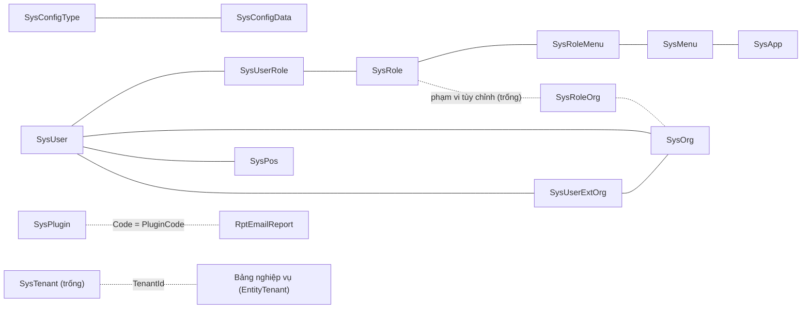

# 📊 Báo Cáo Các Bảng `Sys*` Trong CSDL Staging — Vai Trò Từng Bảng

> 📅 **Ngày đọc số liệu:** 15/10/2026 · **Nguồn số liệu:** `mssql_staging` (`10.10.8.30 / DEV_ITS10`), chỉ đọc (DAB `read_records`, `aggregate_records`) — đọc theo yêu cầu trực tiếp của người dùng.
> 📌 **Đối chiếu mã nguồn:** `Modules.CfgSystem.Core/Entities/`, `Shared.DTO/Enums/BaseEnums.cs`, `SqlValidator.cs`, module `Mail` (dùng `SysPlugin`), FE `api-services/system/`.

---

## 🧭 I. Tóm tắt

- Staging có **21 bảng `Sys*`** (khớp danh mục bảng của CSDL; không có bảng `Sys*` nào khác).
- Chia **4 nhóm**:

| Nhóm | Bảng | Việc chính |
|---|---|---|
| **A. Cấu hình hệ thống** | `SysConfig`, `SysConfigType`, `SysConfigData`, `SysOpConfig`, `SysTerminology`, `SysDictType`, `SysDictData` | Giao diện web, danh mục dùng chung, cấu hình vận hành từng phân hệ, bản dịch |
| **B. Tài khoản & phân quyền** | `SysUser`, `SysRole`, `SysUserRole`, `SysMenu`, `SysRoleMenu`, `SysRoleOrg`, `SysAccess` | Ai đăng nhập, có quyền gì, thấy menu nào |
| **C. Cơ cấu tổ chức** | `SysOrg`, `SysPos`, `SysUserExtOrg`, `SysTenant` | Đơn vị, chức vụ, kiêm nhiệm, đa thuê bao |
| **D. Ứng dụng, phân hệ, tệp** | `SysApp`, `SysPlugin`, `SysFile` | Ứng dụng con, nhóm phân hệ, tệp tải lên |

- **Bảng đang trống trên staging (0 dòng):** `SysDictType`, `SysDictData`, `SysRoleOrg`, `SysTenant` — tính năng có trong khung nhưng dự án chưa dùng.
- Các nhật ký thao tác (`SysOpLog`, `SysDiffLog`) **không** nằm trong CSDL này mà ở CSDL log riêng (`LogDefault`, xem [báo cáo 03](03-bao-cao-tong-the-entity-csdl-sharedata.md)).

### ✅ Quyết định cho ShareData: phân định bảng nghiệp vụ riêng và bảng cấu hình dùng chung

~~*Quyết định cũ (16/10/2026): dùng cả ba bảng cấu hình chung `SysConfigType/SysConfigData`, `SysTerminology`, `SysOpConfig` (nhóm `sharedata_tracker`), không tạo bảng cấu hình riêng.*~~

**Quyết định cập nhật (17/10/2026):**
- **Danh mục bảng nguồn chuyển sang bảng riêng `ShareDataSourceTable`:** Đây là quy tắc nghiệp vụ riêng của ShareData (quản lý bảng nguồn phục vụ Change Tracking và bộ dựng SQL Query Builder). Bảng không có giao diện người dùng; sửa trực tiếp bằng `.sql` để truy vết lỗi nhanh và kiểm soát chặt chẽ.
- **Mã lỗi ESH và bản dịch vẫn dùng bảng hệ thống chung:** `SysConfigType/SysConfigData` (25 mã `ESH-xxxx`) và `SysTerminology` (`lz.*`).
- **`SysOpConfig` nhóm `sharedata_config`:** Lưu 48 tham số vận hành và giới hạn cấu hình động (19 tham số Worker, 23 tham số FE, 6 tham số WebAPI), toàn bộ đều có giá trị mặc định dự phòng an toàn và khoảng an toàn tuyệt đối trong mã nguồn (khai tập trung tại `ShareDataConst.cs` thuộc `Module.ShareData.Core/Constants`, nạp qua `ShareDataConfigService` ở WebAPI và `DataWorkerConfigService` ở Worker).

| Bảng chung | Quyết định | Các phân hệ khác dùng thế nào (căn cứ mã nguồn) | ShareData dùng cho |
|---|---|---|---|
| `SysConfigType` / `SysConfigData` | **Giữ** | TMS, VideoWall, Toll, Mail đều dùng cùng cách: `tms_zone_type`, `vehicle_type`, `tms_incident_status`, `equipment_state`, `videowall_controller_color`, `videowall_event_source`, `toll_*`, `mail_trigger_type`… (khai ở seed `SysConfigTypeSeedData.cs` và enum FE `BaseConfigTypeEnum`) | Danh mục giá trị `sharedata_*`: `sharedata_error_code` (25 mã `ESH-xxxx`), `sharedata_direction`, `sharedata_session_state`… |
| `SysTerminology` | **Giữ, không đổi** | Toàn hệ thống dùng chung cho bản dịch `lz.*` | Nhãn, thông báo, lỗi đa ngôn ngữ của ShareData |
| `SysOpConfig` | **Giữ** | Cấu hình vận hành của từng phân hệ nằm trong bảng này theo `GroupCode`. Nhóm đang dùng trong mã: `cctv_config`, `cctv_public_equipment_ids`, `mail_config`, `noti_config`, `toll_config`, `vds_config`, `operation_config`, `tms_traffic_matrix` (thêm `media_config`, `wp_config`, `vms_config`… trên staging, bảng bên dưới) | Nhóm `sharedata_config`: 48 tham số vận hành và giới hạn (19 Worker, 23 FE, 6 WebAPI), nạp lại định kỳ |

**Vì sao chọn bảng riêng `ShareDataSourceTable` thay cho bảng chung `SysOpConfig` và `ShareDataTrackVersion` cũ:**
- Tách biệt rõ ràng quy tắc bảng nguồn của ShareData với các cấu hình vận hành dùng chung.
- Hỗ trợ linh hoạt cả hai công tắc nghiệp vụ `IsTracked` (bật/tắt giám sát Change Tracking) và `IsQueryable` (cho phép/chặn trích xuất SQL qua Visual Query Builder), kèm `DefaultAlias` (đã loại bỏ `Category`).
- Mỗi bảng nguồn giữ một mốc trạng thái độc lập (`LastVersion`, `LastChangeTime`, `LastIssue`), không phụ thuộc bảng chung, loại bỏ hoàn toàn rủi ro mất danh sách bảng khi đặt lại mốc.
- Chi tiết xem tại [báo cáo 03, mục IV.4](03-bao-cao-tong-the-entity-csdl-sharedata.md#4-danh-mục-bảng-nguồn--bảng-sharedatasourcetable).

**Điều cần biết khi dùng `SysOpConfig` cho phân hệ mới:**
- Khai nhóm trong `SysConfigData` loại `operation_config_type` thì màn hình *Cấu hình hoạt động* mới hiện nhóm (script `sharedata-seed-cau-hinh-*.sql` mục 4 đã khai nhóm `sharedata_config`). Thiếu dòng này, SQL và Worker vẫn chạy, chỉ màn hình không hiện tên nhóm.
- Độ dài cột trên staging (bản chụp `.dacpac` 14/10/2026): `SysOpConfig.Code` **64**, `Value` 256, `GroupCode` 64; validator cho phép `Code` đến 128 nên mã dài hơn 64 sẽ lỗi khi ghi.
- Staging còn cột `SysOpConfig.Lang` (16) mà entity không khai.

**Căn cứ và giới hạn của kết luận này:** MCP `mssql_dev` (DEV_ITS10 local) trả rỗng cho `SysConfigType` và `SysOpConfig`, nên không dùng để đếm. Kết luận dựa vào mã nguồn (hằng `GroupCode` trong các module, seed C# của CfgSystem, enum FE) và số liệu staging của báo cáo này. Tệp `.dacpac` chỉ có cấu trúc, không có dữ liệu.

### Cách đọc cột "Căn cứ"

| Ký hiệu | Nghĩa |
|---|---|
| ✅ Mã | Xác nhận từ entity/mã nguồn trong repo |
| 📌 DB | Xác nhận từ dữ liệu staging đọc được |
| ⚠️ Suy ra | Suy từ tên bảng chuẩn của khung Admin.NET hoặc từ vài dấu hiệu gián tiếp — **chưa có entity trong repo để xác nhận** |

> ⚠️ Các entity `SysUser`, `SysRole`, `SysMenu`, `SysOrg`, `SysPos`, `SysTenant`, `SysApp`, `SysPlugin`, `SysFile`, `SysAccess`… thuộc thư viện khung (không có mã nguồn trong repo), và DAB không trả danh sách cột. Vì vậy báo cáo chỉ nêu **vai trò**, không liệt kê cột của các bảng này.

---

## 🗂️ II. Chi tiết từng bảng

### A. Cấu hình hệ thống

| Bảng | Số dòng | Vai trò | Căn cứ |
|---|---:|---|---|
| `SysConfig` | 6 | Cấu hình **giao diện web**: tiêu đề, phụ đề, mô tả, watermark, bản quyền, logo. Mọi dòng thuộc nhóm `WebConfig` (mã `sys_web_title`, `sys_web_viceTitle`, `sys_web_viceDesc`, `sys_web_watermark`, `sys_web_copyright`, `sys_web_logo`) | 📌 DB |
| `SysConfigType` | 122 | **Loại danh mục** dùng chung (đầu của cặp loại–giá trị): `Code`, `Name`, `OrderNo`, `Remark`, `Status` | ✅ Mã |
| `SysConfigData` | 501 | **Giá trị của danh mục**: trỏ `ConfigTypeId → SysConfigType.ID`, có `Name`, `Value`, `OrderNo`, `Status`; thêm `TagType`, `StyleSetting`, `ClassSetting` để FE hiển thị nhãn có màu | ✅ Mã |
| `SysOpConfig` | 111 | **Cấu hình vận hành theo nhóm** của từng phân hệ (`GroupCode` + `Code` + `Value`, có `IsSysConfig`, `OrderNo`, `Remark`, `Status` 0/1). Service/Worker đọc theo `GroupCode` (mẫu CctvProxy: có nạp lại định kỳ, giữ bản cũ khi DB lỗi). Sửa trên màn hình *Cấu hình hoạt động* | ✅ Mã · 📌 DB |
| `SysTerminology` | 4.695 | **Bảng dịch thuật** đa ngôn ngữ: `Name` = tiền tố nhóm (`lz.label`, `lz.entity`…), `Code` = khóa sau tiền tố, `Value` = nội dung dịch, `Lang` (mặc định `vi-VN`) | ✅ Mã · 📌 DB |
| `SysDictType` | 0 | Loại từ điển của khung Admin.NET. **Trống**; FE có đoạn gọi `SysDictTypeApi` đã bị comment (`stores/userInfo.ts:128`), dự án dùng `SysConfigType/Data` thay thế | 📌 DB · ⚠️ Suy ra |
| `SysDictData` | 0 | Giá trị từ điển — như trên, **trống** | 📌 DB · ⚠️ Suy ra |

#### `SysOpConfig` — các nhóm cấu hình trên staging

| `GroupCode` | Số dòng | Phục vụ |
|---|---:|---|
| `media_config` | 23 | Media |
| `cctv_config` | 18 | CCTV |
| `mail_config` | 18 | Gửi mail |
| `toll_config` | 11 | Thu phí |
| `its_operation_config` | 10 | Vận hành ITS |
| `operation_config` | 9 | Vận hành chung |
| `vds_config` | 6 | VDS |
| `day_operation` | 4 | Vận hành theo ngày |
| `shift_operation` | 3 | Vận hành theo ca |
| `wp_config` | 3 | Cổng thông tin (WP) |
| `vms_config` | 2 | VMS |
| `tms_incident_action_group` | 2 | Nhóm hành động sự cố TMS |
| `tms_traffic_matrix` | 2 | Ma trận lưu lượng TMS |

📌 Nhóm `sharedata_tracker` (danh sách bảng theo dõi Change Tracking cũ của ShareData) đã được **bãi bỏ ngày 17/10/2026** và chuyển sang bảng riêng `ShareDataSourceTable` của ShareData. Nhóm cấu hình mới của ShareData trên `SysOpConfig` là `sharedata_config` (48 tham số vận hành và giới hạn).

#### `SysOpConfig` — cách cấu hình: API, giao diện, script

`SysOpConfig` có CRUD API đầy đủ trong code và một màn hình quản trị; script `.sql` chỉ dùng để nạp dữ liệu ban đầu hàng loạt.

| Lớp | Vị trí | Ghi chú |
|---|---|---|
| **API** (module CfgSystem) | [`SysOpConfigController.cs`](../../../../TA-ITS015-WEBAPI-V1.0/src/Modules/CfgSystem/Modules.CfgSystem/Controllers/OpConfig/SysOpConfigController.cs) | `POST Page`, `GET List`, `POST Single`, `POST Add`, `POST Update`, `POST Delete`, `POST BatchDelete`, `GET AllDataList` |
| **Kiểm tra dữ liệu** | [`OpConfigValidator.cs`](../../../../TA-ITS015-WEBAPI-V1.0/src/Modules/CfgSystem/Modules.CfgSystem/Controllers/OpConfig/Validators/OpConfigValidator.cs) | Bắt buộc khi thêm: `Name` (≤ 64), `GroupCode`, `Code` (≤ 128), `Status`; `Value` ≤ 256; `Remark` ≤ 1024; `OrderNo` ≥ 0 |
| **Giao diện** (WEBVUE) | [`views/cfgSystem/sysOpConfig/`](../../../../TA-ITS015-WEBVUE-V1.0/src/src/views/cfgSystem/sysOpConfig/index.vue) (danh sách + form `editOpConfig.vue`), gọi qua [`sys-op-config-api.ts`](../../../../TA-ITS015-WEBVUE-V1.0/src/src/api-services/cfgSystem/apis/sys-op-config-api.ts) | `App.vue` gọi `apiCfgsystemSysopconfigListGet` lúc khởi động để nạp biến dùng chung |
| **Service/Worker** | Đọc trực tiếp bảng theo `GroupCode` (mẫu `CctvOptionsLoader`), **không** đi qua API | Dòng thêm/sửa bằng màn hình hay bằng script đều có hiệu lực như nhau |
| **Script `.sql`** | Thư mục `sql/` của từng phân hệ | Nạp một lần cấu hình mặc định, chạy được trên nhiều môi trường; không phải kênh cấu hình duy nhất |

> 📌 Với ShareData: Danh mục bảng nguồn và mốc Change Tracking được cấu hình trực tiếp bằng SQL trên bảng riêng `ShareDataSourceTable` (không có giao diện, Worker nạp lại định kỳ theo tham số `reload_interval_sec` trong `SysOpConfig` nhóm `sharedata_config`, mặc định 30 giây, khoảng 5–3600; không còn chế độ 0). Màn hình *Cấu hình hoạt động* dùng để quản trị 48 tham số vận hành và giới hạn thuộc nhóm `sharedata_config` (script `sharedata-seed-cau-hinh-*.sql` mục 4 đã seed).

#### `SysTerminology` — phân bố theo nhóm `Name`

| `Name` (tiền tố) | Số dòng | Dùng cho |
|---|---:|---|
| `lz.label` | 2.210 | Nhãn hiển thị |
| `lz.entity` | 986 | Tên thực thể/trường |
| `lz.message` | 701 | Thông báo |
| `lz.exception` | 388 | Thông báo lỗi |
| `lz.validation` | 256 | Thông báo kiểm tra dữ liệu |
| `lz.button` | 118 | Nút bấm |
| `param` | 20 | Tham số |
| `lz._root`, `lz.router`, `lz.param`, `lz.ui` | 8 / 3 / 2 / 1 | Gốc, route, tham số, UI |
| `lz.validation...scheduleTimeRangeInvalid` (thừa tiền tố) | 2 | ⚠️ Bất thường — xem mục IV |

### B. Tài khoản & phân quyền

| Bảng | Số dòng | Vai trò | Căn cứ |
|---|---:|---|---|
| `SysUser` | 19 | **Tài khoản người dùng** đăng nhập hệ thống (gắn đơn vị, chức vụ) | ⚠️ Suy ra |
| `SysRole` | 14 | **Vai trò** — nhóm quyền gán cho người dùng; có phạm vi dữ liệu | ⚠️ Suy ra |
| `SysUserRole` | 64 | Gán **người dùng ↔ vai trò** (nhiều–nhiều) | ⚠️ Suy ra |
| `SysMenu` | 379 | **Cây menu** và các nút/quyền chức năng của FE | ⚠️ Suy ra |
| `SysRoleMenu` | 1.052 | Gán **vai trò ↔ menu/nút** — quyết định người dùng thấy và thao tác được gì | ⚠️ Suy ra |
| `SysRoleOrg` | 0 | Gán vai trò ↔ đơn vị khi phạm vi dữ liệu là "tùy chỉnh theo đơn vị". **Trống**: chưa dùng | 📌 DB · ⚠️ Suy ra |
| `SysAccess` | 79 | Có hằng `SysAccessTypeEnum.Jwt = "jwt"` (`BaseEnums.cs:590`) — nhiều khả năng lưu **phiên/token truy cập**. Chưa có entity để xác nhận | ⚠️ Suy ra |

### C. Cơ cấu tổ chức

| Bảng | Số dòng | Vai trò | Căn cứ |
|---|---:|---|---|
| `SysOrg` | 28 | **Cây đơn vị/tổ chức** | ⚠️ Suy ra |
| `SysPos` | 33 | **Chức vụ** | ⚠️ Suy ra |
| `SysUserExtOrg` | 4 | Người dùng **kiêm nhiệm** thêm đơn vị/chức vụ ngoài đơn vị chính | ⚠️ Suy ra |
| `SysTenant` | 0 | Danh sách **thuê bao** (đa thuê bao). **Trống**, nhưng entity nghiệp vụ vẫn kế thừa `EntityTenant` (cột `TenantId`) | 📌 DB · ✅ Mã |

### D. Ứng dụng, phân hệ, tệp

| Bảng | Số dòng | Vai trò | Căn cứ |
|---|---:|---|---|
| `SysApp` | 31 | **Ứng dụng con** (nhóm menu/quyền theo ứng dụng). Có API riêng (`sys-app-api.ts`), bộ nhớ đệm `sysApp`. Staging có mã `TMS`, `VMST`… lẫn dữ liệu thử | 📌 DB · ⚠️ Suy ra |
| `SysPlugin` | 17 | **Nhóm phân hệ/plugin** (tên như "Tích hợp VDS", "Tích hợp VMS", "FMS"). `Code` của bảng này được **module Mail dùng để gom báo cáo** (`RptEmailReport.PluginCode = SysPlugin.Code`, tên nhóm lấy từ `SysPlugin.Name`) | ✅ Mã · 📌 DB |
| `SysFile` | 89 | **Metadata tệp tải lên** (logo, ảnh, tài liệu đính kèm) | ⚠️ Suy ra |

---

## 🔗 III. Quan hệ chính

> Quan hệ của nhóm B, C và `SysApp ↔ SysMenu` là suy ra theo mô hình chuẩn của khung; riêng `SysConfigType → SysConfigData` và `SysPlugin → RptEmailReport` đã xác nhận từ mã.

---

## 🛡️ IV. Quan sát cần lưu ý

1. **Danh sách bảng bị chặn trong SQL trích xuất ShareData** (`SqlValidator.RestrictedTables`): `SysUser`, `SysUserRole`, `SysUserExtOrg`, `SysRole`, `SysRoleMenu`, `SysRoleOrg`, `SysTenant`, `SysConfig`, `SysConfigData`, `SysConfigType`, `SysOrg`, `ShareDataPartner`.
   - **Không nằm trong danh sách chặn:** `SysAccess`, `SysApp`, `SysFile`, `SysMenu`, `SysOpConfig`, `SysPlugin`, `SysPos`, `SysTerminology`, `SysDictType`, `SysDictData`.
   - ⚠️ `SysAccess` (có thể chứa token) và `SysOpConfig` (nhóm `mail_config`, 18 dòng, có thể có thông tin kết nối thư) là hai bảng nên được xem xét đưa vào danh sách chặn. **Chưa kiểm** nội dung nhạy cảm của hai bảng này — báo cáo không đọc giá trị `Value`/token.
2. **Dữ liệu thử lẫn trong staging:** `SysApp` có dòng tên/mã vô nghĩa (`t`/`qw`, `twewe`/`qweweew`…), `SysPlugin` có dòng `Plugin A`, `plugin`, một dòng tên trống và hai dòng cùng tên "Tích hợp VDS". Mã `SysPlugin.Code` được module Mail dùng, nên dòng trùng/rác có thể làm lệch cách gom báo cáo email.
3. **`SysTerminology` có 2 dòng `Name` bất thường:** `Name` bị gán nhầm cả chuỗi `lz.validation...scheduleTimeRangeInvalid` (thừa tiền tố phân hệ) thay vì tiền tố nhóm chuẩn (`lz.validation`). Cần đối chiếu cách khóa này được tra cứu.
4. **Bảng trống** (`SysDictType`, `SysDictData`, `SysRoleOrg`, `SysTenant`): giữ nguyên trong CSDL nhưng chưa có dữ liệu — không phải lỗi, chỉ cho biết tính năng chưa dùng.

---

## 🧪 V. Phương pháp và giới hạn

- Số dòng: `count(*)` từng bảng; phân bố nhóm: `groupby GroupCode` (`SysOpConfig`) và `groupby Name` (`SysTerminology`); tên danh mục: `read_records` chỉ các cột `Name`, `Code`, `Remark`.
- ⛔ Không đọc cột nhạy cảm (mật khẩu, token, `Value` của cấu hình kết nối). Chỉ truy vấn đọc, không ghi.
- Số liệu là **ảnh chụp tại thời điểm đọc**; số dòng có thể đổi khi người dùng thao tác.
- Vai trò đánh dấu ⚠️ cần được xác nhận bằng entity của thư viện khung hoặc người nắm hệ thống phân quyền trước khi dùng làm căn cứ thiết kế.
