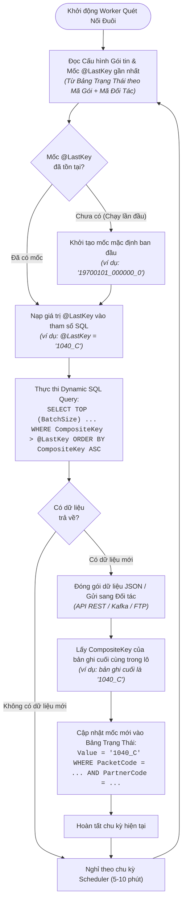

# 📐 Thiết Kế Kỹ Thuật: Khóa Nối Đuôi Kết Hợp (Composite @LastKey) — Phân Hệ ShareData

> 🔴 **NGUỒN GỐC TÀI LIỆU (PROVENANCE):**  
> - **Ảnh phác thảo viết tay gốc:** [`../_source/50d2fc5f676ae734be7b.jpg`](../_source/50d2fc5f676ae734be7b.jpg)  
> - **Phiên thảo luận kỹ thuật:** Cuộc họp rà soát kiến trúc ShareData ngày **26/10/2026** (trích đoạn `[20:00 – 25:00]` trong tệp ghi âm [`Sharedata_26_10.m4a`](../../../../DocBusinessThienAn/Sharedata_26_10.m4a)).  
> - **Người phác thảo & định hướng:** Tech Lead  
> - **Trạng thái:** Đã chốt kiến trúc (Approved Design).

---

## 🖼️ 1. Bản Ghi Nguyên Văn Phác Thảo Tay (Handwritten Transcript)

Dưới đây là chuyển thể 1:1 toàn bộ nội dung chữ viết, công thức và sơ đồ trên tờ giấy phác thảo [50d2fc5f676ae734be7b.jpg](../_source/50d2fc5f676ae734be7b.jpg):

```text
================================================================================
                                   @lastkey
================================================================================

    @lastkey   =   CONCAT ( . . . )
                         ↓
                   [ Key A ]  duy nhất

================================================================================
                           BẢNG TRẠNG THÁI LƯU VẾT
================================================================================
 gói tin    |    đối tác    |      key      |         Value
------------+---------------+---------------+-----------------------
 [Mã gói]   |  [Mã đối tác] |       x       |       1040_C
            |               |               |

================================================================================
                         LUỒNG DỮ LIỆU & LỌC NỐI ĐUÔI
================================================================================
 DL (Dữ liệu nguồn)
 |
 |   10:00    A        1000_A          SELECT ...
 |   10:30    B        1030_B
 |   10:40    C        1040_C  ======> WHERE [CompositeKey] > 1040_C
 |--------------------------- (Vạch cắt đợt quét 1)  ---------------------------
 |   10:40    C
 |   10:50    D
 |
```

---

## 🎯 2. Bài Toán Nghiệp Vụ & Vấn Đề Gốc Rễ (Problem Statement)

### 2.1. Hiện tượng Trùng Mốc Thời Gian (Timestamp Collision)
Trong phân hệ Chia sẻ Dữ liệu (**ShareData**), cơ chế gửi gói tin nối đuôi định kỳ (Scheduled Incremental Extraction) cần một biến mốc `@LastKey` (hoặc `@LastTime`) để chỉ trích xuất dữ liệu mới phát sinh kể từ lần quét trước:

* **Tình huống thực tế:** Nhiều sự kiện giao thông, bản tin camera hoặc trạng thái thiết bị có thể được ghi nhận vào cùng một phút hoặc cùng một giây trong CSDL (ví dụ tại mốc `10:40` có đồng thời 2 bản ghi mang mã `C1` và `C2`).
* **Bế tắc khi chỉ lọc theo một trường thời gian đơn thuần:**
  - Nếu dùng điều kiện nghiêm ngặt: `WHERE ThoiGian > @LastTime`  
    → Sau khi đợt quét 1 xử lý xong bản ghi `C1` ở mốc `10:40` và lưu mốc là `10:40`, đợt quét 2 dùng điều kiện `> 10:40` sẽ **bỏ sót hoàn toàn bản ghi `C2`** cũng mang mốc `10:40`.
  - Nếu nới lỏng điều kiện: `WHERE ThoiGian >= @LastTime`  
    → Đợt quét 2 sẽ **quét lặp lại toàn bộ các bản ghi `C1`** đã gửi ở đợt 1, dẫn đến trùng lặp dữ liệu phía đối tác nhận tin.

---

## 🛠️ 3. Giải Pháp Thiết Kế Kỹ Thuật (Architectural Solution)

### 3.1. Nguyên Lý Khóa Kết Hợp Độc Nhất (Composite Key Principle)
Thay vì sử dụng một trường đơn lẻ làm mốc nối đuôi, hệ thống chuyển sang sử dụng **Khóa Kết Hợp (Composite Key)** bằng cách ghép nối trường thời gian với một trường định danh duy nhất (Unique ID, Mã bản ghi, Khóa chính):

```text
CompositeKey = CONCAT(ThoiGianFormatted, '_', UniqueColumn)
```

* **Ví dụ cụ thể:**
  - Bản ghi 1: `10:00` và ID `A` → Khóa kết hợp: `'1000_A'`
  - Bản ghi 2: `10:30` và ID `B` → Khóa kết hợp: `'1030_B'`
  - Bản ghi 3: `10:40` và ID `C` → Khóa kết hợp: `'1040_C'`
  - Bản ghi 4: `10:40` và ID `C_next` → Khóa kết hợp: `'1040_C_next'`
  - Bản ghi 5: `10:50` và ID `D` → Khóa kết hợp: `'1050_D'`

### 3.2. Cơ Chế So Sánh Chuỗi Thứ Tự Từ Điển (Lexicographical Comparison)
Khi sắp xếp tăng dần (`ORDER BY CompositeKey ASC`):
* Chuỗi `'1040_C_next'` luôn lớn hơn chuỗi `'1040_C'`.
* Do đó, mệnh đề truy vấn cho chu kỳ quét kế tiếp:
  ```sql
  WHERE CONCAT(FORMAT(Z.ThoiGian, 'HHmm'), '_', Z.ID) > @LastKey
  ```
  *(với `@LastKey = '1040_C'*)*
* Kết quả: Đợt quét 2 sẽ lấy tiếp chính xác bản ghi `C_next` (cùng mốc `10:40`) và bản ghi `D` (mốc `10:50`), **triệt tiêu hoàn toàn cả 2 nguy cơ: không bỏ sót và không trùng lặp**.

---

## 🔄 4. Quy Trình Vận Hành Toàn Trình (Execution Flowchart)



---

## 🗄️ 5. Cấu Trúc Bảng Quản Lý Trạng Thái Khóa (State Tracking Schema)

Bảng trạng thái lưu vết mốc quét nối đuôi được quản lý theo bộ 3 định danh:

| Tên Cột | Kiểu Dữ Liệu | Ràng Buộc | Ý Nghĩa Nghiệp Vụ | Ví Dụ Dữ Liệu |
| :--- | :--- | :--- | :--- | :--- |
| `PacketCode` | `NVARCHAR(64)` | PK, Not Null | Mã gói tin dữ liệu chia sẻ | `'PKT_TRAFFIC_FLOW'` |
| `PartnerCode` | `NVARCHAR(64)` | PK, Not Null | Mã đối tác liên kết nhận tin | `'CSGT_DONG_DANG'` |
| `KeyParam` | `NVARCHAR(64)` | PK, Not Null | Tên biến tham số nối đuôi | `'@LastKey'` |
| `KeyValue` | `NVARCHAR(256)`| Not Null | Giá trị mốc nối đuôi hiện tại | `'1040_C'` |
| `LastUpdated`| `DATETIME2` | Not Null | Thời điểm cập nhật mốc gần nhất | `2026-10-26 10:45:00` |

---

## 💻 6. Mẫu Cấu Hình Truy Vấn Thực Tế (SQL Query Reference)

```sql
-- Ví dụ câu truy vấn gói tin hỗ trợ Composite @LastKey
SELECT TOP (100)
    Z.ID,
    Z.ThoiGian,
    Z.TocDoTrungBinh,
    Z.LuuLuongXe,
    CONCAT(FORMAT(Z.ThoiGian, 'yyyyMMdd_HHmmss'), '_', CAST(Z.ID AS NVARCHAR(64))) AS CompositeKey
FROM dbo.GiamSatGiaoThong Z
WHERE CONCAT(FORMAT(Z.ThoiGian, 'yyyyMMdd_HHmmss'), '_', CAST(Z.ID AS NVARCHAR(64))) > @LastKey
ORDER BY CompositeKey ASC;
```

---

## 📌 7. Kết Luận & Khuyến Nghị Áp Dụng Cho Dev

1. **Phương Án Xử Lý Động:** Ưu tiên cơ chế định nghĩa cột `CompositeKey` ngay trong câu truy vấn Dynamic SQL của gói tin để tận dụng tối đa chỉ mục và tối ưu hiệu năng lọc của SQL Server.
2. **Chiều Nhận Dữ Liệu (Inbound):** Chiều nhận không phụ thuộc vào `@LastKey`, chỉ cần kiểm tra chống trùng lặp (`Check Duplicate`) dựa trên `Unique ID / Message ID` nhận được trước khi thực hiện ghi CSDL qua câu lệnh `Write SQL`.
