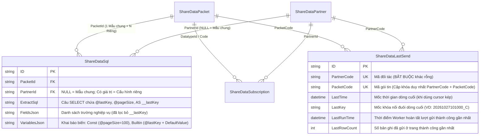
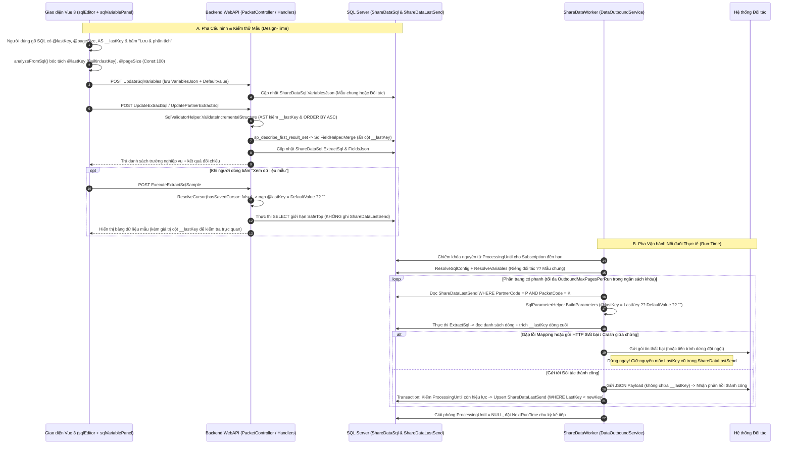

# Thiết Kế Cơ Chế Nối Đuôi (`@lastKey` / `__lastKey`) & Luồng Xử Lý Toàn Trình UI + BE + WORKER

> **Tài liệu đặc tả kỹ thuật chuyên sâu (End-to-End Architecture Specification)** tổng hợp từ 2 phiên rà soát kiến trúc ngày **26/10/2026** và **27/10/2026**, hai bản phác thảo tay gốc [`50d2fc5f676ae734be7b.jpg`](../_source/50d2fc5f676ae734be7b.jpg) và [`b7af82ba478cc7d29e9d.jpg`](../_source/b7af82ba478cc7d29e9d.jpg), đối chiếu trực tiếp với mã nguồn thực thi tại cả 3 tầng **UI (Vue 3)**, **BE (WebAPI)** và **WORKER (ShareDataWorker)**.

---

## 1. Bài Toán Nghiệp Vụ & Giải Mã Hai Bản Vẽ Kỹ Thuật

### 1.1. Hiện tượng trùng mốc thời gian & Vạch cắt nối đuôi (`50d2fc5f676ae734be7b.jpg`)

Trong chiều **Gửi dữ liệu (Outbound)**, các gói tin sự kiện, lưu lượng xe, nhận dạng biển số hoặc trạng thái thiết bị phát sinh liên tục theo thời gian. Khi trích xuất theo lô định kỳ (ví dụ mỗi 5–10 phút hoặc `TOP (@pageSize)` dòng), nhiều bản ghi thường có **cùng một mốc thời gian** (cùng phút, cùng giây hoặc cùng mili-giây):

```text
[Trích bản vẽ 50d2fc5f676ae734be7b.jpg — Nguyên lý @lastKey & Vạch cắt nối đuôi]

   @lastkey = CONCAT( ... )  --->  [ Key A ] duy nhất

   DL nguồn:
     10:00   A    1000_A
     10:30   B    1030_B          SELECT ... WHERE [CompositeKey] > '1040_C'
     10:40   C    1040_C   <===== Bản ghi cuối của Đợt quét 1
   ---------------------------- (Vạch cắt Đợt quét 1) ----------------------------
     10:40   C_2  1040_C_2 <===== Cùng mốc 10:40 nhưng chưa nằm trong Đợt 1
     10:50   D    1050_D
```

* **Bế tắc nếu chỉ lọc trên cột thời gian đơn lẻ:**
  * Dùng toán tử nghiêm ngặt `WHERE ThoiGian > @lastTime`: Đợt 1 dừng ở `10:40` (dòng `C`), Đợt 2 lọc `> 10:40` sẽ **bỏ sót vĩnh viễn** dòng `C_2` cùng mốc `10:40`.
  * Dùng toán tử nới lỏng `WHERE ThoiGian >= @lastTime`: Đợt 2 sẽ **quét lặp lại** dòng `C` đã gửi; nếu tại cùng một mốc `10:40` có số bản ghi lớn hơn hoặc bằng `@pageSize`, Worker sẽ kẹt cứng tại mốc `10:40` mãi mãi.
* **Giải pháp Khóa Kết Hợp Độc Nhất (Composite Cursor):**
  * Ghép chuỗi thời gian (định dạng cố định từ lớn đến nhỏ) với định danh duy nhất của bản ghi (`ID` / `Code`) để tạo ra một khóa đơn điệu tăng dần và **duy nhất trên từng dòng**:
    $$\text{CompositeKey} = \text{CONCAT}(\text{FormattedTime}, \text{'\_'}, \text{UniqueId})$$
  * Mệnh đề lọc luôn dùng toán tử **lớn hơn nghiêm ngặt (`>`)**: `WHERE CompositeKey > @lastKey`. Vì `'1040_C_2' > '1040_C'`, Đợt 2 lấy tiếp chính xác từ `C_2` trở đi — **không bỏ sót và không gửi trùng**.

---

### 1.2. Hai phương án sinh khóa, quy tắc `WHERE + ORDER BY` & lưu trữ (`b7af82ba478cc7d29e9d.jpg`)

Bản vẽ kỹ thuật thứ hai [`b7af82ba478cc7d29e9d.jpg`](../_source/b7af82ba478cc7d29e9d.jpg) đặt lên bàn cân hai kiến trúc tạo khóa `DetectKey`, ràng buộc sắp xếp và mô hình lưu vết theo đối tác:

```text
[Trích bản vẽ b7af82ba478cc7d29e9d.jpg — DetectKey, ORDER BY, Cô lập Đối tác & Crash]

  1) Nối chuỗi dưới SQL ("To order by" — vừa WHERE vừa ORDER BY):
     +------+-------+---------------------+
     | Code | Time  | DetectKey (__lastKey)|
     +------+-------+---------------------+
     |  A   | 10:00 | 1000_A              |
     |  C   | 10:10 | 1010_C (dòng cuối)  | ---> Đẩy sang Worker lưu sau khi gửi xong
     |  E   | 11:00 | 1100_E              |
     +------+-------+---------------------+

  2) Sinh khóa trên C# hoặc truy vấn phụ:
     dl.Time.ToString("HHmm") + "_" + dl.Code  (hoặc SELECT ... WHERE ID = 123)

  3) Bảng lưu trữ theo Đối tác & Phân tách Tham số:
     +--------+---------+-----------+---------+
     | Mã gói | Đối tác |    Key    |  Value  |
     +--------+---------+-----------+---------+
     |  101   |    A    | DetectKey | 1010_C  | ---> Động: tăng dần theo từng lô thành công
     |  101   |    A    | PageSize  |   100   | ---> Tĩnh: giá trị cấu hình cố định
     +--------+---------+-----------+---------+
     * Khi xử lý bị Crash giữa chừng: giữ nguyên mốc cũ, CHỈ lưu Value mới khi gửi xong!
```

| Tiêu chí đối chiếu | Phương án 1: Ghép khóa ngay trong SQL (`AS __lastKey`) — **ĐÃ CHỐT ÁP DỤNG** | Phương án 2: Ghép khóa trong C# Worker (`Time.ToString(...) + Code`) |
| :--- | :--- | :--- |
| **Cách thức hoạt động** | Câu SQL tự chiếu cột hệ thống `CONCAT(...) AS __lastKey`, lọc `WHERE ... > @lastKey` và sắp xếp `ORDER BY __lastKey ASC`. | Câu SQL trả các cột thô; C# đọc công thức cấu hình để tự ghép chuỗi từ dòng cuối. |
| **Độ trong suốt của Worker** | **Tuyệt đối trong suốt:** Worker không cần biết cấu trúc bảng nguồn hay công thức ghép; chỉ đọc cột `__lastKey` của dòng cuối cùng. | Phức tạp: Phải thiết kế ngôn ngữ biểu thức trên UI/DB để lưu công thức ghép và đồng bộ định dạng giữa C# và SQL. |
| **Tính nhất quán thứ tự (`ORDER BY`)** | **Đảm bảo bằng AST Validator:** Thứ tự so sánh trong `WHERE` và `ORDER BY` dùng chung một hệ quy chiếu Collation của SQL Server. | Rủi ro lệch thứ tự so sánh chuỗi giữa `.NET String.Compare` và `SQL Server Collation`. |
| **Chi phí hiệu năng & Khắc phục** | Tốn CPU/IO ghép chuỗi trên tập dòng quét nếu chỉ dùng `@lastKey` trần trên bảng hàng chục triệu dòng. **Khắc phục:** Hệ thống hỗ trợ song song **Cursor đơn (`@lastKey` / `__lastKey`)** và **Cursor kép (`@lastTime` + `@lastKey` / `__lastTime` + `__lastKey`)** để tận dụng Index `B-Tree` trên cột thời gian gốc khi bảng cực lớn. | Tận dụng trực tiếp Index cột lẻ trên SQL nhưng phát sinh chi phí ép kiểu và quản trị công thức ở tầng ứng dụng. |

> [!IMPORTANT]
> **Quy tắc kép bắt buộc ("Vừa `WHERE`, vừa `ORDER BY`"):**
> Khóa nối đuôi không bao giờ do người dùng tự gõ tay giá trị đang chạy, mà do Worker tự động trích xuất từ **dòng cuối cùng** của tập kết quả trả về. Muốn dòng cuối cùng luôn mang khóa lớn nhất trong lô, biểu thức khóa nối đuôi **bắt buộc phải xuất hiện đồng thời ở cả 3 vị trí**:
> 1. Mệnh đề chiếu: `SELECT ..., <BiểuThứcKhóa> AS __lastKey`
> 2. Mệnh đề lọc: `WHERE <BiểuThứcKhóa> > @lastKey`
> 3. Mệnh đề sắp xếp tăng dần: `ORDER BY __lastKey ASC` *(tuyệt đối cấm `DESC`)*.

---

## 2. Kiến Trúc Lưu Trữ Dữ Liệu & Nguyên Tắc Cô Lập Đối Tác

Để hiện thực hóa bảng *"Tên khóa lưu trữ"* trên bản vẽ `b7af82ba478cc7d29e9d.jpg` mà không làm bẩn cấu hình câu truy vấn mẫu mỗi khi Worker chạy, hệ thống **tách bạch hoàn toàn Cấu hình Tham số (Design-time) và Trạng thái Con trỏ (Runtime)** thành 2 bảng CSDL độc lập:



### 2.1. Phân loại 2 nhóm tham số trong `ShareDataSql.VariablesJson`

Mỗi phần tử `SqlVariableItem` trong mảng JSON `VariablesJson` đại diện cho một biến `@tên` xuất hiện trong câu SQL:

| Nhóm tham số | `ValueKind` & `Value` | Vai trò & Vòng đời | Lưu ở đâu? | Ví dụ thực tế |
| :--- | :--- | :--- | :--- | :--- |
| **Tham số cố định (Static)** | `ValueKind = "Const"`, `Value = "100"` | Cố định theo cấu hình của gói tin hoặc đối tác (như kích thước trang, ngưỡng lọc mã trạm). Worker chỉ đọc, không bao giờ ghi đè. | `ShareDataSql.VariablesJson` | `@pageSize = 100` (`int`) |
| **Tham số thời điểm chạy** | `ValueKind = "Builtin"`, `Value = "now"` | Tự động lấy giờ máy chủ tại thời điểm thực thi câu truy vấn. | Không lưu trạng thái (tính động lúc chạy) | `@now` (`datetime`) |
| **Tham số nối đuôi (Stateful Cursor)** | `ValueKind = "Builtin"`, `Value = "lastKey"` *(hoặc `"lastTime"`)* | Biến đổi liên tục sau mỗi trang gửi thành công: Lần đầu chưa có mốc thì nạp `DefaultValue` (Mốc bắt đầu); từ lần thứ 2 trở đi nạp `LastKey` từ lần gửi trước. | Khai báo & `DefaultValue` ở `ShareDataSql.VariablesJson`; **Mốc chạy thực tế (`LastKey`) ở `ShareDataLastSend`** | `@lastKey`: lần 1 `""` → sau trang 1 lưu `"1010_C"` → sau trang 2 lưu `"1100_E"` |

### 2.2. Quy tắc bất biến: Mẫu chung KHÔNG BAO GIỜ lưu mốc chạy

Giả sử **Gói tin 101** có câu SQL mẫu chung (`ShareDataSql` với `PartnerId = NULL`), và có 2 đối tác **A** và **B** cùng đăng ký nhận gói 101 mà không tạo cấu hình SQL riêng:
* Nếu lưu mốc `LastKey` vào dòng mẫu chung: Đối tác A chạy lúc `10:10` ghi mốc `1010_C`; Đối tác B mới kết nối lúc `10:15` đọc nhầm mốc `1010_C` của A → **Đối tác B bị nhảy cóc và mất toàn bộ dữ liệu trước `10:10`**. Ngược lại, nếu B reset mốc về `08:00`, A chạy chu kỳ kế tiếp sẽ gửi lặp lại dữ liệu từ `08:00`.
* **Cơ chế chuẩn của hệ thống (Shared SQL, Isolated Cursor):**
  * Câu SQL và danh sách khai báo biến được **kế thừa từ mẫu chung** (`PartnerId = NULL`) khi đối tác chưa tách cấu hình riêng.
  * Mốc `LastKey` trong `ShareDataLastSend` **luôn luôn khóa cứng theo cặp `(PartnerCode, PacketCode)`**:
    * `(PartnerCode = 'DOI_TAC_A', PacketCode = '101_vmsData')` → `LastKey = '20261027101000_C'`
    * `(PartnerCode = 'DOI_TAC_B', PacketCode = '101_vmsData')` → `LastKey = '20261027080000_A'`
  * Nhờ đó, N đối tác dùng chung 1 câu SQL mẫu vẫn vận hành trên **N con trỏ tiến độ độc lập tuyệt đối**. Khi một đối tác bấm *"Tạo cấu hình mới"* để tách câu SQL riêng (`PartnerId = <ID>`), con trỏ `ShareDataLastSend` hiện hữu của đối tác đó vẫn giữ nguyên liền mạch (hoặc người quản trị chủ động bấm *"Đặt lại"* nếu đổi cấu trúc khóa).

---

## 3. Luồng Xử Lý Toàn Trình: UI → BE WebAPI → ShareDataWorker

### 3.1. Sơ đồ luồng tổng thể 4 giai đoạn (`flowchart TD`)

Quy trình khép kín tuân thủ đúng khung 4 giai đoạn: **(1) Khởi tạo & Cấu hình trên UI → (2) Thẩm định AST & Lưu tại BE → (3) Thu thập & Phân trang tại Worker → (4) Ánh xạ, Xuất dữ liệu & Commit Mốc nguyên tử**.

```mermaid
flowchart TD
    subgraph G1["GIAI ĐOẠN 1: KHỞI TẠO & CẤU HÌNH TRÊN GIAO DIỆN (UI VUE 3)"]
        U1(["SuperAdmin mở tab Nguồn dữ liệu (Chiều Gửi)"]) --> U2("Chọn Mẫu chung hoặc Đối tác (Tạo cấu hình mới nếu cần)")
        U2 --> U3("Soạn câu SQL có SELECT ... AS __lastKey, WHERE ... > @lastKey, ORDER BY __lastKey ASC")
        U3 --> U4("Bấm 'Lưu & phân tích': UI quét token @biến từ SQL xuống Bảng Tham số")
        U4 --> U5("Tự gán @lastKey -> Builtin:lastKey, @pageSize -> Const:100; nhập Mốc bắt đầu (tùy chọn)")
        U5 --> U6("Tag kiểm nhanh trên UI xác nhận câu SQL đã có AS __lastKey & ORDER BY __lastKey ASC")
    end

    subgraph G2["GIAI ĐOẠN 2: THẨM ĐỊNH AST, DÒ CỘT & LƯU CẤU HÌNH (BE WEBAPI)"]
        U6 --> B1("UI lưu Bảng Tham số trước (UpdateSqlVariables) rồi lưu Câu SQL (UpdateExtractSql)")
        B1 --> B2{"SqlValidatorHelper kiểm tra AST (TSql160Parser)"}
        B2 -- "Vi phạm: thiếu __lastKey, thiếu ORDER BY hoặc dùng DESC" --> BErr("Trả mã lỗi kèm tọa độ Dòng/Cột để Monaco Editor gạch đỏ")
        BErr --> U3
        B2 -- "Hợp lệ" --> B3("Dò cột qua dm_exec_describe_first_result_set & lọc bỏ cột hệ thống '__*'")
        B3 --> B4("Lưu ExtractSql, FieldsJson, VariablesJson vào bảng ShareDataSql")
    end

    subgraph G3["GIAI ĐOẠN 3: THU THẬP & TRÍCH XUẤT NỐI ĐUÔI (SHAREDATA WORKER)"]
        B4 --> W1(["Đến lịch gửi hoặc nhận tín hiệu NATS có dữ liệu mới"])
        W1 --> W2("Chiếm khóa phân tán nguyên tử Subscription.ProcessingUntil")
        W2 --> W3("Phân giải SQL & Biến hiệu lực (Ưu tiên Riêng đối tác -> fallback Mẫu chung)")
        W3 --> W4("Đọc ShareDataLastSend theo cặp riêng (PartnerCode, PacketCode)")
        W4 --> W5{"Đã có bản ghi ShareDataLastSend?"}
        W5 -- "Chưa có (Lần gửi đầu / vừa Reset)" --> W6("Nạp @lastKey = variable.DefaultValue ?? chuỗi rỗng")
        W5 -- "Đã có mốc" --> W7("Nạp @lastKey = lastSend.LastKey")
        W6 --> W8("Thực thi Dynamic SQL & quét ngược lấy giá trị cột __lastKey ở dòng cuối cùng")
        W7 --> W8
    end

    subgraph G4["GIAI ĐOẠN 4: ÁNH XẠ, VẬN CHUYỂN & COMMIT MỐC NGUYÊN TỬ"]
        W8 --> M1{"Có bản ghi trả về?"}
        M1 -- "0 dòng" --> MEmpty("Ghi nhận lượt quét rỗng, giải phóng khóa ProcessingUntil")
        M1 -- "Có dữ liệu (> 0 dòng)" --> M2("DataMappingProcess dựng JSON theo TargetShapeJson (bỏ qua __lastKey)")
        M2 --> M3("DataOutboundTransport đẩy gói tin sang Đối tác (HTTP API / Kafka / FTP)")
        M3 --> M4{"Gửi thành công?"}
        M4 -- "Thất bại / Crash / Timeout" --> MFail("KHÔNG cập nhật ShareDataLastSend (Giữ nguyên mốc cũ để quét lại)")
        M4 -- "Thành công (HTTP 2xx)" --> M5("Transaction CommitSuccess: kiểm còn giữ khóa ProcessingUntil & LastKey mới > cũ")
        M5 --> M6("Ghi mốc LastKey mới vào ShareDataLastSend")
        M6 --> M7{"SQL có TOP/OFFSET, đầy trang, mốc có tiến & còn ngân sách khóa?"}
        M7 -- "Còn trang tiếp & dưới ngưỡng OutboundMaxPagesPerRun" --> W4
        M7 -- "Hết dữ liệu hoặc hết ngân sách khóa" --> MEnd(["Hoàn tất chu kỳ & Giải phóng khóa"])
    end
```



### 3.2. Tuần tự tương tác chi tiết giữa các thành phần (`sequenceDiagram`)



---

### 3.3. Chi tiết xử lý tại từng phân tầng kỹ thuật

#### Tầng 1 — Giao diện Cấu hình & Quản trị Mốc (`sqlEditor.vue`, `sqlVariablePanel.vue`)

1. **Tự động phân tích biến khi bấm *"Lưu & phân tích"* (`analyzeFromSql`):**
   * Bộ quét biểu thức chính quy `SQL_TOKEN_RE` loại bỏ toàn bộ comment (`-- ...`, `/* ... */`), chuỗi ký tự `N'...'`, tên cột bọc `[...]` và biến hệ thống SQL `@@ROWCOUNT`, chỉ trích xuất đúng danh sách tham số `@tên` người dùng viết trong câu SQL.
   * Cơ chế nhận diện thông minh (`buildDetectedRow`):
     * Biến trùng tên `@lastKey` → tự động gán nguồn **`Lần trước (theo cột __lastKey)`** (`ValueKind = "Builtin"`, `Value = "lastKey"`, kiểu `string`).
     * Biến trùng tên `@pageSize` → tự động gán nguồn **`Giá trị nhập`** (`ValueKind = "Const"`, `Value = "100"`, kiểu `int`).
     * Các biến `@khác` → thêm dòng mới và yêu cầu người dùng chọn nguồn trước khi lưu.
   * **Thứ tự lưu hai pha chống lỗi gà-trứng:** Khi bấm *"Lưu & phân tích"*, `sqlEditor.vue` luôn gọi `variablePanelRef.saveIfDirty()` để lưu bảng biến lên CSDL **trước**, sau đó mới gọi API lưu câu SQL. Nhờ vậy BE không bao giờ báo lỗi *"Biến `@lastKey` chưa được khai báo"* khi vừa viết câu SQL mới.

2. **Kiểm tra nhanh tại chỗ & Cấu hình Mốc bắt đầu (`defaultValue`):**
   * Khi bảng biến có dòng nguồn `lastKey`, thanh tiêu đề của `sqlVariablePanel.vue` hiển thị tag kiểm tra trực tiếp (`hasValidLastKeySql`):
     * **Tag xanh (Hợp lệ):** Câu SQL đã có `AS __lastKey` và `ORDER BY __lastKey` (không có `DESC`).
     * **Tag cảnh báo vàng:** Nhắc ngay người cấu hình bổ sung `AS __lastKey` và `ORDER BY __lastKey ASC` trước khi lưu.
   * Bên dưới dòng biến `lastKey` xuất hiện ô nhập phụ **Mốc bắt đầu (`defaultValue`)**: Dùng cho lần gửi đầu tiên khi đối tác chưa có bản ghi trong `ShareDataLastSend` (ví dụ chỉ muốn lấy dữ liệu từ `'20261028000000_'` trở đi thay vì quét từ đầu bảng lịch sử).

3. **Phân tách rạch ròi giao diện Mẫu chung và Đối tác (theo chốt kiến trúc 27/10/2026):**

   | Ngữ cảnh đang mở | Hành vi hiển thị Mốc đang chạy (`SavedValue`) | Chức năng Đối chiếu & Thao tác trên Mốc |
   | :--- | :--- | :--- |
   | **Tab Mẫu chung** (`partnerId == null`) | **Ẩn hoàn toàn cột *"Mốc đang chạy"*** trên bảng tham số (vì mẫu chung không có mốc chạy riêng). | Cung cấp nút bấm trên thanh tiêu đề **"Xem mốc đang chạy (N đối tác)"** mở ngăn kéo (`svp-partner-cursor-drawer`). Ngăn kéo liệt kê từng đối tác đăng ký gói, nhãn nguồn đang dùng (`Mẫu chung` hay `Cấu hình riêng`), giá trị `LastKey` hiện tại của từng đối tác, và nút **`↺ Đặt lại`** độc lập cho từng dòng đối tác. |
   | **Tab Đối tác** (`partnerId != null`) | **Hiển thị trực tiếp cột *"Mốc đang chạy"*** của đúng đối tác đang chọn (ví dụ `20261027101000_C` hoặc *Chưa có mốc*). | Hiển thị thêm cột **"So với mẫu"** (`=` giống mẫu, `+` biến mới, `-` biến thiếu so với mẫu, `≠` khác nguồn/giá trị hằng/mốc bắt đầu) và nút **`↺ Đặt lại`** ngay cạnh mốc đang chạy của đối tác đó. Nếu đối tác đang kế thừa mẫu chung, khung soạn thảo khóa chỉ đọc cho đến khi bấm **"Tạo cấu hình mới"** (kế thừa từ mẫu chung hoặc sao chép từ đối tác khác). |

---

#### Tầng 2 — Backend WebAPI: Kiểm tra AST, Ẩn Cột Kỹ Thuật & Quản trị Mốc (`Module.ShareData`)

1. **Tự động suy luận chế độ Nối đuôi (`SqlValidatorHelper.IsIncrementalSql`):**
   * Hệ thống không bắt người dùng bật tay một công tắc rời rạc dễ quên. `SqlValidatorHelper.IsIncrementalSql(sql, variables.CursorNames)` phân tích cây cú pháp T-SQL: hễ câu truy vấn có tham chiếu đến bất kỳ biến nào mang nguồn con trỏ (`lastKey` / `lastTime` trong `SqlVariableSet.CursorNames`) thì câu SQL đó tự động được xác định là **Truy vấn Nối đuôi (Incremental)** và phải vượt qua bộ luật kiểm định con trỏ.

2. **Luật kiểm định cây cú pháp AST (`SqlValidatorHelper.ValidateIncrementalStructure`):**
   Sử dụng `TSql160Parser` (`Microsoft.SqlServer.TransactSql.ScriptDom`) bóc tách `QuerySpecification` ngoài cùng của câu `SELECT`:
   * **Luật 1 — Ràng buộc an toàn nền:** Chỉ cho phép duy nhất 1 câu `SELECT` đọc dữ liệu; chặn mọi câu lệnh ghi/DDL, thủ tục hệ thống, bảng ngoài danh mục `ShareDataSourceTable`, và chặn mọi biến `@...` chưa khai báo trong `VariablesJson`.
   * **Luật 2 — Bắt buộc có `ORDER BY` ngoài cùng & Cấm `DESC`:** Truy vấn nối đuôi không có `ORDER BY` bị từ chối ngay (`IncrementalMissingOrderBy`). Cột mốc sắp xếp giảm dần (`SortOrder.Descending`) bị từ chối ngay (`IncrementalOrderByDescForbidden`) vì lấy dòng cuối của tập giảm dần sẽ làm lùi con trỏ về quá khứ.
   * **Luật 3 — Đối chiếu khớp cột chiếu & khóa sắp xếp:**
     * *Chế độ khóa đơn `@lastKey` (phổ biến nhất):* Danh sách `SELECT` bắt buộc có cột mang alias `__lastKey` (`IncrementalMissingCursorKeyColumn`). Phần tử đầu tiên của `ORDER BY` bắt buộc là `__lastKey` hoặc lặp lại chính xác biểu thức AST tạo nên `__lastKey` (`OrderElementMatchesSelectColumn` chuẩn hóa không phân biệt hoa thường/khoảng trắng/ngoặc vuông).
     * *Chế độ khóa kép `@lastTime` + `@lastKey` (cho bảng cực lớn):* Danh sách `SELECT` bắt buộc có đủ 2 cột `__lastTime` và `__lastKey`; `ORDER BY` bắt buộc mở đầu đúng thứ tự `__lastTime ASC, __lastKey ASC`.
   * Khi phát hiện vi phạm, `SqlValidatorHelper.TryLocateError` định vị chính xác `(Line, Column)` của token lỗi để trả về cho Monaco Editor trên UI gạch chân đỏ ngay dòng sai.

3. **Tự động ẩn cột kỹ thuật `__lastKey` khỏi danh sách trường nghiệp vụ (`SqlFieldHelper`):**
   * Sau khi câu SQL vượt qua kiểm tra AST, BE gọi `sys.dm_exec_describe_first_result_set` để lấy danh sách cột thật từ SQL Server.
   * `SqlFieldHelper.IsSystemColumn(name)` đánh dấu mọi cột bắt đầu bằng hai dấu gạch dưới (`__lastKey`, `__lastTime`) là **cột hệ thống**. `SqlFieldHelper.Merge` loại bỏ hoàn toàn các cột này trước khi lưu vào `ShareDataSql.FieldsJson`.
   * Hệ quả thiết kế rất sạch: Người làm cấu hình Ánh xạ gói tin (`ShareDataMapping`) chỉ nhìn thấy các trường dữ liệu nghiệp vụ thuần túy, không bao giờ nhìn thấy hay vô tình ánh xạ nhầm cột `__lastKey` ra bản tin gửi đối tác.

4. **Các API phục vụ vòng đời cấu hình và quản trị con trỏ (`ShareDataPacketController`):**
   * `GET GetSqlVariables(packetCode, partnerId?)`: Gọi `PacketSqlService.LoadItems` — nếu truyền `partnerId`, BE tra thêm bảng `ShareDataLastSend` theo `(partner.Code, packet.Code)` để đính kèm `SavedValue = lastSend?.LastKey` vào đúng dòng biến `lastKey`.
   * `POST ExecuteExtractSqlSample`: Chạy thử câu SQL đang soạn với giới hạn dòng an toàn `SafeTop`. BE chủ động gọi `SqlParameterHelper.ResolveCursor(hasSavedCursor: false, null)` để mô phỏng lượt chạy đầu tiên (`@lastKey = DefaultValue ?? ""`), tuyệt đối **không đọc hay ghi đè** mốc đang chạy thật của đối tác.
   * `POST ResetLastSend(packetCode, partnerId)`: Chỉ dành cho `SuperAdmin`; tìm và xóa bản ghi `ShareDataLastSend` của cặp `(partner.Code, packet.Code)` đồng thời ghi vết kiểm toán `_activityLogger.LogDeleteAsync(row)`. Lượt quét kế tiếp của Worker sẽ tự động quay về trạng thái khởi tạo từ `DefaultValue`.

---

#### Tầng 3 — Dịch Vụ Nền: Thực Thi, Phân Trang Có Phanh & Chống Crash (`ShareDataWorker`)

Toàn bộ luồng gửi nền tại [`DataOutboundService.cs`](../../../../TA-ITS015-WEBAPI-V1.0/src/Services/ShareData/ShareDataWorker/Infrastructure/Services/DataOutbound/DataOutboundService.cs) và [`DataOutboundExtractionProcess.cs`](../../../../TA-ITS015-WEBAPI-V1.0/src/Services/ShareData/ShareDataWorker/Infrastructure/Services/DataOutbound/Extraction/DataOutboundExtractionProcess.cs) được thiết kế để chịu tải đa tiến trình (Multi-Worker) và chịu lỗi sập nguồn (Crash-Safe):

1. **Chiếm khóa phân tán & Phân giải cấu hình kết hợp con trỏ độc lập:**
   * Mỗi `ShareDataSubscription` đến hạn được Worker chiếm quyền xử lý bằng câu `UPDATE ... SET ProcessingUntil = @lockUntil WHERE ID = @id AND (ProcessingUntil IS NULL OR ProcessingUntil < @now)`. Hai tiến trình Worker chạy song song không bao giờ quét trùng cùng một đăng ký của đối tác.
   * `SqlTextHelper.ResolveSqlConfig` và `ResolveVariables` lấy câu SQL + bộ biến hiệu lực: nếu đối tác có cấu hình riêng (`IsCustom == true`) thì dùng bản riêng; nếu không thì dùng bản mẫu chung.
   * Ngược lại, `GetLastSend(db, partner.Code, packet.Code)` **luôn truy vấn `ShareDataLastSend` theo mã đối tác đang chạy**, giữ vững tính cô lập con trỏ.

2. **Phân giải giá trị `@lastKey` lúc chạy (`SqlParameterHelper`):**
   * `ResolveCursor(hasSavedCursor, lastSend)`:
     * `hasSavedCursor == false` (chưa từng gửi hoặc vừa bấm *Đặt lại mốc*): trả `effectiveLastKey = ""`. Khi đi vào `SqlParameterHelper.BuildParameters`, biến nguồn `lastKey` nhận giá trị `variable.DefaultValue ?? ""` (nếu người dùng có khai *Mốc bắt đầu* thì lọc từ mốc đó, không khai thì lấy chuỗi rỗng `""` để lấy từ bản ghi nhỏ nhất).
     * `hasSavedCursor == true`: nạp thẳng `lastSend.LastKey` vào tham số `@lastKey`.

3. **Trích xuất mốc dòng cuối (`DataOutboundExtractionProcess.Extract`):**
   * Worker truyền mảng `SugarParameter[]` vào `db.Ado.SqlQueryAsync<dynamic>(cleanSql, parameters)`.
   * Sau khi nhận danh sách dòng `rawList`, hàm `Extract` duyệt ngược từ dòng cuối cùng về đầu (`for (var i = rawList.Count - 1; i >= 0; i--)`), tìm cột `__lastKey` không phân biệt hoa thường và trích xuất chuỗi `maxCursorKey` làm mốc ứng viên cho trang hiện tại.

4. **Ánh xạ (`DataMappingProcess`) → Vận chuyển (`DataOutboundTransport`) → Commit Nguyên Tử (`CommitSuccess`):**
   * Dữ liệu thô đi qua `DataMappingProcess.Map` (chiếu theo `TargetShapeJson`, tự động bỏ qua `__lastKey`) rồi chuyển sang `DataOutboundTransport.Execute` để gửi tới đối tác.
   * **Cơ chế chống mất dữ liệu khi Crash (At-Least-Once Guarantee):**
     * Nếu Worker bị kill tiến trình, cúp điện, đứt mạng trong lúc đang đọc SQL, đang ánh xạ JSON hoặc đang chờ phản hồi HTTP từ đối tác, hàm `CommitSuccess` **chưa bao giờ được gọi**. Bảng `ShareDataLastSend` vẫn bảo toàn nguyên vẹn mốc `LastKey` của trang thành công trước đó. Khi Worker sống lại, nó quét lại đúng trang vừa dở dang — **không bao giờ bị hụt bản ghi**.
   * **Giao dịch `CommitSuccess` 2 lớp bảo vệ:**
     Khi gửi thành công (`transportResult.IsSuccess == true`), Worker mở transaction CSDL (`db.Ado.UseTranAsync`):
     1. *Kiểm tra quyền sở hữu khóa:* Cập nhật `ShareDataSubscription` kèm điều kiện `WHERE ID == sub.ID AND ProcessingUntil == processingUntil`. Nếu khóa đã hết hạn và bị một Worker khác chiếm mất, lệnh cập nhật trả về `0` dòng → `RollbackTranAsync()` ngay lập tức để không ghi đè mốc chồng chéo.
     2. *Cập nhật con trỏ chỉ tiến không lùi (Monotonic Cursor Update):* Khi cập nhật `ShareDataLastSend`, mệnh đề `WHERE` ép điều kiện `x.LastKey == null || x.LastKey.CompareTo(newKey) < 0`. Con trỏ chỉ được phép tiến về phía trước, tuyệt đối không bao giờ bị ghi lùi bởi một gói tin trễ.

5. **Phân trang có phanh (Braked Pagination) trong một chu kỳ:**
   * Nếu câu SQL có `TOP (@pageSize)` hoặc `OFFSET ... FETCH` (`SqlValidatorHelper.HasRowLimit(sql) == true`) và số dòng trả về còn dữ liệu:
     * Worker không dừng lại ở 1 trang duy nhất (tránh tồn đọng hàng đợi khi lưu lượng tăng đột biến), mà lặp tiếp sang trang 2, trang 3... ngay trong cùng lần thức dậy.
     * Vòng lặp tự động **phanh an toàn** khi chạm 1 trong 4 ngưỡng:
       1. Đạt số trang tối đa mỗi lượt `OutboundMaxPagesPerRun`.
       2. Thời gian chạy đã vượt quá tỷ lệ ngân sách an toàn của khóa `OutboundLockBudgetPercent` (đảm bảo luôn kịp commit và nhả khóa trước hạn `ProcessingUntil`).
       3. Trang vừa chạy trả `0` dòng.
       4. Mốc `LastKey` trích ra bị rỗng hoặc **không tiến thêm** (`!cursorAdvanced`) — cơ chế tự vệ ngăn lặp vô hạn nếu câu SQL quên lọc theo `@lastKey`.

---

## 4. Quy Chuẩn Viết Biểu Thức Khóa, Tình Huống Biên & Ranh Giới Chiều Nhận

### 4.1. Quy tắc vàng khi định dạng chuỗi trong `CONCAT(...) AS __lastKey`

Vì SQL Server so sánh `WHERE CompositeKey > @lastKey` theo **thứ tự từ điển từng ký tự từ trái sang phải (Lexicographical Order)**, người viết câu SQL cấu hình cần tuân thủ 3 nguyên tắc định dạng:

1. **Thời gian luôn định dạng từ đơn vị lớn đến nhỏ có độ dài cố định:**
   * ✅ Đúng: `CONVERT( VARCHAR(23), t.EventTime, 121 )` hoặc `FORMAT(t.EventTime, 'yyyyMMddHHmmssfff')` (ví dụ `'20261028091530120'`).
   * ❌ Sai: `FORMAT(t.EventTime, 'dd/MM/yyyy HH:mm:ss')` (ngày `'02/11/2026'` sẽ nhỏ hơn `'15/10/2026'` khi so chuỗi!).
2. **Thành phần định danh phụ (`ID` / `Code`):**
   * Nếu là `GUID` / mã chuỗi cố định: nối trực tiếp sau dấu phân tách `'_'`, ví dụ `CONCAT(FORMAT(t.EventTime, 'yyyyMMddHHmmssfff'), '_', t.ID)`.
   * Nếu là số tự tăng (`BIGINT` / `INT`) có độ dài chữ số khác nhau (`9` vs `10`): đệm số `0` bên trái độ dài cố định, ví dụ `RIGHT(CONCAT('00000000000000000000', CAST(t.Id AS VARCHAR(20))), 20)` để `'..._00000000000000000010' > '..._00000000000000000009'`.
3. **Tránh `NULL` làm rỗng cả chuỗi:** Dùng `CONCAT(...)` của T-SQL (tự coi `NULL` là chuỗi rỗng) thay vì toán tử cộng chuỗi `+` (vốn biến cả biểu thức thành `NULL` nếu một cột thành phần bị `NULL`), và chỉ ghép từ các cột `NOT NULL` (như thời gian tạo + khóa chính).

### 4.2. Bảng xử lý các tình huống biên (Edge Cases) & Ranh giới Chiều Nhận

| STT | Tình huống thực tế | Cách hệ thống UI + BE + WORKER xử lý |
| :---: | :--- | :--- |
| **1** | **Đối tác mới đăng ký gói nối đuôi lần đầu tiên** | Chưa có dòng trong `ShareDataLastSend` → Worker nạp `@lastKey = DefaultValue ?? ""`. Nếu quản trị viên đã nhập `Mốc bắt đầu = '20261028000000_'`, Worker chỉ lấy dữ liệu từ đầu ngày 28/10 trở đi; nếu để trống `Mốc bắt đầu`, Worker quét tuần tự từ bản ghi cũ nhất theo từng trang `@pageSize`. |
| **2** | **Tại cùng 1 mili-giây có 250 bản ghi trùng thời gian, trong khi `@pageSize = 100`** | Trang 1 lấy 100 bản ghi đầu tiên của mili-giây đó, dừng ở khóa `'20261028090000123_ID100'`. Trang 2 lọc `> '20261028090000123_ID100'` lấy tiếp 100 bản ghi kế tiếp (`ID101..ID200`), Trang 3 lấy nốt 50 bản ghi còn lại (`ID201..ID250`). Không sót và không kẹt vòng lặp. |
| **3** | **Worker gửi xong HTTP sang đối tác nhưng sập nguồn đúng tích tắc trước khi commit DB** | Mốc `ShareDataLastSend` chưa cập nhật nên khi khởi động lại, Worker gửi lại đúng trang đó (đảm bảo **At-Least-Once / Zero Data Loss**). Phía nhận xử lý lũy đẳng (Idempotent) theo khóa định danh bản ghi. |
| **4** | **Đối tác đang chạy Mẫu chung chuyển sang bấm *"Tạo cấu hình mới"* (SQL riêng)** | UI sao chép câu SQL và bộ biến mẫu chung sang bản riêng của đối tác. Bảng `ShareDataLastSend` khóa theo `(PartnerCode, PacketCode)` nên đối tác **tiếp tục nối đuôi mượt từ mốc cũ** nếu giữ nguyên định dạng `__lastKey`; nếu đổi công thức khóa, SuperAdmin bấm **`↺ Đặt lại`** ngay trên bảng biến của đối tác. |
| **5** | **SuperAdmin bấm `↺ Đặt lại` mốc trên UI đúng lúc Worker đang gửi dở một trang** | Nếu `ResetLastSend` xóa dòng trước khi Worker xong trang, `CommitSuccess` của Worker (vẫn giữ `ProcessingUntil` hợp lệ) sẽ ghi mốc của trang vừa gửi; nếu SuperAdmin bấm sau khi trang xong, dòng `ShareDataLastSend` bị xóa sạch và chu kỳ kế tiếp quét lại từ `DefaultValue`. |
| **6** | **Bảng nguồn có hàng chục triệu dòng, biểu thức `CONCAT(...) > @lastKey` không dùng được Index (Non-SARGable)** | Người cấu hình khai thêm biến `@lastTime` (`Builtin:lastTime`) và chiếu thêm cột `t.EventTime AS __lastTime` để câu SQL dùng điều kiện SARGable đánh thẳng vào Index thời gian: `WHERE t.EventTime >= @lastTime AND (t.EventTime > @lastTime OR CONCAT(...) > @lastKey) ORDER BY __lastTime ASC, __lastKey ASC`. |
| **7** | **Ranh giới với Chiều Nhận Dữ liệu (Inbound)** | **Chiều Nhận KHÔNG sử dụng `@lastKey` hay `ShareDataLastSend`**. Bên đối tác chủ động đẩy bản tin sang hệ thống; tầng Inbound kiểm tra chống trùng lặp (`Check Duplicate` / `MERGE` / `WHERE NOT EXISTS` theo khóa chính/mã bản tin) trong khối câu lệnh ghi `WriteSql`. |

---

## 5. Mẫu Cấu Hình Chuẩn Đầu-Cuối (End-to-End Reference)

### 5.1. Câu truy vấn trích xuất chuẩn trên UI (`ExtractSql`)

```sql
SELECT TOP (@pageSize)
    t.ID AS eventId,
    t.DeviceCode AS deviceCode,
    t.LaneNo AS laneNo,
    t.Speed AS speed,
    t.CreateTime AS eventTime,
    CONCAT(FORMAT(t.CreateTime, 'yyyyMMddHHmmssfff'), '_', t.ID) AS __lastKey
FROM dbo.TMS_TrafficFlow AS t
WHERE t.IsDelete IS NULL
  AND CONCAT(FORMAT(t.CreateTime, 'yyyyMMddHHmmssfff'), '_', t.ID) > @lastKey
ORDER BY __lastKey ASC
```

### 5.2. Cấu hình tham số sinh ra trong `ShareDataSql.VariablesJson`

```json
[
  {
    "Code": "pageSize",
    "Name": null,
    "DataType": "int",
    "ValueKind": "Const",
    "Value": "100",
    "DefaultValue": null,
    "Remark": "Số bản ghi tối đa mỗi trang quét"
  },
  {
    "Code": "lastKey",
    "Name": null,
    "DataType": "string",
    "ValueKind": "Builtin",
    "Value": "lastKey",
    "DefaultValue": "20261028000000000_",
    "Remark": "Khóa nối đuôi thời gian + ID"
  }
]
```

*(Trong `ShareDataSql.FieldsJson`, bộ dò cột chỉ lưu 5 trường nghiệp vụ `eventId`, `deviceCode`, `laneNo`, `speed`, `eventTime`; cột `__lastKey` tự động bị loại trừ).*

### 5.3. Diễn biến trạng thái `ShareDataLastSend` qua các chặng vận hành

Giả định **Đối tác A (`CSGT_LS`)** và **Đối tác B (`VEC_ETC`)** cùng đăng ký nhận gói `101_trafficFlow` dùng chung câu SQL mẫu ở mục 5.1:

| Chặng thời gian | Sự kiện diễn ra | Tham số `@lastKey` truyền vào SQL | Trạng thái bảng `ShareDataLastSend` sau sự kiện |
| :--- | :--- | :--- | :--- |
| **Chặng 0 — Vừa lưu cấu hình** | SuperAdmin bấm *"Lưu & phân tích"* trên UI | *(Chưa chạy Worker)* | Chưa có bản ghi nào (Mẫu chung không lưu mốc). |
| **Chặng 1 — Đối tác A chạy lần đầu (Trang 1)** | Quét được 100 dòng đầu ngày 28/10, dòng thứ 100 là `CreateTime = 08:10:05.250`, `ID = 'f9a1'`. Gửi HTTP `200 OK`. | `'20261028000000000_'` *(lấy từ `DefaultValue`)* | `(CSGT_LS, 101_trafficFlow)` → `LastKey = '20261028081005250_f9a1'`, `LastRowCount = 100`. |
| **Chặng 2 — Đối tác A quét tiếp Trang 2 nhưng mạng đứt** | Quét 40 dòng tiếp theo, nhưng gọi HTTP sang `CSGT_LS` bị `Timeout`. | `'20261028081005250_f9a1'` | **Giữ nguyên** `LastKey = '20261028081005250_f9a1'` *(không mất 40 dòng đang dở)*. |
| **Chặng 3 — Chu kỳ sau mạng thông & Đối tác B bắt đầu chạy** | Đối tác A gửi lại thành công 40 dòng (dòng cuối `08:15:00.000`, `ID = 'b209'`). Cùng lúc Đối tác B chạy lượt đầu tiên được 100 dòng (dòng cuối `08:10:05.250`, `ID = 'f9a1'`). | A: `'20261028081005250_f9a1'`<br/>B: `'20261028000000000_'` | • `(CSGT_LS, 101_trafficFlow)` → `LastKey = '20261028081500000_b209'`<br/>• `(VEC_ETC, 101_trafficFlow)` → `LastKey = '20261028081005250_f9a1'` |
| **Chặng 4 — SuperAdmin đặt lại mốc của riêng Đối tác A** | Trên UI mở ngăn kéo *"Xem mốc đang chạy (2 đối tác)"* → bấm **`↺ Đặt lại`** ở dòng `CSGT_LS`. | `POST ResetLastSend` | • Dòng `(CSGT_LS, 101_trafficFlow)` bị xóa (lượt tới của A quay lại `'20261028000000000_'`).<br/>• Dòng `(VEC_ETC, 101_trafficFlow)` **không bị ảnh hưởng**. |
