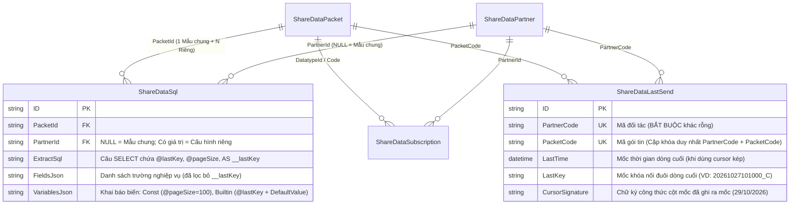
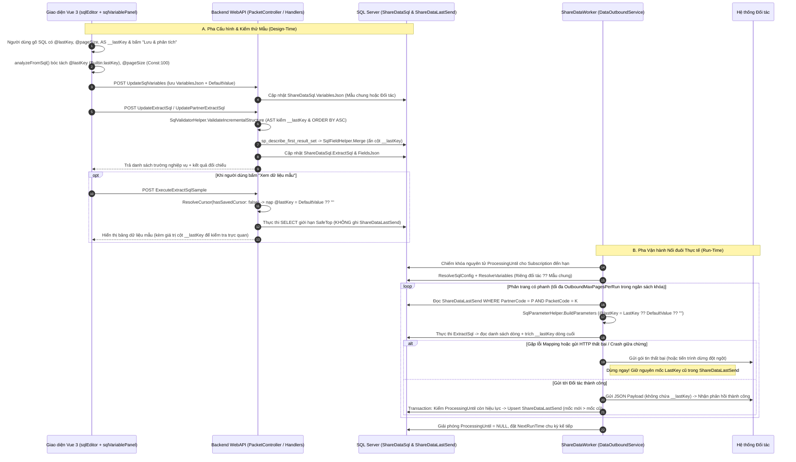

# Kịch bản & Biên bản Cuộc họp: Phân hệ ShareData — Khóa Nối Đuôi (@lastKey / __lastKey) qua 2 buổi 27/10 và 28/10/2026
### (Gộp 29/10/2026 từ 2 biên bản: buổi 27/10 — 4 tệp ghi âm Sharedata_27_10_01..04.m4a + 2 bản vẽ tay; buổi 28/10 — tệp ghi âm Sharedata_28_10.m4a + 3 bản vẽ tay)

> **Cách đọc:** Phần A là buổi 27/10 (mục `A.x`), Phần B là buổi 28/10 (giữ nguyên số mục `1.x`, `2.x` của biên bản 28/10 cũ để các tài liệu đang trỏ tới không bị lệch). Lời thoại hai buổi giữ nguyên như bản chép. **Phần C** (gộp 30/10/2026 từ tài liệu 08) là thiết kế cơ chế nối đuôi và đối chiếu mã, không phải lời họp; mục đánh số `C.x`.
>
> **Đánh số phương án giữa hai buổi:** buổi 27/10 nêu 2 cách — (1) nối chuỗi dưới SQL, (2) lưu công thức để C# ghép, kèm ý "truy vấn lại theo ID dòng cuối" [A — Phần 3, 03:01 – 03:28]. Buổi 28/10 Tech Lead nhắc lại "hôm đó anh nói là có 2 cách" [B — 02:04] rồi tách thành 3: **PA1** nối chuỗi trong câu SQL chính, **PA2** lưu công thức SQL và chỉ tính trên dòng cuối, **PA3** ghép trong mã C#. Trong tệp này "PA1/PA2/PA3" luôn theo cách đánh số của buổi 28/10.
>
> **Đã lược 29/10/2026 — chỉ giữ ý xử lý nối đuôi.** Bỏ phần giao diện và phần không liên quan: buổi 27/10 Phần 1 (rà soát chung, công cụ ghi chú), Phần 2 (tải trang, tên nút, khối so sánh, kiểu dữ liệu) và 3 câu ở Phần 4 về chỗ hiển thị mốc trên màn hình; buổi 28/10 mục 1.5 (giao diện bảng tham số).

- **Người tham gia:** Tech Lead, Dev
- **Tài liệu trực quan đính kèm:**
  - Buổi 27/10 — Bản vẽ tay 1 (Nguyên lý `@lastkey = CONCAT(...)` & Vạch cắt nối đuôi): [50d2fc5f676ae734be7b.jpg](file:///Users/hoangquydat/ThienAn/DocBusinessThienAn/H%E1%BB%AFuNgh%E1%BB%8B-ChiL%C4%83ng/ShareData/_source/50d2fc5f676ae734be7b.jpg)
  - Buổi 27/10 — Bản vẽ tay 2 (So sánh 2 cách sinh `DetectKey`, `To order by`, Bảng lưu trữ theo Đối tác & Crash): [b7af82ba478cc7d29e9d.jpg](file:///Users/hoangquydat/ThienAn/DocBusinessThienAn/H%E1%BB%AFuNgh%E1%BB%8B-ChiL%C4%83ng/ShareData/_source/b7af82ba478cc7d29e9d.jpg)
  - Buổi 28/10 — Bản vẽ tay 1 (Mối liên hệ `@lastKey -> __lastKey`, Gói 101/102, Lấy dòng cuối cùng): [854760f3b1c0319e68d15.jpg](file:///Users/hoangquydat/ThienAn/DocBusinessThienAn/H%E1%BB%AFuNgh%E1%BB%8B-ChiL%C4%83ng/ShareData/_source/854760f3b1c0319e68d15.jpg)
  - Buổi 28/10 — Bản vẽ tay 2 (Trục thời gian `cũ -> mới`, Mệnh đề `WHERE / ORDER BY`, Giá trị mặc định & Lưu trữ theo Đối tác): [ad85cb3a1a099a57c3184.jpg](file:///Users/hoangquydat/ThienAn/DocBusinessThienAn/H%E1%BB%AFuNgh%E1%BB%8B-ChiL%C4%83ng/ShareData/_source/ad85cb3a1a099a57c3184.jpg)
  - Buổi 28/10 — Bản vẽ tay 3 (Công thức xử lý SQL trên dòng cuối vs. Xử lý C# Worker): [eca33912e821687f31306.jpg](file:///Users/hoangquydat/ThienAn/DocBusinessThienAn/H%E1%BB%AFuNgh%E1%BB%8B-ChiL%C4%83ng/ShareData/_source/eca33912e821687f31306.jpg)

---

# PHẦN A — BUỔI 27/10/2026: KHÓA NỐI ĐUÔI COMPOSITE KEY, LƯU OFFSET THEO ĐỐI TÁC & XỬ LÝ CRASH

- **Thời lượng:** 11 phút 29 giây phần nối đuôi (tệp 03: 06:39 + tệp 04: 04:50); tệp 01–02 (13:33) bàn giao diện, đã lược
- **Chủ đề chính:**
  1. **Giải Mã Bản Vẽ Kỹ Thuật b7af82ba478cc7d29e9d.jpg — Cơ Chế Khóa Nối Đuôi Composite Key (@LastKey / DetectKey):**
     - Đánh giá 2 phương án sinh khóa nối đuôi ghép chuỗi: Phương án 1 (SQL CONCAT / Select nối chuỗi) vs Phương án 2 (C# Worker xử lý ghép chuỗi `dl.Time.ToString("HHmm") + "_" + Code`).
     - Xác định mệnh đề truy vấn: Trường khóa nối đuôi bắt buộc phải xuất hiện đồng thời trong cả mệnh đề `WHERE` (`WHERE DetectKey > @LastKey`) và mệnh đề sắp xếp (`ORDER BY DetectKey ASC`).
  2. **Kiến Trúc Bảng Lưu Trữ Trạng Thái Offset ("Tên khóa lưu trữ"):**
     - Bắt buộc cấu trúc khóa trạng thái phải bao gồm cả `Mã gói` và `Đối tác` (`PartnerId`). Tuyệt đối không lưu mốc chạy thật ở cấp mẫu dùng chung vì sẽ gây xung đột dữ liệu (race condition / data collision) giữa các đối tác dùng chung mẫu.
     - Cơ chế xử lý khi Worker bị Crash hoặc dừng đột ngột giữa chừng: Giữ nguyên mốc `LastKey` cũ, chỉ commit mốc mới khi toàn bộ batch dữ liệu đã được xử lý trọn vẹn.
     - Phân định rạch ròi giữa tham số cố định (`PageSize = 100`) và tham số biến đổi theo lần chạy (`DetectKey` / `@LastKey`).

---

## A.1. Tóm tắt nội dung & Quyết định kỹ thuật cốt lõi (Executive Summary)

### A.1.1. Giải Mã Toàn Diện 2 Bản Vẽ Kỹ Thuật (50d2fc5f676ae734be7b.jpg & b7af82ba478cc7d29e9d.jpg)

Hai bản vẽ tay tại [50d2fc5f676ae734be7b.jpg](file:///Users/hoangquydat/ThienAn/DocBusinessThienAn/H%E1%BB%AFuNgh%E1%BB%8B-ChiL%C4%83ng/ShareData/_source/50d2fc5f676ae734be7b.jpg) và [b7af82ba478cc7d29e9d.jpg](file:///Users/hoangquydat/ThienAn/DocBusinessThienAn/H%E1%BB%AFuNgh%E1%BB%8B-ChiL%C4%83ng/ShareData/_source/b7af82ba478cc7d29e9d.jpg) được Tech Lead trực tiếp phác thảo (trong phần 3 và phần 4 của cuộc họp: `Sharedata_27_10_03.m4a` và `Sharedata_27_10_04.m4a`), ghi nhận trực quan toàn bộ bài toán và lời giải cho cơ chế khóa nối đuôi (Incremental Fetching / Offset Tracking).

```
      BẢN VẼ TAY 1 (50d2fc5f676ae734be7b.jpg): NGUYÊN LÝ @lastkey & VẠCH CẮT
 
   @lastkey  =  CONCAT ( ... )  --->  [ Key A ] duy nhất
 
   +----------+-----------+-------+---------------+
   | gói tin  |  đối tác  |  key  |     Value     |
   +----------+-----------+-------+---------------+
   |   ...    |    ...    |   x   |    1004_C     |
   +----------+-----------+-------+---------------+
 
   DL:
     10:00  A   1000_A
     10:30  B   1030_B          select > 1040_C
     10:40  C   1040_C
   ------------------- (Vạch cắt đợt quét 1) -------------------
     10:40  C
     10:50  D

=========================================================================

      BẢN VẼ TAY 2 (b7af82ba478cc7d29e9d.jpg): DETECTKEY, ORDER BY & LƯU TRỮ
 
 [BẢNG DỮ LIỆU NGUỒN]
  +------+-------+----------+
  |  DL  | Code  |   Time   |
  +------+-------+----------+
  |  1   |   A   |  10:00   |
  |  2   |   B   |  10:05   |
  |  3   |   C   |  10:10   |
  +------+-------+----------+
 
  Điều kiện lọc:
  Where HHmmss_Code > [trước đó]
 
 -------------------------------------------------------------------------
 
  1) Lấy DL (To order by) — Nối chuỗi dưới SQL:
  +------+-------+--------------------+
  | Code | Time  | DetectKey (LastKey)|
  +------+-------+--------------------+
  |  A   | 10:00 | 1000-A             |
  |  C   | 10:10 | 1010_C  (Khoanh tròn) ---> Đẩy sang Worker lưu trữ
  |  E   | 11:00 | 1100_E             |
  +------+-------+--------------------+
 
  2) Phương thức sinh khóa trên C# / Truy vấn phụ:
     Time.ToString("HHmm") + "-" + Code
     hoặc biết dòng cuối ID = 123 ---> SELECT ... WHERE ID = 123
     Code C# = dl.Time.ToString(...)
     Tham số phiên quét:
     {
        DetectKey: 1010_C
        PageSize : 100
     }
 
 -------------------------------------------------------------------------
 
 [TÊN KHÓA LƯU TRỮ TRẠNG THÁI OFFSET]
  +--------+---------+-----------+---------+
  | Mã gói | Đối tác |    Key    |  Value  |
  +--------+---------+-----------+---------+
  |  101   |    A    | DetectKey | 1010_C  | ---> Worker commit khi xong batch (10 -> 20 -> 1100_E)
  |  101   |    A    | PageSize  |   100   | ---> Giá trị cố định (fixed)
  +--------+---------+-----------+---------+
 
  Tình huống sự cố:
  Khi xử lý bị Crash / Dừng giữa chừng ---> Chỉ lưu Value mới sau khi xử lý xong!
  (Cột Đối tác BẮT BUỘC có mặt; nếu lưu trống ở mẫu chung thì 2 đối tác A, B
   xài chung gói 101 sẽ ghi đè 10 / 20 lên nhau gây conflict không chạy được).
```

#### Phân tích 2 phương án sinh khóa nối đuôi:
1. **Phương án 1 — Xử lý tại Database bằng câu lệnh SQL (SQL CONCAT):**
   - Trong câu truy vấn động, người cấu hình bổ sung cột ghép chuỗi: `CONCAT(FORMAT(Time, 'HHmm'), '_', Code) AS DetectKey`.
   - Câu truy vấn sử dụng: `WHERE DetectKey > @LastKey ORDER BY DetectKey ASC`.
   - **Ưu điểm:** Tầng Worker C# hoàn toàn trong suốt (agnostic), chỉ việc đọc giá trị cột `DetectKey` của bản ghi cuối cùng trong danh sách kết quả rồi lưu lại.
   - **Nhược điểm:** Phép toán ghép chuỗi và convert dữ liệu trên tập dữ liệu lớn sẽ tiêu tốn tài nguyên Database IO, không tận dụng được index có sẵn của trường `Time` và `Code`, khó debug khi có sai lệch định dạng.
2. **Phương án 2 — Xử lý tại tầng ứng dụng Worker (C# Application Processing):**
   - Câu truy vấn SQL giữ nguyên các cột riêng lẻ: `SELECT Time, Code, ... FROM Table ORDER BY Time ASC, Code ASC`.
   - Worker C# khi đọc từng bản ghi sẽ áp dụng công thức ánh xạ: `dl.Time.ToString("HHmm") + "_" + dl.Code`.
   - Bản ghi cuối cùng của đợt quét (ví dụ dòng C lúc 10:10) sẽ cho ra chuỗi `1010_C`. Chuỗi này được đóng gói làm giá trị `DetectKey` lưu vào bảng trạng thái.
   - **Ưu điểm:** Giảm tải tối đa cho CSDL, truy vấn SQL tận dụng được index cây B-Tree của các cột gốc.
   - **Nhược điểm:** Phải lưu trữ công thức hoặc quy tắc ánh xạ trường trong cấu hình để Worker biết cách thức lắp ráp chuỗi.

### A.1.2. Kiến Trúc Bảng Lưu Trữ Trạng Thái Offset ("Tên khóa lưu trữ")
- **Bắt buộc phân định theo từng Đối tác cụ thể:**
  - Trong mô hình ShareData, một gói tin mẫu (ví dụ: Gói 101 - Dữ liệu VMS/Giao thông) có thể được dùng chung bởi nhiều đối tác khác nhau (Đối tác A, Đối tác B...).
  - Tuy nhiên, tiến độ quét và lấy dữ liệu của mỗi đối tác là hoàn toàn độc lập:
    - Đối tác A có thể đang quét đến mốc `10:10` (`1010_C`).
    - Đối tác B có thể vừa mới khởi động hoặc đang quét ở mốc `08:00`.
  - **Quy tắc bất biến:** Bảng lưu trữ trạng thái offset bắt buộc phải quản lý theo cặp khóa `(Mã gói, Đối tác, Key)`.
  - **Cấm kỵ:** Không bao giờ được phép lưu giá trị offset chạy thật vào cấu hình mẫu chung. Nếu lưu chung, khi Đối tác A vừa ghi mốc 10:10, Đối tác B chạy sau sẽ đọc đè mốc này, làm nhảy cóc dữ liệu của Đối tác B hoặc gây xung đột dữ liệu nghiêm trọng.
- **Phân loại 2 nhóm tham số trong bảng lưu trữ:**
  - **Tham số cố định (Static Parameter):** Ví dụ `PageSize = 100`. Giá trị này do hệ thống hoặc người quản trị thiết lập cố định, không thay đổi qua các lần quét.
  - **Tham số biến đổi theo lần chạy (Stateful / Dynamic Parameter):** Ví dụ `DetectKey` / `@LastKey`. Giá trị này được cập nhật liên tục sau mỗi mẻ quét dữ liệu thành công (lần 1: `1000_A`, lần 2: `1010_C`, lần 3: `1100_E`...).

### A.1.3. Cơ Chế Xử Lý Khi Worker Gặp Sự Cố (Crash Resilience)
- Trong trường hợp Worker đang thực thi đọc một batch dữ liệu (ví dụ 100 dòng), nếu tiến trình bị crash, tắt nguồn hoặc mất kết nối mạng giữa chừng:
  - Hệ thống chỉ cập nhật giá trị `Value` mới (ví dụ `1010_C`) vào CSDL sau khi toàn bộ quy trình đóng gói và gửi/nhận dữ liệu của batch đó hoàn tất thành công.
  - Nếu gặp sự cố, transaction cập nhật offset không được thực hiện. Mốc `LastKey` cũ vẫn được bảo toàn. Khi Worker khởi động lại, nó sẽ quét lại đúng từ mốc an toàn trước đó, đảm bảo tính bền vững (zero data loss).

---

## A.2. Kịch bản & Lời thoại chi tiết theo mốc thời gian (Detailed Transcript)

*(Phần 1–2 của buổi 27/10 bàn giao diện và việc chung, đã lược 29/10/2026; giữ Phần 3–4 về khóa nối đuôi.)*

---

### A — PHẦN 3: PHÂN TÍCH BẢN VẼ TAY b7af82ba478cc7d29e9d.jpg — KHÓA NỐI ĐUÔI COMPOSITE KEY (@LastKey)
*(Trích xuất từ tệp ghi âm: `DocBusinessThienAn/Sharedata_27_10_03.m4a` — Thời lượng: 06 phút 39 giây)*

- `[00:00 - 00:15]` **Tech Lead:** Quay lại chỗ này... Cái key, anh muốn là có time nó là: Hour Minute _ Code... Nó phải lớn hơn cái trước đó.
- `[00:16 - 00:23]` **Dev:** Cái trước đó này của mình chắc chắn phải lưu rồi đúng không?
- `[00:24 - 00:30]` **Tech Lead:** Đúng rồi! Nhưng mà lưu nó sẽ có 2 cách. Thứ nhất là: Làm sao để xử lý ra được thằng này? Đúng không?
- `[00:31 - 00:44]` **Tech Lead:** Thì cách thứ nhất là mình xử lý dưới cơ sở dữ liệu luôn. Là mình... cho nó tải về... ví dụ như là `DetectKey` gì đó.
- `[00:45 - 00:55]` **Tech Lead:** Đó: A, 10 giờ... Mình nối ở dưới câu truy vấn luôn! Là ra vậy luôn. *(Tech Lead cầm bút vẽ mục 1 trên tờ giấy b7af82ba478cc7d29e9d.jpg)*.
- `[00:56 - 01:03]` **Dev:** Hình như cái này mình cũng lưu luôn nè, nếu mà đi theo hướng này.
- `[01:04 - 01:15]` **Tech Lead:** Thì lúc đó là mình sẽ lưu lại là cái cột nào là cái cột làm khóa để mình lấy.
- `[01:16 - 01:28]` **Tech Lead:** Còn cách thứ hai á, là mình sẽ lưu làm sao để biến đổi ra được thằng này. Để trong code C# khi mà nó lấy dữ liệu từng cột nè, nó phải map lại được.
- `[01:29 - 01:38]` **Tech Lead:** Ví dụ như ở cột Time này, nó sẽ `ToString("HHmm")` cộng với lại cái dấu gạch ngang (hoặc gạch dưới), cộng với lại cái `Code`.
- `[01:39 - 01:48]` **Tech Lead:** Thì phải lưu được cái mã này vào, để C# nó sẽ xử lý. *(Tech Lead ghi chú mục 2 trên tờ giấy b7af82ba478cc7d29e9d.jpg)*.
- `[01:49 - 02:00]` **Tech Lead:** Thằng này thì cách này nó sẽ tốn vận hành trên C#, trên code của mình. Còn cách này nó sẽ tốn vận hành trên SQL, cái IO phép toán nối chuỗi. Nếu mà có hình ảnh nối chuỗi, convert gì đó thì nó sẽ tốn, nó sinh thêm một cục nữa.
- `[02:01 - 02:10]` **Dev:** Nó có hai cách. Nhưng mà cách nào đi nữa thì nó cũng phải lưu một cái lại là...
- `[02:11 - 02:20]` **Tech Lead:** Cái cách này nó phải lưu lại được cái cột nào để nó lấy giá trị đó ra. Ví dụ nó đến dòng C đi...
- `[02:21 - 02:30]` **Tech Lead:** Thì nó phải lấy được cái cột đó ra, lấy được cái giá trị này ra để nó lưu trữ.
- `[02:31 - 02:40]` **Tech Lead:** Còn nếu đi cách này á, nó phải lưu được cái công thức ở chỗ này. Đúng không?
- `[02:41 - 02:50]` **Dev:** Lưu được công thức... rồi xử lý C#?
- `[02:51 - 03:00]` **Tech Lead:** Đúng rồi, để convert ra được thằng này. C# hoặc là code SQL gì đó, làm sao để nó map ra được thôi. Có thể dò... ví dụ như lưu SQL thì có thể dùng truy vấn để truy vấn lại, nếu được.
- `[03:01 - 03:15]` **Tech Lead:** Ví dụ mình đã biết cái key cuối cùng là key A rồi, thì mình lại truy vấn lại, lấy cái mã này select lại cái mã này. Đúng không? Cũng được, cũng là một cách.
- `[03:16 - 03:28]` **Tech Lead:** Ví dụ như query 100 dòng, dòng cuối mình biết được ID của nó là 123, thì về cơ bản là `SELECT ... WHERE ID = ...`.
- `[03:29 - 03:40]` **Tech Lead:** Được chưa? Còn không thì lưu dưới dạng là code C#. C# là cái... lúc đó phải viết trong code, ví dụ như `Time.ToString(...)` gì đó thì nó sẽ hơi khó quá.
- `[03:41 - 03:52]` **Dev:** Nhưng mà cái IO bên dưới SQL á, theo hướng này... thì nó sẽ nặng cơ sở dữ liệu. Nó nặng do là mình kiểu lưu nhiều quá hay sao?
- `[03:53 - 04:05]` **Tech Lead:** Nó phải convert chỗ này... Select nối chuỗi! Giống như `CONCAT` vậy á. Tại vì cái chỗ nối chuỗi này nè, nhiều mấu nối phức tạp quá thì nó sẽ tăng cái tải này lên.
- `[04:06 - 04:15]` **Dev:** Tăng thời gian tìm kiếm hả anh?
- `[04:16 - 04:25]` **Tech Lead:** Tăng ở chỗ liên quan đến truy vấn. Truy vấn nó cao. Ví dụ như lấy dữ liệu của cái bảng đó nhiều đi, nó nối thêm chỗ này chắc chắn nó phải tăng lên rồi.
- `[04:26 - 04:36]` **Tech Lead:** Thì nó có hai trường hợp. Thứ hai: Nó phải có một cái chỗ để nó cấu hình, chính là cái chỗ giá trị nhập đó.
- `[04:37 - 04:45]` **Tech Lead:** Rồi, ngoài ra nữa thì nó sẽ còn một cái nữa là: Cái tên khóa lưu trữ.
- `[04:46 - 04:55]` **Tech Lead:** Để vô cái bảng cấu hình cái giá trị lần cuối đó, nó phải có: Thứ nhất là cái gì? Cái mã gói đúng không? Thứ hai là gói tin... Mã gói, đối tác, và cái key đó.
- `[04:56 - 05:05]` **Tech Lead:** Để nó lấy được cái value trước đó... nó định nghĩa là cái gì, để nó xử lý. *(Tech Lead vẽ bảng "Tên khóa lưu trữ" ở cuối tờ giấy b7af82ba478cc7d29e9d.jpg)*.
- `[05:06 - 05:15]` **Tech Lead:** Cái này mới là mức bình thường. Còn cái mức nâng cao hơn nữa là phải tối ưu nữa là: Trường hợp lấy cái dữ liệu này, vô tình xử lý nó bị crash đi!
- `[05:16 - 05:25]` **Dev:** Bị dừng giữa chừng? Bị crash app à?
- `[05:26 - 05:35]` **Tech Lead:** Ừ, thì xử lý như thế nào nữa? Cái đó tính sau. Nhưng trước mắt cứ lấy lên được đúng giá trị trước đó, lưu ngược lại giá trị mới khi mà nó xử lý xong. Đấy, là được.
- `[05:36 - 05:48]` **Tech Lead:** Đó thì nó sẽ có hai cái. Và cái key này có thể là lớn hơn (`>`), hoặc là lớn hơn hoặc bằng (`>=`). Mặc định là lớn hơn. Lớn hơn hay lớn hơn bằng... thì cũng xem xét. Nếu mà cho phép giá trị bằng thì có cần không? Nếu không thì thôi lớn hơn, mặc định là lớn hơn đi.
- `[05:49 - 06:05]` **Dev:** Cái value này là người dùng tự set vô hả anh?
- `[06:06 - 06:15]` **Tech Lead:** Không! Value này là hệ thống detect chứ! Là cái này nè... *(Chỉ vào mục DetectKey trên bản vẽ)*. Có nghĩa là lúc mà em lấy dữ liệu, em phải order theo một cái hướng gì đó.
- `[06:16 - 06:25]` **Tech Lead:** Ví dụ như ở đây, do kết hợp giữa code với time thì bắt buộc phải order dựa trên cái hàng key này.
- `[06:26 - 06:33]` **Dev:** Tại vì không order là nó không detect được.
- `[06:34 - 06:40]` **Tech Lead:** Đúng rồi! Nên là nó chính là cái hàng vừa trong cái `WHERE`, vừa trong cái `ORDER` luôn đó! Vừa `WHERE`, vừa `ORDER` vô trong thằng này luôn. Thì nó sẽ lưu ra được cái giá trị, lúc nào nó cũng sẽ tăng dần, hoặc là giảm dần.
- `[06:41 - 06:48]` **Tech Lead:** Nhưng mà thường sẽ tăng dần mà. Tại vì thường mấy cái dữ liệu này là theo thời gian rồi. Thời gian thì chỉ có thời gian tăng theo tương lai thôi chứ không thể giảm về quá khứ được. Mấy dữ liệu thời gian này mới có cái vụ nối tiếp. Chứ mấy dữ liệu mà dạng quản lý thì cơ bản là gửi lại hết rồi. Đa số là gửi lại hết. Nên xu hướng sẽ tăng dần.
- `[06:49 - 06:55]` **Dev:** Vậy thôi hả anh?
- `[06:56 - 07:05]` **Tech Lead:** Ừ, vậy thôi. Đơn giản!

---

### A — PHẦN 4: BẢNG LƯU TRỮ OFFSET THEO ĐỐI TÁC, XỬ LÝ CRASH & QUY CHUẨN THAM SỐ
*(Trích xuất từ tệp ghi âm: `DocBusinessThienAn/Sharedata_27_10_04.m4a` — Thời lượng: 04 phút 50 giây)*

- `[00:00 - 00:10]` **Tech Lead:** Nghĩa là làm sao để nó biến đổi ra được cái key này nè... Chứ không phải là nhập cái giá trị này vào.
- `[00:11 - 00:20]` **Dev:** Em ví dụ ha, em nhập là test đi, thì em phải biến đổi sao cho nó ra được cái này đúng không?
- `[00:21 - 00:30]` **Tech Lead:** Đúng rồi! Chính là cái này nè. Còn cái giá trị mà nhập vào á, về bản chất là load cái thằng này lên nè, để nó biết là giá trị trước đó, giá trị gần nhất đang chạy là cái gì.
- `[00:31 - 00:45]` **Tech Lead:** Ví dụ nó hiện lên đây. Nhưng mà chắc thực ra không cần hiện đâu. Do nếu mà hiện thì phải hiện theo đúng đối tác, chứ không thể nào mà hiện theo mẫu được. Ví dụ như hai đối tác này cùng xài mẫu chung đi, thì ở đây nó sẽ hiện rất là nhiều, không thể nào mà hiện được.
- `[00:46 - 00:55]` **Tech Lead:** Tại vì nếu mà hiện theo mẫu là cũng không đúng, vì nó đang chạy theo đối tác mà! Cái mẫu bao giờ cũng sẽ trống, mẫu không bao giờ hiện được.
- `[00:56 - 01:10]` **Tech Lead:** Cho nên không... chỗ này không bao giờ lưu trống được, lưu trống là không chạy được. Nếu mà lưu trống là đối tác A cũng chạy cái mã này, cũng chạy gói 101 này, cũng cái key A đó... thì lúc đó là nhiều đối tác cùng đè lên cái key này là nó sẽ sai!
- `[01:11 - 01:25]` **Dev:** Em ví dụ xong cái luồng này, giờ ví dụ đang phát triển đi, giả sử em muốn test á... kiểu kiểm tra... có cách nào kiểu mình tự self-test lại không?
- `[01:26 - 01:38]` **Tech Lead:** Thì mình tạo một cái mã mới, tạo một cái đối tác mới thôi. Tự test case đó coi sao. Tạo một cái đối tác mới, thế thôi.
- `[02:16 - 02:30]` **Dev:** Vậy nếu như cái "Giá trị đã lưu" này nó đi theo đối tác, vậy mẫu chung nó không có đúng không anh?
- `[02:31 - 02:40]` **Tech Lead:** Đúng rồi! Mẫu chung sao hiện được? Nó đâu có lưu gì đâu mà nó hiện!
- `[02:41 - 02:55]` **Tech Lead:** Giờ không... không chia đối tác, không lưu đối tác rồi sao mà nó đúng? Giờ thằng A cũng xài mẫu chung, giờ nó lưu ở đây là số 10. Thằng B cũng xài mẫu chung, nó ghi vô đây là số 20 là nó ghi đè vô đây rồi! Nó ghi đè vô rồi hai thằng conflict với nhau rồi sao chạy được nữa?
- `[02:56 - 03:05]` **Tech Lead:** Bắt buộc chỗ này phải chia theo đối tác! Đấy, vậy thôi. Cho nó dễ. Chung key, chung key là dễ nhất.
- `[03:06 - 03:15]` **Tech Lead:** Cái key đó mình sẽ đặt để nó định nghĩa là cái giá trị này nó đang là cái giá trị gì đó. Ví dụ như là `DetectKey` đi, thì biết được là à thằng này là `DetectKey`. Tại vì nhiều tình huống trong cùng một cái câu nó có hai ba cái câu điều kiện khác nhau.
- `[03:16 - 03:25]` **Tech Lead:** Đúng không? Ví dụ như là cái của em là `DetectKey` đi, là cái giá trị trước đó, ví dụ như `10:10_C`. Rồi phân trang đi, `PageSize` đi, là `100`. Đó, thì nó sẽ lưu hai cái thằng này vô đây: `PageSize`, `DetectKey` cho đối tác A gói 101.
- `[03:26 - 03:35]` **Tech Lead:** Đúng không? Thì khi mình update thì mình chỉ update thằng này thôi (`DetectKey`), thằng này là fixed rồi (`PageSize`). Thì nó là giá trị cố định, cái nguồn giá trị là giá trị cố định.
- `[03:36 - 03:45]` **Dev:** Nhìn phức tạp lại nó cũng hơi rối ha, cái chỗ này nè...
- `[03:46 - 03:55]` **Tech Lead:** Nó là nó có thể tạo nhiều... tạo nhiều tham số. Tùy từng tham số: tham số là nó sẽ fixed giá trị, có tham số là nó sẽ biến đổi dựa trên lần chạy.
- `[03:56 - 04:05]` **Tech Lead:** Mỗi lần chạy lấy giá trị khác nhau. Lần sau nó chạy ví dụ nó tiếp đến E, lúc 11 giờ... thì chỗ này bắt buộc nó phải là 11 giờ gạch E (`1100_E`). Nó phải lưu được thằng này vô để xử lý tiếp.
- `[04:06 - 04:18]` **Dev:** Dạ em hiểu rồi.
- `[04:19 - 04:30]` **Tech Lead:** Rồi, xem kỹ lại rồi ráp vô.
- `[04:31 - 04:50]` **Dev:** Dạ vâng anh, em nắm rõ phần này rồi!

---

# PHẦN B — BUỔI 28/10/2026: 3 PHƯƠNG ÁN KHÓA NỐI ĐUÔI, HIỆU NĂNG TRUY VẤN LỚN & BẢNG LƯU OFFSET THEO ĐỐI TÁC

- **Thời lượng:** 15 phút 25 giây (toàn văn tệp audio `DocBusinessThienAn/Sharedata_28_10.m4a`)
- **Chủ đề chính:**
  1. **Bản chất của Khóa Nối Đuôi (`@lastKey` và `__lastKey`):** Tham số truyền vào câu truy vấn (`@lastKey`) tương ứng với cột mốc đầu ra (`__lastKey`) được trích xuất từ dòng cuối cùng của danh sách kết quả (`last list`) để lưu trữ lại làm mốc quét cho lần tiếp theo.
  2. **Đặc thù cấu trúc khóa theo từng gói tin:** Gói 101 (sự kiện, thời gian cập nhật liên tục) cần độ chi tiết cao kết hợp mã thiết bị (`UpdateTime yyyyMMddHHmmssfff_Code`); Gói 102 (thời tiết, chu kỳ chậm 1-2 tiếng) không cần mili-giây `fff` mà chỉ cần thời gian bản tin (`PacketTime yyyyMMddHHmmss_Code`).
  3. **Đánh giá & So sánh 3 Phương án Kỹ thuật Xử lý Khóa Nối Đuôi:**
     - **Phương án 1 (Đẩy xuống SQL làm - Full Projection):** Câu SQL chính trực tiếp ghép chuỗi cột `__lastKey` cho toàn bộ các dòng kết quả. Dễ cấu hình, trong suốt với Worker nhưng tốn CPU CSDL và lãng phí phép tính ghép chuỗi trên 99 dòng đầu bị bỏ đi.
     - **Phương án 2 (Lưu công thức SQL xử lý dòng cuối cùng - Single Row Evaluation):** Câu SQL chính lấy dữ liệu nguyên bản theo index. Worker sau khi đọc xong batch chỉ gọi một truy vấn phụ siêu nhẹ áp dụng công thức trên duy nhất dòng cuối cùng (`SELECT công_thức WHERE ID = @idCuối`). Tối ưu vượt trội khi quét bảng hàng triệu dòng.
     - **Phương án 3 (Xử lý ghép chuỗi tại C# Worker):** Tối ưu nhất về mặt CSDL nhưng phụ thuộc cứng vào mã nguồn C#, khó cấu hình động trên giao diện, nên thống nhất tạm thời gác lại.
  4. **Quy tắc sắp xếp (`ORDER BY`) và lọc (`WHERE`):** Dữ liệu luôn sắp xếp tăng dần theo thời gian/mã (`cũ -> mới`), đảm bảo dòng cuối cùng luôn là dữ liệu mới nhất (`A -> dữ liệu mới nhất`). Cung cấp giá trị khởi tạo mặc định (`default value` / `min khởi tạo`) để kiểm soát mốc bắt đầu, tránh gửi dữ liệu thử nghiệm cũ.
  5. **Kiến trúc Bảng Lưu Trữ Offset:** Bắt buộc lưu trữ phân định theo bộ 3 `(Mã gói, Đối tác, Key) -> Value`. Cấm lưu mốc chạy thật vào mẫu dùng chung để triệt tiêu nguy cơ xung đột tương tranh (race condition) giữa các đối tác.
  6. **Định hướng triển khai:** Thống nhất tập trung triển khai Phương án 1 và kiểm thử hiệu năng Phương án 2.

---

## 1. Tóm tắt nội dung & Quyết định kỹ thuật cốt lõi (Executive Summary)

### 1.1. Giải Mã Trực Quan 3 Bản Vẽ Kỹ Thuật

Ba bản vẽ tay kỹ thuật được Tech Lead phác thảo trực tiếp trong cuộc họp ngày 28/10/2026 ghi nhận toàn diện cơ chế khóa nối đuôi (Cursor-based Pagination / Incremental Offset Tracking):

#### Bản vẽ tay 1: Mối quan hệ `@lastKey` ↔ `__lastKey` & Cấu trúc khóa từng gói tin ([854760f3b1c0319e68d15.jpg](file:///Users/hoangquydat/ThienAn/DocBusinessThienAn/H%E1%BB%AFuNgh%E1%BB%8B-ChiL%C4%83ng/ShareData/_source/854760f3b1c0319e68d15.jpg))

```
   BẢN VẼ TAY 1 (854760f3b1c0319e68d15.jpg): NGUYÊN TẮC CỘT MỐC & DÒNG CUỐI CÙNG
 
   @lastKey  --->  __lastKey  (Cột mốc trong câu SQL)
       |
       +---> Lấy từ DÒNG CUỐI CÙNG của danh sách kết quả (last row of list)
             và LƯU LẠI vào bảng trạng thái offset.
 
   [CẤU TRÚC KHÓA THEO ĐẶC THÙ GÓI TIN]:
   - Gói 101 (Trạng thái/Sự kiện): 
       UpdateTime yyyyMMddHHmmssfff_Code  (Độ chính xác cao tới mili-giây fff + Mã thiết bị)
   - Gói 102 (Dữ liệu thời tiết/Môi trường):
       PacketTime yyyyMMddHHmmss_Code     (Không cần fff, chu kỳ phát sinh 1-2 tiếng/lần)
 
   [PHƯƠNG ÁN 1 & 2 - ĐẨY SQL LÀM]:
   - Trường dữ liệu nào làm key thì chỉ định trường đó.
   - lastKey -> lưu 1 đoạn mốc [A] để lấy cho lần thứ 2.
```

#### Bản vẽ tay 2: Trục thời gian tăng dần, Mệnh đề WHERE / ORDER BY & Phân định Đối tác ([ad85cb3a1a099a57c3184.jpg](file:///Users/hoangquydat/ThienAn/DocBusinessThienAn/H%E1%BB%AFuNgh%E1%BB%8B-ChiL%C4%83ng/ShareData/_source/ad85cb3a1a099a57c3184.jpg))

```
   BẢN VẼ TAY 2 (ad85cb3a1a099a57c3184.jpg): CHIỀU DỮ LIỆU & BẢNG OFFSET THEO ĐỐI TÁC
 
   Trục thời gian:  [ CŨ ]  ------------------------>  [ MỚI ]
                     |                                   |
                     v                                   v
             Dữ liệu cũ đứng trước            Dòng cuối cùng = Dữ liệu MỚI NHẤT (A)
 
   Mệnh đề truy vấn:
     WHERE  [Cột điều kiện]  >  @lastKey
     ORDER BY  Date ASC, HHmm ASC, Code ASC   (Hoặc ORDER BY __lastKey ASC)
 
   Min khởi tạo (Default Value):
     Nếu chưa có mốc chạy trước đó -> Dùng giá trị mặc định (vd: '20261028000000_A')
     để bỏ qua dữ liệu cũ từ giai đoạn chạy thử nghiệm.
 
   Bảng minh họa duyệt dữ liệu:
   +-------+-------+--------------------+
   | Date  | Code  | __lastKey          |
   +-------+-------+--------------------+
   | 10:00 |   A   | 1000_A             |
   | 10:10 |   B   | 1010_B (Last item) | ---> Cầm giá trị '1010_B' lưu vào CSDL
   +-------+-------+--------------------+
 
   Lần quét kế tiếp:
     WHERE __lastKey > '1010_B'
     -> Trích xuất các bản ghi tiếp theo (11:10_D...)
 
   BẢNG LƯU TRỮ OFFSET:
   Phân định theo 3 khóa độc lập: [Mã gói] + [Đối tác] + [Key] -> [Value]
   (Ví dụ: Gói 101, Đối tác B, Key '__lastKey' -> Value '1010_B')
```

#### Bản vẽ tay 3: So sánh 3 phương án xử lý — SQL Full vs. SQL Single Row vs. C# Worker ([eca33912e821687f31306.jpg](file:///Users/hoangquydat/ThienAn/DocBusinessThienAn/H%E1%BB%AFuNgh%E1%BB%8B-ChiL%C4%83ng/ShareData/_source/eca33912e821687f31306.jpg))

```
   BẢN VẼ TAY 3 (eca33912e821687f31306.jpg): CÔNG THỨC XỬ LÝ DÒNG CUỐI VS C# WORKER
 
   [CƠ CHẾ LƯU KHÓA]:
 
   Phương án 1 (SQL Full Projection):
     - SELECT CONCAT(...) AS __lastKey cho 100 dòng.
     - Vấn đề: 99 dòng đầu bị bỏ đi, gây lãng phí IO/CPU trên bảng lớn hàng triệu dòng.
 
   Phương án 2 (Công thức xử lý SQL trên dòng cuối - Single Row Evaluation):
     - Câu SQL chính: SELECT bình thường theo index gốc (nhẹ, nhanh).
     - Khi Worker chạy tới dòng cuối cùng (đã xác định được ID dòng cuối):
         SELECT [Công thức ghép chuỗi] FROM Bảng WHERE ID = @lastRowId
     - Chỉ tính toán DUY NHẤT 1 dòng cuối cùng! Tiết kiệm tài nguyên tối đa.
 
   Phương án 3 (C# Worker Code):
     - var d = lastRow;
     - string key = d.UpdateTime.ToString("yyyyMMddHHmmss") + "_" + d.Code;
     - Đánh giá: Tối ưu CSDL nhưng phụ thuộc cứng vào code C#, khó cấu hình động.
```

---

### 1.2. Phân Tích So Sánh Chi Tiết 3 Phương Án Trong Trao Đổi

#### A. Phân tích chi tiết Phương án 1 (SQL Full Projection):
- **Cơ chế:** Viết trực tiếp phép ghép chuỗi trong câu truy vấn chính:
  `SELECT TOP (@pageSize) CONVERT(varchar(23), UpdateTime, 121) + '_' + CAST(ID AS varchar(64)) AS __lastKey, ...`
  `WHERE (CONVERT(varchar(23), UpdateTime, 121) + '_' + CAST(ID AS varchar(64))) > @lastKey ORDER BY __lastKey ASC`.
- **Ưu điểm:** Rất đơn giản, toàn bộ logic gói gọn trong 1 câu truy vấn SQL duy nhất, tầng Worker hoàn toàn trong suốt chỉ đọc cột `__lastKey` của dòng cuối cùng.
- **Rủi ro khi mở rộng (Scale Bottleneck):**
  - Mệnh đề `WHERE` chứa hàm `CONVERT` và phép cộng chuỗi `+` là biểu thức **Non-Sargable** kinh điển trong thiết kế CSDL.
  - SQL Server không thể sử dụng cấu trúc cây B-Tree Index của cột `UpdateTime` hay `ID`. CSDL buộc phải thực hiện quét toàn bộ bảng (Table Scan / Clustered Index Scan) qua hàng triệu bản ghi, tính toán ghép chuỗi cho từng dòng rồi mới so sánh với `@lastKey`.
  - Hậu quả: Tiêu tốn Disk IO, CPU nhảy vọt lên 100%, tăng nguy cơ khóa tương tranh (lock contention/deadlock) và gây timeout khi dữ liệu tăng trưởng lớn.

#### B. Nút thắt cổ chai của Phương án 2 (SQL Single Row Evaluation / Trì hoãn tính toán):
- **Cơ chế đề xuất trong trao đổi:** Câu SQL chính chỉ lấy các cột nghiệp vụ nguyên bản. Khi Worker duyệt tới dòng cuối cùng (đã có `ID` của dòng cuối), Worker thực thi thêm một câu truy vấn phụ: `SELECT [công_thức_ghép_chuỗi] WHERE ID = @lastRowId` để lấy chuỗi mốc lưu lại vào CSDL.
- **Nút thắt cổ chai cốt lõi:**
  1. *Tiết kiệm nhầm chỗ:* Việc bỏ phép ghép chuỗi ở `SELECT` cho 99 dòng đầu chỉ tiết kiệm được vài micro-giây CPU trên RAM, không mang lại ý nghĩa đáng kể cho hệ thống.
  2. *Mệnh đề WHERE ở chu kỳ sau vẫn bị nghẽn:* Lần quét kế tiếp, Worker truyền chuỗi mốc vừa tính vào `@lastKey`. Câu SQL chính vẫn phải so sánh `WHERE (CONVERT(...) + '_' + ID) > @lastKey` nên CSDL **vẫn bị Table Scan toàn bộ bảng 100%**, nút thắt I/O nghiêm trọng nhất vẫn còn nguyên.
  3. *Tăng độ trễ mạng (Network Latency):* Mỗi đợt quét Worker phải gửi 2 round-trips mạng xuống CSDL (Query 1 lấy dữ liệu + Query 2 tính mốc), làm tăng gấp đôi độ trễ mạng so với 1 câu truy vấn đơn.

#### C. Phân tích Phương án 3 (C# Worker Mapping):
- **Cơ chế:** CSDL chỉ trả về các trường gốc (`UpdateTime`, `Code/ID`). Tầng Worker dùng C# ghép chuỗi `d.UpdateTime.ToString(...) + "_" + d.Code`.
- **Đánh giá:** Rất tối ưu cho CSDL nhưng bị phụ thuộc cứng vào mã nguồn C# (hardcoded logic), phải mở code ra tra cứu tên thuộc tính, biên dịch lại service khi có thay đổi, triệt tiêu tính tùy biến động trên giao diện UI cho SuperAdmin. Do đó cuộc họp đã thống nhất gác lại.

| Tiêu chí | PA1: SQL Full Projection | PA2: SQL Single Row Formula | PA3: C# Worker Mapping |
| :--- | :--- | :--- | :--- |
| **Bản chất mốc** | Chuỗi ghép 1 biến `@lastKey` | Chuỗi ghép 1 biến `@lastKey` | Chuỗi ghép 1 biến `@lastKey` |
| **Mệnh đề WHERE** | `WHERE CONCAT(...) > @lastKey` | `WHERE CONCAT(...) > @lastKey` | `WHERE CONCAT(...) > @lastKey` |
| **Sử dụng Index** | ❌ Không (Non-Sargable) | ❌ Không (Non-Sargable) | ❌ Không (Non-Sargable) |
| **Tải trên CSDL** | 🔴 Rất nặng (Table Scan + CPU) | 🔴 Rất nặng (Table Scan) + 2 query | 🟡 Vẫn Table Scan ở WHERE |
| **Số Round-trip** | 1 round-trip | **2 round-trips** | 1 round-trip |
| **Tính linh hoạt UI** | Cao (1 câu SQL) | Trung bình (cần thêm ô công thức) | Thấp (phụ thuộc code C#) |
| **Đánh giá hệ thống** | Làm trước vì đơn giản; dữ liệu lớn hoặc chạy lại từ đầu thì hay nghẽn ở nối chuỗi [13:49 – 14:09] | Cân nhắc cho bảng vài triệu dòng; làm lên rồi đo hiệu năng để chọn giữa PA1 và PA2 [13:31 – 14:25] | Gác lại: khó, phụ thuộc mã C# [14:28 – 15:23] |

> 📌 **Ghi chú bổ sung 29/10/2026 — kết quả đo, không phải lời họp.** Số trang đọc của PA1, PA2, PA3 trên bảng 1.000.000 dòng,
> cách đang dùng (PA1 viết theo 2 cột gốc, 421 trang) và 3 điều kiện để đạt: xem mục C.4.3.

---

### 1.3. Kiến Trúc Lưu Trữ Trạng Thái Offset & Chống Xung Đột Tương Tranh

1. **Bộ 3 định danh bắt buộc: `(Mã gói, Đối tác, Key) -> Value`:**
   - Mỗi đối tác có tốc độ tiếp nhận và tiến độ xử lý dữ liệu khác nhau. Một gói tin mẫu (ví dụ gói 101) phục vụ đồng thời nhiều đối tác (Đối tác A, Đối tác B...).
   - **Quy tắc bất biến:** Giá trị `Value` của mốc chạy thật bắt buộc phải gắn liền với `Mã gói` và `Mã đối tác` (`PartnerId`).
   - ⛔ **CẤM:** Tuyệt đối không được lưu mốc chạy thật vào cấu hình mẫu chung. Nếu lưu chung, khi Đối tác A vừa chạy tới mốc `10:10`, Đối tác B chạy sau sẽ đọc đè mốc này làm mất dữ liệu hoặc gây xung đột nghiêm trọng.
2. **Tách biệt 2 loại tham số:**
   - **Tham số cố định (Static Parameter):** `@pageSize = 100` (giá trị cố định, do cấu hình hệ thống quy định).
   - **Tham số trạng thái động (Stateful Parameter):** `@lastKey` (mốc giá trị tăng dần, cập nhật liên tục sau mỗi mẻ quét thành công).
3. **Giá trị khởi tạo mặc định (`default value`):**
   - Hỗ trợ thiết lập mốc bắt đầu (ví dụ: ngày giờ cụ thể `20261028000000_A`) cho lần chạy đầu tiên để chủ động bỏ qua dữ liệu rác/thử nghiệm phát sinh trước đó.
   - Nếu không cấu hình mốc bắt đầu, hệ thống quét từ đầu lịch sử (`WHERE ... > ''` hoặc bỏ mệnh đề WHERE).

---

### 1.4. Trục Thời Gian Tăng Dần & Cơ Chế Lấy Bản Ghi Mới Nhất

- **Nguyên lý sắp xếp tăng dần (`cũ -> mới`):**
  - Mọi câu truy vấn dữ liệu nối đuôi bắt buộc phải có mệnh đề sắp xếp tăng dần: `ORDER BY Date ASC, Time ASC, Code ASC` (hoặc `ORDER BY __lastKey ASC`).
  - Khi duyệt danh sách kết quả từ trên xuống dưới:
    - Các bản ghi cũ hơn nằm ở đầu danh sách.
    - Bản ghi mới nhất luôn nằm ở vị trí cuối cùng của danh sách (`last item of list`).
- **Cơ chế ghi nhận mốc:**
  - Worker xử lý xong mẻ dữ liệu, đọc giá trị của cột `__lastKey` tại dòng cuối cùng, rồi commit giá trị này vào bảng offset với `Key = '__lastKey'`.
  - Ở chu kỳ quét tiếp theo, Worker đọc giá trị đã lưu truyền vào tham số `@lastKey` để tiếp tục trích xuất các bản ghi kế tiếp (`WHERE __lastKey > @lastKey`).

---

## 2. Kịch bản & Lời thoại chi tiết theo mốc thời gian (Detailed Transcript)

*(Toàn văn tệp ghi âm: `DocBusinessThienAn/Sharedata_28_10.m4a` — Thời lượng: 15 phút 25 giây)*

---

### PHẦN 1: CẤU TRÚC KHÓA NỐI ĐUÔI THEO GÓI TIN & NGUYÊN LÝ LẤY DÒNG CUỐI CÙNG
*(Thời gian: 00:00 – 04:08)*

- `[00:00 - 00:15]` **Tech Lead:** Thường kỳ thì phải... phải theo một cái cấu trúc gì đó... theo cấu trúc tức là theo... theo cái giá trị mình nhập. Cái giá trị này nó đang nói dưới server kiểu... mã đối tác, mã gói... hay mã gói, mã đối tác gì đó.
- `[00:16 - 00:30]` **Tech Lead:** Nhưng mà cái dữ liệu, cái dữ liệu này nó đi theo từng dữ liệu chứ không phải là nó... nó fix, nên là mình phải có cấu... cấu trúc.
- `[00:31 - 00:52]` **Tech Lead:** Ví dụ gói 101 đi, thì anh muốn nó là... cái cột UpdateTime chẳng hạn... Anh muốn nó là yyyy... MMddHHmmssfff... gạch Code.
- `[00:53 - 01:10]` **Tech Lead:** Nhưng mà gói 102 đi ha, thì muốn nó là cái trường PacketTime... yyyyMMddHHmmss... Cùng thời... Không cần fff, vì cơ bản là nó không chạy được đến fff.
- `[01:11 - 01:30]` **Tech Lead:** Ví dụ như dữ liệu về thời tiết chẳng hạn, hay gì đó, thì cơ bản là không thể nào mà nó... một cái dữ liệu nó chạy lặp lại mấy giây, trong vòng mấy mili-giây. Thường ví dụ một tiếng, hai tiếng mới có dữ liệu... hoặc có thể nó đến, nhiều khi đến phút thôi. Nên mỗi cái nó không... Mỗi cái nó có một cách.
- `[01:31 - 01:42]` **Dev:** Mỗi cái nó có một cách, mà cái cách này là mình tự... xử lý dưới... cái hạ tầng của mình đây nè.
- `[01:43 - 02:03]` **Tech Lead:** Đúng rồi. Có nghĩa là mình phải nhập cái name, làm sao để trong code mình hiểu được là nó sẽ xử lý như thế nào. Đó, làm sao để nó nối được ra thành cái chuỗi này nè. Nó sẽ dùng cái chương trình nào để nó ra được cái này. Rồi nó kết hợp với cái thằng nào đó. Tức là phải có một cái công thức.
- `[02:04 - 02:15]` **Tech Lead:** Hôm đó anh nói là có 2 cách. Như hôm bữa 2 cách đó. Một là đẩy xuống SQL làm.
- `[02:16 - 02:26]` **Dev:** Ừ.
- `[02:27 - 02:45]` **Tech Lead:** Đẩy xuống SQL làm thì nó sẽ dễ. Có cái là nó nối lại hết rồi. Mình chỉ còn khai báo cái... trường dữ liệu nào làm key đó. Ví dụ như mình nối sẵn ở SQL cái này, cột của nó là cột A đi. Thì mình sẽ khai báo cái thằng lastKey này... nó sẽ dựa theo cái column A để nó lấy.
- `[02:46 - 02:48]` **Dev:** Đang gắn này...
- `[02:49 - 03:06]` **Tech Lead:** Đúng không? Thì về cơ bản khi mà nó chạy, thì cái thời gian chạy theo nguyên tắc thường nó sẽ tăng dần. Đúng không em? Nó sẽ tăng dần. Tăng dần thì dữ liệu cũ nó sẽ đứng trước, dữ liệu mới nó sẽ đứng cuối cùng.
- `[03:07 - 03:15]` **Tech Lead:** Thì kiểu gì khi mà em duyệt đến cái dòng cuối cùng, em lấy được cái cột A này, bao giờ nó cũng là cái dữ liệu... mới nhất trong cái danh sách đó.
- `[03:16 - 03:17]` **Dev:** Mới nhất.
- `[03:18 - 03:32]` **Tech Lead:** Đó, thì lấy cái cột đó ra, giá trị nó là X, mình sẽ lưu cái X đó lại vào một cái key gì đó. Đúng không? Thì key này nó sẽ bao gồm là cái gì? Cái gói tin, đối tác, và cái key đó.
- `[03:33 - 03:46]` **Tech Lead:** Thì mình sẽ lưu cái giá trị value này vào trong cái value này. Đó, rồi lần sau nó lấy, nó WHERE, điều kiện...
- `[03:47 - 04:08]` **Tech Lead:** Nó đi tiếp thì nó làm gì? Nó lấy cái lastKey... nó sẽ móc cái value kia ra.

---

### PHẦN 2: THIẾT LẬP MỆNH ĐỀ TRUY VẤN, GIÁ TRỊ KHỞI TẠO VÀ BẢNG LƯU TRỮ OFFSET
*(Thời gian: 04:09 – 10:14)*

- `[04:09 - 04:26]` **Tech Lead:** Đó là cách đầu tiên là sẽ đẩy xuống SQL làm. Thì đẩy xuống SQL làm cái dễ á là không... không phải nhớ công thức dài dòng. Không cần cài công thức, mình chỉ lưu cái tên trường này... mình lấy.
- `[04:27 - 04:37]` **Tech Lead:** Về cơ bản nó chính là cái hàng... hàng này luôn nè. Nó sẽ nằm ở khúc chỗ này nè.
- `[04:38 - 04:40]` **Dev:** Mình coi khoảng nha.
- `[04:41 - 05:07]` **Tech Lead:** Đó, nó cũng gợi ý ra vậy. Nó giống như cái cột lastTime á em. Có nghĩa là một cái trường... một cái trường giống như vầy nè. Nó giống kiểu như là một cái trường nội bộ để mình quản lý. Giống như là em SELECT ra, em SELECT em tự động em nối để nó ra một cái key gì đó. Thì khi mà em SELECT nó sẽ ra một cái trường này. Mình làm cái trường này mình đi lưu luôn nó, kiểu vậy đó. Cầm cái trường đó mình đi lưu luôn.
- `[05:08 - 05:16]` **Tech Lead:** Thì lúc đó là cái `@lastKey` đó, mình sẽ gán...
- `[05:17 - 05:30]` **Tech Lead:** Thì khi mà nó duyệt đến dòng cuối cùng, dòng cuối cùng của danh sách, thì nó sẽ phải lấy được cái thằng này ra để nó lưu lại. Khi mà nó thiết lập theo cái lần... theo cái giá trị trước đó... lần trước đó.
- `[05:31 - 05:46]` **Tech Lead:** Nếu mà ở đây thiết lập giá trị lần trước, thì nó phải lấy được cái thằng thiết lập ở đây. Để nó lấy cái giá trị... nó đưa vô trỏng. Lấy giá trị ra nó đưa vô trỏng. Rất là đơn giản thôi.
- `[05:47 - 06:05]` **Tech Lead:** Còn ở dưới đây là... cái bảng này là... cái bảng này làm cũng mấy lần rồi nè. Code, đặt cho nó một cái trường giống như là... Key đi. Rồi Value. Thì cái lastKey này mình cũng nối nó thành...
- `[06:06 - 06:24]` **Tech Lead:** Khi mà nó duyệt xuống, chắc chắn phải ORDER rồi, không thể nào không ORDER được. ORDER dựa trên cái cặp này luôn: ORDER BY Ngày, Date, Time, Code... ORDER BY ba thằng này luôn.
- `[06:25 - 06:45]` **Tech Lead:** Và WHERE cũng y chang vậy. Nếu mà trước đó nó không có giá trị gì đó thì để... nó bằng một cái giá trị mặc định gì đó. Ví dụ như là để bằng rỗng hay gì đó để nó lấy từ đầu. Hoặc nếu mà không có giá trị gì, khỏi WHERE này luôn để lấy từ đầu.
- `[06:46 - 07:10]` **Tech Lead:** Hoặc là mình gán một cái giá trị min... khởi tạo, bắt đầu. Ví dụ như cái giao dịch dữ liệu này mình muốn... nó phát sinh dữ liệu, cái dữ liệu này có thể nó phát sinh từ lúc chạy thử rồi, thì nhiều tình huống mình không muốn nó gửi dữ liệu chạy thử, thì mình sẽ cố định luôn là nếu mà không có giá trị thì set cái default value... bằng một cái giá trị gì đó. Ví dụ như set trước cái key này luôn, nhập tay vô: 2026...
- `[07:11 - 07:40]` **Tech Lead:** Thì lúc đó nó sẽ lấy cái thằng này. Còn khi mà nó đã có giá trị mới nhất nó lấy rồi, khi mà chạy đúng không, đứng gần chắc chắn 2 thằng này sẽ lấy được. Có thằng A này, xử lý không có vấn đề gì. Đến thằng B, thì nó là giá trị cuối rồi, last list rồi, giá trị cuối của list rồi.
- `[07:41 - 08:05]` **Tech Lead:** Thì lúc đó là mới xét tới là bây giờ... cái lastKey tiếp theo... à nó đang... nó đang sử dụng nguồn giá trị là lần trước đó, thì suy ra là phải lưu lại. Lưu lại giá trị trước đó. Mà lưu lại giá trị trước đó đang đặt là cái cột lastKey. Thì suy ra là phải lấy được cái lastKey của thằng B này, last của thằng B này luôn. Cầm cái giá trị này đi lưu lại vào trong cái bảng.
- `[08:06 - 08:24]` **Tech Lead:** Để làm sao để lúc sau nó chạy nó lấy lại được thằng này. Nhưng mà khi lưu thì không có lưu một mình nó, mà khi lưu thì nó sẽ có cái cặp này: gói tin, đối tác, và cái key. Phải đặt cho nó cái key gì đó để nó lưu lại thì mới đúng.
- `[08:25 - 08:35]` **Tech Lead:** Chứ cái nào cũng để lastKey, lastKey, lastKey... một đống lastKey là nó trùng hết. Mình phải đặt cho nó một cái tên định danh cho nó.
- `[08:36 - 08:42]` **Dev:** Đặt theo ID của data...
- `[08:43 - 09:05]` **Tech Lead:** Đúng rồi, ví dụ như là cái này gói 1.1 đi ha, 101... key gì đó, key data gì đó, để lúc đó nó sẽ hiểu được trên thằng này. Hoặc cái gì đó. Mỗi cái key tại vì cơ bản là nó sẽ dựa trên gói tin với đối tác nó không bao giờ trùng được.
- `[09:06 - 09:15]` **Dev:** Đúng rồi, nó đâu có trùng được. Tại nó đi theo cái mã đối tác... mã gói, mã đối tác...
- `[09:16 - 09:40]` **Tech Lead:** Lúc đầu là tính là nối, nối chuỗi cái key này nè. Nhưng mà thôi mắc công á, chia làm ba luôn cho nó dễ: Đối tác xác định luôn, gói tin xác định luôn, và cái key nó ném nó vô. Lưu lại cái mục đích này.
- `[09:41 - 10:00]` **Tech Lead:** Lúc trước thì chỉ lưu cái key thôi, lúc trước chỉ định danh cái key thôi. Thì cái key đó nhiều tình huống là khác đối tác là phải đi nối chuỗi á. Tự động nối chuỗi chèn cái đối tác vô... để cho khác cái key. Nhưng mà làm mất công á, nên thôi chia nó ra. Lưu một ô luôn cho nó dễ.
- `[10:01 - 10:14]` **Tech Lead:** Đó, mục tiêu là lấy lần sau nó chạy nó lấy thằng này mới. Ví dụ đây chạy tiếp đến thằng B nè, thằng C, thằng D gì đó... Ví dụ lấy được hai dòng B, C thì cái lần tiếp theo nó lưu lại thằng D...

---

### PHẦN 3: ĐÁNH GIÁ 3 PHƯƠNG ÁN KỸ THUẬT & TỐI ƯU TRUY VẤN DỮ LIỆU LỚN
*(Thời gian: 10:15 – 13:08)*

- `[10:15 - 10:25]` **Tech Lead:** Và lần sau nó chạy nó sẽ lấy lớn hơn thằng này tiếp. Nó quay lại quy trình. Thì đó là cách đầu là cái... cách đẩy xuống cho SQL làm. Một cách ha.
- `[10:26 - 10:27]` **Dev:** Một cách.
- `[10:28 - 10:35]` **Tech Lead:** Thì nó sẽ có cái khuyết là nó sẽ bị vướng vào chỗ mà... tính toán nó xuống truy vấn á.
- `[10:36 - 10:39]` **Dev:** Truy vấn... hiệu năng lùi đúng không?
- `[10:40 - 10:45]` **Tech Lead:** Đúng rồi, nối chuỗi. Cứ cấp nào cứ... cho nó xong. Còn cách kia... Cách kia là đẩy xử lý lên code hả?
- `[10:46 - 10:49]` **Dev:** Qua C# gì?
- `[10:50 - 10:55]` **Tech Lead:** Ừ. Mình có tới 2 cách để đẩy lên.
- `[10:56 - 11:15]` **Dev:** Tức là làm một cách, rồi một cách kia nữa, rồi xong rồi phân tích nọ kia. Đưa AI nó chuyển qua nhanh lắm.
- `[11:16 - 11:35]` **Tech Lead:** Có cách này... anh thấy nó sẽ dễ hơn, mà anh không biết nó tối ưu không. Đó là: Cũng y chang này luôn, cũng y chang như này, nhưng mà cái chỗ này nè, chắc chắn chỗ này nó phải có cái hàm nối chuỗi rồi. Đúng không? Ví dụ như cái hàm nối chuỗi là cái câu SQL đó.
- `[11:36 - 11:55]` **Tech Lead:** Thay vì như này, anh sẽ cầm nguyên cái cụm này nè, lưu... lưu xuống dưới này. Thấy chưa? Lưu xuống. Thì về bản chất là tới cái lúc... cái lần cuối nó chạy á, nó giống như thằng này nè: Thằng A xong đến thằng B nó chạy, đã biết được nó là thằng đứng cuối danh sách rồi.
- `[11:56 - 12:12]` **Tech Lead:** Chắc chắn phải xác định được, cuối danh sách. Thì bắt đầu nó mới lấy cái thằng đó ra. Lấy thằng đó ra nó sẽ thấy được là cái... cái gì ta? Cái nó gọi là cái gì ta? Cái công thức... Công thức xử lý SQL.
- `[12:13 - 12:35]` **Tech Lead:** Về cơ bản nó gọi lại cái hàm này: `SELECT` cái công thức này `WHERE ID = ...` gì đó. Hiểu không? Thì lúc đó nó chỉ ảnh hưởng một dòng đó thôi. Chứ nó không có phải nó đi nó... nó phải nó gán hết tất cả.
- `[12:36 - 12:50]` **Tech Lead:** Tại vì cơ bản nó gán hết thì thằng này cũng bỏ. Ví dụ như 100 dòng thì tất cả bỏ hết 99 dòng đầu rồi. Chỉ có cái dòng cuối là nó lấy được thôi. Còn thằng này là nó chỉ tác động đúng một dòng cuối cùng. SELECT ra đúng một dòng cuối cùng.
- `[12:51 - 12:55]` **Dev:** Ok...
- `[12:56 - 13:08]` **Tech Lead:** Đó, thì là cách thứ hai. Còn cách thứ ba là cái công thức này là biến thành công thức của C#. Biến thành code C# luôn. Nhưng cách 3 chắc sẽ khó. Mình ưu tiên cách 1 với cách 2 thôi.

---

### PHẦN 4: KẾT LUẬN ĐỊNH HƯỚNG TRIỂN KHAI & PHÂN CÔNG THỰC HIỆN
*(Thời gian: 13:09 – 15:25)*

- `[13:09 - 13:12]` **Dev:** Nhưng cho em hỏi...
- `[13:13 - 01:14]` **Tech Lead:** Nói chung vòng vòng vậy thôi.
- `[13:15 - 13:16]` **Dev:** Đó cũng một vấn đề.
- `[13:17 - 13:18]` **Tech Lead:** Hai cái thôi. Hiểu là được.
- `[13:19 - 13:23]` **Dev:** Không, nhưng mà tính ra nó nghe xong á, nó cũng phát triển lên hòm hòm lên được.
- `[13:24 - 13:30]` **Tech Lead:** Hiểu được là... hình dung rồi.
- `[13:31 - 13:43]` **Tech Lead:** Mấy cái... mai đi em báo cáo lại ha. Mai chắc lên được á. Còn cái vụ xử lý thì tùy. Hai cái anh gợi ý vậy đó, xem cái nào tối ưu hơn. Anh thì anh chắc thiên về...
- `[13:44 - 13:48]` **Dev:** Bây giờ thà tối ưu không, thì mình cứ lên đi rồi xong mình... Mình chạy hiệu năng đồ này nọ.
- `[13:49 - 14:04]` **Tech Lead:** Hồi trước, trước là hay dùng kiểu này nè. Trước là bên mình hay dùng kiểu này. Nhưng mà dùng kiểu này thì thời gian á, dữ liệu nó lớn á, ví dụ như là tình huống là nó phải chạy lại hết dữ liệu á, là nó hay bị nghẽn chỗ này nè. Tại vì nó phải đi xử lý câu lệnh nhiều.
- `[14:05 - 14:09]` **Dev:** Nối chuỗi, ờ đúng rồi nối chuỗi nó nặng á, nối chuỗi...
- `[14:10 - 14:25]` **Tech Lead:** Bảng tới bảng mấy... mấy triệu dòng. Thì có thể xem xét là cái kia, cái kia là chỉ lấy cái cuối. Có dòng nào là lấy dòng đó. Tác động đúng cái dòng đó thôi.
- `[14:26 - 14:27]` **Dev:** Ghê ha...
- `[14:28 - 14:36]` **Tech Lead:** Còn cái C# thì thôi. C# thì... thực ra C# là tối ưu nhất á, nhưng mà C#... C# lại khó.
- `[14:37 - 14:43]` **Dev:** C# nếu mà xử lý thì nó cũng nặng trên RAM... Nó bị phụ thuộc code quá.
- `[14:44 - 15:00]` **Tech Lead:** Tại vì C# thì em mới khi khai báo... Cái này ví dụ như cái này em còn truyền... còn truyền cái cột được. Còn C# là em phải mở code ra em coi cái biến đó là cái biến gì. Em mới chấm được.
- `[15:01 - 15:15]` **Tech Lead:** Đấy, là phải biết được, ví dụ như mình đặt cái biến qua `d`, thì phải truyền đúng cái `d` là cái gì vào. Còn cái này á, mở cái bảng ra là biết rồi. Mở cái câu truy vấn ra là thấy rồi. Nên là cái C# là cái cuối cùng. C# thì nó hơi khó.
- `[15:16 - 15:18]` **Dev:** Khó thì khỏi bàn.
- `[15:19 - 15:23]` **Tech Lead:** Bỏ qua. Thì hai cái đầu thôi.
- `[15:24 - 15:25]` **Dev:** Ok anh.

---

# PHẦN C — THIẾT KẾ CƠ CHẾ NỐI ĐUÔI & ĐỐI CHIẾU MÃ (gộp từ tài liệu 08 ngày 30/10/2026)

> **Không phải lời họp.** Phần A, B là biên bản; phần này là thiết kế viết sau họp và đối chiếu với mã working tree.
> Gộp nguyên tài liệu `doc/08-thiet-ke-luong-noi-duoi-toan-trinh-ui-be-worker.md` (đã xóa); mục `x.y` cũ nay là `C.x.y`.

> **Tài liệu đặc tả kỹ thuật chuyên sâu (End-to-End Architecture Specification)** tổng hợp từ 2 phiên rà soát kiến trúc ngày **26/10/2026** và **27/10/2026**, hai bản phác thảo tay gốc [`50d2fc5f676ae734be7b.jpg`](../../_source/50d2fc5f676ae734be7b.jpg) và [`b7af82ba478cc7d29e9d.jpg`](../../_source/b7af82ba478cc7d29e9d.jpg), đối chiếu trực tiếp với mã nguồn thực thi tại cả 3 tầng **UI (Vue 3)**, **BE (WebAPI)** và **WORKER (ShareDataWorker)**.

---

## C.1. Bài Toán Nghiệp Vụ & Giải Mã Hai Bản Vẽ Kỹ Thuật

### C.1.1. Hiện tượng trùng mốc thời gian & Vạch cắt nối đuôi (`50d2fc5f676ae734be7b.jpg`)

Trong chiều **Gửi dữ liệu (Outbound)**, các gói tin sự kiện, lưu lượng xe, nhận dạng biển số hoặc trạng thái thiết bị phát sinh liên tục theo thời gian. Khi trích xuất theo lô định kỳ (ví dụ mỗi 5–10 phút hoặc `TOP (@pageSize)` dòng), nhiều bản ghi thường có **cùng một mốc thời gian** (cùng phút, cùng giây hoặc cùng mili-giây):

```text
[Trích bản vẽ 50d2fc5f676ae734be7b.jpg — Nguyên lý @lastKey & Vạch cắt nối đuôi]

   @lastkey = CONCAT( ... )  --->  [ Key A ] duy nhất

   DL nguồn:
     10:00   A    1000_A
     10:30   B    1030_B          SELECT ... WHERE [CompositeKey] > '1040_C'
     10:40   C    1040_C   <===== Bản ghi cuối của Đợt quét 1
   ---------------------------- (Vạch cắt Đợt quét 1) ----------------------------
     10:40   C_2  1040_C_2 <===== Cùng mốc 10:40 nhưng chưa nằm trong Đợt 1
     10:50   D    1050_D
```

* **Bế tắc nếu chỉ lọc trên cột thời gian đơn lẻ:**
  * Dùng toán tử nghiêm ngặt `WHERE ThoiGian > @lastTime`: Đợt 1 dừng ở `10:40` (dòng `C`), Đợt 2 lọc `> 10:40` sẽ **bỏ sót vĩnh viễn** dòng `C_2` cùng mốc `10:40`.
  * Dùng toán tử nới lỏng `WHERE ThoiGian >= @lastTime`: Đợt 2 sẽ **quét lặp lại** dòng `C` đã gửi; nếu tại cùng một mốc `10:40` có số bản ghi lớn hơn hoặc bằng `@pageSize`, Worker sẽ kẹt cứng tại mốc `10:40` mãi mãi.
* **Giải pháp Khóa Kết Hợp Độc Nhất (Composite Cursor):**
  * Ghép chuỗi thời gian (định dạng cố định từ lớn đến nhỏ) với định danh duy nhất của bản ghi (`ID` / `Code`) để tạo ra một khóa đơn điệu tăng dần và **duy nhất trên từng dòng**:
    $$\text{CompositeKey} = \text{CONCAT}(\text{FormattedTime}, \text{'\_'}, \text{UniqueId})$$
  * Mệnh đề lọc luôn dùng toán tử **lớn hơn nghiêm ngặt (`>`)**: `WHERE CompositeKey > @lastKey`. Vì `'1040_C_2' > '1040_C'`, Đợt 2 lấy tiếp chính xác từ `C_2` trở đi — **không bỏ sót và không gửi trùng**.

---

### C.1.2. Hai phương án sinh khóa, quy tắc `WHERE + ORDER BY` & lưu trữ (`b7af82ba478cc7d29e9d.jpg`)

Bản vẽ kỹ thuật thứ hai [`b7af82ba478cc7d29e9d.jpg`](../../_source/b7af82ba478cc7d29e9d.jpg) đặt lên bàn cân hai kiến trúc tạo khóa `DetectKey`, ràng buộc sắp xếp và mô hình lưu vết theo đối tác:

```text
[Trích bản vẽ b7af82ba478cc7d29e9d.jpg — DetectKey, ORDER BY, Cô lập Đối tác & Crash]

  1) Nối chuỗi dưới SQL ("To order by" — vừa WHERE vừa ORDER BY):
     +------+-------+---------------------+
     | Code | Time  | DetectKey (__lastKey)|
     +------+-------+---------------------+
     |  A   | 10:00 | 1000_A              |
     |  C   | 10:10 | 1010_C (dòng cuối)  | ---> Đẩy sang Worker lưu sau khi gửi xong
     |  E   | 11:00 | 1100_E              |
     +------+-------+---------------------+

  2) Sinh khóa trên C# hoặc truy vấn phụ:
     dl.Time.ToString("HHmm") + "_" + dl.Code  (hoặc SELECT ... WHERE ID = 123)

  3) Bảng lưu trữ theo Đối tác & Phân tách Tham số:
     +--------+---------+-----------+---------+
     | Mã gói | Đối tác |    Key    |  Value  |
     +--------+---------+-----------+---------+
     |  101   |    A    | DetectKey | 1010_C  | ---> Động: tăng dần theo từng lô thành công
     |  101   |    A    | PageSize  |   100   | ---> Tĩnh: giá trị cấu hình cố định
     +--------+---------+-----------+---------+
     * Khi xử lý bị Crash giữa chừng: giữ nguyên mốc cũ, CHỈ lưu Value mới khi gửi xong!
```

| Tiêu chí đối chiếu | PA1: Ghép khóa ngay trong SQL (`AS __lastKey`) | PA3: Ghép khóa trong C# Worker (`Time.ToString(...) + Code`) — gác lại |
| :--- | :--- | :--- |
| **Cách thức hoạt động** | Câu SQL tự chiếu cột hệ thống `CONCAT(...) AS __lastKey`, lọc `WHERE ... > @lastKey` và sắp xếp `ORDER BY __lastKey ASC`. | Câu SQL trả các cột thô; C# đọc công thức cấu hình để tự ghép chuỗi từ dòng cuối. |
| **Độ trong suốt của Worker** | **Tuyệt đối trong suốt:** Worker không cần biết cấu trúc bảng nguồn hay công thức ghép; chỉ đọc cột `__lastKey` của dòng cuối cùng. | Phức tạp: Phải thiết kế ngôn ngữ biểu thức trên UI/DB để lưu công thức ghép và đồng bộ định dạng giữa C# và SQL. |
| **Tính nhất quán thứ tự (`ORDER BY`)** | **Đảm bảo bằng AST Validator:** Thứ tự so sánh trong `WHERE` và `ORDER BY` dùng chung một hệ quy chiếu Collation của SQL Server. | Rủi ro lệch thứ tự so sánh chuỗi giữa `.NET String.Compare` và `SQL Server Collation`. |
| **Chi phí hiệu năng & Khắc phục** | Tốn CPU/IO ghép chuỗi trên tập dòng quét nếu chỉ dùng `@lastKey` trần trên bảng hàng chục triệu dòng. **Khắc phục:** Hệ thống hỗ trợ song song **Cursor đơn (`@lastKey` / `__lastKey`)** và **Cursor kép (`@lastTime` + `@lastKey` / `__lastTime` + `__lastKey`)** để tận dụng Index `B-Tree` trên cột thời gian gốc khi bảng cực lớn. | Tận dụng trực tiếp Index cột lẻ trên SQL nhưng phát sinh chi phí ép kiểu và quản trị công thức ở tầng ứng dụng. |

> **Đánh số phương án** theo biên bản 28/10 (Phần B): PA1 ghép khóa trong câu SQL chính, PA2 lưu công thức SQL và chỉ tính trên dòng cuối, PA3 ghép trong C#. Bảng trên chỉ so PA1 với PA3; PA2 đã đo (29/10/2026) và không giảm được chi phí vì điều kiện `WHERE` vẫn so chuỗi ghép.
> **Hiện trạng mã:** khung PA1 (Worker chỉ đọc cột hệ thống của dòng cuối) viết theo **2 cột mốc gốc** (`__lastTime` + `__lastKey`, không ghép chuỗi) để dùng được chỉ mục. Câu mẫu gói 101 (tệp seed) đã theo dạng này; gói 103, 104, 106, 107, 109 còn bọc `COALESCE` ở cột thời gian — xem mục C.4.3 và C.5.1.

> [!IMPORTANT]
> **Quy tắc kép bắt buộc ("Vừa `WHERE`, vừa `ORDER BY`"):**
> Khóa nối đuôi không bao giờ do người dùng tự gõ tay giá trị đang chạy, mà do Worker tự động trích xuất từ **dòng cuối cùng** của tập kết quả trả về. Muốn dòng cuối cùng luôn mang khóa lớn nhất trong lô, biểu thức khóa nối đuôi **bắt buộc phải xuất hiện đồng thời ở cả 3 vị trí**:
> 1. Mệnh đề chiếu: `SELECT ..., <BiểuThứcKhóa> AS __lastKey`
> 2. Mệnh đề lọc: `WHERE <BiểuThứcKhóa> > @lastKey`
> 3. Mệnh đề sắp xếp tăng dần: `ORDER BY __lastKey ASC` *(tuyệt đối cấm `DESC`)*.
>
> Quy tắc trên là của **chế độ chỉ khóa**. Ở **chế độ 2 cột mốc** (`@lastTime` + `@lastKey`): chiếu `<cột thời gian> AS __lastTime`, `<cột ID> AS __lastKey`; lọc trên cột gốc `WHERE t.Time >= ISNULL(@lastTime, '17530101') AND (@lastTime IS NULL OR t.Time > @lastTime OR t.ID > @lastKey)`; sắp xếp `ORDER BY t.Time ASC, t.ID ASC` (bộ kiểm cú pháp chấp nhận biểu thức trùng biểu thức của cột `__lastTime` / `__lastKey`).

---

## C.2. Kiến Trúc Lưu Trữ Dữ Liệu & Nguyên Tắc Cô Lập Đối Tác

Để hiện thực hóa bảng *"Tên khóa lưu trữ"* trên bản vẽ `b7af82ba478cc7d29e9d.jpg` mà không làm bẩn cấu hình câu truy vấn mẫu mỗi khi Worker chạy, hệ thống **tách bạch hoàn toàn Cấu hình Tham số (Design-time) và Trạng thái Con trỏ (Runtime)** thành 2 bảng CSDL độc lập:



### C.2.1. Phân loại 2 nhóm tham số trong `ShareDataSql.VariablesJson`

Mỗi phần tử `SqlVariableItem` trong mảng JSON `VariablesJson` đại diện cho một biến `@tên` xuất hiện trong câu SQL:

| Nhóm tham số | `ValueKind` & `Value` | Vai trò & Vòng đời | Lưu ở đâu? | Ví dụ thực tế |
| :--- | :--- | :--- | :--- | :--- |
| **Tham số cố định (Static)** | `ValueKind = "Const"`, `Value = "100"` | Cố định theo cấu hình của gói tin hoặc đối tác (như kích thước trang, ngưỡng lọc mã trạm). Worker chỉ đọc, không bao giờ ghi đè. | `ShareDataSql.VariablesJson` | `@pageSize = 100` (`int`) |
| **Tham số thời điểm chạy** | `ValueKind = "Builtin"`, `Value = "now"` | Tự động lấy giờ máy chủ tại thời điểm thực thi câu truy vấn. | Không lưu trạng thái (tính động lúc chạy) | `@now` (`datetime`) |
| **Tham số nối đuôi (Stateful Cursor)** | `ValueKind = "Builtin"`, `Value = "lastKey"` *(hoặc `"lastTime"`)* | Biến đổi liên tục sau mỗi trang gửi thành công: Lần đầu chưa có mốc thì nạp `DefaultValue` (Mốc bắt đầu); từ lần thứ 2 trở đi nạp `LastKey` từ lần gửi trước. | Khai báo & `DefaultValue` ở `ShareDataSql.VariablesJson`; **Mốc chạy thực tế (`LastKey`) ở `ShareDataLastSend`** | `@lastKey`: lần 1 `""` → sau trang 1 lưu `"1010_C"` → sau trang 2 lưu `"1100_E"` |

### C.2.2. Quy tắc bất biến: Mẫu chung KHÔNG BAO GIỜ lưu mốc chạy

Giả sử **Gói tin 101** có câu SQL mẫu chung (`ShareDataSql` với `PartnerId = NULL`), và có 2 đối tác **A** và **B** cùng đăng ký nhận gói 101 mà không tạo cấu hình SQL riêng:
* Nếu lưu mốc `LastKey` vào dòng mẫu chung: Đối tác A chạy lúc `10:10` ghi mốc `1010_C`; Đối tác B mới kết nối lúc `10:15` đọc nhầm mốc `1010_C` của A → **Đối tác B bị nhảy cóc và mất toàn bộ dữ liệu trước `10:10`**. Ngược lại, nếu B reset mốc về `08:00`, A chạy chu kỳ kế tiếp sẽ gửi lặp lại dữ liệu từ `08:00`.
* **Cơ chế chuẩn của hệ thống (Shared SQL, Isolated Cursor):**
  * Câu SQL và danh sách khai báo biến được **kế thừa từ mẫu chung** (`PartnerId = NULL`) khi đối tác chưa tách cấu hình riêng.
  * Mốc `LastKey` trong `ShareDataLastSend` **luôn luôn khóa cứng theo cặp `(PartnerCode, PacketCode)`**:
    * `(PartnerCode = 'DOI_TAC_A', PacketCode = '101_vmsData')` → `LastKey = '20261027101000_C'`
    * `(PartnerCode = 'DOI_TAC_B', PacketCode = '101_vmsData')` → `LastKey = '20261027080000_A'`
  * Nhờ đó, N đối tác dùng chung 1 câu SQL mẫu vẫn vận hành trên **N con trỏ tiến độ độc lập tuyệt đối**. Khi một đối tác bấm *"Tạo cấu hình mới"* để tách câu SQL riêng (`PartnerId = <ID>`), con trỏ `ShareDataLastSend` hiện hữu của đối tác đó vẫn giữ nguyên liền mạch (hoặc người quản trị chủ động bấm *"Đặt lại"* nếu đổi cấu trúc khóa).

---

## C.3. Luồng Xử Lý Toàn Trình: UI → BE WebAPI → ShareDataWorker

### C.3.1. Sơ đồ luồng tổng thể 4 giai đoạn (`flowchart TD`)

Quy trình khép kín tuân thủ đúng khung 4 giai đoạn: **(1) Khởi tạo & Cấu hình trên UI → (2) Thẩm định AST & Lưu tại BE → (3) Thu thập & Phân trang tại Worker → (4) Ánh xạ, Xuất dữ liệu & Commit Mốc nguyên tử**.

```mermaid
flowchart TD
    subgraph G1["GIAI ĐOẠN 1: KHỞI TẠO & CẤU HÌNH TRÊN GIAO DIỆN (UI VUE 3)"]
        U1(["SuperAdmin mở tab Nguồn dữ liệu (Chiều Gửi)"]) --> U2("Chọn Mẫu chung hoặc Đối tác (Tạo cấu hình mới nếu cần)")
        U2 --> U3("Soạn câu SQL có SELECT ... AS __lastKey, WHERE ... > @lastKey, ORDER BY __lastKey ASC")
        U3 --> U4("Bấm 'Lưu & phân tích': UI quét token @biến từ SQL xuống Bảng Tham số")
        U4 --> U5("Tự gán @lastKey -> Builtin:lastKey, @pageSize -> Const:100; nhập Mốc bắt đầu (tùy chọn)")
        U5 --> U6("Tag kiểm nhanh trên UI xác nhận câu SQL đã có AS __lastKey & ORDER BY __lastKey ASC")
    end

    subgraph G2["GIAI ĐOẠN 2: THẨM ĐỊNH AST, DÒ CỘT & LƯU CẤU HÌNH (BE WEBAPI)"]
        U6 --> B1("UI lưu Bảng Tham số trước (UpdateSqlVariables) rồi lưu Câu SQL (UpdateExtractSql)")
        B1 --> B2{"SqlValidatorHelper kiểm tra AST (TSql160Parser)"}
        B2 -- "Vi phạm: thiếu __lastKey, thiếu ORDER BY hoặc dùng DESC" --> BErr("Trả mã lỗi kèm tọa độ Dòng/Cột để Monaco Editor gạch đỏ")
        BErr --> U3
        B2 -- "Hợp lệ" --> B3("Dò cột qua dm_exec_describe_first_result_set & lọc bỏ cột hệ thống '__*'")
        B3 --> B4("Lưu ExtractSql, FieldsJson, VariablesJson vào bảng ShareDataSql")
    end

    subgraph G3["GIAI ĐOẠN 3: THU THẬP & TRÍCH XUẤT NỐI ĐUÔI (SHAREDATA WORKER)"]
        B4 --> W1(["Đến lịch gửi hoặc nhận tín hiệu NATS có dữ liệu mới"])
        W1 --> W2("Chiếm khóa phân tán nguyên tử Subscription.ProcessingUntil")
        W2 --> W3("Phân giải SQL & Biến hiệu lực (Ưu tiên Riêng đối tác -> fallback Mẫu chung)")
        W3 --> W4("Đọc ShareDataLastSend theo cặp riêng (PartnerCode, PacketCode)")
        W4 --> W5{"Đã có mốc LastKey / LastTime?"}
        W5 -- "Chưa có (Lần gửi đầu / vừa Reset): GetLastSend tạo dòng rỗng" --> W6("Nạp @lastKey = DefaultValue ?? chuỗi rỗng; @lastTime = DefaultValue ?? NULL")
        W5 -- "Đã có mốc" --> W7("Nạp @lastKey = lastSend.LastKey")
        W6 --> W8("Thực thi Dynamic SQL & quét ngược lấy giá trị cột __lastKey ở dòng cuối cùng")
        W7 --> W8
    end

    subgraph G4["GIAI ĐOẠN 4: ÁNH XẠ, VẬN CHUYỂN & COMMIT MỐC NGUYÊN TỬ"]
        W8 --> M1{"Có bản ghi trả về?"}
        M1 -- "0 dòng" --> MEmpty("Ghi nhận lượt quét rỗng, giải phóng khóa ProcessingUntil")
        M1 -- "Có dữ liệu (> 0 dòng)" --> M2("DataMappingProcess dựng JSON theo TargetShapeJson (bỏ qua __lastKey)")
        M2 --> M3("DataOutboundTransport đẩy gói tin sang Đối tác (HTTP API / Kafka / FTP)")
        M3 --> M4{"Gửi thành công?"}
        M4 -- "Thất bại / Crash / Timeout" --> MFail("KHÔNG cập nhật ShareDataLastSend (Giữ nguyên mốc cũ để quét lại)")
        M4 -- "Thành công (HTTP 2xx)" --> M5("Transaction CommitSuccess: kiểm còn giữ khóa ProcessingUntil & LastKey mới > cũ")
        M5 --> M6("Ghi mốc LastKey mới vào ShareDataLastSend")
        M6 --> M7{"SQL có TOP/OFFSET, đầy trang, mốc có tiến & còn ngân sách khóa?"}
        M7 -- "Còn trang tiếp & dưới ngưỡng OutboundMaxPagesPerRun" --> W4
        M7 -- "Hết dữ liệu hoặc hết ngân sách khóa" --> MEnd(["Hoàn tất chu kỳ & Giải phóng khóa"])
    end
```



### C.3.2. Tuần tự tương tác chi tiết giữa các thành phần (`sequenceDiagram`)



---

### C.3.3. Chi tiết xử lý tại từng phân tầng kỹ thuật

#### Tầng 1 — Giao diện Cấu hình & Quản trị Mốc (`sqlEditor.vue`, `sqlVariablePanel.vue`)

1. **Tự động phân tích biến khi bấm *"Lưu & phân tích"* (`analyzeFromSql`):**
   * Bộ quét biểu thức chính quy `SQL_TOKEN_RE` loại bỏ toàn bộ comment (`-- ...`, `/* ... */`), chuỗi ký tự `N'...'`, tên cột bọc `[...]` và biến hệ thống SQL `@@ROWCOUNT`, chỉ trích xuất đúng danh sách tham số `@tên` người dùng viết trong câu SQL.
   * Cơ chế nhận diện thông minh (`buildDetectedRow`):
     * Biến trùng tên `@lastKey` → tự động gán nguồn **`Lần trước (theo cột __lastKey)`** (`ValueKind = "Builtin"`, `Value = "lastKey"`, kiểu `string`).
     * Biến trùng tên `@pageSize` → tự động gán nguồn **`Giá trị nhập`** (`ValueKind = "Const"`, `Value = "100"`, kiểu `int`).
     * Các biến `@khác` → thêm dòng mới và yêu cầu người dùng chọn nguồn trước khi lưu.
   * **Thứ tự lưu hai pha chống lỗi gà-trứng:** Khi bấm *"Lưu & phân tích"*, trang `dataSource/index.vue` (`handleSaveSql` / `handleSavePartnerSql`) luôn gọi `sqlVariablePanelRef.saveIfDirty()` để lưu bảng biến lên CSDL **trước**, sau đó mới gọi API lưu câu SQL. Nhờ vậy BE không bao giờ báo lỗi *"Biến `@lastKey` chưa được khai báo"* khi vừa viết câu SQL mới.

2. **Dải kiểm nhanh tại chỗ & Cấu hình Mốc bắt đầu (`defaultValue`):**
   * Khi bảng biến có dòng nguồn mốc (`lastTime` hoặc `lastKey`), xuất hiện dòng giải thích (`svp-hint-line`) và dải kiểm nhanh (`svp-checks`) gồm 3 mục, chế độ 2 cột mốc thêm mục thứ 4:
     * **Cột mốc (`checkCursorColumns`):** Chế độ 2 cột mốc kiểm tra có `AS __lastTime` và `AS __lastKey`; chế độ chỉ khóa kiểm tra có `AS __lastKey`.
     * **Lọc theo biến (`checkCursorFilter`):** Mọi biến nguồn `lastTime` / `lastKey` có mặt trong câu SQL (`@tên`).
     * **Sắp xếp (`checkOrderAsc`):** Có `ORDER BY` ngoài cùng và phần sau nó không chứa `DESC`.
     * **Tham số lấy mốc theo key (`svp-check-key-source`, chỉ chế độ 2 cột mốc, thêm 29/10/2026):** Phải có biến chọn nguồn `lastKey`. Bắt trường hợp `@lastKey` chọn nhầm nguồn `lastTime` (ô giá trị hiện *Toàn bộ / Từ ngày*): khi đó `@lastKey` nhận giờ thay cho mã, ba mục trên vẫn đạt nhưng Worker báo lỗi kiểu dữ liệu ở mọi lượt. Chỉ cảnh báo trên màn hình, không chặn lưu (câu chỉ dùng mốc thời gian vẫn hợp lệ).
   * **Cấu hình giá trị mốc (`defaultValue`):**
     * *Chế độ 2 cột mốc:* Dòng `@lastKey` không hiện ô nhập (dùng phân biệt các dòng trùng thời gian).
     * *Chế độ chỉ khóa:* Dòng `@lastKey` hiển thị ô nhập mốc bắt đầu kèm dòng chữ nhỏ gợi ý định dạng bên dưới.

3. **Phân tách rạch ròi giao diện Mẫu chung và Đối tác (Bảng 3 cột gọn & Dòng mốc đang chạy):**
   * Tab Mẫu chung chuẩn hóa **3 cột** (`Tham số` · `Nguồn giá trị` · `Giá trị cấu hình`); tab đối tác thêm cột đầu **`So mẫu chung`**. Không dùng wizard hay bảng nhiều cột rườm rà.

   | Ngữ cảnh đang mở | Hành vi hiển thị Mốc đang chạy (`SavedValue`) | Chức năng Đối chiếu & Thao tác trên Mốc |
   | :--- | :--- | :--- |
   | **Tab Mẫu chung** (`partnerId == null`) | Bảng giữ đúng 3 cột. Ngay dưới bảng hiện thẳng bảng mốc của các đối tác dùng gói (`svp-partner-cursor-drawer`), không qua nút mở. | Bảng liệt kê từng đối tác đăng ký gói, nhãn nguồn (`Mẫu chung` hay `Cấu hình riêng`), mốc đang chạy (kết hợp `lastTime` và `lastKey` nối ` · `), nút **`✎ Đặt mốc`** (ô nhập theo bộ biến của chính đối tác) và **`↺ Đặt lại`** cho từng dòng đối tác. |
   | **Tab Đối tác** (`partnerId != null`) | Bảng thêm cột `So mẫu chung`. Tách riêng dòng **"Mốc đang chạy"** (`svp-progress`) đặt bên dưới bảng, hiển thị các nhãn `@tên` và mã mốc `savedValue` của đối tác. | Cột `So mẫu chung` hiện ký hiệu so biến với mẫu chung (`=` giống, `+` mới, `-` thiếu, `≠` khác nguồn/giá trị) kèm tooltip chi tiết; dòng mốc có nút bút **Đặt mốc** và **`↺ Đặt lại`**. Khung soạn thảo khóa chỉ đọc nếu đối tác đang kế thừa mẫu chung cho đến khi bấm "Tạo cấu hình mới". |

---

#### Tầng 2 — Backend WebAPI: Kiểm tra AST, Ẩn Cột Kỹ Thuật & Quản trị Mốc (`Module.ShareData`)

1. **Tự động suy luận chế độ Nối đuôi (`SqlValidatorHelper.IsIncrementalSql`):**
   * Hệ thống không bắt người dùng bật tay một công tắc rời rạc dễ quên. `SqlValidatorHelper.IsIncrementalSql(sql, variables.CursorNames)` phân tích cây cú pháp T-SQL: hễ câu truy vấn có tham chiếu đến bất kỳ biến nào mang nguồn con trỏ (`lastKey` / `lastTime` trong `SqlVariableSet.CursorNames`) thì câu SQL đó tự động được xác định là **Truy vấn Nối đuôi (Incremental)** và phải vượt qua bộ luật kiểm định con trỏ.

2. **Luật kiểm định cây cú pháp AST (`SqlValidatorHelper.ValidateIncrementalStructure`):**
   Sử dụng `TSql160Parser` (`Microsoft.SqlServer.TransactSql.ScriptDom`) bóc tách `QuerySpecification` ngoài cùng của câu `SELECT`:
   * **Luật 1 — Ràng buộc an toàn nền:** Chỉ cho phép duy nhất 1 câu `SELECT` đọc dữ liệu; chặn mọi câu lệnh ghi/DDL, thủ tục hệ thống, bảng ngoài danh mục `ShareDataSourceTable`, và chặn mọi biến `@...` chưa khai báo trong `VariablesJson`.
   * **Luật 2 — Bắt buộc có `ORDER BY` ngoài cùng & Cấm `DESC`:** Truy vấn nối đuôi không có `ORDER BY` bị từ chối ngay (`IncrementalMissingOrderBy`). Cột mốc sắp xếp giảm dần (`SortOrder.Descending`) bị từ chối ngay (`IncrementalOrderByDescForbidden`) vì lấy dòng cuối của tập giảm dần sẽ làm lùi con trỏ về quá khứ.
   * **Luật 3 — Đối chiếu khớp cột chiếu & khóa sắp xếp:**
     * *Chế độ khóa đơn `@lastKey` (phổ biến nhất):* Danh sách `SELECT` bắt buộc có cột mang alias `__lastKey` (`IncrementalMissingCursorKeyColumn`). Phần tử đầu tiên của `ORDER BY` bắt buộc là `__lastKey` hoặc lặp lại chính xác biểu thức AST tạo nên `__lastKey` (`OrderElementMatchesSelectColumn` chuẩn hóa không phân biệt hoa thường/khoảng trắng/ngoặc vuông).
     * *Chế độ khóa kép `@lastTime` + `@lastKey` (cho bảng cực lớn):* Danh sách `SELECT` bắt buộc có đủ 2 cột `__lastTime` và `__lastKey`; `ORDER BY` bắt buộc mở đầu đúng thứ tự `__lastTime ASC, __lastKey ASC`.
   * Khi phát hiện vi phạm, `SqlValidatorHelper.TryLocateError` định vị chính xác `(Line, Column)` của token lỗi để trả về cho Monaco Editor trên UI gạch chân đỏ ngay dòng sai.

3. **Tự động ẩn cột kỹ thuật `__lastKey` khỏi danh sách trường nghiệp vụ (`SqlFieldHelper`):**
   * Sau khi câu SQL vượt qua kiểm tra AST, BE gọi `sys.dm_exec_describe_first_result_set` để lấy danh sách cột thật từ SQL Server.
   * `SqlFieldHelper.IsSystemColumn(name)` đánh dấu mọi cột bắt đầu bằng hai dấu gạch dưới (`__lastKey`, `__lastTime`) là **cột hệ thống**. `SqlFieldHelper.Merge` loại bỏ hoàn toàn các cột này trước khi lưu vào `ShareDataSql.FieldsJson`.
   * Hệ quả thiết kế rất sạch: Người làm cấu hình Ánh xạ gói tin (`ShareDataMapping`) chỉ nhìn thấy các trường dữ liệu nghiệp vụ thuần túy, không bao giờ nhìn thấy hay vô tình ánh xạ nhầm cột `__lastKey` ra bản tin gửi đối tác.

4. **Các API phục vụ vòng đời cấu hình và quản trị con trỏ (`ShareDataPacketController`):**
   * `GET GetSqlVariables(packetCode, partnerId?)`: Gọi `PacketSqlService.LoadItems` — nếu truyền `partnerId`, BE tra thêm bảng `ShareDataLastSend` theo `(partner.Code, packet.Code)` để đính kèm `SavedValue` cho cả hai nguồn con trỏ: dòng `lastKey` nhận `lastSend?.LastKey`, dòng `lastTime` nhận `lastSend?.LastTime?.ToString("yyyy-MM-dd HH:mm:ss.fff", CultureInfo.InvariantCulture)`. Nhờ đó UI hiển thị chính xác mốc con trỏ đang chạy của đối tác cả về thời gian lẫn mã khóa.
   * `POST ExecuteExtractSqlSample`: Chạy thử câu SQL đang soạn với giới hạn dòng an toàn `SafeTop`. BE chủ động gọi `SqlParameterHelper.ResolveCursor(hasSavedCursor: false, null)` để mô phỏng lượt chạy đầu tiên (`@lastKey = DefaultValue ?? ""`), tuyệt đối **không đọc hay ghi đè** mốc đang chạy thật của đối tác.
   * `POST ResetLastSend(packetCode, partnerId)`: Chỉ dành cho `SuperAdmin`; tìm và xóa bản ghi `ShareDataLastSend` của cặp `(partner.Code, packet.Code)` đồng thời ghi vết kiểm toán `_activityLogger.LogDeleteAsync(row)`, và xóa `LastTimeRun` của các đăng ký cùng (đối tác, gói) để lượt sau không lấy lại mốc cũ từ đó. Lượt quét kế tiếp của Worker sẽ tự động quay về trạng thái khởi tạo từ `DefaultValue`.

---

#### Tầng 3 — Dịch Vụ Nền: Thực Thi, Phân Trang Có Phanh & Chống Crash (`ShareDataWorker`)

Toàn bộ luồng gửi nền tại [`DataOutboundService.cs`](../../../../../TA-ITS015-WEBAPI-V1.0/src/Services/ShareData/ShareDataWorker/Infrastructure/Services/DataOutbound/DataOutboundService.cs) và [`DataOutboundExtractionProcess.cs`](../../../../../TA-ITS015-WEBAPI-V1.0/src/Services/ShareData/ShareDataWorker/Infrastructure/Services/DataOutbound/Extraction/DataOutboundExtractionProcess.cs) được thiết kế để chịu tải đa tiến trình (Multi-Worker) và chịu lỗi sập nguồn (Crash-Safe):

1. **Chiếm khóa phân tán & Phân giải cấu hình kết hợp con trỏ độc lập:**
   * Mỗi `ShareDataSubscription` đến hạn được Worker chiếm quyền xử lý bằng câu `UPDATE ... SET ProcessingUntil = @lockUntil WHERE ID = @id AND (ProcessingUntil IS NULL OR ProcessingUntil < @now)`. Hai tiến trình Worker chạy song song không bao giờ quét trùng cùng một đăng ký của đối tác.
   * `SqlTextHelper.ResolveSqlConfig` và `ResolveVariables` lấy câu SQL + bộ biến hiệu lực: nếu đối tác có cấu hình riêng (`IsCustom == true`) thì dùng bản riêng; nếu không thì dùng bản mẫu chung.
   * Ngược lại, `GetLastSend(...)` **luôn truy vấn `ShareDataLastSend` theo mã đối tác đang chạy**, giữ vững tính cô lập con trỏ.
   * Lần đọc đầu (chưa có dòng), `GetLastSend` **tạo ngay một dòng** với `LastKey = null` và `LastTime = Subscription.LastTimeRun ?? (câu SQL có khai @lastTime ? null : giờ hiện tại − chu kỳ)`. Vì vậy "chưa có mốc" trong tài liệu này nghĩa là `LastKey`/`LastTime` rỗng, không phải chưa có dòng.
   * Dòng mốc có `CursorSignature` khác chữ ký công thức cột mốc của câu SQL hiện tại (`SqlValidatorHelper.GetCursorSignature`: băm biểu thức `__lastTime`, `__lastKey`, bỏ khoảng trắng, hoa thường và tiền tố bí danh) thì `GetLastSend` trả mốc trống: lượt đó gửi lại từ mốc khởi tạo thay vì bỏ sót hoặc đứng im, kèm log cảnh báo máy chủ (29/10/2026). Dòng ghi trước ngày này chưa có chữ ký thì dùng như cũ.

2. **Phân giải giá trị tham số con trỏ lúc chạy (`SqlParameterHelper`):**
   * **Tham số `@lastKey`:**
     * `hasSavedCursor == false` (chưa từng gửi hoặc vừa bấm *Đặt lại mốc*): trả `effectiveLastKey = ""`. Khi đi vào `SqlParameterHelper.BuildParameters`, biến nguồn `lastKey` nhận giá trị `variable.DefaultValue ?? ""` (nếu người dùng có khai *Mốc bắt đầu* thì lọc từ mốc đó, không khai thì lấy chuỗi rỗng `""` để lấy từ bản ghi nhỏ nhất).
     * `hasSavedCursor == true`: nạp thẳng `lastSend.LastKey` vào tham số `@lastKey`.
   * **Tham số `@lastTime`:**
     * Khi đối tác chưa có bản ghi `ShareDataLastSend` (hoặc sau khi bấm *Đặt lại mốc* khiến `context.LastTime` là `null`): `SqlParameterHelper.BuildVariableParameter` tự động lấy mốc khởi tạo từ `variable.DefaultValue` (chuẩn hóa `yyyy-MM-dd HH:mm:ss`). Nếu người dùng có khai mốc bắt đầu, biến `@lastTime` nhận giá trị thời gian đó (bỏ qua toàn bộ dữ liệu lịch sử/chạy thử trước mốc); nếu không khai báo `DefaultValue`, truyền `DBNull.Value` để quét toàn bộ lịch sử.
     * Khi đã có mốc chạy trong `ShareDataLastSend`: nạp trực tiếp giá trị `context.LastTime` vào `@lastTime`.

3. **Trích xuất mốc dòng cuối (`DataOutboundExtractionProcess.Extract`):**
   * Worker truyền mảng `SugarParameter[]` vào `db.Ado.SqlQueryAsync<dynamic>(cleanSql, parameters)`.
   * Sau khi nhận danh sách dòng `rawList`, hàm `Extract` duyệt ngược từ dòng cuối cùng về đầu (`for (var i = rawList.Count - 1; i >= 0; i--)`), tìm cột `__lastKey` không phân biệt hoa thường và trích xuất chuỗi `maxCursorKey` làm mốc ứng viên cho trang hiện tại.

4. **Ánh xạ (`DataMappingProcess`) → Vận chuyển (`DataOutboundTransport`) → Commit Nguyên Tử (`CommitSuccess`):**
   * Dữ liệu thô đi qua `DataMappingProcess.Map` (chiếu theo `TargetShapeJson`, tự động bỏ qua `__lastKey`) rồi chuyển sang `DataOutboundTransport.Execute` để gửi tới đối tác.
   * **Cơ chế chống mất dữ liệu khi Crash (At-Least-Once Guarantee):**
     * Nếu Worker bị kill tiến trình, cúp điện, đứt mạng trong lúc đang đọc SQL, đang ánh xạ JSON hoặc đang chờ phản hồi HTTP từ đối tác, hàm `CommitSuccess` **chưa bao giờ được gọi**. Bảng `ShareDataLastSend` vẫn bảo toàn nguyên vẹn mốc `LastKey` của trang thành công trước đó. Khi Worker sống lại, nó quét lại đúng trang vừa dở dang — **không bao giờ bị hụt bản ghi**.
   * **Giao dịch `CommitSuccess` 2 lớp bảo vệ:**
     Khi gửi thành công (`transportResult.IsSuccess == true`), Worker mở transaction CSDL (`db.Ado.UseTranAsync`):
     1. *Kiểm tra quyền sở hữu khóa:* Cập nhật `ShareDataSubscription` kèm điều kiện `WHERE ID == sub.ID AND ProcessingUntil == processingUntil`. Nếu khóa đã hết hạn và bị một Worker khác chiếm mất, lệnh cập nhật trả về `0` dòng → `RollbackTranAsync()` ngay lập tức để không ghi đè mốc chồng chéo.
     2. *Cập nhật con trỏ chỉ tiến không lùi (Monotonic Cursor Update):* Khi cập nhật `ShareDataLastSend`, mệnh đề `WHERE` ép điều kiện `x.LastKey == null || x.LastKey.CompareTo(newKey) < 0` (chế độ chỉ khóa); câu SQL có `@lastTime` thì so cả cặp: `LastTime == null || LastTime < newTime || (LastTime == newTime && (LastKey == null || LastKey < newKey))`. Khóa kiểu số nguyên hoặc GUID (giá trị `__lastKey` dòng cuối giữ nguyên kiểu) được so đúng kiểu trong mã thay vì so chuỗi — so chuỗi coi `'18' < '9'` nên mốc đứng im và trang bị gửi lặp mãi (29/10/2026). Chữ ký công thức khác thì ghi đè mốc cũ. Con trỏ chỉ được phép tiến về phía trước, tuyệt đối không bao giờ bị ghi lùi bởi một gói tin trễ.

5. **Phân trang có phanh (Braked Pagination) trong một chu kỳ:**
   * Nếu câu SQL có `TOP (@pageSize)` hoặc `OFFSET ... FETCH` (`SqlValidatorHelper.HasRowLimit(sql) == true`) và số dòng trả về còn dữ liệu:
     * Worker không dừng lại ở 1 trang duy nhất (tránh tồn đọng hàng đợi khi lưu lượng tăng đột biến), mà lặp tiếp sang trang 2, trang 3... ngay trong cùng lần thức dậy.
     * Vòng lặp tự động **phanh an toàn** khi chạm 1 trong 4 ngưỡng:
       1. Đạt số trang tối đa mỗi lượt `OutboundMaxPagesPerRun`.
       2. Thời gian chạy đã vượt quá tỷ lệ ngân sách an toàn của khóa `OutboundLockBudgetPercent` (đảm bảo luôn kịp commit và nhả khóa trước hạn `ProcessingUntil`).
       3. Trang vừa chạy trả `0` dòng.
       4. Mốc `LastKey` trích ra bị rỗng hoặc **không tiến thêm** (`!cursorAdvanced`) — cơ chế tự vệ ngăn lặp vô hạn nếu câu SQL quên lọc theo `@lastKey`.

---

## C.4. Quy Chuẩn Viết Biểu Thức Khóa, Tình Huống Biên & Ranh Giới Chiều Nhận

### C.4.1. Quy tắc vàng khi định dạng chuỗi trong `CONCAT(...) AS __lastKey`

Vì SQL Server so sánh `WHERE CompositeKey > @lastKey` theo **thứ tự từ điển từng ký tự từ trái sang phải (Lexicographical Order)**, người viết câu SQL cấu hình cần tuân thủ 3 nguyên tắc định dạng:

1. **Thời gian luôn định dạng từ đơn vị lớn đến nhỏ có độ dài cố định:**
   * ✅ Đúng: `CONVERT( VARCHAR(23), t.EventTime, 121 )` hoặc `FORMAT(t.EventTime, 'yyyyMMddHHmmssfff')` (ví dụ `'20261028091530120'`).
   * ❌ Sai: `FORMAT(t.EventTime, 'dd/MM/yyyy HH:mm:ss')` (ngày `'02/11/2026'` sẽ nhỏ hơn `'15/10/2026'` khi so chuỗi!).
2. **Thành phần định danh phụ (`ID` / `Code`):**
   * Nếu là `GUID` / mã chuỗi cố định: nối trực tiếp sau dấu phân tách `'_'`, ví dụ `CONCAT(FORMAT(t.EventTime, 'yyyyMMddHHmmssfff'), '_', t.ID)`.
   * Nếu là số tự tăng (`BIGINT` / `INT`) có độ dài chữ số khác nhau (`9` vs `10`): đệm số `0` bên trái độ dài cố định, ví dụ `RIGHT(CONCAT('00000000000000000000', CAST(t.Id AS VARCHAR(20))), 20)` để `'..._00000000000000000010' > '..._00000000000000000009'`.
3. **Tránh `NULL` làm rỗng cả chuỗi:** Dùng `CONCAT(...)` của T-SQL (tự coi `NULL` là chuỗi rỗng) thay vì toán tử cộng chuỗi `+` (vốn biến cả biểu thức thành `NULL` nếu một cột thành phần bị `NULL`), và chỉ ghép từ các cột `NOT NULL` (như thời gian tạo + khóa chính).

### C.4.2. Bảng xử lý các tình huống biên (Edge Cases) & Ranh giới Chiều Nhận

| STT | Tình huống thực tế | Cách hệ thống UI + BE + WORKER xử lý |
| :---: | :--- | :--- |
| **1** | **Đối tác mới đăng ký gói nối đuôi lần đầu tiên** | Chưa có dòng trong `ShareDataLastSend`:<br>• *Chế độ khóa đơn:* Worker nạp `@lastKey = DefaultValue ?? ""`. Nếu quản trị viên đã nhập `Mốc bắt đầu = '20261028000000_'`, Worker chỉ lấy dữ liệu từ đầu ngày 28/10 trở đi; nếu để trống `Mốc bắt đầu`, Worker quét tuần tự từ bản ghi cũ nhất theo từng trang `@pageSize`.<br>• *Chế độ 2 cột mốc (`@lastTime` + `@lastKey`):* Worker nạp `@lastTime = DefaultValue` (nếu có cấu hình, định dạng `yyyy-MM-dd HH:mm:ss`, ngược lại truyền `NULL` để quét toàn bộ lịch sử) và `@lastKey = ""`. Dữ liệu chạy thử trước ngày cấu hình được bỏ qua hoàn toàn. |
| **2** | **Tại cùng 1 mili-giây có 250 bản ghi trùng thời gian, trong khi `@pageSize = 100`** | Trang 1 lấy 100 bản ghi đầu tiên của mili-giây đó, dừng ở khóa `'20261028090000123_ID100'`. Trang 2 lọc `> '20261028090000123_ID100'` lấy tiếp 100 bản ghi kế tiếp (`ID101..ID200`), Trang 3 lấy nốt 50 bản ghi còn lại (`ID201..ID250`). Không sót và không kẹt vòng lặp. |
| **3** | **Worker gửi xong HTTP sang đối tác nhưng sập nguồn đúng tích tắc trước khi commit DB** | Mốc `ShareDataLastSend` chưa cập nhật nên khi khởi động lại, Worker gửi lại đúng trang đó (đảm bảo **At-Least-Once / Zero Data Loss**). Phía nhận xử lý lũy đẳng (Idempotent) theo khóa định danh bản ghi. |
| **4** | **Đối tác đang chạy Mẫu chung chuyển sang bấm *"Tạo cấu hình mới"* (SQL riêng)** | UI sao chép câu SQL và bộ biến mẫu chung sang bản riêng của đối tác. Bảng `ShareDataLastSend` khóa theo `(PartnerCode, PacketCode)` nên đối tác **tiếp tục nối đuôi mượt từ mốc cũ** nếu giữ nguyên định dạng `__lastKey`; nếu đổi công thức khóa, Worker nhận ra qua chữ ký công thức (`CursorSignature`) và tự gửi lại từ mốc khởi tạo (29/10/2026); SuperAdmin vẫn có thể bấm **`↺ Đặt lại`** ngay trên bảng biến của đối tác. |
| **5** | **SuperAdmin bấm `↺ Đặt lại` mốc trên UI đúng lúc Worker đang gửi dở một trang** | Nếu `ResetLastSend` xóa dòng trước khi Worker xong trang, `CommitSuccess` của Worker (vẫn giữ `ProcessingUntil` hợp lệ) sẽ ghi mốc của trang vừa gửi; nếu SuperAdmin bấm sau khi trang xong, dòng `ShareDataLastSend` bị xóa sạch và chu kỳ kế tiếp quét lại từ `DefaultValue`. |
| **6** | **Bảng nguồn có hàng chục triệu dòng, biểu thức `CONCAT(...) > @lastKey` không dùng được Index (Non-SARGable)** | Người cấu hình khai thêm biến `@lastTime` (`Builtin:lastTime`) và chiếu thêm cột `t.EventTime AS __lastTime` để câu SQL dùng điều kiện SARGable đánh thẳng vào Index thời gian: `WHERE t.EventTime >= ISNULL(@lastTime, '17530101') AND (@lastTime IS NULL OR t.EventTime > @lastTime OR t.ID > @lastKey) ORDER BY t.EventTime ASC, t.ID ASC`. Kết quả đo thực tế (29/10/2026 trên bảng 1.000.000 dòng có chỉ mục `(UpdateTime, ID)`): Index Seek toàn diện ở mọi mốc, số trang đọc giảm từ 11.786 xuống 421 trang/lượt; khi SQL Server dùng lại kế hoạch cũ cũng chỉ tốn 420 trang (so với 4.072.255 trang ở câu cũ). |
| **7** | **Ranh giới với Chiều Nhận Dữ liệu (Inbound)** | **Chiều Nhận KHÔNG sử dụng `@lastKey` hay `ShareDataLastSend`**. Bên đối tác chủ động đẩy bản tin sang hệ thống; tầng Inbound kiểm tra chống trùng lặp (`Check Duplicate` / `MERGE` / `WHERE NOT EXISTS` theo khóa chính/mã bản tin) trong khối câu lệnh ghi `WriteSql`. |

### C.4.3. Bảng so sánh hiệu năng các phương án nối mốc (Thực nghiệm trên bảng 1.000.000 dòng)

Hệ thống sử dụng **Phương án 1 (PA1) về mặt luồng nghiệp vụ**: toàn bộ logic phân trang đẩy xuống một câu truy vấn SQL duy nhất, Worker đọc mốc ở dòng cuối rồi lưu lại (không gọi CSDL lần hai như PA2, không viết logic phân trang trong C# như PA3).

Tuy nhiên, việc đạt được hiệu năng tối ưu **421 trang/lượt** (giảm 75 lần so với 31.588 trang của PA1 gốc) phụ thuộc vào cách biểu diễn cột mốc và cấu trúc mệnh đề `WHERE`:

| Cách viết câu truy vấn | Số cột mốc | Cột mốc bọc hàm? | Trang đọc mỗi lượt | Đánh giá hiệu năng |
| :--- | :---: | :---: | :---: | :--- |
| **PA1 gốc ghép chuỗi** (`CONVERT(...) + '_' + ID`) | 1 | Có (`CONVERT`/ghép chuỗi) | **31.588** | Quét toàn bộ bảng (Table/Clustered Index Scan) ở mọi lượt. |
| **2 cột nhưng dùng `COALESCE(UpdateTime, CreateTime, ...)`** (như gói 103–109) | 2 | Có (`COALESCE`) | **31.588** | Quét toàn bảng vì SQL Server phải tính `COALESCE` cho từng dòng. |
| **2 cột gốc, `WHERE ... OR (UpdateTime = @lastTime AND ID > @lastKey)`** (bản cũ DB dev) | 2 | Không | **11.786** | Quét chỉ mục từ đầu tới mốc (Index Scan). Rủi ro lên **4.072.255** trang nếu dùng lại kế hoạch cũ. |
| **2 cột gốc tối ưu: `WHERE UpdateTime >= ISNULL(@lastTime, ...) AND (...)`** (gói 101 chuẩn seed) | 2 | Không | **421** | **Index Seek tuyệt đối** ở mọi vị trí mốc, kế hoạch tái sử dụng ổn định (~420 trang). |

#### 3 điều kiện tiên quyết để đạt Index Seek 421 trang:
1. **Cột mốc giữ nguyên giá trị gốc, không bọc hàm:** Không bọc `CONVERT`, ghép chuỗi hay `COALESCE` ở cột chiếu và mệnh đề `WHERE` để đảm bảo tính SARGable.
2. **Mệnh đề `WHERE` có vế chặn dưới `UpdateTime >= ISNULL(@lastTime, '17530101')`:** Vế này cung cấp cho SQL Server một điểm bắt đầu (Seek Predicate) trên cây chỉ mục B-Tree để nhảy thẳng tới mốc thay vì duyệt từ đầu bảng.
3. **Bảng nguồn có chỉ mục phức hợp `(UpdateTime, ID)`:** Đảm bảo thứ tự sắp xếp và tìm kiếm khớp 100% với cấu trúc cây chỉ mục vật lý của CSDL.

---

## C.5. Mẫu Cấu Hình Chuẩn Đầu-Cuối (End-to-End Reference)

### C.5.1. Câu truy vấn trích xuất trên UI (`ExtractSql`)

**Khuyến nghị — chế độ 2 cột mốc** (câu mẫu gói 101 trong `sql/sharedata-seed-goi-tin-ShareDataSql.sql`, dùng chỉ mục `(UpdateTime, ID)`):

```sql
SELECT TOP (@pageSize)
    zs.UpdateTime AS __lastTime,
    zs.ID AS __lastKey,
    zs.ID AS zoneStatusId,
    zs.ZoneId AS zoneId,
    zs.UpdateTime AS dataTime
FROM dbo.TmsZoneStatus zs
WHERE zs.UpdateTime >= ISNULL(@lastTime, '17530101')
  AND (@lastTime IS NULL OR zs.UpdateTime > @lastTime OR zs.ID > @lastKey)
ORDER BY zs.UpdateTime ASC, zs.ID ASC
```

**Minh họa chế độ chỉ khóa** (dùng cho mục C.5.2–5.3). ⚠️ Điều kiện `CONCAT(FORMAT(...)) > @lastKey` không dùng được chỉ mục và `FORMAT` chậm; chỉ hợp bảng nhỏ. Bảng `dbo.TMS_TrafficFlow` là tên minh họa, không có trong hệ thống:

```sql
SELECT TOP (@pageSize)
    t.ID AS eventId,
    t.DeviceCode AS deviceCode,
    t.LaneNo AS laneNo,
    t.Speed AS speed,
    t.CreateTime AS eventTime,
    CONCAT(FORMAT(t.CreateTime, 'yyyyMMddHHmmssfff'), '_', t.ID) AS __lastKey
FROM dbo.TMS_TrafficFlow AS t
WHERE t.IsDelete IS NULL
  AND CONCAT(FORMAT(t.CreateTime, 'yyyyMMddHHmmssfff'), '_', t.ID) > @lastKey
ORDER BY __lastKey ASC
```

### C.5.2. Cấu hình tham số sinh ra trong `ShareDataSql.VariablesJson`

```json
[
  {
    "Code": "pageSize",
    "Name": null,
    "DataType": "int",
    "ValueKind": "Const",
    "Value": "100",
    "DefaultValue": null,
    "Remark": "Số bản ghi tối đa mỗi trang quét"
  },
  {
    "Code": "lastKey",
    "Name": null,
    "DataType": "string",
    "ValueKind": "Builtin",
    "Value": "lastKey",
    "DefaultValue": "20261028000000000_",
    "Remark": "Khóa nối đuôi thời gian + ID"
  }
]
```

*(Trong `ShareDataSql.FieldsJson`, bộ dò cột chỉ lưu 5 trường nghiệp vụ `eventId`, `deviceCode`, `laneNo`, `speed`, `eventTime`; cột `__lastKey` tự động bị loại trừ).*

### C.5.3. Diễn biến trạng thái `ShareDataLastSend` qua các chặng vận hành

Giả định **Đối tác A (`CSGT_LS`)** và **Đối tác B (`VEC_ETC`)** cùng đăng ký nhận gói `101_trafficFlow` dùng chung câu SQL mẫu ở mục C.5.1:

| Chặng thời gian | Sự kiện diễn ra | Tham số `@lastKey` truyền vào SQL | Trạng thái bảng `ShareDataLastSend` sau sự kiện |
| :--- | :--- | :--- | :--- |
| **Chặng 0 — Vừa lưu cấu hình** | SuperAdmin bấm *"Lưu & phân tích"* trên UI | *(Chưa chạy Worker)* | Chưa có bản ghi nào (Mẫu chung không lưu mốc). |
| **Chặng 1 — Đối tác A chạy lần đầu (Trang 1)** | Quét được 100 dòng đầu ngày 28/10, dòng thứ 100 là `CreateTime = 08:10:05.250`, `ID = 'f9a1'`. Gửi HTTP `200 OK`. | `'20261028000000000_'` *(lấy từ `DefaultValue`)* | `(CSGT_LS, 101_trafficFlow)` → `LastKey = '20261028081005250_f9a1'`, `LastRowCount = 100`. |
| **Chặng 2 — Đối tác A quét tiếp Trang 2 nhưng mạng đứt** | Quét 40 dòng tiếp theo, nhưng gọi HTTP sang `CSGT_LS` bị `Timeout`. | `'20261028081005250_f9a1'` | **Giữ nguyên** `LastKey = '20261028081005250_f9a1'` *(không mất 40 dòng đang dở)*. |
| **Chặng 3 — Chu kỳ sau mạng thông & Đối tác B bắt đầu chạy** | Đối tác A gửi lại thành công 40 dòng (dòng cuối `08:15:00.000`, `ID = 'b209'`). Cùng lúc Đối tác B chạy lượt đầu tiên được 100 dòng (dòng cuối `08:10:05.250`, `ID = 'f9a1'`). | A: `'20261028081005250_f9a1'`<br/>B: `'20261028000000000_'` | • `(CSGT_LS, 101_trafficFlow)` → `LastKey = '20261028081500000_b209'`<br/>• `(VEC_ETC, 101_trafficFlow)` → `LastKey = '20261028081005250_f9a1'` |
| **Chặng 4 — SuperAdmin đặt lại mốc của riêng Đối tác A** | Trên UI mở ngăn kéo *"Xem mốc đang chạy (2 đối tác)"* → bấm **`↺ Đặt lại`** ở dòng `CSGT_LS`. | `POST ResetLastSend` | • Dòng `(CSGT_LS, 101_trafficFlow)` bị xóa (lượt tới của A quay lại `'20261028000000000_'`).<br/>• Dòng `(VEC_ETC, 101_trafficFlow)` **không bị ảnh hưởng**. |

---

## C.6. Edge Case Khi Người Dùng Tự Viết Câu SQL — Ghi Chú Sửa 29/10/2026

Đối chiếu với trao đổi 27–28/10 (bảng mốc `(Mã gói, Đối tác, Key) → Value`). Test tái hiện nằm ở `tests/BE/ITS/ShareData/Services/DataOutboundServiceTests.cs`, vùng 14, đều chạy qua `ProcessSubscriptions`. Phần lưu câu SQL và đặt mốc kiểm qua API ở `ShareDataPacketControllerTests.cs` và trên màn hình ở `tests/FE/views/sharedata/` (`sqlEditor.test.ts` ca 59, `datasource.test.ts` ca 60–64).

| Tình huống | Trước 29/10 | Sau khi sửa |
| :--- | :--- | :--- |
| Đổi câu "chỉ khóa" sang "2 cột" | Câu chỉ khóa ghi giờ chạy vào `LastTime`; câu 2 cột nhận giờ đó làm mốc → bỏ sót dòng tồn | Chữ ký công thức đổi → gửi lại từ mốc khởi tạo, không mất dòng |
| Đổi câu "2 cột" sang "chỉ khóa" (đổi công thức, giữ tên biến) | `LastKey` là ID gốc đem so với chuỗi ghép → câu đứng im | Như trên |
| Khóa kiểu số nguyên / GUID | Chốt chặn ghi mốc so chuỗi (`'18' < '9'`) → gửi lặp mãi một trang | So đúng kiểu |
| Một câu gộp hai nguồn, một nguồn về trễ | Một cặp mốc chung → dòng nguồn trễ bị bỏ | Mỗi nguồn một **nhóm mốc** (30/10/2026, quy ước ngay dưới bảng): mốc nhóm lưu riêng ở `ShareDataLastSendKey` theo `(PartnerCode, PacketCode, CursorKey)` — đúng bảng `(Mã gói, Đối tác, Key) → Value` của sếp; nguồn về trễ giữ mốc riêng nên không mất dòng |
| Câu 2 cột viết WHERE thiếu cặp (thời gian, khóa): `X > @lastTime AND K > @lastKey`, chỉ so thời gian khi đã khai `@lastKey`, so nhầm cột khác cột `__lastTime` | Lưu được, Worker gửi rồi bỏ sót dòng | Lưu bị từ chối (`SqlIncrementalCursorFilterInvalid`, nêu đúng hai dạng hợp lệ); Worker kiểm lại trước khi chạy, câu nạp thẳng bằng tệp `.sql` thì dừng với cảnh báo `CursorOrderInvalid`, giữ nguyên mốc |
| Dạng bộ kiểm từng nhận (nới tối 29/10, chặn lại 30/10): khai `@lastTime` mà không khai `@lastKey` (chỉ so thời gian, `>` hay `>=`); so cột mốc với hằng số thay cho biến mốc; cột mốc không lấy từ cột dữ liệu (`GETDATE() AS __lastTime`) | Lưu được: mất dòng trùng giờ ở ranh giới trang; có `TOP` thì lượt nào cũng lấy lại trang đầu; từ trang 2 không còn dòng nào khớp | Lưu bị từ chối (`SqlIncrementalCursorFilterInvalid` / `SqlIncrementalKeyFilterInvalid`); Worker dừng với cảnh báo `CursorOrderInvalid`. 13 câu trong DB dev đều dạng cặp nên không câu nào bị chặn |
| Câu chỉ khóa so `K >= @lastKey` | Lưu được, không báo | Lưu được kèm cảnh báo `SqlLastKeyFilterInclusive`: dòng cuối lượt trước gửi lại ở mọi lượt, trang 1 dòng (`TOP 1`) thì kẹt ở dòng đó. Dạng 2 cột vốn đã chặn `K >= @k` |
| Câu chỉ khóa mà `__lastKey` là một cột chuỗi trơn (ID GUID) | Lưu được; ID không tăng theo thứ tự ghi nên dòng mới nhỏ hơn mốc bị bỏ | Lưu được kèm cảnh báo `SqlLastKeyNotTimeOrdered` (cột số tự tăng thì không cảnh báo) |
| Cột thời gian `datetime2` bị làm tròn | — | Không tái hiện: dữ liệu do ITS ghi qua SqlSugar đã làm tròn về `datetime` lúc ghi |
| Lưu câu SQL làm đổi công thức cột mốc khi đối tác đang có mốc | Lưu xong không báo; tới lượt chạy sau Worker thấy chữ ký lệch mới tự gửi lại từ mốc khởi tạo | Lưu trả `RequiresConfirm` kèm `CursorResetPartners` (các đối tác đang có mốc); màn hình hỏi xác nhận kèm tên đối tác, đồng ý thì gửi lại với `Force` và xóa mốc cùng `LastTimeRun` của các đối tác đó ngay lúc lưu |
| Đối tác chỉ muốn nhận dữ liệu từ một thời điểm | Phải tách cấu hình riêng chỉ để đổi mốc khởi tạo | Nút "Đặt mốc" theo từng đối tác (dải Mốc đang chạy ở tab đối tác, bảng mốc ở tab Mẫu chung) gọi API `SetLastSend`, chỉ SuperAdmin: ghi `ShareDataLastSend` kèm chữ ký công thức của câu đối tác đang chạy, xóa `LastTimeRun`, ghi nhật ký. Ô nhập theo chế độ của cấu hình đối tác: 2 cột bắt buộc mốc thời gian, chỉ khóa bắt buộc mốc khóa |

#### Quy ước câu gộp nhiều nguồn (nhóm mốc, 30/10/2026)

* Mỗi nguồn một nhóm `<nhóm>` (chữ, số, gạch dưới): biến `@lastKey_<nhóm>` chọn nguồn *Nối tiếp lần trước (theo key)*, so theo thời gian thì thêm `@lastTime_<nhóm>` chọn nguồn *theo thời gian*; câu trả cột `__lastKey_<nhóm>` (và `__lastTime_<nhóm>`). Biến và cột không hậu tố vẫn là nhóm mặc định lưu ở `ShareDataLastSend`.
* Nhánh `UNION` của nguồn nào lọc theo biến của nhóm đó đúng dạng cặp ở mục C.4.3; cột của nhóm khác để `NULL`. `UNION` nằm trong bảng dẫn xuất, `TOP (@pageSize)` và `ORDER BY` ở câu ngoài; `ORDER BY` phải xếp dòng của mỗi nguồn theo đúng (thời gian, khóa) của nguồn đó (bộ kiểm chưa dò được điều này).
* Worker lấy mốc mỗi nhóm ở dòng cuối có `__lastKey_<nhóm>` trong trang, ghi trong cùng giao dịch với chốt chặn chỉ tiến và chữ ký công thức riêng từng nhóm. Đặt mốc (`SetLastSend` kèm `CursorKey`) ghi mốc một nhóm; Đặt lại xóa mốc mọi nhóm. Màn hình hiện mốc và ô Đặt mốc theo từng nhóm.

```sql
SELECT TOP (@pageSize) u.rowCode, u.__lastTime_pkt, u.__lastKey_pkt, u.__lastTime_toll, u.__lastKey_toll
FROM (
    SELECT p.Code AS rowCode, p.UpdateTime AS sortTime, p.ID AS sortKey,
           p.UpdateTime AS __lastTime_pkt, p.ID AS __lastKey_pkt,
           CAST(NULL AS datetime) AS __lastTime_toll, CAST(NULL AS nvarchar(64)) AS __lastKey_toll
    FROM ShareDataPacket p
    WHERE p.UpdateTime >= ISNULL(@lastTime_pkt, '17530101')
      AND (@lastTime_pkt IS NULL OR p.UpdateTime > @lastTime_pkt OR p.ID > @lastKey_pkt)
    UNION ALL
    SELECT t.SourceId, t.SourceWriteDate, t.ID, NULL, NULL, t.SourceWriteDate, t.ID
    FROM TollPriceList t
    WHERE t.SourceWriteDate >= ISNULL(@lastTime_toll, '17530101')
      AND (@lastTime_toll IS NULL OR t.SourceWriteDate > @lastTime_toll OR t.ID > @lastKey_toll)
) u
ORDER BY u.sortTime ASC, u.sortKey ASC
```

**Bộ kiểm chỉ xem hình dạng điều kiện mốc**, không xem các điều kiện AND khác (lọc nghiệp vụ như `Code LIKE @prefix` là của người viết).

**Cột thời gian mốc có giá trị trống (rà 30/10/2026, chờ chốt):** dạng 2 cột gốc lọc `X >= ISNULL(@lastTime, …)` nên dòng có `X` trống không bao giờ được gửi, cho tới khi dòng đó được cập nhật. DB dev có 35/299 dòng `TmsZoneStatus` (nguồn gói 101) chưa có `UpdateTime`. Bộ kiểm không bắt được vì đây là dữ liệu, không phải câu SQL. Hướng xử lý: bảng nguồn ghi `UpdateTime` ngay khi tạo dòng (cùng việc với gói 103–109), hoặc thêm cột tính `COALESCE(UpdateTime, CreateTime)` lưu sẵn kèm chỉ mục rồi dùng cột đó làm `__lastTime`.

**Còn lại:** mẫu gợi ý *select-incremental* trong ô soạn SQL (`sqlEditor.vue`) đang sinh dạng chỉ khóa với ID trơn (`t.Id AS __lastKey … t.Id > @lastKey`), lưu xong bị cảnh báo `SqlLastKeyNotTimeOrdered` nếu ID là GUID — nên đổi sang mẫu 2 cột dạng cặp (hộp *Tự động chèn khóa nối đuôi* cũ không còn trong mã, chỉ còn câu dịch `lastKeySetup*`); mã cảnh báo trên giao diện khi Worker tự đặt lại mốc vì câu bị đổi ngoài màn hình (hiện chỉ ghi log máy chủ); viết lại câu mẫu gói 103, 104, 106, 107, 109 bỏ `COALESCE` (cần đổi bảng nguồn trước: dòng mới tạo có `UpdateTime` trống); nạp lại seed gói 101 vào DB dev (đang chạy `WHERE` dạng cũ, 11.786 trang); DB dev chưa có bộ biến (`VariablesJson` trống) cho câu mẫu gói 103–109 — tệp seed chỉ khai bộ biến cho gói 101, nên các câu này chưa được nhận là câu nối đuôi.

**Giới hạn của cơ chế "lấy dòng lớn hơn mốc"** (không cách lưu mốc nào gỡ được): khóa không duy nhất, dữ liệu vào trễ trong cùng một nguồn, gửi lại sau khi sập (chủ ý "chỉ lưu khi xử lý xong"; phía nhận chống trùng).
