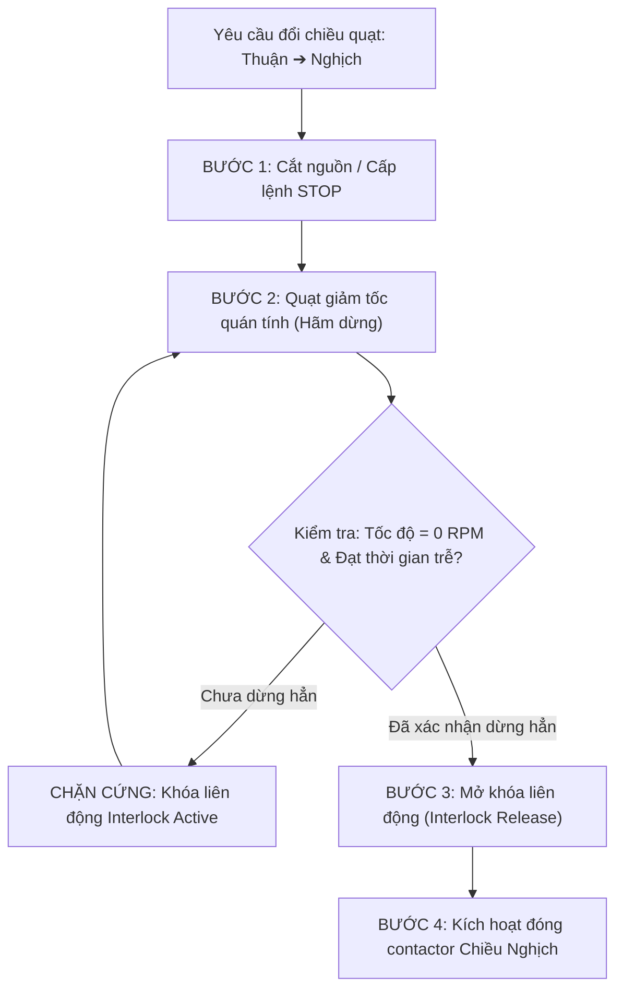
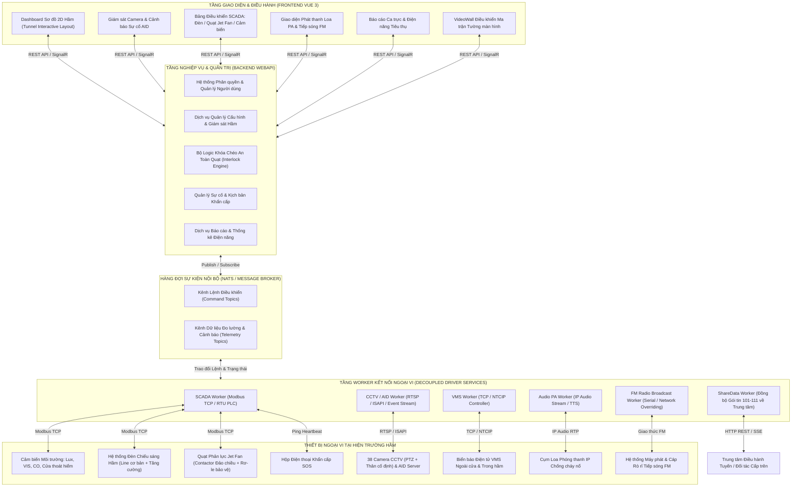

# 🎙️ BẢN GỠ BĂNG HỘI THOẠI KỸ THUẬT & BIÊN BẢN HỌP: KICK-OFF HNV ITS
> **Tệp ghi âm gốc:** [`DocBusinessThienAn/Kich off hnv its.m4a`](file:///Users/hoangquydat/ThienAn/DocBusinessThienAn/Kich%20off%20hnv%20its.m4a)  
> **Thời lượng:** 33 phút 36 giây (2015.9 giây)  
> **Dự án:** Hệ thống Quản lý Giám sát Giao thông Hầm ITS (ITS Tunnel Management System - Hầm Hải Vân / HNV ITS)  
> **Đơn vị thực hiện:** Công ty Cổ phần Công nghệ Thiên Ân (Thien An Technology - TAC)  
> **Thời điểm trao đổi:** Tháng 10/2026  
> **Thành phần tham gia:**
> - **Tech Lead:** Định hướng kiến trúc toàn hệ thống, bóc tách 4 phân hệ trụ cột, quy định cơ chế an toàn vận hành (interlock quạt), đánh giá rủi ro thiết bị ngoại vi, chiến lược chuyển đổi hệ thống (swap & DB migration).
> - **Dev:** Thảo luận chi tiết giải pháp kỹ thuật, giao thức kết nối phần cứng, biểu mẫu báo cáo ca trực, cơ chế hiển thị sơ đồ hầm và luồng dữ liệu chia sẻ qua ShareData.

---

## 📌 TÓM TẮT CÁC QUYẾT ĐỊNH KIẾN TRÚC & QUY TẮC CỐT LÕI

### 1. Bốn Phân Hệ Trụ Cột của ITS Hầm
Hệ thống Quản lý Hầm ITS (HNV ITS) được bóc tách thành 4 phân hệ nghiệp vụ độc lập:
1. **CCTV & AID (Automatic Incident Detection):**
   - Giám sát toàn diện 2 ống hầm với quy mô **38 camera** (19 camera PTZ/cố định trên mỗi hướng ống hầm).
   - Tích hợp giải thuật AID tự động phát hiện và cảnh báo tức thời các sự cố: xe dừng đỗ trái phép, người đi bộ trong hầm, khói/lửa cháy, đất đá hoặc hàng hóa rơi vãi trên làn xe.
2. **VMS (Variable Message Sign - Biển báo thông tin điện tử):**
   - Biển báo điện tử bố trí trước cửa hầm và phân bổ đều bên trong hầm.
   - Hiển thị thông điệp cảnh báo chữ (text), biểu tượng giao thông, hướng dẫn giảm tốc độ và kịch bản đóng làn/chuyển làn khi xảy ra sự cố.
3. **VideoWall (Ma trận tường màn hình Trung tâm Điều hành):**
   - Quản lý hiển thị tập trung tại Trung tâm điều hành hầm (TMC Hầm).
   - Đơn giản hơn VideoWall tuyến: tập trung vào 1–2 màn hình chính hiển thị **Sơ đồ mặt cắt phẳng 2D tương tác của hầm (Tunnel Interactive Layout Dashboard)** và ma trận kéo thả camera khẩn cấp.
4. **SCADA Hầm (Giám sát & Điều khiển Cơ điện - Tự động hóa):**
   - **Cảm biến môi trường:** Ánh sáng trong/ngoài hầm (Luxmeter), Cảm biến tầm nhìn (VIS), Cảm biến nồng độ khí độc CO/NOx, Cảm biến trạng thái mở cửa thoát hiểm (Cross-passage Door Sensors).
   - **Hệ thống Chiếu sáng (Lighting):** Điều khiển phân cấp đèn (đèn cơ bản, đèn tăng cường cửa vào/cửa ra) tự động theo cảm biến Lux hoặc điều khiển bằng tay theo kịch bản.
   - **Hệ thống Quạt thông gió phản lực (Jet Fan):** Điều khiển quạt quay thuận/nghịch theo hướng luồng khí và nồng độ khí CO, hoặc hút khói cưỡng bức khi xảy ra hỏa hoạn.
   - **Hệ thống Loa phát thanh (PA - Public Address):** Phát thông báo khẩn cấp bằng file âm thanh mẫu (mp3/wav thu âm hoặc text-to-speech) hoặc phát thanh trực tiếp từ microphone điều hành.
   - **Điện thoại khẩn cấp (SOS Phone):** Bố trí dọc theo các hốc cứu hộ trong hầm, giám sát tình trạng sống/chết (Heartbeat/IP Online/Offline).
   - **Hệ thống Tiếp sóng FM (FM Radio Re-broadcasting):** Đè sóng FM cục bộ trong hầm để phát thanh cảnh báo hoặc thông tin chỉ dẫn cho tài xế đang nghe đài radio trên xe ô tô khi lưu thông trong hầm.

---

### 2. Quy Tắc An Toàn Sống Còn (Critical Safeguard P0) — Quạt Phản Lực Jet Fan

> [!CAUTION]
> **CẤM ĐẢO CHIỀU QUAY QUẠT PHẢN LỰC TỨC THỜI (ZERO INSTANT REVERSAL):**  
> Quạt phản lực Jet Fan trong hầm có công suất lớn và quán tính cực lớn. Khi quạt đang quay theo **Chiều Thuận (Forward)**, **TUYỆT ĐỐI CẤM** cấp lệnh đảo sang **Chiều Nghịch (Reverse)** (hoặc ngược lại) ngay lập tức.  
> Việc đảo chiều đột ngột sẽ gây sụp áp lưới điện, quá tải dòng khởi động, cháy động cơ hoặc gãy cánh quạt, gây thiệt hại tài sản hàng tỷ đồng và đe dọa an toàn trong hầm.

**Quy trình hãm dừng và khóa chéo an toàn (Safety Interlock Sequence):**
1. Khi có lệnh chuyển chiều: Phần mềm gửi lệnh **DỪNG QUẠT (STOP)** trước tiên.
2. Động cơ quạt kích hoạt chu trình giảm tốc tự nhiên hoặc hãm điện động (Deceleration phase).
3. **Chốt chặn an toàn (Stop Interlock Timer / Feedback Gate):** Hệ thống bắt buộc phải chờ:
   - Cảm biến tốc độ vòng quay (Zero-speed switch/Encoder) phản hồi tốc độ $\approx 0\text{ RPM}$, HOẶC
   - Bộ đếm thời gian an toàn (Safety Delay Timer $\ge 60 - 90\text{ giây}$) đếm lùi về 0.
4. Chỉ khi trạng thái DỪNG HOÀN TOÀN được xác nhận ở cả phần mềm và thanh ghi trạng thái PLC, hệ thống mới cho phép kích hoạt tiếp điểm quay chiều ngược lại.
5. **Cơ chế phòng thủ 2 lớp (Dual-layer Interlock):** Khóa chéo phải được cấu hình đồng thời ở **Lớp Phần mềm điều khiển (Software Guard)** và **Lớp Rơ-le/PLC phần cứng (Hardware Interlock)**.



---

### 3. Kiến Trúc Bóc Tách Driver / Adapter Ngoại Vi (Decoupled Hardware Workers)

- **Nguyên tắc cô lập lỗi:** Tuyệt đối không nhúng logic giao tiếp phần cứng (Modbus, ISAPI, Onvif, RTSP, IP Audio, FM Serial/TCP) trực tiếp vào WebAPI nghiệp vụ.
- **Mô hình Worker chuyên trách:** Mỗi hệ thiết bị ngoại vi được tách thành các **Background Service / Worker độc lập**:
  - `ScadaWorker`: Đọc/ghi Modbus RTU/TCP tới PLC trạm hầm, quản lý cảm biến, đèn, quạt.
  - `CctvAidWorker`: Lấy luồng RTSP/ISAPI, bắt sự kiện AID từ camera/server AID.
  - `VmsWorker`: Đóng gói lệnh NTCIP/TCP gửi tới bảng điện tử VMS.
  - `AudioPaWorker`: Quản lý stream âm thanh IP Audio tới các cụm loa.
  - `FmBroadcastWorker`: Điều khiển thiết bị phát sóng/đè tần số FM.
- **Kênh truyền thông nội bộ:** Các Worker giao tiếp với WebAPI và cơ sở dữ liệu qua **Message Broker / NATS / hàng đợi sự kiện**, giúp hệ thống không bị nghẽn (non-blocking) khi thiết bị ngoại vi gặp sự cố mất mạng hoặc phản hồi chậm.

---

### 4. Giải Pháp Hiển Thị Bản Đồ Hầm: Nền Tảng Map Server Toàn Tuyến & Đề Xuất Sơ Đồ Hình Ảnh Tương Tác

- **Hiện trạng hệ thống toàn tuyến:** Hệ thống ITS hiện tại (Hữu Nghị - Chi Lăng) đang sử dụng **Map Server** (`Tac Map Server` / Web GIS) để quản lý và hiển thị toàn tuyến cao tốc.
- **Vấn đề thực tế đối với phân đoạn hầm:** Chiều dài hầm giao thông có giới hạn (vài km), khi đưa lên bản đồ số Map Server ở tỷ lệ chung thì đoạn hầm bị co lại rất nhỏ (*"ngắn ngủn à, trên bản đồ nó bằng nha xíu"*), dẫn đến việc 38 camera và hàng chục quạt, cảm biến, đèn bị chồng đè icon, gây khó khăn cho nhân viên trực thao tác click chọn.
- **Phương án giải pháp thảo luận trong cuộc họp:**
  - Giữ nền tảng Map Server cho toàn tuyến, nhưng đối với riêng phân hệ hầm: cân nhắc chuyển sang hoặc bổ sung giao diện **Dạng hình ảnh / Sơ đồ mặt cắt 2D có tương tác (Interactive Tunnel Diagram / Dashboard)**.
  - Hoặc vẽ thêm **vùng chi tiết lân cận (detail zone / inset overlay)** chèn vào để phóng to khu vực hầm, cho phép người vận hành tương tác trực tiếp lên từng thiết bị (bấm vào quạt/đèn để mở popup điều khiển).

---

### 5. Thiết Bị Tiếp Sóng FM — Đánh Giá Rủi Ro Cao Nhất Dự Án

- **Đặc thù kỹ thuật:** Thiết bị đè sóng FM (FM Radio Re-broadcasting / Tunnel Overriding) là hạng mục hoàn toàn mới, rất ít đơn vị tại Việt Nam đã tích hợp phần mềm thành công, chưa có thư viện giao thức chuẩn hóa sẵn.
- **Hành động bắt buộc:**
  - Xếp vào nhóm **Rủi ro P0 (High-Risk)** trong kế hoạch phát triển.
  - Cần yêu cầu nhà thầu phần cứng cung cấp sớm thiết bị mẫu, tài liệu SDK/API giao thức chi tiết và môi trường thử nghiệm thực địa trước khi code tính năng.

---

### 6. Báo Cáo Chuyên Biệt Ca Trực & Tiêu Thụ Điện Năng

- **Báo cáo sự cố ca trực:** Ghi nhận tự động các cảnh báo từ hệ thống AID, cảm biến CO vượt ngưỡng, cửa thoát hiểm mở, kèm thời gian nhân viên trực xử lý và ghi chú kết quả.
- **Biểu mẫu nhập tay chỉ số (Manual Entry Form):** Cho phép kỹ sư vận hành nhập các chỉ số đo kiểm định kỳ, kết quả bảo dưỡng hoặc nhật ký ca trực.
- **Báo cáo tiêu thụ điện năng:** Theo dõi công suất tiêu thụ điện định kỳ theo ca/ngày/tháng của 3 phụ tải lớn nhất hầm:
  1. Trạm bơm PCCC hầm.
  2. Dàn quạt thông gió phản lực (Jet Fans).
  3. Hệ thống đèn chiếu sáng hầm.

---

### 7. Chiến Lược Chuyển Đổi Hệ Thống (System Swap & Data Migration)

- **Chạy song song (Parallel Run):** Hệ thống SCADA/ITS cũ của hầm vẫn giữ nguyên để đảm bảo an toàn giao thông không gián đoạn; hệ thống mới được triển khai song song trên hạ tầng mạng LAN/VLAN riêng biệt để kiểm thử đối chiếu từng chức năng.
- **Chuyển đổi dữ liệu (ETL Data Migration):** Cơ sở dữ liệu của hệ thống cũ và hệ thống mới khác biệt 100% về cấu trúc bảng và mô hình entity -> Đội ngũ kỹ sư phát triển công cụ / script ETL tự động để bóc tách, chuẩn hóa và nạp toàn bộ dữ liệu lịch sử sự cố, danh mục thiết bị và nhật ký vận hành sang cơ sở dữ liệu mới.
- **Tích hợp liên thông cấp trên (ShareData):** Toàn bộ trạng thái thiết bị, sự cố và số liệu lưu lượng hầm được đóng gói vào các gói tin chuẩn hóa (Gói tin 101 – 111) thông qua module **ShareData**, truyền tự động về Trung tâm Điều hành Giao thông ITS toàn tuyến và các đối tác liên quan.

---

## 📜 NỘI DUNG GỠ BĂNG CHI TIẾT THEO MỐC THỜI GIAN

```mermaid
timeline
    title Tiến trình Thảo luận Cuộc họp Kick-off HNV ITS
    00:00 - 11:00 : Tổng quan 4 Phân hệ : CCTV & AID (38 Cam) : VMS Dẫn luồng : VideoWall Ma trận : Khái quát SCADA
    11:00 - 22:00 : Chi tiết SCADA Hầm : Cảm biến Môi trường : Chiếu sáng : Quạt Jet Fan & Interlock : Loa PA : Tiếp sóng FM
    22:00 - 33:36 : Rủi ro Thiết bị FM : Kế thừa Cù Mông : Báo cáo Điện năng : Dashboard 2D : Chiến lược Swap & ShareData
```

### 🕒 [00:00 – 11:00] Khởi động dự án, Phân tích Hiện trạng & Bốn Phân hệ Trụ cột

- **[00:02] Tech Lead:** Bữa nay mình họp kick-off về cái phần quản lý hầm của dự án HNV ITS. Về tổng quan thì hệ thống quản lý hầm nó sẽ có một số cái phân hệ chính mà bên mình cần nắm rõ phạm vi để bóc tách kiến trúc.
- **[00:25] Tech Lead:** Đầu tiên là phân hệ CCTV. Đối với hầm này thì quy mô mỗi ống hầm sẽ có khoảng 19 camera. Hầm có 2 ống độc lập cho 2 chiều chạy, thành ra tổng cộng là có 38 camera giám sát xuyên suốt bên trong hầm. Camera này nó vừa làm nhiệm vụ quan sát trực quan cho điều hành viên, vừa kết nối vào hệ thống AID để phát hiện sự cố tự động.
- **[01:10] Dev:** 38 cam này là kết hợp cả camera PTZ với cam thân cố định đúng không anh?
- **[01:15] Tech Lead:** Đúng rồi, ở hai đầu cửa hầm và các vị trí trọng yếu sẽ có cam quay quét PTZ để bao quát, còn dọc theo lòng hầm cách một khoảng nhất định sẽ có các camera thân cố định góc nhìn dọc theo tim đường. Quan trọng nhất của camera hầm là giải thuật AID. Nếu có xe tải bị chết máy dừng giữa đường, hoặc có người đi bộ lạ đi lạc vào trong hầm, hoặc có dấu hiệu khói/cháy phát sinh là hệ thống AID phải nhận diện và bắn cảnh báo ngay lập tức về trung tâm.
- **[02:15] Tech Lead:** Phân hệ thứ hai là VMS. Hệ thống biển báo điện tử VMS trong hầm nó chia làm hai nhóm: nhóm đặt trước cửa hầm để cảnh báo từ xa (cho tài xế biết tình trạng hầm thông thoáng hay đang hạn chế tốc độ hoặc cấm vào hầm khi có sự cố), và nhóm VMS phụ gắn bên trong hầm chỉ dẫn từng làn đường. VMS này sẽ nhận lệnh điều khiển hiển thị các nội dung cảnh báo khẩn cấp, biển báo chữ và hình ảnh đồ họa tiêu chuẩn.
- **[03:30] Tech Lead:** Phân hệ thứ ba là VideoWall. Bên trung tâm hầm cũng có hệ thống tường màn hình, tuy nhiên quy mô của nó sẽ gọn hơn so với VideoWall của tuyến cao tốc. VideoWall hầm thường chỉ có 1 đến 2 màn hình lớn để hiển thị cái sơ đồ tổng thể toàn bộ hầm, trạng thái các thiết bị cơ điện, và hiển thị luân phiên hoặc tự động bung pop-up camera khi AID bắt được sự cố.
- **[04:45] Dev:** Còn phân hệ thứ tư là SCADA hầm đúng không anh? Cái này chắc là phần việc nặng nhất?
- **[04:50] Tech Lead:** Đúng, phân hệ cốt lõi nhất của hầm chính là hệ thống SCADA hầm – quản lý toàn bộ thiết bị cơ điện và cảm biến tự động hóa. Hầm nó như một cơ thể sống, bên trong tối và kín gió nên bắt buộc phải có hệ thống cảm biến môi trường, hệ thống đèn chiếu sáng, quạt thông gió, hệ thống thông tin liên lạc khẩn cấp gồm loa PA, điện thoại SOS và tiếp sóng FM. Mình sẽ đi sâu vào từng thiết bị của SCADA này.

---

### 🕒 [11:00 – 22:00] Đặc tả Kỹ thuật Thiết bị SCADA Hầm: Cảm biến, Đèn, Quạt Jet Fan, Loa PA & FM

- **[11:02] Tech Lead:** Về cảm biến môi trường trong hầm, chúng ta có các loại:
  - Cảm biến ánh sáng (Luxmeter): Đặt ở bên ngoài cửa hầm và bên trong đoạn đầu hầm. Đo cường độ ánh sáng tự nhiên để hệ thống tự động điều chỉnh độ sáng đèn bên trong, tránh hiện tượng "mù tạm thời" (hiệu ứng hố đen/lỗ trắng) cho tài xế khi chạy từ ngoài trời nắng vào hầm tối hoặc ngược lại.
  - Cảm biến tầm nhìn (VIS): Đo độ trong suốt của không khí và khói bụi trong lòng hầm.
  - Cảm biến nồng độ khí CO: Giám sát nồng độ khí độc phát thải từ ống xả phương tiện. Khi nồng độ CO vượt ngưỡng an toàn (ppm), hệ thống phải kích hoạt quạt thông gió để làm sạch không khí.
  - Cảm biến mở cửa thoát hiểm: Các cửa hầm lánh nạn (cross-passage) nối giữa 2 ống hầm. Bình thường cửa đóng kín, nếu có người mở cửa thoát hiểm thì cảm biến từ/tiếp điểm trên cửa phải báo về phần mềm ngay.
- **[13:40] Dev:** Hệ thống đèn chiếu sáng trong hầm điều khiển phân cấp như thế nào anh?
- **[13:45] Tech Lead:** Đèn chiếu sáng hầm chia thành nhiều dải: dải đèn cơ bản chạy suốt chiều dài hầm và dải đèn tăng cường ở khu vực cửa hầm. Phần mềm sẽ có hai chế độ: Chế độ Tự động (Auto) – đọc giá trị từ cảm biến Luxmeter bên ngoài rồi tra theo bảng kịch bản chiếu sáng để bật/tắt các line đèn tương ứng; và Chế độ Bằng tay (Manual) – cho phép điều hành viên bật tắt theo yêu cầu bảo trì hoặc kịch bản diễn tập.
- **[15:10] Tech Lead:** Bây giờ đến phần đặc biệt quan trọng: **Quạt thông gió phản lực (Jet Fan)**. Cái này anh em lưu ý kỹ giùm anh, đây là quy tắc sống còn của hệ thống điều khiển quạt hầm.
- **[15:30] Tech Lead:** Quạt phản lực gắn trên trần hầm có hai chiều quay: Chiều Thuận (đẩy luồng khí theo hướng xe chạy bình thường) và Chiều Nghịch (thổi ngược lại khi cần đẩy khói ra một cửa hầm cụ thể theo kịch bản PCCC). Nhưng **TUYỆT ĐỐI KHÔNG ĐƯỢC PHÉP ĐẢO CHIỀU TỨC THÌ**. Nếu một cái quạt công suất mấy chục kilowatt đang quay hết tốc lực theo chiều này mà mình gửi lệnh đảo chiều ngay lập tức thì quán tính cực lớn sẽ làm gãy cánh quạt, vặn gãy trục hoặc cháy động cơ ngay lập tức. Tiền quạt này đắt khủng khiếp, vài tỷ một bộ chứ không ít.
- **[16:50] Dev:** Tức là mình phải có một quy trình hãm dừng và độ trễ an toàn đúng không anh?
- **[16:55] Tech Lead:** Đúng! Quy trình bắt buộc là: Khi muốn đổi từ Thuận sang Nghịch, phần mềm phải gửi lệnh DỪNG (STOP) trước. Sau đó phải chờ cho quạt giảm tốc hoàn toàn. Mình phải khóa logic lại, có timer đếm lùi an toàn hoặc đọc tín hiệu cảm biến tốc độ báo về bằng 0, thông thường phải chờ từ 60 đến 90 giây cho quạt dừng hẳn rồi mới được cho phép bấm hoặc gửi lệnh quay chiều ngược lại. Cái logic interlock này phải chặn cứng ở cả giao diện phần mềm lẫn thanh ghi PLC bên dưới, không bao giờ được để sót.
- **[18:40] Dev:** Còn hệ thống Loa phát thanh và Điện thoại SOS thì sao anh?
- **[18:45] Tech Lead:** Điện thoại SOS thì bố trí ở các hốc cứu hộ cách nhau tầm 100 đến 150m. Trước đây một số hầm có chức năng nhấc máy gọi thẳng vào tổng đài IP, nhưng thực tế khai thác hiện tại phần mềm của mình chủ yếu làm nhiệm vụ giám sát trạng thái mạng: ping heartbeat/IP để biết thiết bị nào online, thiết bị nào bị đứt cáp mất kết nối để báo đội bảo trì.
- **[19:35] Tech Lead:** Hệ thống Loa phát thanh (PA): Dùng cụm loa phóng thanh IP chống cháy nổ gắn dọc trần hầm. Phần mềm cần có tính năng phát các file âm thanh thu âm sẵn (file mp3/wav mẫu như: "Chú ý có sự cố cháy, đề nghị các phương tiện tắt máy và đi vào cửa thoát hiểm..."), hỗ trợ công cụ text-to-speech hoặc phát thanh trực tiếp từ micro tại phòng điều hành khi cần thông báo khẩn.
- **[20:50] Tech Lead:** Còn một hệ thống nữa là **Tiếp sóng FM (FM Radio Re-broadcasting)**. Xe ô tô đi vào hầm dài thì sóng radio ngoài trời sẽ bị mất. Hệ thống này thu sóng FM từ ngoài đưa vào hầm qua dây cáp rò rỉ (leaky feeder cable), và có bộ phát đè sóng. Khi có sự cố, hệ thống cho phép đè lên các tần số FM phổ biến (như VOV Giao thông) để tài xế đang nghe radio trên xe ô tô trong hầm nhận được ngay cảnh báo sự cố hầm.

---

### 🕒 [22:00 – 33:36] Đánh giá Rủi ro Thiết bị FM, So sánh Cù Mông, Báo cáo Điện năng, Dashboard 2D & Chiến lược Swap

- **[22:05] Tech Lead:** Trong các thiết bị vừa nêu, anh đánh giá **hệ thống Tiếp sóng FM là rủi ro kỹ thuật cao nhất (High Risk)** của dự án này. Tại vì các thiết bị như CCTV, VMS, quạt hay đèn thì bên mình đã có kinh nghiệm làm ở các dự án trước như hầm Cù Mông, hầm Đèo Cả hay bên Hữu Nghị - Chi Lăng rồi. Nhưng cái bộ đè sóng FM này ít đơn vị làm, chưa có chuẩn API có sẵn. Bên mình cần phải làm việc sớm với nhà thầu cung cấp thiết bị phần cứng để lấy tài liệu giao thức truyền thông, cổng kết nối (RS485 hay IP) và mượn thiết bị test thử nghiệm ngay.
- **[23:45] Dev:** Hệ thống này có kế thừa được gì từ dự án hầm Cù Mông không anh?
- **[23:50] Tech Lead:** Hầu hết logic nghiệp vụ cơ bản về giám sát thiết bị hầm, kịch bản chiếu sáng và quạt thông gió là mình kế thừa từ kinh nghiệm bên hầm Cù Mông và Hữu Nghị - Chi Lăng. Tuy nhiên ở HNV ITS lần này, chủ đầu tư yêu cầu thêm các mẫu **Báo cáo chuyên biệt**:
  - Thứ nhất là Báo cáo ca trực và tổng hợp sự cố phát sinh trong ca.
  - Thứ hai là Form nhập chỉ số vận hành bằng tay cho nhân viên ca trực nhập nhật ký kiểm tra định kỳ.
  - Thứ ba là **Báo cáo điện năng tiêu thụ** của 3 cụm phụ tải lớn: Hệ thống bơm PCCC hầm, Dàn quạt thông gió phản lực và Hệ thống đèn chiếu sáng hầm. Cái này bên vận hành họ rất cần để hạch toán chi phí điện năng hàng tháng.
- **[26:10] Dev:** Về phần hiển thị giao diện, VideoWall hầm có dùng Map Server như bên cao tốc không anh?
- **[26:15] Tech Lead:** Thì cái bản đồ của Hữu Nghị Chi Lăng hiện tại đang là Google Map, ủa không, cái gì... cái gì **Map Server** đúng không? Map Server! Nhưng mà cái hầm có thể là sẽ chuyển qua dạng hình đó. Dạng hình thì nó sẽ dễ quản lý hơn. Chứ cái cái kia nếu mà trên bản đồ nó rất là nhỏ, cái hầm nó ngắn ngủn à! Trên bản đồ nó bằng nha xíu à thì không thể nào nhìn thấy được. Thì mình sẽ dùng qua một cái hình ảnh, và hình này thì nó sẽ cho phép mình tương tác. Có thể mình sẽ vẽ thêm cái vùng lân cận gì chèn vô kia thôi... để mình tương tác, mình thao tác trên cái hầm.
- **[27:40] Tech Lead:** Còn về VideoWall hầm, tường màn hình của hầm chỉ có 1 đến 2 màn hình ở giữa thôi. Lúc trước bên hệ cũ mấy anh chia các màn hình ra nhiều loại, nhưng bản chất vẫn là một trang web, nên đợt demo hôm bữa bị thắc mắc là tại sao lại chia nhiều loại màn hình đang cùng chức năng. Đợt này mình gom lại, gắn thêm cái Dashboard hầm, người trực bấm vào là link tới các module chức năng tương ứng rất nhanh.
- **[28:30] Dev:** Về việc triển khai, mình sẽ thay thế hệ thống cũ như thế nào anh? Có cần ngắt hệ thống cũ không?
- **[28:35] Tech Lead:** Tuyệt đối không được ngắt hệ thống cũ! Hầm đang chạy xe 24/7, nếu ngắt giám sát là mất an toàn ngay. Chiến lược của mình là **Chạy song song (Parallel Run)**. Hệ thống cũ vẫn giám sát bình thường, mình dựng hệ thống mới trên mạng độc lập để cấu hình và kiểm thử từng phân hệ. Khi nào hệ thống mới hoàn toàn ổn định và được nghiệm thu thì mới thực hiện chuyển đổi chính thức.
- **[29:40] Tech Lead:** Về cơ sở dữ liệu, DB cũ và DB mới của mình cấu trúc khác nhau hoàn toàn 100%. Cho nên mình phải viết tool hoặc script ETL để migrate dữ liệu: chuyển danh mục thiết bị, lịch sử sự cố và các thông số vận hành cũ sang cấu trúc bảng mới của Thiên Ân.
- **[30:50] Dev:** Kiến trúc code của các phần kết nối thiết bị thì tổ chức thế nào anh?
- **[30:55] Tech Lead:** Phải bóc tách hoàn toàn. Áp dụng mô hình Worker độc lập như bên VideoWall và ShareData. Phần kết nối phần cứng Modbus của SCADA, giao thức VMS, luồng RTSP camera, audio loa PA và FM đều phải tách thành các Background Service riêng biệt. Lỗi phần cứng không bao giờ được phép làm ảnh hưởng hay treo WebAPI nghiệp vụ.
- **[32:10] Dev:** Còn việc kết nối với Trung tâm ITS tuyến trên thì sao anh?
- **[32:15] Tech Lead:** Dữ liệu hầm sẽ được đóng gói và chia sẻ về Trung tâm ITS tuyến thông qua phân hệ **ShareData** của bên mình. Các gói tin chuẩn hóa (như gói 101, 102, 105, 110...) sẽ mang dữ liệu trạng thái hầm, sự cố AID và số liệu giao thông về trung tâm điều hành chung. Ngoài ra cũng có thể nhúng trực tiếp giao diện Web Portal hầm qua mạng WAN cho cấp trên theo dõi.
- **[33:15] Tech Lead:** Rồi, cơ bản các đầu việc là như vậy. Anh em chia nhau theo từng phân hệ: Backend chuẩn bị cấu trúc Worker và Entity, Frontend lên khung Dashboard 2D hầm, và team tích hợp phần cứng liên hệ ngay để lấy tài liệu thiết bị FM. Kết thúc cuộc họp ở đây.

---

## 🏗️ KIẾN TRÚC TỔNG THỂ HỆ THỐNG ITS HẦM (HNV ITS)



---

## 📋 BẢNG DANH MỤC THIẾT BỊ NGOẠI VI & YÊU CẦU TÍCH HỢP

| STT | Nhóm Thiết Bị | Danh Mục Cụ Thể | Số Lượng / Vị Trí | Giao Thức Kết Nối | Yêu Cầu Kỹ Thuật & Nghiệp Vụ Cốt Lõi | Mức Độ Rủi Ro |
|:---:|---|---|---|---|---|:---:|
| **1** | **Camera & AID** | Camera PTZ & Cố định | 38 cam (19 cam x 2 ống hầm) | ONVIF, RTSP, Hikvision ISAPI | Tự động bắt sự cố dừng xe, khói, người đi bộ; tự động pop-up trên VideoWall. | Trung bình |
| **2** | **Biển báo VMS** | VMS cửa hầm & trong hầm | Theo thiết kế từng hướng | TCP/IP, NTCIP | Hiển thị chữ tiếng Việt unicode, đồ họa cảnh báo kịch bản đóng làn hầm. | Thấp |
| **3** | **Cảm biến Hầm** | Lux, VIS, CO, Door | Bố trí dọc 2 ống hầm | Modbus TCP qua PLC | Đọc chu kỳ 1s - 5s, kích hoạt cảnh báo ngưỡng, lưu lịch sử môi trường. | Thấp |
| **4** | **Chiếu sáng Hầm** | Đèn cơ bản & Tăng cường | Dọc toàn bộ chiều dài hầm | Relay output qua PLC Modbus | Chế độ Auto theo Luxmeter cửa hầm hoặc Manual theo kịch bản vận hành. | Thấp |
| **5** | **Quạt Phản lực** | Quạt Jet Fan trần hầm | Theo cặp cụm quạt 2 ống | PLC Modbus + Feedback contactor | **Interlock 2 lớp**: Khóa cứng thời gian dừng (60-90s) trước khi đổi chiều quay. | **Cao (P0)** |
| **6** | **Loa Thông báo** | Cụm loa IP chống nổ | Dọc hầm & hốc kỹ thuật | RTP / IP Audio Stream | Phát file âm thanh mp3/wav mẫu, Text-To-Speech hoặc phát live micro. | Trung bình |
| **7** | **Điện thoại SOS** | Hộp gọi cứu nạn khẩn cấp | Hốc cứu hộ dọc hầm | ICMP Ping / SIP Heartbeat | Giám sát trạng thái sống/chết (online/offline) của thiết bị trên bản đồ. | Thấp |
| **8** | **Tiếp sóng FM** | Bộ phát đè tần số FM | Trạm điều hành & Cáp rò rỉ | RS485 / Serial / TCP Custom | Đè sóng radio các kênh FM phổ biến khi xảy ra tình huống khẩn cấp. | **Rất Cao (P0)** |
| **9** | **Tường Màn hình** | VideoWall Trung tâm | 1 - 2 màn hình lớn tại TMC | HDMI Matrix / Web Dashboard | Hiển thị sơ đồ phẳng 2D hai ống hầm và ma trận camera khẩn cấp. | Thấp |
| **10**| **Chia sẻ Dữ liệu** | ShareData Gateway | Tích hợp trong hệ thống | HTTP REST, SSE (Gói 101-111) | Truyền tự động sự cố hầm, trạng thái thiết bị và lưu lượng về tuyến trên. | Thấp |

---

## 🎯 MA TRẬN RỦI RO & KẾ HOẠCH HÀNH ĐỘNG (ACTION ITEMS)

### Ma Trận Quản Trị Rủi Ro Dự Án (Risk Matrix)

| Mã Rủi Ro | Phân Hệ / Thiết Bị | Nội Dung Nguy Cơ | Tác Động | Biện Pháp Phòng Ngừa & Giảm Thiểu |
|---|---|---|:---:|---|
| **R-01** | **SCADA / Jet Fan** | Đảo chiều quạt tức thời khi đổi kịch bản vận hành gây cháy nổ / gãy trục quạt. | **Nghiêm trọng (Catastrophic)** | Thiết kế chu trình dừng bắt buộc; cài đặt bộ đếm thời gian trễ an toàn (Safety Delay Timer $\ge 60\text{s}$) và khóa chéo logic cả trên phần mềm lẫn phần cứng PLC. |
| **R-02** | **Phát thanh FM** | Thiết bị đè sóng FM là công nghệ mới, thiếu tài liệu giao thức và SDK chuẩn. | **Rất Cao (High Impact)** | Ưu tiên làm việc khẩn cấp với nhà cung cấp phần cứng; yêu cầu cung cấp thiết bị demo và tài liệu protocol trong tuần đầu kick-off. |
| **R-03** | **Chuyển đổi Hệ thống** | Gián đoạn giám sát giao thông hầm trong quá trình thay thế hệ thống cũ. | **Cao (Critical Impact)** | Bắt buộc áp dụng chiến lược Chạy song song (Parallel Run); chỉ cắt chuyển sau khi hệ thống mới hoàn thành chạy thử đối chiếu 100%. |
| **R-04** | **Chuyển đổi CSDL** | Sai lệch hoặc mất mát dữ liệu sự cố và lịch sử vận hành cũ do schema khác biệt 100%. | **Trung bình** | Viết script ETL tự động có logging chi tiết; thực hiện kiểm thử đối chiếu toàn vẹn dữ liệu trước và sau migrate. |
| **R-05** | **Giao diện Giám sát** | Bản đồ Map Server toàn tuyến thu nhỏ hầm khiến khó thao tác icon thiết bị. | **Trung bình** | Bổ sung giao diện Dashboard Sơ đồ mặt cắt 2D hầm hoặc vẽ vùng chi tiết (detail zone overlay) chèn vào Map Server. |

