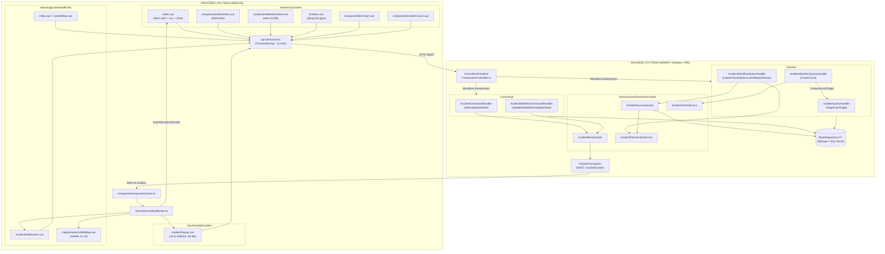
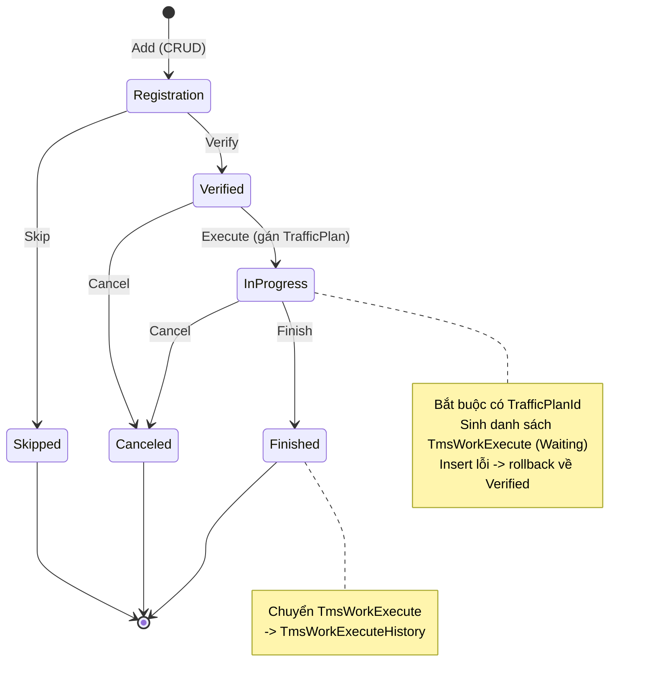
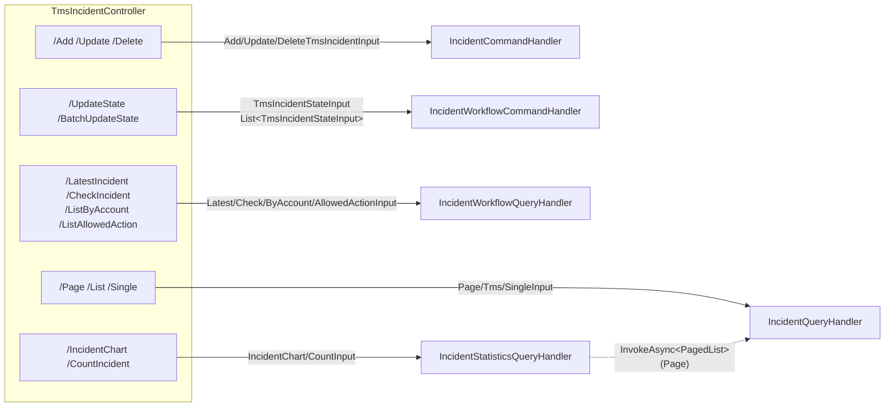
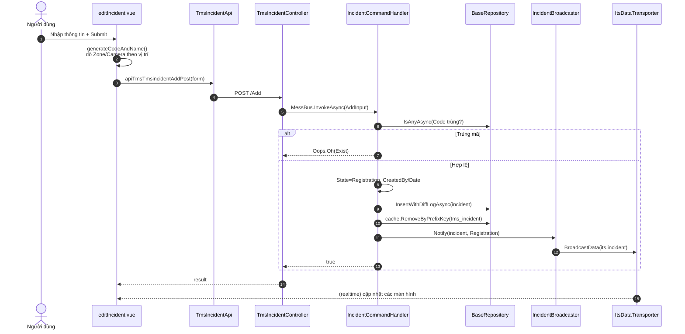
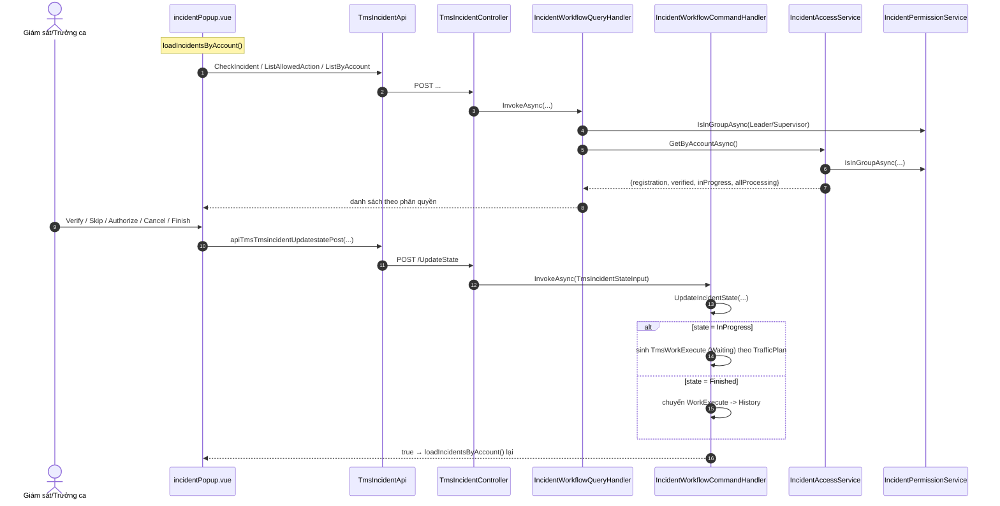
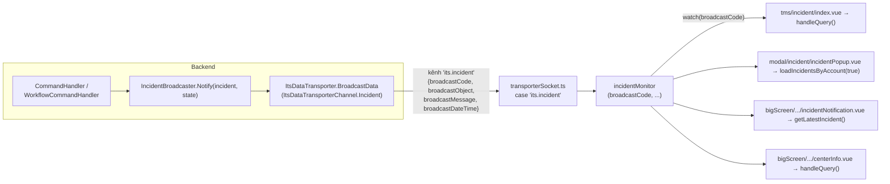
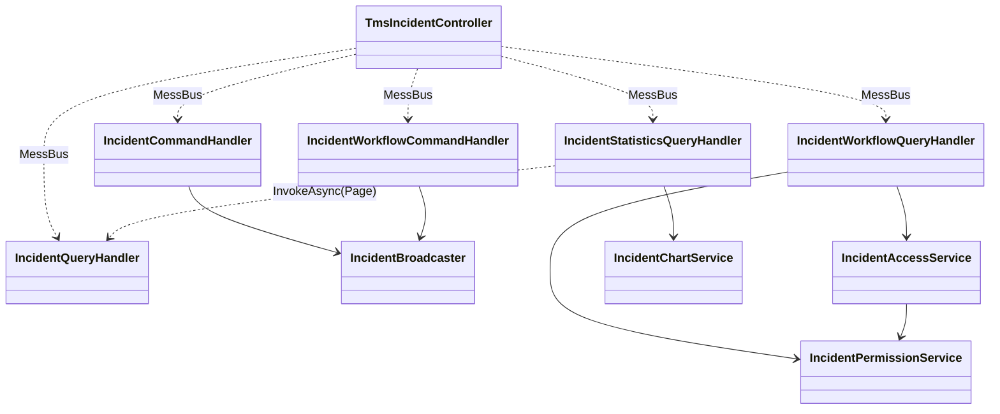
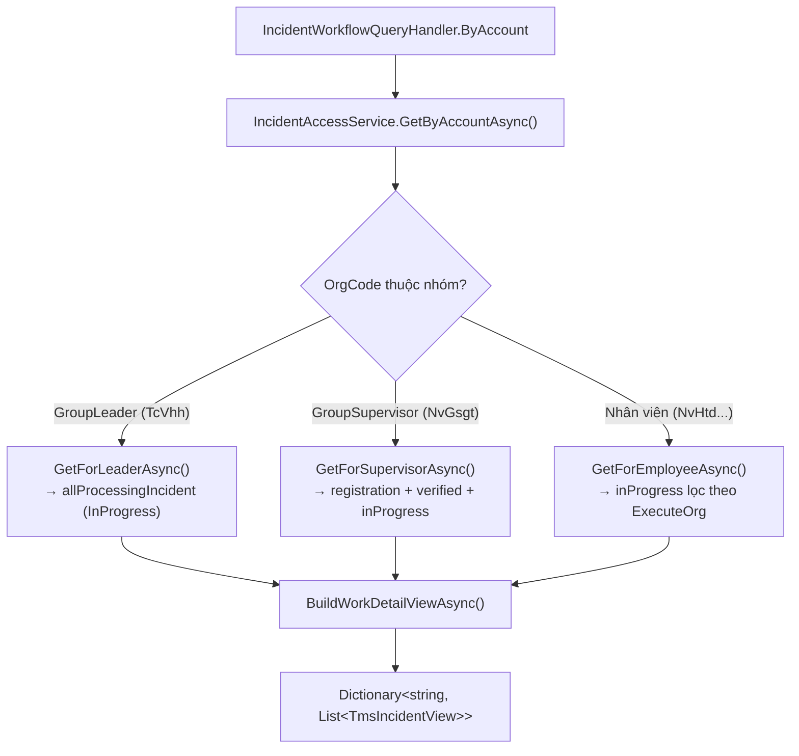
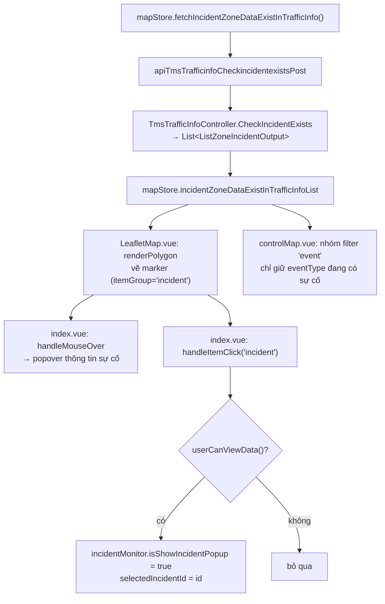

# Sơ đồ kiến trúc & luồng xử lý Sự cố (Incident)

> Tài liệu sơ đồ hoá source code và luồng xử lý phân hệ **TMS Incident** (Backend .NET + Frontend Vue). Bổ sung cho `incident-flow.md` (mô tả chi tiết bằng lời). Sơ đồ dùng cú pháp **Mermaid** (xem được trên VS Code/GitHub/Kiro preview).

---

## 1. Bản đồ source code (component map)

---

## 2. Vòng đời trạng thái sự cố (state machine)

Giá trị enum `TmsIncidentStateEnum`: `Skipped=0, Registration=1, Verified=2, InProgress=3, Finished=4, Canceled=5` (và `Updated=99`, `Deleted=100` chỉ dùng cho thông báo realtime).

---

## 3. Điều phối CQRS — message → handler

> Mỗi message type được Wolverine định tuyến tới **đúng một** `HandleAsync`. `IncidentStatisticsQueryHandler` tái sử dụng truy vấn Page bằng cách dispatch lại `PageTmsIncidentInput` qua `IMessageBus`.

---

## 4. Luồng tạo sự cố (Add) — sequence

---

## 5. Luồng xử lý realtime trong Popup — sequence

---

## 6. Luồng realtime broadcast (BE → FE)

---

## 7. Sơ đồ phụ thuộc lớp BE (class dependency)

---

## 8. Phân quyền nhóm → dữ liệu hiển thị (ByAccount)

---

## 9. Sự cố trên bản đồ (BigScreen) — luồng hiển thị & tương tác

---

## 10. Bảng tham chiếu file ↔ chức năng

| Chức năng | Backend | Frontend |
|-----------|---------|----------|
| CRUD sự cố | `IncidentCommandHandler`, `IncidentQueryHandler` | `index.vue`, `editIncident.vue`, `detailIncident.vue` |
| Chuyển trạng thái | `IncidentWorkflowCommandHandler` | `index.vue` (skip/cancel), `incidentPopup.vue` |
| Theo account/phân quyền | `IncidentWorkflowQueryHandler`, `IncidentAccessService`, `IncidentPermissionService` | `incidentPopup.vue`, `incidentMonitor.ts` |
| Biểu đồ/thống kê | `IncidentStatisticsQueryHandler`, `IncidentChartService` | `lineChart.vue`, `incidentCount.vue` |
| Thông báo realtime | `IncidentBroadcaster` → `ItsDataTransporter` | `transporterSocket.ts`, `incidentMonitor.ts` |
| Hiển thị trên bản đồ | `TmsTrafficInfoController` (zone-incident) | `LeafletMap.vue`, `controlMap.vue`, `incidentNotification.vue` |
| Dòng thời gian | (đọc WorkExecute/History) | `timeline.vue` |

---

> Ghi chú: tên handler đã chuẩn hoá theo refactor mới (`Incident*Handler`, bỏ tiền tố `Tms`). Route/endpoint và DTO giữ nguyên (`api/tms/TmsIncident/...`). Chi tiết logic xem `incident-flow.md`; đề xuất tối ưu xem `incident-improvements.md`/`incident-refactor.md`.
