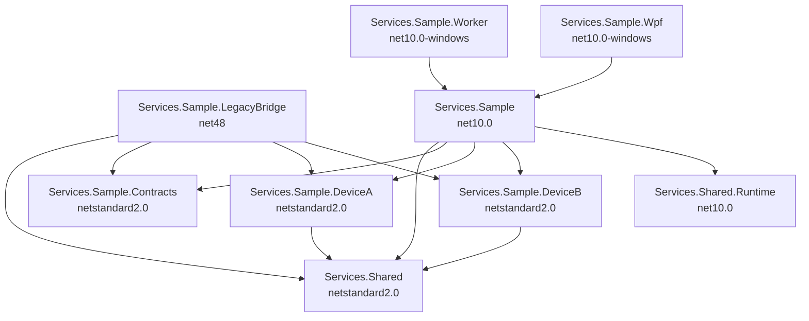

# PROJECT STRUCTURE WPF + WORKER V3

> Template `src/Services/Sample` cho .NET 10, WPF và Windows Worker Service.  
> Contract/codec portable dùng `netstandard2.0` để .NET 10 và .NET Framework 4.8 cùng tham chiếu.  
> Event nội bộ dùng MediatR; NATS chỉ dùng cho giao tiếp bên ngoài process.

## 1. Mục tiêu

Template minh họa các yêu cầu:

1. Worker là process production chạy pipeline và ghi dữ liệu; WPF là client tương tác có thể điều khiển cùng pipeline.
2. Nguồn thiết bị (Device A + Device B), API và NATS input đều đi qua cùng một bounded queue.
3. Event trong process dùng MediatR; feed quan sát cho UI dùng `PipelineEventStream`; không dùng NATS làm event dispatcher nội bộ.
4. Thiết bị A, B và thiết bị bổ sung dùng codec DLL độc lập; luồng thu thập tổng hợp nhiều thiết bị vào một kết quả.
5. Chuyển đổi giữa các thiết bị đi qua canonical model, không tạo converter theo từng cặp.
6. `Services.Shared` và `Services.Sample.Contracts` dùng `netstandard2.0` để consumer .NET 10 và .NET Framework 4.8 dùng chung.
7. Infrastructure chỉ chạy trên .NET 10 được tách vào `Services.Shared.Runtime`.
8. Không tạo interface cho mỗi class. Chỉ giữ interface khi có nhiều implementation hoặc là public plugin contract.

Luồng chính:

```text
Device A + Device B (hoặc API / NATS input)
          |
          v
  MessageQueue<RawMessage>
          |
          v
 normalize -> persist
          |
          +---- MediatR notification  (domain event nội bộ)
          +---- PipelineEventStream   (feed quan sát in-process cho UI)
          +---- NATS output           (external integration, optional)
```

Luồng thu thập + tổng hợp thiết bị (mỗi chu kỳ):

```text
Device A: canonical -> DeviceACodec.Encode -> frame A -> Decode -> canonical A
Device B: canonical -> DeviceBCodec.Encode -> frame B -> Decode -> canonical B
        -> AggregatedReading (count/avg/min/max/status của A + B)
        -> RawMessage(source = "devices")
        -> MessageQueue<RawMessage> -> pipeline
```

Encode rồi Decode ngay trong một chu kỳ để chạy thật cả hai chiều codec (mô phỏng thiết bị phát frame và pipeline giải mã lại).

## 2. Project layout

```text
src/Services/
├── Shared/
│   ├── Services.Shared/                         # netstandard2.0, portable
│   │   ├── Services.Shared.csproj
│   │   └── Devices/
│   │       ├── IDeviceCodec.cs
│   │       ├── DeviceFrame.cs
│   │       ├── DeviceTarget.cs
│   │       └── CanonicalDeviceMessage.cs
│   │
│   └── Services.Shared.Runtime/                 # net10.0, infrastructure
│       ├── Services.Shared.Runtime.csproj
│       ├── NLog.config
│       ├── Configuration/
│       ├── Extensions/
│       ├── Messaging/
│       │   └── NatsBus.cs
│       ├── Persistence/
│       ├── Queuing/
│       │   └── MessageQueue.cs
│       └── Time/
│           └── ServiceClock.cs
│
└── Sample/
    ├── Services.Sample.Contracts/               # netstandard2.0
    │   └── Messages/
    │       ├── RawMessage.cs
    │       └── ProcessedMessage.cs
    │
    ├── Services.Sample.DeviceA/                 # netstandard2.0 DLL
    │   └── DeviceACodec.cs
    │
    ├── Services.Sample.DeviceB/                 # netstandard2.0 DLL
    │   └── DeviceBCodec.cs
    │
    ├── Services.Sample.LegacyBridge/            # net48 sample host
    │   └── Program.cs
    │
    ├── Services.Sample/                         # net10.0 business/core
    │   ├── Configuration/
    │   ├── Extensions/
    │   └── Features/
    │       ├── DataFlow/
    │       │   ├── Mapping/
    │       │   ├── Models/
    │       │   ├── Notifications/           # MediatR domain event
    │       │   ├── Observability/           # PipelineEventStream + PipelineActivity (UI feed)
    │       │   ├── Pipeline/
    │       │   ├── Processing/
    │       │   ├── Persistence/
    │       │   └── Sources/                 # Api, Nats (external input, config-gated)
    │       └── Devices/
    │           ├── AggregatedReading.cs
    │           ├── DeviceAggregationService.cs
    │           ├── DeviceAcquisitionRunner.cs
    │           ├── DeviceAcquisitionHostedService.cs
    │           ├── DeviceCodecRegistry.cs
    │           ├── DeviceMessageConverter.cs
    │           └── DevicePluginLoader.cs
    │
    ├── Services.Sample.Worker/                  # net10.0-windows (auto-run pipeline)
    └── Services.Sample.Wpf/                     # net10.0-windows (interactive: Load config/Start/Stop)
```

## 3. Dependency graph



Quy tắc:

- Portable project không reference Runtime, SqlSugar, NLog, Hosting, NATS hoặc `Shared.Utility`.
- Runtime project được phép reference technical integration hiện có.
- Device codec chỉ reference `Services.Shared` portable và vendor SDK tương thích target của codec.
- Worker/WPF chỉ reference Core.
- MediatR notification không được publish hoặc subscribe qua NATS.

## 4. Chính sách interface tối giản

Baseline chỉ khai báo một custom interface:

```csharp
public interface IDeviceCodec
{
    string DeviceType { get; }
    string ProtocolVersion { get; }

    CanonicalDeviceMessage Decode(DeviceFrame frame);

    DeviceFrame Encode(
        CanonicalDeviceMessage message,
        DeviceTarget target);
}
```

Lý do giữ `IDeviceCodec`: có nhiều implementation từ các DLL thiết bị khác nhau.

Không tạo các interface one-to-one sau:

```text
ILogManager<T>
IDbFactory
IServiceClock
IMessageQueue<T>
IMessageBus
IConfigService
IDataProcessor
IDemoPublisher
IPluginLoader
IDeviceCodecRegistry
```

Thay bằng concrete class:

```text
ILogger<T>                 # abstraction chuẩn của Microsoft
DbFactory
ServiceClock
MessageQueue<T>
NatsBus
ConfigService
DataProcessor
PipelineEventStream        # feed quan sát in-process cho UI
DevicePluginLoader
DeviceCodecRegistry
DeviceMessageConverter
DeviceAggregationService   # thu thập + tổng hợp Device A/B
DeviceAcquisitionRunner    # điều khiển Start/Stop luồng thu thập
```

Không dùng số lượng consumer làm lý do tạo interface. Interface chỉ được thêm khi:

1. có từ hai implementation thực tế;
2. là contract được implement bởi DLL bên ngoài;
3. cần public polymorphism ổn định qua assembly boundary.

## 5. Portable boundary và legacy

### 5.1. Vì sao dùng `netstandard2.0`

`netstandard2.0` có thể được tham chiếu bởi:

- .NET 10;
- .NET Framework 4.7.2/4.8;
- các host legacy khác có hỗ trợ .NET Standard 2.0.

Public API portable chỉ dùng:

- POCO class có constructor không tham số;
- `string`, `byte[]`, `DateTime`, primitive type;
- collection BCL phổ biến;
- synchronous codec cho phép biến đổi CPU-bound.

Không dùng trong portable API:

- SqlSugar/NLog/NATS types;
- `IAsyncEnumerable<T>`;
- `IAsyncDisposable`;
- API chỉ có ở .NET mới;
- model từ vendor SDK;
- record làm wire contract nếu serializer legacy cần constructor không tham số/property setter.

### 5.2. Giới hạn quan trọng

Một DLL chỉ target .NET Framework 4.8 không được bảo đảm có thể load trực tiếp vào process .NET 10.

Các lựa chọn đúng:

1. Retarget/multi-target adapter sang `netstandard2.0` hoặc `net10.0` để load in-process.
2. Nếu vendor DLL bắt buộc `net48`, chạy nó trong `Services.Sample.LegacyBridge` hoặc Windows Service .NET Framework riêng và giao tiếp IPC.

`Services.Sample.LegacyBridge` chứng minh `Services.Shared`, Contracts và hai codec portable được consumer `net48` sử dụng. Nó không biến một vendor DLL .NET Framework-only thành DLL .NET 10.

## 6. MediatR event nội bộ

MediatR chỉ dùng bên trong `Services.Sample`.

Ví dụ notification:

```csharp
public sealed record DataPersistedNotification(
    DataRecord Record,
    DateTime PersistedAt) : INotification;
```

Pipeline phát notification sau khi transaction/insert thành công:

```csharp
await publisher.Publish(
    new DataPersistedNotification(record, clock.GetServerTime()),
    cancellationToken);
```

Handler:

```csharp
public sealed class DataPersistedNotificationHandler(
    ILogger<DataPersistedNotificationHandler> logger)
    : INotificationHandler<DataPersistedNotification>
{
    public Task Handle(
        DataPersistedNotification notification,
        CancellationToken cancellationToken)
    {
        logger.LogInformation(
            "Stored {MessageId} from {Source}",
            notification.Record.MessageId,
            notification.Record.Source);

        return Task.CompletedTask;
    }
}
```

Quy tắc:

- Event nội bộ: MediatR `IPublisher`/`INotification`.
- Request/response nội bộ chỉ dùng MediatR khi thật sự cần dispatch nhiều handler/module.
- External message: gọi `NatsBus` tường minh.
- Không tạo handler MediatR chỉ để wrap một lời gọi NATS.
- MediatR notification là best-effort in-process, không thay thế outbox.
- Nếu cần bảo đảm event sau DB commit, dùng transactional outbox; không giả lập durability bằng pub/sub.

### 6.1. `PipelineEventStream` vs MediatR

`PipelineEventStream` là feed quan sát (observability/telemetry) in-process để UI hiển thị tiến trình trực tiếp. Nó khác MediatR:

- MediatR `INotification`: domain event, nhiều handler nghiệp vụ có thể phản ứng (persistence, cache, ...).
- `PipelineEventStream`: feed một chiều producer → subscriber UI, best-effort, không phải domain event, không dùng cho logic nghiệp vụ.

Producer gọi `events.Publish(stage, detail, level)` tại các bước (Acquire, Aggregate, Queue, Store, Nats, Process). WPF subscribe `ActivityPublished` và marshal về UI thread. Worker không cần subscribe (đã có NLog); nếu không có subscriber thì Publish là no-op. Không dùng `PipelineEventStream` thay cho MediatR hay NATS.

### 6.2. Luồng demo tương tác trên WPF

WPF host pipeline đầy đủ nhưng không auto-run source; người dùng điều khiển bằng nút:

```text
[Nạp cấu hình]  -> ConfigService.ReloadAsync + hiển thị codec/registry -> bật nút Start
[Start]         -> DeviceAcquisitionRunner.Start()
                     mỗi chu kỳ: acquire Device A + Device B -> tổng hợp
                     -> enqueue -> PipelineWorker normalize/persist/log/nats
                     -> phát activity qua PipelineEventStream
[Stop]          -> DeviceAcquisitionRunner.StopAsync()
[Xóa log]       -> xóa danh sách activity trên UI
```

`MainViewModel` giữ `ObservableCollection<PipelineActivity>` (giới hạn 200 dòng, mới nhất lên đầu), subscribe `PipelineEventStream.ActivityPublished` và marshal về UI thread bằng `Dispatcher`. Nút Start chỉ bật sau khi đã nạp cấu hình; Stop chỉ bật khi đang chạy.

## 7. Multi-device contract

### 7.1. DeviceFrame

```csharp
public sealed class DeviceFrame
{
    public string DeviceType { get; set; }
    public string ProtocolVersion { get; set; }
    public string DeviceId { get; set; }
    public byte[] Payload { get; set; }
}
```

### 7.2. CanonicalDeviceMessage

```csharp
public sealed class CanonicalDeviceMessage
{
    public string DeviceId { get; set; }
    public DateTime ObservedAtUtc { get; set; }
    public double Value { get; set; }
    public string Status { get; set; }
}
```

### 7.3. Registry

`DeviceCodecRegistry` là concrete singleton, dựng immutable map theo:

```text
(DeviceType, ProtocolVersion)
```

Duplicate key phải fail startup/first resolution. Không reflection trên mỗi message.

### 7.4. Conversion

```csharp
var canonical = sourceCodec.Decode(sourceFrame);
var targetFrame = targetCodec.Encode(canonical, target);
```

Với A, B, C chỉ viết ba codec. Không viết:

```text
AtoBConverter
BtoAConverter
AtoCConverter
CtoAConverter
BtoCConverter
CtoBConverter
```

### 7.5. Plugin DLL

`DevicePluginLoader` có thể scan thư mục `Service:Devices:PluginDirectory` khi registry được dựng. Plugin phải:

- target `netstandard2.0` hoặc target tương thích .NET 10;
- reference đúng `Services.Shared` portable;
- có concrete public class implement `IDeviceCodec`;
- có constructor không tham số;
- dùng unique `(DeviceType, ProtocolVersion)`.

Plugin được load khi process khởi động. Không hot-load/hot-unload trong baseline. Thêm DLL mới yêu cầu restart service.

## 8. Project targets

### 8.1. Services.Shared

```xml
<Project Sdk="Microsoft.NET.Sdk">
  <PropertyGroup>
    <TargetFramework>netstandard2.0</TargetFramework>
    <Nullable>enable</Nullable>
    <ImplicitUsings>disable</ImplicitUsings>
  </PropertyGroup>
</Project>
```

Không có package/project reference.

### 8.2. Services.Shared.Runtime

```xml
<Project Sdk="Microsoft.NET.Sdk">
  <PropertyGroup>
    <TargetFramework>net10.0</TargetFramework>
    <Nullable>enable</Nullable>
    <ImplicitUsings>enable</ImplicitUsings>
  </PropertyGroup>

  <ItemGroup>
    <PackageReference Include="Microsoft.Extensions.Hosting" Version="10.0.10" />
    <PackageReference Include="Microsoft.Extensions.Hosting.WindowsServices" Version="10.0.10" />
    <PackageReference Include="Microsoft.Extensions.Http" Version="10.0.10" />
    <PackageReference Include="Microsoft.Extensions.Options.ConfigurationExtensions" Version="10.0.10" />
    <PackageReference Include="Microsoft.Extensions.Configuration.Binder" Version="10.0.10" />
    <PackageReference Include="NLog.Extensions.Logging" Version="6.1.2" />
    <PackageReference Include="SqlSugarCore" Version="5.1.4.216" />
  </ItemGroup>
</Project>
```

NATS module và `Shared.Utility` vẫn là external project references của Runtime.

`MediatR` không thuộc Runtime; package được đặt tại Core nơi khai báo notification:

```xml
<ItemGroup>
  <PackageReference Include="MediatR" Version="12.4.1" />
</ItemGroup>
```

### 8.3. Services.Sample.Contracts

```xml
<Project Sdk="Microsoft.NET.Sdk">
  <PropertyGroup>
    <TargetFramework>netstandard2.0</TargetFramework>
    <Nullable>enable</Nullable>
    <ImplicitUsings>disable</ImplicitUsings>
  </PropertyGroup>
</Project>
```

### 8.4. Device A/B

Mỗi codec project target `netstandard2.0`, chỉ reference `Services.Shared`.

### 8.5. Legacy bridge

```xml
<Project Sdk="Microsoft.NET.Sdk">
  <PropertyGroup>
    <OutputType>Exe</OutputType>
    <TargetFramework>net48</TargetFramework>
  </PropertyGroup>
</Project>
```

Có thể dùng `Microsoft.NETFramework.ReferenceAssemblies.net48` làm build-only package khi máy build không cài targeting pack.

## 9. Runtime services

`Services.Shared.Runtime` đăng ký concrete class:

```csharp
services.AddSingleton<DbFactory>();
services.AddSingleton<SettingRepository>();
services.AddSingleton<ServiceClock>();
services.AddSingleton<NatsClient>();
services.AddSingleton<NatsBus>();
```

Core đăng ký (common, dùng cho cả Worker và WPF):

```csharp
services.AddSingleton<ConfigService>();
services.AddSingleton<InputMapper>();
services.AddSingleton<PipelineEventStream>();
services.AddSingleton<IDeviceCodec, DeviceACodec>();
services.AddSingleton<IDeviceCodec, DeviceBCodec>();
services.AddSingleton<DevicePluginLoader>();
services.AddSingleton<DeviceCodecRegistry>();
services.AddSingleton<DeviceMessageConverter>();
services.AddSingleton<DeviceAggregationService>();
services.AddSingleton<DeviceAcquisitionRunner>();
services.AddMediatR(...);
// pipeline core: queue, DataProcessor, DataRepository, PipelineWorker, ConfigReloadWorker
```

Hai entry point host-specific:

```csharp
// Worker: tự chạy external source + tự bật thu thập thiết bị theo Service:Devices:Enabled
services.AddDataPipeline(configuration);
//   -> AddPipelineCore + HttpClient + NatsSource + ApiSource + DeviceAcquisitionHostedService

// WPF: pipeline đầy đủ nhưng không auto-run; thu thập thiết bị do nút Start/Stop điều khiển
services.AddInteractivePipeline(configuration);
//   -> AddPipelineCore + HttpClient
```

`DeviceAcquisitionRunner` là singleton `IAsyncDisposable`: DI dispose khi host shutdown nên loop dừng gọn ở cả hai host. Worker bọc thêm `DeviceAcquisitionHostedService` để auto Start/Stop theo config; WPF gọi `Start()`/`StopAsync()` trực tiếp từ ViewModel.

`ILogger<T>` được NLog provider cung cấp qua Microsoft logging abstraction. Không có custom logging interface/wrapper.

## 10. Config

```json
{
  "Service": {
    "Devices": {
      "PluginDirectory": "plugins",
      "Enabled": true,
      "IntervalSeconds": 3,
      "DeviceAId": "DEVICE-A-01",
      "DeviceBId": "DEVICE-B-01"
    }
  }
}
```

- `PluginDirectory` là startup-only. Thay đổi qua DB reload phải log yêu cầu restart và giữ giá trị cũ.
- `Enabled`: Worker tự bật luồng thu thập khi khởi động. WPF bỏ qua cờ này (điều khiển bằng nút Start/Stop) nên để `false`.
- `IntervalSeconds`: chu kỳ acquire; phải > 0 khi `Enabled = true`.
- `DeviceAId`/`DeviceBId`: mã định danh dùng cho demo thu thập.
- Toàn bộ nhánh `Devices` lấy từ file config (không nằm trong allow-list override DB) và được giữ nguyên qua reload.

Cấu hình demo cũ `Service:Demo` đã bị loại bỏ cùng `DemoSource`/`DemoPublisher`; luồng demo nay là thu thập thiết bị A + B.

NATS vẫn có:

```text
Service:Nats:InputSubject
Service:Nats:OutputSubject
```

Nhưng chỉ dùng cho integration message bên ngoài process, không dùng làm internal event channel.

## 11. NLog

Nguồn cấu hình mặc định nằm tại:

```text
src/Services/Shared/Services.Shared.Runtime/NLog.config
```

Worker/WPF link file này vào output. `FileTarget` không dùng thuộc tính `concurrentWrites` vì NLog hiện tại không hỗ trợ thuộc tính đó.

## 12. Build và validation

Chạy từ `src/`:

```powershell
dotnet build "Services\Shared\Services.Shared\Services.Shared.csproj"
dotnet build "Services\Sample\Services.Sample.Contracts\Services.Sample.Contracts.csproj"
dotnet build "Services\Sample\Services.Sample.DeviceA\Services.Sample.DeviceA.csproj"
dotnet build "Services\Sample\Services.Sample.DeviceB\Services.Sample.DeviceB.csproj"
dotnet build "Services\Sample\Services.Sample.LegacyBridge\Services.Sample.LegacyBridge.csproj"
dotnet build "Services\Sample\Services.Sample.Worker\Services.Sample.Worker.csproj"
dotnet build "Services\Sample\Services.Sample.Wpf\Services.Sample.Wpf.csproj"
dotnet build "TAC_WebAPI.sln"
```

Validation bắt buộc:

1. Portable Shared và Contracts tạo asset `netstandard2.0`.
2. Legacy bridge `net48` compile khi reference portable assemblies.
3. Registry resolve được Device A và Device B.
4. A decode -> canonical -> B encode chạy được; chiều ngược lại cũng chạy được.
5. MediatR handler chạy in-process sau persistence.
6. Internal notification không publish qua NATS.
7. Worker/WPF load được NLog config mới.
8. Worker shutdown dừng producer trước, complete queue và drain message đã nhận.
9. `DeviceAcquisitionRunner` acquire được Device A + Device B, tổng hợp thành `AggregatedReading` và enqueue `RawMessage(source="devices")`.
10. WPF: Load config -> Start -> danh sách activity nhận được các bước Acquire/Aggregate/Queue/Store qua `PipelineEventStream`; Stop dừng luồng.
11. `PipelineEventStream` không publish qua NATS và không thay MediatR; không subscriber thì Publish là no-op.
12. Worker auto-start thu thập theo `Service:Devices:Enabled`; runner dừng gọn khi host shutdown.

## 13. Quy tắc mở rộng

Khi thêm Device C:

1. Tạo DLL target `netstandard2.0` hoặc target tương thích Worker.
2. Reference `Services.Shared`.
3. Implement `IDeviceCodec`.
4. Copy DLL và dependency vào plugin directory, hoặc thêm project reference/register built-in.
5. Restart Worker.

Không sửa `IDeviceCodec` chỉ để đáp ứng field riêng của vendor. Field riêng được decode vào canonical fields/metadata hoặc xử lý bên trong codec.

Không đưa vendor SDK vào `Services.Shared.Runtime` nếu SDK chỉ dùng cho một thiết bị. SDK thuộc project codec của thiết bị đó.

## 14. Kết luận

Ranh giới cuối cùng:

```text
Portable compatibility : Services.Shared + Services.Sample.Contracts + Device codec DLLs
Modern infrastructure  : Services.Shared.Runtime
Business runtime       : Services.Sample
Internal events        : MediatR
External transport     : NatsBus
Legacy-only vendor DLL : net48 bridge/out-of-process
```

Thiết kế này giảm custom interface xuống đúng plugin contract cần polymorphism, tránh dùng NATS cho event nội bộ và vẫn cho phép .NET Framework 4.8 dùng chung contract/codec portable.