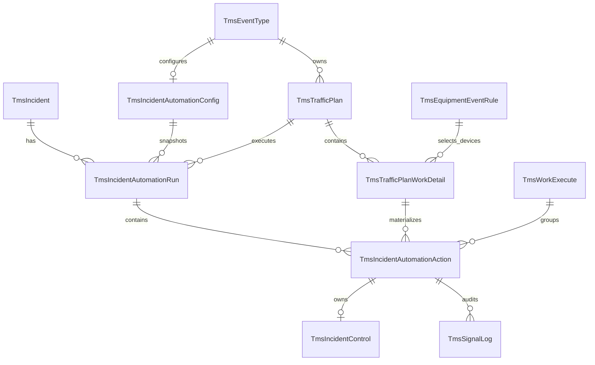

# THIẾT KẾ KỊCH BẢN XỬ LÝ SỰ CỐ TỰ ĐỘNG

## 1. Thông tin tài liệu

| Thuộc tính | Giá trị |
|---|---|
| Phạm vi | Module TMS - quản lý sự kiện/sự cố, kịch bản và điều khiển thiết bị |
| Trạng thái | Thiết kế đề xuất, chưa triển khai |
| Ngày cập nhật | 24/07/2026 |
| Project nghiệp vụ | `Modules/TMS/Modules.TMS` |
| Project domain | `Modules/TMS/Modules.TMS.Core` |
| Cơ sở dữ liệu | SQL Server, SqlSugar |
| Xử lý bất đồng bộ | Wolverine + BackgroundService poller (không dùng Hangfire cho luồng này) |

## 2. Mục tiêu

Thiết kế bổ sung luồng tự động xử lý sự kiện/sự cố theo loại sự kiện, bao gồm:

1. Tại màn hình quản lý loại sự kiện/sự cố, cho phép:
   - Bật/tắt tự động thực thi.
   - Chọn kịch bản tự động tương ứng.
   - Thiết lập thời gian chờ trước khi chạy để người vận hành nhận cảnh báo và có thể can thiệp.
   - Thiết lập tự động kết thúc sau một khoảng thời gian.
   - Thiết lập chính sách khi thực thi hoặc cập nhật thiết bị về mặc định bị lỗi.
2. Kịch bản có chế độ thực thi rõ ràng: thủ công, tự động hoặc dùng được cho cả hai chế độ.
3. Khi hết thời gian chờ, hệ thống tự động chạy các bước theo đúng thứ tự kịch bản, bao gồm điều khiển VMS và LCS.
4. Trước khi điều khiển thiết bị, hệ thống chụp trạng thái để audit, idempotency và phát hiện xung đột. Khi kết thúc, hệ thống gọi chung luồng manual để cập nhật thiết bị về cấu hình mặc định (`VmsCurrent.Default*`) nếu có và đủ điều kiện; không gửi lại `BeforeSnapshotJson`/`OldData` như nội dung hoàn tác.
5. Luồng tự động phải dùng lại state machine, dữ liệu công việc, phân quyền thiết bị, cache và broadcast của luồng incident thủ công; không tạo một luồng độc lập gây lệch trạng thái.
6. Mọi job phải idempotent, có thể retry an toàn và không phụ thuộc vào bộ nhớ của một instance API.

## 3. Phạm vi và ngoài phạm vi

### 3.1. Trong phạm vi

- Cấu hình tự động theo `TmsEventType`.
- Phân loại kịch bản thủ công/tự động.
- Cấu hình hành động thiết bị cho từng bước kịch bản.
- Cảnh báo đếm ngược trước khi tự chạy.
- Tạo và theo dõi lần chạy tự động.
- Chọn thiết bị VMS/LCS từ vị trí sự cố và các rule hiện hữu.
- Thực thi tuần tự theo `Step`, `OrderNo`.
- Tự kết thúc, cập nhật thiết bị về cấu hình mặc định nếu đủ điều kiện và ghi lịch sử.
- Cho phép người vận hành hủy tự động, chạy ngay hoặc kết thúc sớm.

### 3.2. Ngoài phạm vi của tài liệu

- Giao thức chi tiết của từng hãng VMS/LCS.
- Thay đổi firmware thiết bị.
- Thiết kế giao diện frontend chi tiết.
- Tự động tạo kịch bản bằng AI hoặc thuật toán tối ưu giao thông.

## 4. Hiện trạng mã nguồn

### 4.1. Các thành phần đang có

| Thành phần | File chính | Hiện trạng |
|---|---|---|
| Sự kiện/sự cố | `Modules.TMS.Core/Entities/TmsIncident.cs` | Có `EventTypeId`, `TrafficPlanId`, vị trí, thiết bị, zone và state của incident. |
| Loại sự kiện | `Modules.TMS.Core/Entities/TmsEventType.cs` | Có loại Event/Incident, mức ưu tiên, trạng thái; chưa có cấu hình tự động. |
| Kịch bản | `Modules.TMS.Core/Entities/TmsTrafficPlans.cs` | Liên kết `EventTypeId`; chưa phân biệt thủ công/tự động. |
| Chi tiết kịch bản | `Modules.TMS.Core/Entities/TmsTrafficPlanWorkDetail.cs` | Liên kết kịch bản với công việc, có `Step`, `OrderNo`, đơn vị thực hiện, state. |
| Danh mục công việc | `Modules.TMS.Core/Entities/TmsWorkDetail.cs` | Có `WorkType`, `WorkMode`, `ControlType`, nhưng chưa có payload lệnh VMS/LCS. |
| Công việc runtime | `Modules.TMS.Core/Entities/TmsWorkExecute.cs` | Được sinh khi incident chuyển `InProgress`; trạng thái Waiting/Executed/Skipped. |
| Chiếm quyền thiết bị | `Modules.TMS.Core/Entities/TmsIncidentControl.cs` | Lưu incident, equipment, priority, state; là nguồn danh sách thiết bị của luồng reset mặc định hiện hữu nhưng chưa đủ token/version để kiểm tra quyền reset an toàn. |
| Nhật ký tín hiệu | `Modules.TMS.Core/Entities/TmsSignalLog.cs` | Có `OldData`, `NewData`, URL và thời gian cũ/mới; dùng cho audit, không phải nguồn nội dung reset. |
| Reset thiết bị khi Finish | `Modules.VMS/Infrastructure/Services/Process/VmsProcessService.cs` | `ResetIncidentToDefault` lấy `VmsCurrent.DefaultUrl/DefaultColor/DefaultBackColor`, gửi qua pipeline `ChangeVmsContent`, thành công thì ghi log/broadcast và xóa `TmsIncidentControl`. |
| Gợi ý thiết bị | `Controllers/Equipment/Queries/EquipmentPositionQueryHandler.cs` | Có thuật toán lọc thiết bị theo loại, vị trí, hướng, zone và rule Before/After. |
| Rule thiết bị theo sự kiện | `Modules.TMS.Core/Entities/TmsEquipmentEventRule.cs` | Map `EventTypeId + EquipmentTypeId` sang `ProcessType` Before/After; không chứa bước kịch bản hoặc nội dung lệnh. |
| Workflow incident | `Controllers/Incident/Commands/IncidentWorkflowCommandHandler.cs` | Chuyển state, sinh `TmsWorkExecute`, archive khi kết thúc; hiện finalize trước và chưa gọi reset mặc định trong backend. |
| Cập nhật công việc | `Controllers/Incident/Commands/TmsWorkExecuteCommandHandler.cs` | Người dùng chuyển Waiting sang Executed/Skipped và broadcast. |
| Quản lý thiết bị theo incident | `Controllers/IncidentControl/Command/TmsIncidentControlCommandHandler.cs` | CRUD quyền điều khiển, có `override`/`append`; chưa khóa cạnh tranh. |

`Modules.TMS/Modules.TMS.csproj` loại trừ thư mục `Modules.TMS/Core/**` cũ và tham chiếu project `Modules.TMS.Core`. Vì vậy entity chính thức phải được thêm/sửa trong project `Modules.TMS.Core`, không sửa bản source cũ dưới `Modules.TMS/Core`.

### 4.2. Luồng thủ công hiện tại

1. Tạo incident ở trạng thái `Registration`.
2. Xác minh incident để chuyển sang `Verified`.
3. Chọn `TrafficPlanId`, chuyển incident sang `InProgress`.
4. `IncidentWorkflowCommandHandler` join `TmsTrafficPlanWorkDetail` với `TmsWorkDetail`, sau đó sinh `TmsWorkExecute` ở trạng thái `Waiting`.
5. Người vận hành đánh dấu từng công việc là `Executed` hoặc `Skipped`.
6. Khi chọn Finish, frontend gọi `TmsIncident/UpdateState(Finished)`; backend archive work execute và chuyển incident sang `Finished` trước.
7. Frontend hỏi xác nhận lần hai rồi gọi `VmsCurrent/Restart/{IncidentId}`.
8. `VmsProcessService.ResetIncidentToDefault` lấy thiết bị từ `TmsIncidentControl`; thiết bị có `VmsCurrent.DefaultUrl` sẽ được gửi `DefaultUrl`, `DefaultColor`, `DefaultBackColor` qua `ChangeVmsContent` với `ProcessType = reset`.
9. Gửi thành công thì cập nhật `VmsCurrent`, ghi log `Reset Incident`, broadcast và xóa `TmsIncidentControl`; gửi lỗi thì giữ control để thử lại. Luồng Cancel hiện không gọi reset.

Luồng manual xác nhận đúng semantics là **đưa về cấu hình mặc định**, không khôi phục `TmsSignalLog.OldData`. Điểm cần cải thiện là đưa thao tác reset vào backend workflow dùng chung và chạy trước bước finalize/archive, thay vì phụ thuộc hộp thoại thứ hai ở frontend.

### 4.3. Khoảng trống cần xử lý

- Chưa có cấu hình tự động theo loại sự kiện.
- Chưa có job delay/cảnh báo/auto-finish cho incident.
- Chưa có bảng runtime lưu một lần chạy tự động và kết quả từng thiết bị.
- Chưa có orchestration tự động gọi pipeline điều khiển/reset VMS/LCS; backend reset hiện nằm ở module VMS và chỉ được frontend manual gọi sau Finish.
- `TmsWorkDetail.ControlType` mới chỉ là metadata, chưa đủ payload để gửi lệnh.
- `TmsSignalLog.OldData` và `BeforeSnapshotJson` chỉ dùng audit/conflict detection, không phải nội dung reset; nội dung mặc định lấy từ `VmsCurrent.Default*`.
- `ResetIncidentToDefault` chưa trả kết quả từng thiết bị và chưa kiểm tra ownership token, hash/version, lệnh mới hơn hoặc priority cao hơn.
- Chưa có idempotency key, ownership token hoặc device version/hash.
- Các đoạn update incident, sinh work execute, archive/delete hiện chưa thể hiện một transaction bao toàn bộ thao tác.
- Query kịch bản hợp lệ chưa ràng buộc chặt `EventTypeId` ở backend; lựa chọn đúng kịch bản còn phụ thuộc caller.

## 5. Các quyết định thiết kế

### 5.1. Không thêm trực tiếp toàn bộ cấu hình tự động vào `TmsEventType`

Màn hình loại sự kiện vẫn là nơi quản lý cấu hình, nhưng dữ liệu được lưu ở bảng `TmsIncidentAutomationConfig` quan hệ 1-1 với loại sự kiện đang hoạt động.

Lý do:

- Không làm entity loại sự kiện phình to.
- Có thể version hóa và mở rộng failure/reset policy.
- Runtime có thể snapshot đúng phiên bản cấu hình đã dùng.
- Dễ khóa duy nhất một cấu hình active theo tenant và event type.

### 5.2. Có thêm chế độ trên kịch bản, nhưng dùng enum thay cho boolean

Thêm `ExecutionMode` vào `TmsTrafficPlan` với ba giá trị:

- `Manual`: chỉ dùng thủ công.
- `Automatic`: chỉ dùng tự động.
- `Both`: dùng được cho cả hai.

Không dùng `IsAutomatic` vì boolean không diễn đạt được trường hợp một kịch bản dùng chung cho cả hai luồng. Dữ liệu cũ mặc định `Manual` để không thay đổi hành vi hiện hữu.

### 5.3. Tái sử dụng `TmsEquipmentEventRule`, không tạo bảng chọn thiết bị trùng lặp

`TmsEquipmentEventRule` tiếp tục là nguồn cấu hình duy nhất để xác định loại thiết bị và vị trí tương đối `Before`/`After` theo loại sự kiện. Không lặp lại `EquipmentTypeId`, `ProcessType`, selection mode, bán kính hoặc danh sách target trong một bảng action mới.

Bảng rule không chứa bước kịch bản hoặc nội dung lệnh VMS/LCS, vì vậy phần còn thiếu được đặt trực tiếp trên `TmsTrafficPlanWorkDetail`: liên kết rule, liên kết cấu hình lệnh/template hiện hữu (nếu có), payload fallback và chính sách retry/reset. Mô hình này phù hợp giả định một chi tiết kịch bản tương ứng một lệnh logic. Nếu sau này một chi tiết bắt buộc chứa nhiều lệnh độc lập, khi đó mới tách bảng con riêng.

### 5.4. Runtime phải có `Run` và `Action`

- `TmsIncidentAutomationRun`: một lần tự động xử lý incident.
- `TmsIncidentAutomationAction`: một lệnh cụ thể trên một thiết bị cụ thể.

Không dùng riêng `TmsSignalLog` làm runtime vì signal log là audit log, không có state machine, retry, ownership và idempotency.

### 5.5. Không dùng Hangfire; lịch chạy do worker quét DB

Quyết định: **bỏ Hangfire cho luồng này**, thay bằng `TmsIncidentAutomationWorker : BackgroundService` quét `TmsIncidentAutomationRun` mỗi 2 giây.

Lý do:

- Trạng thái và mốc thời gian đã bền vững trong DB business (`Status`, `ExecuteDueAt`, `AutoFinishAt`), nên Hangfire không bổ sung tính bền vững nào.
- Tránh **hai nguồn sự thật**: trước đây phải lưu `ExecuteJobId`/`FinishJobId` và gọi `BackgroundJob.Delete` chỉ để giữ Hangfire khớp với `Status`.
- Hủy lịch chỉ cần đổi `Status`; worker không bao giờ chọn lại run đã kết thúc.
- Kiểm soát được độ chính xác đếm ngược. Hangfire chuyển scheduled job sang queue theo `SchedulePollingInterval` (mặc định 15 giây), gây lệch so với đồng hồ đếm ngược trên giao diện.
- Worker kiêm luôn vai trò **recovery**: run bị treo do restart sẽ được nhặt lại ở nhịp quét kế tiếp, không cần recovery job riêng.

An toàn khi chạy nhiều instance API: mọi chuyển trạng thái đều qua compare-and-set (`ClaimRunStatusAsync`), nên chỉ một instance claim được mỗi run. Không cần distributed lock.

Worker không chứa business logic — chỉ tìm run tới hạn rồi gọi `TmsIncidentAutomationService`. Service đọc lại DB, kiểm tra điều kiện và thực thi idempotent. DB là nguồn trạng thái duy nhất.

### 5.6. Countdown được tính ở client từ `DueAt`

Backend broadcast một lần khi tạo/hủy/thay đổi run với `DueAt`. Frontend tự tính số giây còn lại. Không tạo job hoặc broadcast mỗi giây.

### 5.7. Auto-finish tính từ thời điểm kịch bản đã kích hoạt thành công

`AutoFinishAt = ActivatedAt + AutoFinishAfterSeconds`.

`ActivatedAt` được đặt khi toàn bộ action bắt buộc đã `Applied`. Cách này tránh trường hợp thời gian giữ trạng thái bị mất do bước điều khiển thiết bị chậm hoặc retry.

## 6. Mô hình dữ liệu đề xuất

### 6.1. Quy ước chung

- Tất cả entity cấu hình/runtime kế thừa `EntityTenant` để có ID, tenant, audit và soft-delete theo convention dự án.
- ID và khóa logic dùng `string` với `EntityConst.KeyFieldLength`.
- Enum lưu string bằng `EntityConst.ConfigFieldLength` để dễ đọc và tương thích cách lưu state hiện hữu.
- Payload/snapshot JSON dùng `nvarchar(max)` và luôn có `PayloadSchemaVersion`.
- Mọi DateTime nhận từ FE hoặc tạo tại server phải dùng `BaseUtil.TimeServer`.
- Các trường `CreateTime`, `CreateUId`, `UpdateTime`, `UpdateUId`, `TenantId`, soft-delete dùng trường kế thừa, không lặp lại trong các bảng dưới đây.

### 6.2. Thay đổi bảng `TmsTrafficPlan`

Entity hiện hữu: `Modules.TMS.Core/Entities/TmsTrafficPlans.cs`.

| Cột mới | Kiểu C# | Null | Mặc định | Mô tả |
|---|---|---:|---|---|
| `ExecutionMode` | `string` | Không | `Manual` | `Manual`, `Automatic`, `Both`. |
| `PlanVersion` | `int` | Không | `1` | Tăng khi thay đổi cấu trúc/payload kịch bản đã được dùng. |

Ràng buộc:

- Kịch bản được chọn cho tự động phải có `Status = Enable`.
- `ExecutionMode` phải là `Automatic` hoặc `Both`.
- `TmsTrafficPlan.EventTypeId` phải trùng `TmsIncident.EventTypeId` và `TmsIncidentAutomationConfig.EventTypeId`.
- Không cho sửa trực tiếp cấu hình detail/rule/lệnh của version đang có run ở `WarningPending`, `Starting`, `Running`, `Active`, `FinishPending` hoặc `ResettingDefault`. Có thể clone sang version mới.

### 6.3. Thay đổi bảng `TmsWorkExecute` và history

Thêm cùng bộ trường vào `TmsWorkExecute` và entity history tương ứng:

| Cột mới | Kiểu C# | Null | Mặc định | Mô tả |
|---|---|---:|---|---|
| `ExecutionSource` | `string` | Không | `Manual` | Nguồn `Manual` hoặc `Automatic`. |
| `AutomationRunId` | `string` | Có | `null` | Liên kết lần chạy tự động. |

`TmsIncidentAutomationAction.WorkExecuteId` là quan hệ nhiều action thiết bị tới một work execute. Không thêm `AutomationActionId` vào work execute vì một bước có thể điều khiển nhiều thiết bị.

### 6.4. Bảng mới `TmsIncidentAutomationConfig`

Mục đích: cấu hình cách tự động xử lý theo loại sự kiện/sự cố.

| Cột | Kiểu C# | Null | Mặc định | Mô tả |
|---|---|---:|---|---|
| `EventTypeId` | `string` | Không |  | Loại sự kiện áp dụng. |
| `IsAutoExecuteEnabled` | `bool` | Không | `false` | Bật tự chạy. |
| `TriggerState` | `string` | Không | `Verified` | Bắt đầu countdown tại `Registration` hoặc `Verified`. |
| `AutoVerifyIncident` | `bool` | Không | `false` | Cho phép system actor tự xác minh nếu trigger từ Registration. |
| `WarningDelaySeconds` | `int` | Không | `30` | Thời gian cảnh báo trước khi chạy. |
| `TrafficPlanId` | `string` | Không |  | Kịch bản tự động. |
| `IsAutoFinishEnabled` | `bool` | Không | `false` | Bật tự kết thúc. |
| `AutoFinishAfterSeconds` | `int?` | Có | `null` | Khoảng giữ trạng thái sau `ActivatedAt`. |
| `FailurePolicy` | `string` | Không | `StopAndResetDefault` | Chính sách lỗi khi apply. |
| `ResetPolicy` | `string` | Không | `ResetToDefault` | Chính sách đưa thiết bị về cấu hình mặc định khi kết thúc/lỗi. |
| `ConfigVersion` | `int` | Không | `1` | Version được snapshot vào run. |
| `Status` | `StatusEnum?` | Có | `Enable` | Trạng thái cấu hình. |
| `Remark` | `string` | Có | `null` | Ghi chú. |

Index/ràng buộc:

- Unique active: `(TenantId, EventTypeId)` với điều kiện chưa soft-delete.
- Index tra cứu: `(TenantId, Status, IsAutoExecuteEnabled)`.
- `WarningDelaySeconds`: đề xuất `0..86400`.
- Nếu `TriggerState = Registration` thì `AutoVerifyIncident` phải bằng `true`; nếu không, chỉ cảnh báo nhưng không được tự chuyển `InProgress`.
- Nếu `IsAutoFinishEnabled = true`, `AutoFinishAfterSeconds` phải lớn hơn `0`.
- Không cho enable nếu kịch bản không qua bước `ValidateAutomaticPlan`.

### 6.5. Tái sử dụng bảng hiện hữu `TmsEquipmentEventRule`

Không tạo bảng mới để cấu hình chọn thiết bị. `TmsEquipmentEventRule` hiện đã xác định:

| Cột hiện hữu | Vai trò trong luồng tự động |
|---|---|
| `EventTypeId` | Loại sự kiện/sự cố áp dụng. |
| `EquipmentTypeId` | Loại thiết bị VMS/LCS cần tìm. |
| `ProcessType` | Chọn thiết bị phía `Before` hoặc `After` vị trí sự cố. |
| `Status` | Chỉ dùng rule đang Enable. |
| `Remark` | Ghi chú quản trị. |

`EquipmentPositionQueryHandler.ResolveProcessType` đang đọc đúng bảng này và mặc định `Before` khi thiếu rule. Luồng tự động phải tái sử dụng logic đó qua `TmsEquipmentSelectionService`, không khai báo lại `EquipmentTypeId`, `ProcessType`, selection mode hoặc fixed target trong cấu hình kịch bản.

Để backend tự chọn target mà không phụ thuộc input từ FE, bổ sung tối thiểu vào chính bảng rule:

| Cột bổ sung | Kiểu C# | Null | Mặc định | Mô tả |
|---|---|---:|---|---|
| `SuggestionRangeMeters` | `int` | Không | `4000` | Phạm vi recommended; thống nhất mặc định hiện tại của `EquipmentPositionQueryHandler`. |
| `MaxTargetCount` | `int?` | Có | `null` | Giới hạn thiết bị gần nhất; null là lấy toàn bộ thiết bị recommended. |

Hai trường này là chính sách chọn thiết bị theo loại sự kiện nên thuộc `TmsEquipmentEventRule`, không thuộc từng kịch bản/lệnh.

Ràng buộc cần siết trước khi dùng tự động:

- Unique active phải là `(TenantId, EventTypeId, EquipmentTypeId)`. Handler hiện kiểm tra trùng cả `ProcessType`, nên có thể tồn tại đồng thời một dòng Before và một dòng After; trong khi `ResolveProcessType` dùng `GetFirstAsync` không có thứ tự, dẫn tới kết quả không xác định.
- `EventTypeId`, `EquipmentTypeId`, `ProcessType` phải non-null đối với record enable.
- Không dùng mặc định `Before` khi validate/execute auto plan. Auto plan bắt buộc có rule enable rõ ràng; mặc định Before chỉ giữ cho luồng tra cứu thủ công để tương thích ngược.
- Nếu rule đang được `TmsTrafficPlanWorkDetail` tham chiếu thì không được hard-delete. Chỉ disable hoặc chặn xóa bằng business validation.
- Khi tạo run, snapshot `EventTypeId`, `EquipmentTypeId`, `ProcessType` vào `PlanSnapshotJson`; thay đổi rule sau đó không làm đổi target của run đã schedule.

### 6.6. Mở rộng bảng hiện hữu `TmsTrafficPlanWorkDetail`

Không tạo `TmsTrafficPlanDeviceAction` và `TmsTrafficPlanDeviceTarget` trong phiên bản đầu. Mỗi `TmsTrafficPlanWorkDetail` tự động đại diện một lệnh logic; nếu cùng một step cần nhiều lệnh VMS/LCS thì tạo nhiều detail có cùng `Step` và `OrderNo` khác nhau.

Bổ sung các trường sau vào bảng hiện hữu:

| Cột mới | Kiểu C# | Null | Mặc định | Mô tả |
|---|---|---:|---|---|
| `EquipmentEventRuleId` | `string` | Có | `null` | Rule chọn loại/vị trí thiết bị; bắt buộc với bước điều khiển tự động. |
| `DeviceCommandConfigId` | `string` | Có | `null` | ID cấu hình/template lệnh VMS/LCS hiện hữu; adapter resolve theo `TmsWorkDetail.ControlType`. |
| `CommandPayloadJson` | `string` | Có | `null` | Payload fallback nếu hệ thống thiết bị chưa có bảng cấu hình lệnh dùng chung. |
| `PayloadSchemaVersion` | `int` | Không | `1` | Version schema payload. |
| `DelayAfterPreviousSeconds` | `int` | Không | `0` | Delay sau detail trước. |
| `TimeoutSeconds` | `int` | Không | `30` | Timeout một lần gửi lệnh. |
| `MaxRetryCount` | `int` | Không | `3` | Số lần retry. |
| `RetryIntervalSeconds` | `int` | Không | `5` | Khoảng cách retry. |
| `FailurePolicy` | `string` | Không | `Inherit` | Kế thừa run hoặc override failure policy. |
| `ResetPolicy` | `string` | Không | `Inherit` | Kế thừa chính sách reset về mặc định. |
| `IsRequired` | `bool` | Không | `true` | Detail bắt buộc để run chuyển Active. |

Ràng buộc:

- Các trường mới được phép null/giá trị mặc định đối với detail thủ công để tương thích dữ liệu cũ.
- Detail có `TmsWorkDetail.WorkMode = Automatic` và `ControlType = VMS/LCS` bắt buộc có `EquipmentEventRuleId`.
- Rule phải Enable và `rule.EventTypeId` phải trùng `TmsTrafficPlan.EventTypeId`.
- `ControlType` quyết định adapter; loại thiết bị lấy từ `TmsEquipmentEventRule.EquipmentTypeId`, không lưu lặp trên detail.
- Phải có ít nhất `DeviceCommandConfigId` hoặc `CommandPayloadJson`. Nếu bảng cấu hình lệnh hiện hữu đã chứa đầy đủ payload thì chỉ lưu ID tham chiếu, không copy cấu hình sang detail.
- Payload phải hợp lệ theo `ControlType + PayloadSchemaVersion`.
- Thứ tự duy nhất trong một plan dùng dữ liệu hiện hữu `(TrafficPlanId, Step, OrderNo)`.

Nếu sau này phát sinh yêu cầu một detail chứa nhiều lệnh độc lập, có version/lifecycle riêng, mới tách bảng con `TmsTrafficPlanDeviceCommand`. Không tạo trước khi có nhu cầu này.

### 6.7. Bảng mới `TmsIncidentAutomationRun`

Mục đích: lưu trạng thái bền vững của một lần tự động xử lý.

| Cột | Kiểu C# | Null | Mặc định | Mô tả |
|---|---|---:|---|---|
| `IncidentId` | `string` | Không |  | Incident được xử lý. |
| `RunNo` | `int` | Không | `1` | Số lần chạy trên incident. |
| `EventTypeId` | `string` | Không |  | Snapshot khóa loại sự kiện. |
| `AutomationConfigId` | `string` | Không |  | Cấu hình nguồn. |
| `ConfigVersion` | `int` | Không |  | Version cấu hình đã dùng. |
| `TrafficPlanId` | `string` | Không |  | Kịch bản nguồn. |
| `PlanVersion` | `int` | Không |  | Version kịch bản đã dùng. |
| `ConfigSnapshotJson` | `string` | Không |  | Snapshot cấu hình để audit/retry. |
| `PlanSnapshotJson` | `string` | Không |  | Snapshot thứ tự detail, rule và cấu hình lệnh. |
| `TriggerState` | `string` | Không |  | State đã kích hoạt run. |
| `Status` | `string` | Không | `WarningPending` | State machine của run. |
| `IdempotencyKey` | `string` | Không |  | Ví dụ `incident:{id}:run:{runNo}`. |
| `WarningStartedAt` | `DateTime` | Không |  | Thời điểm bắt đầu cảnh báo. |
| `ExecuteDueAt` | `DateTime` | Không |  | Thời điểm được phép chạy. |
| `StartedAt` | `DateTime?` | Có | `null` | Bắt đầu apply. |
| `ActivatedAt` | `DateTime?` | Có | `null` | Các action bắt buộc đã applied. |
| `AutoFinishAt` | `DateTime?` | Có | `null` | Thời điểm auto-finish. |
| `ResettingAt` | `DateTime?` | Có | `null` | Bắt đầu cập nhật thiết bị về cấu hình mặc định. |
| `FinishedAt` | `DateTime?` | Có | `null` | Hoàn tất run. |

| `CancelReason` | `string` | Có | `null` | Lý do hủy. |
| `ErrorCode` | `string` | Có | `null` | Mã lỗi cuối. |
| `ErrorMessage` | `string` | Có | `null` | Thông tin lỗi đã loại dữ liệu nhạy cảm. |
| `StartedBy` | `string` | Có | `SYSTEM_AUTOMATION` | System hoặc người bấm chạy ngay. |
| `ConcurrencyVersion` | `long`/rowversion | Không |  | Optimistic concurrency. |

Index/ràng buộc:

- Unique `(TenantId, IncidentId, RunNo)`.
- Unique `IdempotencyKey`.
- Index `(TenantId, Status, ExecuteDueAt)` phục vụ recovery.
- Index `(TenantId, Status, AutoFinishAt)` phục vụ recovery finish.
- Tại một thời điểm chỉ có một run active cho một incident. Có thể dùng filtered unique index trên `IncidentId` với các state chưa kết thúc hoặc kiểm tra trong transaction có lock.

### 6.8. Bảng mới `TmsIncidentAutomationAction`

Một record tương ứng một thiết bị đã resolve. Danh sách thiết bị được cố định trước lần gửi lệnh đầu tiên để retry không làm thay đổi target.

| Cột | Kiểu C# | Null | Mặc định | Mô tả |
|---|---|---:|---|---|
| `AutomationRunId` | `string` | Không |  | Run cha. |
| `TrafficPlanWorkDetailId` | `string` | Không |  | Bước kịch bản và cấu hình lệnh nguồn. |
| `WorkExecuteId` | `string` | Có | `null` | Runtime work item hiện hữu. |
| `EquipmentId` | `string` | Không |  | Thiết bị đã resolve. |
| `DeviceType` | `string` | Không |  | `VMS`, `LCS`. |
| `Step` | `int` | Không |  | Step snapshot. |
| `OrderNo` | `int` | Không |  | Thứ tự snapshot. |
| `Status` | `string` | Không | `Pending` | State của action. |
| `IdempotencyKey` | `string` | Không |  | Duy nhất cho run/action/equipment. |
| `RequestedPayloadJson` | `string` | Không |  | Payload lệnh đã resolve. |
| `BeforeSnapshotJson` | `string` | Có | `null` | Trạng thái trước apply để audit/idempotency; không dùng làm nội dung reset. |
| `BeforeStateHash` | `string` | Có | `null` | Hash/version trạng thái trước apply. |
| `AppliedSnapshotJson` | `string` | Có | `null` | Trạng thái mong đợi sau apply. |
| `AppliedStateHash` | `string` | Có | `null` | Hash/version dùng phát hiện lệnh mới trước khi reset mặc định. |
| `DeviceVersionBefore` | `string` | Có | `null` | Version thiết bị nếu adapter hỗ trợ. |
| `DeviceVersionAfter` | `string` | Có | `null` | Version sau apply. |
| `IncidentControlId` | `string` | Có | `null` | Quyền điều khiển đã acquire. |
| `OwnershipToken` | `string` | Có | `null` | Token chứng minh ownership hiện tại. |
| `AttemptCount` | `int` | Không | `0` | Số lần gửi. |
| `MaxRetryCount` | `int` | Không |  | Snapshot retry config. |
| `NextRetryAt` | `DateTime?` | Có | `null` | Lần retry kế tiếp. |
| `AppliedAt` | `DateTime?` | Có | `null` | Apply thành công. |
| `ResetStatus` | `string` | Có | `NotRequired` | Kết quả cập nhật về cấu hình mặc định. |
| `ResetAttemptCount` | `int` | Không | `0` | Số lần reset. |
| `ResetAt` | `DateTime?` | Có | `null` | Reset mặc định thành công. |
| `ResultJson` | `string` | Có | `null` | Phản hồi adapter đã loại dữ liệu nhạy cảm. |
| `ErrorCode` | `string` | Có | `null` | Mã lỗi. |
| `ErrorMessage` | `string` | Có | `null` | Chi tiết lỗi. |
| `ConcurrencyVersion` | `long`/rowversion | Không |  | Optimistic concurrency. |

Index/ràng buộc:

- Unique `IdempotencyKey`.
- Unique `(TenantId, AutomationRunId, TrafficPlanWorkDetailId, EquipmentId)`.
- Index `(AutomationRunId, Step, OrderNo, Status)`.
- Index `(EquipmentId, Status)` phục vụ kiểm tra xung đột.

### 6.9. Mở rộng `TmsIncidentControl`

Giữ bảng hiện hữu làm nguồn quyền điều khiển thiết bị, bổ sung:

| Cột mới | Kiểu C# | Null | Mặc định | Mô tả |
|---|---|---:|---|---|
| `AutomationRunId` | `string` | Có | `null` | Null đối với luồng thủ công cũ. |
| `AutomationActionId` | `string` | Có | `null` | Action đang sở hữu thiết bị. |
| `OwnershipToken` | `string` | Có | `null` | Token ngẫu nhiên duy nhất. |
| `PreviousControlId` | `string` | Có | `null` | Owner bị override ngay trước đó. |
| `IsActive` | `bool` | Không | `false` | Có đang là owner hiện hành không. |
| `ControlVersion` | `long` | Không | `0` | Tăng sau mỗi thay đổi owner/lệnh. |
| `AppliedStateHash` | `string` | Có | `null` | Hash trạng thái owner đã áp. |
| `AcquiredAt` | `DateTime?` | Có | `null` | Thời điểm acquire. |
| `ReleasedAt` | `DateTime?` | Có | `null` | Thời điểm release. |

Index/ràng buộc:

- Unique `(TenantId, IncidentId, EquipmentId)` cho record active/non-delete.
- Filtered unique `(TenantId, EquipmentId)` với `IsActive = 1` để một thiết bị chỉ có một owner hiện hành.
- Acquire/override/release phải chạy trong transaction và kiểm tra priority.
- Chuẩn hóa constants `append`/`override`; không tiếp tục phát sinh string tự do hoặc typo.

Nếu dữ liệu nghiệp vụ cho phép nhiều incident đồng thời cùng ghi một thiết bị, không được bỏ unique index đơn giản. Khi đó phải xác định rõ merge semantics theo loại thiết bị. Với VMS/LCS, đề xuất một owner hiện hành vì trạng thái hiển thị/làn không thể merge tổng quát.

### 6.10. Vai trò của `TmsSignalLog`

- Tiếp tục ghi Old/New để audit và tra cứu lịch sử.
- `OldData`, `OldUrl`, `BeforeSnapshotJson` không phải nguồn nội dung reset.
- Nội dung reset lấy từ cấu hình mặc định hiện hành của thiết bị (`VmsCurrent.DefaultUrl`, `DefaultColor`, `DefaultBackColor` hoặc cấu hình mặc định tương ứng của adapter).
- Snapshot/hash của `TmsIncidentAutomationAction` chỉ dùng idempotency và phát hiện thiết bị đã nhận lệnh mới.
- Nên thêm index `(TenantId, IncidentId, EquipmentId, CreateTime DESC)`.

### 6.11. Quan hệ bảng



## 7. Constants và state machine

### 7.1. Traffic plan execution mode

```text
Manual
Automatic
Both
```

### 7.2. Automation run status

| State | Ý nghĩa |
|---|---|
| `WarningPending` | Đang cảnh báo, chờ đến `ExecuteDueAt`. |
| `Starting` | Job đã nhận quyền bắt đầu và đang tái kiểm tra. |
| `Running` | Đang resolve/apply các action. |
| `Active` | Toàn bộ action bắt buộc đã applied. |
| `FinishPending` | Đã lên lịch auto-finish. |
| `Canceling` | Đang hủy trước/trong khi chạy. |
| `ResettingDefault` | Đang gọi luồng dùng chung để cập nhật thiết bị đủ điều kiện về cấu hình mặc định. |
| `Completed` | Hoàn tất và reset mặc định thành công/không có thiết bị cần reset. |
| `CompletedWithWarnings` | Hoàn tất nhưng có thiết bị thiếu default, không đủ điều kiện hoặc reset lỗi. |
| `Canceled` | Bị hủy trước khi apply action. |
| `Failed` | Lỗi không thể tiếp tục. |

Chuyển state hợp lệ:

```text
WarningPending -> Starting | Canceling
Starting       -> Running | Canceling | Failed
Running        -> Active | Canceling | ResettingDefault | Failed
Active         -> FinishPending | Canceling | ResettingDefault
FinishPending  -> Canceling | ResettingDefault
Canceling      -> ResettingDefault | Canceled
ResettingDefault -> Completed | CompletedWithWarnings | Failed
```

Mọi transition dùng compare-and-set theo `ConcurrencyVersion`; job chạy lặp lại phải trả về thành công mà không gửi lại lệnh nếu state đã đi qua bước đó.

### 7.3. Automation action status

```text
Pending
WaitingPreviousStep
AcquiringControl
Applying
RetryPending
Applied
Failed
Skipped
```

### 7.4. Reset status

```text
NotRequired
Pending
Resetting
ResetToDefault
DefaultNotConfigured
ResetSkippedOwnershipChanged
ResetSkippedStateChanged
ResetSkippedHigherPriority
ResetFailed
```

### 7.5. Failure policy

| Policy | Hành vi |
|---|---|
| `StopAndResetDefault` | Dừng step tiếp theo và gọi luồng reset mặc định cho các thiết bị đã applied, nếu đủ điều kiện. Mặc định. |
| `Continue` | Ghi lỗi, tiếp tục action khác; run kết thúc với warning. |
| `RetryThenStop` | Retry đủ số lần rồi dừng và reset mặc định theo policy. |

### 7.6. Reset policy

| Policy | Hành vi |
|---|---|
| `ResetToDefault` | Gọi chung luồng manual để áp cấu hình mặc định hiện hành của thiết bị nếu có và đủ điều kiện. |
| `NoReset` | Không gửi lệnh mặc định; chỉ dùng cho action được phê duyệt rõ. |

## 8. Luồng chức năng

### 8.1. Quản lý cấu hình theo loại sự kiện

Màn hình loại sự kiện thêm tab/section “Xử lý tự động”, gọi CQRS/API của `IncidentAutomationConfig`.

Chức năng:

1. Xem cấu hình theo `EventTypeId`.
2. Tạo/cập nhật cấu hình.
3. Bật/tắt tự động thực thi.
4. Chọn kịch bản có cùng `EventTypeId`, trạng thái Enable và mode Automatic/Both.
5. Thiết lập thời gian cảnh báo.
6. Chọn trigger Registration/Verified.
7. Bật auto-finish và nhập thời gian.
8. Chọn failure/reset policy.
9. Validate kịch bản trước khi enable.
10. Preview thiết bị có khả năng được chọn bằng incident mẫu; preview không acquire hoặc gửi lệnh.

Cập nhật cấu hình không thay đổi run đã tạo. Run luôn dùng snapshot config/plan tại thời điểm schedule. Nếu muốn áp dụng cấu hình mới cho incident đang WarningPending, người dùng phải hủy run cũ và schedule lại, có audit.

### 8.2. Quản lý kịch bản tự động

Kịch bản thêm `ExecutionMode`. Với mỗi `TmsTrafficPlanWorkDetail` tự động:

- `TmsWorkDetail.WorkMode` phải được chuẩn hóa thành `Automatic`.
- `ControlType` phải map được tới một executor, trước mắt VMS hoặc LCS.
- Có `EquipmentEventRuleId` trỏ tới rule enable, cùng EventType với kịch bản.
- Có `DeviceCommandConfigId` trỏ tới cấu hình lệnh hiện hữu hoặc có `CommandPayloadJson` fallback.
- Payload/cấu hình lệnh phải qua validator tương ứng.
- Thứ tự thực thi lấy theo `Step ASC`, `TmsTrafficPlanWorkDetail.OrderNo ASC`.

Kịch bản mode `Automatic` không được enable nếu còn bước bắt buộc chỉ có thể thao tác thủ công. Nếu nghiệp vụ muốn kịch bản hỗn hợp, dùng mode `Both`, đánh dấu bước thủ công không bắt buộc hoặc không bật auto config cho đến khi có executor.

### 8.3. Tạo cảnh báo và schedule run

Khi incident đạt `TriggerState`:

1. Handler workflow gọi `TmsIncidentAutomationService.TryScheduleAsync(incidentId)` sau khi transaction incident commit.
2. Service đọc cấu hình enable theo `EventTypeId`.
3. Kiểm tra chưa có active run cho incident.
4. Kiểm tra plan hợp lệ và cùng EventType.
5. Trong transaction:
   - Tạo run `WarningPending`.
   - Snapshot config và plan.
   - Đặt `WarningStartedAt` và `ExecuteDueAt`.
6. Broadcast cảnh báo gồm `IncidentId`, `RunId`, `ExecuteDueAt`, tên kịch bản và trạng thái.

Không cần đăng ký job ở scheduler ngoài: chỉ cần `Status = WarningPending` và `ExecuteDueAt` trong DB, `TmsIncidentAutomationWorker` sẽ tự phát hiện khi tới hạn. Lỗi ở bước lập lịch tự động **không được** làm thất bại thao tác tạo/xác minh sự cố — các lời gọi `TryScheduleAsync` được bọc try/catch và ghi log.

### 8.4. Hủy trong thời gian cảnh báo

Người vận hành có quyền:

- `CancelAutomation`: hủy job, chuyển run sang `Canceled`, giữ incident theo workflow hiện tại.
- `ExecuteNow`: cập nhật `ExecuteDueAt` về thời gian server hiện tại và enqueue command ngay.
- Thực hiện thủ công: pending run phải bị hủy hoặc đánh dấu superseded trước khi incident chuyển sang plan thủ công.

Hủy chỉ là một lần cập nhật `Status = Canceled`. Worker chỉ quét các run ở `WarningPending`/`FinishPending` nên run đã hủy không bao giờ được chọn lại; nếu worker vừa claim trước đó thì compare-and-set sẽ khiến một bên thất bại và thoát sớm mà không gây tác dụng phụ.

### 8.5. Bắt đầu tự động

Job dispatch `ExecuteIncidentAutomationCommand(RunId)`.

Handler thực hiện:

1. Atomic claim `WarningPending -> Starting` theo concurrency version.
2. Đọc lại incident và kiểm tra:
   - Incident còn tồn tại, chưa Finished/Canceled/Skipped/Deleted.
   - `EventTypeId` không thay đổi.
   - Không có manual workflow mới ghi đè.
   - Cấu hình snapshot cho phép tiếp tục.
3. Nếu trigger từ Registration:
   - Chỉ tự chuyển `Registration -> Verified` khi `AutoVerifyIncident = true`.
   - Ghi system actor và diff log.
4. Gán `TrafficPlanId` snapshot vào incident và dùng chung logic chuyển `Verified -> InProgress` để sinh `TmsWorkExecute`.
5. Gắn `ExecutionSource = Automatic`, `AutomationRunId` vào các work execute.
6. Resolve toàn bộ thiết bị trước lần apply đầu tiên; persist `TmsIncidentAutomationAction`.
7. Chuyển run `Starting -> Running`.
8. Thực thi theo thứ tự kịch bản.

Logic sinh work execute hiện ở `IncidentWorkflowCommandHandler` cần được tách thành service dùng chung, ví dụ `TmsIncidentWorkflowService.MaterializeWorkExecuteAsync`, để luồng manual và automatic không sao chép query/mapping.

### 8.6. Chọn thiết bị tự động

Tách phần lựa chọn trong `EquipmentPositionQueryHandler` thành `TmsEquipmentSelectionService` dùng chung cho manual và automatic.

Input tối thiểu:

- Incident ID, EventTypeId.
- Vị trí, hướng, zone của incident.
- Snapshot `TmsEquipmentEventRule` được tham chiếu từ detail.

Quy tắc:

1. Đọc rule bằng `TmsTrafficPlanWorkDetail.EquipmentEventRuleId`; rule phải Enable và cùng EventType với incident/plan.
2. Lấy `EquipmentTypeId`, `ProcessType`, `SuggestionRangeMeters`, `MaxTargetCount` từ rule; không đọc lại các thông tin này từ cấu hình action khác.
3. Tái sử dụng thuật toán recommended hiện hữu: trong phạm vi nhỏ, đúng hướng vận hành, thuộc zone tuyến và đúng Before/After.
4. Chỉ tự động chọn các thiết bị có `IsRecommended = true`; sắp xếp theo khoảng cách tăng dần rồi áp dụng `MaxTargetCount` nếu có.
5. Thiếu rule hoặc không resolve được thiết bị bắt buộc thì validation/run fail theo failure policy. Không dùng fallback Before trong luồng tự động.
6. Danh sách đã resolve được persist vào `TmsIncidentAutomationAction`. Retry không chạy lại lựa chọn.

Luồng tra cứu thủ công vẫn có thể giữ mặc định Before để tương thích ngược; luồng tự động yêu cầu cấu hình tường minh để tránh điều khiển nhầm thiết bị.

### 8.7. Thực thi từng action thiết bị

Với mỗi action theo thứ tự:

1. Delay `DelayAfterPreviousSeconds` bằng cách ghi mốc "đến hạn" vào action rồi để worker nhặt ở nhịp quét kế tiếp; không dùng `Task.Delay` dài trong request/worker.
2. Acquire quyền thiết bị trong transaction:
   - Lock/check active `TmsIncidentControl` theo EquipmentId.
   - So sánh priority của event/incident.
   - Tạo ownership token.
   - Nếu override, liên kết `PreviousControlId`.
3. Gọi adapter đọc trạng thái hiện tại.
4. Persist `BeforeSnapshotJson`, hash/version và ownership token trước khi gửi lệnh.
5. Gọi adapter VMS/LCS với `IdempotencyKey`.
6. Đọc/xác nhận trạng thái sau lệnh nếu adapter hỗ trợ.
7. Persist `AppliedSnapshotJson`, hash/version, result và `AppliedAt`.
8. Ghi `TmsSignalLog` Old/New.
9. Broadcast trạng thái action.
10. Khi toàn bộ action bắt buộc của một work detail thành công, cập nhật `TmsWorkExecute` thành `Executed` bằng system actor.
11. Chỉ chạy step tiếp theo khi step trước thỏa failure policy.

Trong phiên bản đầu, xử lý tuần tự để dễ bảo toàn thứ tự và quyền thiết bị. Có thể song song có giới hạn các target trong cùng action sau khi adapter, idempotency và rate limit được kiểm chứng.

### 8.8. Chuyển sang Active và schedule auto-finish

Khi toàn bộ action bắt buộc đã `Applied`:

1. Đặt `ActivatedAt`.
2. Nếu không bật auto-finish, run chuyển `Active` và chờ kết thúc thủ công.
3. Nếu bật auto-finish:
   - Tính `AutoFinishAt` từ `ActivatedAt`.
   - Schedule `FinishIncidentAutomationCommand`.
   - Run chuyển `FinishPending` (worker sẽ tự kết thúc khi tới `AutoFinishAt`).
4. Broadcast thời điểm kết thúc dự kiến.

### 8.9. Tự động kết thúc và cập nhật thiết bị về mặc định

Trong tài liệu này, “hoàn tác” khi kết thúc được hiểu là **cập nhật thiết bị về cấu hình mặc định nếu có và đủ điều kiện**, đúng với luồng manual hiện hữu. Không khôi phục `BeforeSnapshotJson`, `TmsSignalLog.OldData` hoặc trạng thái của owner trước đó.

Luồng manual và automatic phải dùng chung một backend orchestration, đề xuất `TmsIncidentCompletionService.FinishWithDeviceResetAsync`. Service này dispatch `ResetIncidentDevicesToDefaultCommand` sang module VMS, nơi tái sử dụng/nâng cấp `VmsProcessService.ResetIncidentToDefault`. Endpoint legacy `VmsCurrent/Restart/{IncidentId}` cũng gọi cùng command/service, không duy trì business logic riêng.

Trình tự:

1. Atomic claim run sang `ResettingDefault`.
2. Hủy các job action/retry/finish còn pending và dừng tạo action mới.
3. Lấy danh sách thiết bị từ `TmsIncidentControl` và kết quả action runtime của incident.
4. Gọi chung `ResetIncidentDevicesToDefaultCommand(IncidentId, RunId, RequestedBy)`.
5. Với từng thiết bị đủ điều kiện, lấy cấu hình mặc định hiện hành. VMS dùng `VmsCurrent.DefaultUrl`, `DefaultColor`, `DefaultBackColor`; LCS dùng cấu hình mặc định tương ứng qua cùng adapter/pipeline.
6. Gửi lệnh mặc định qua pipeline hiện hữu `ChangeVmsContent` với `ProcessType = reset`; không gửi payload từ before snapshot.
7. Khi gửi thành công: cập nhật current state, ghi `TmsSignalLog` loại `Reset Incident`, broadcast, cập nhật `ResetStatus = ResetToDefault` và xóa/release `TmsIncidentControl`.
8. Khi gửi lỗi: đặt `ResetStatus = ResetFailed`, giữ control để retry như luồng manual hiện tại.
9. Khi không có cấu hình mặc định: đặt `ResetStatus = DefaultNotConfigured`, không gửi lệnh và giữ control để người vận hành bổ sung mặc định hoặc xử lý thủ công.
10. Sau best-effort reset, gọi phần finalize của workflow incident để archive work execute và chuyển incident `Finished` hoặc state đích phù hợp.
11. Run chuyển `Completed` hoặc `CompletedWithWarnings`, sau đó broadcast kết quả từng thiết bị và kết quả cuối.

Thứ tự hiện tại ở frontend là update `Finished` trước rồi mới gọi `Restart`. Khi refactor, cả manual và automatic phải reset trước finalize/archive trong backend. Frontend chỉ gửi một yêu cầu Finish; không phụ thuộc hộp thoại thứ hai để quyết định có chạy reset hay không.

### 8.10. Điều kiện cập nhật thiết bị về mặc định

Chỉ gửi lệnh mặc định khi tất cả điều kiện phù hợp:

1. `IncidentId` hợp lệ và có `TmsIncidentControl` cho thiết bị.
2. Thiết bị và thông tin kết nối còn tồn tại, đang cho phép điều khiển.
3. Có cấu hình mặc định hợp lệ; với VMS tối thiểu phải có `VmsCurrent.DefaultUrl`.
4. Control hiện hành vẫn thuộc incident/run đang kết thúc. Với action tự động, `OwnershipToken` phải khớp.
5. Không có incident/action mới hơn hoặc owner ưu tiên cao hơn đã chiếm thiết bị.
6. Nếu adapter hỗ trợ version/hash, trạng thái hiện tại không cho thấy một lệnh mới đã ghi đè sau action của run.
7. `ResetPolicy = ResetToDefault` và adapter hỗ trợ reset loại thiết bị tương ứng.

Kết quả skip phải được ghi rõ:

- Thiếu cấu hình mặc định: `DefaultNotConfigured`.
- Ownership đã đổi: `ResetSkippedOwnershipChanged`.
- Thiết bị đã nhận lệnh mới: `ResetSkippedStateChanged`.
- Có owner ưu tiên cao hơn: `ResetSkippedHigherPriority`.
- Gửi lệnh mặc định lỗi: `ResetFailed` và có thể retry.

`BeforeSnapshotJson`, `OldData`, `OldUrl` vẫn được giữ để audit, đối soát và phát hiện xung đột, nhưng tuyệt đối không dùng làm nội dung reset.

### 8.11. Xử lý khi thiết bị đã bị owner khác chiếm

1. Nếu thiết bị đang thuộc owner mới hoặc incident ưu tiên cao hơn, skip reset mặc định của run cũ.
2. Không khôi phục trạng thái của `PreviousControlId` và không gửi `BeforeSnapshotJson`.
3. Chỉ xóa/release control của incident hiện tại sau khi reset mặc định thành công; không xóa control của owner mới.
4. Nếu thiếu default hoặc reset lỗi, giữ control của incident hiện tại để hỗ trợ retry/xử lý thủ công, đồng thời hoàn tất incident với warning theo policy.

## 9. Tích hợp VMS/LCS

### 9.1. Interface chung

Đề xuất đặt abstraction trong `Modules.TMS/Infrastructure/Services/IncidentAutomation/Devices`:

```csharp
public interface IIncidentDeviceControlAdapter
{
    string DeviceType { get; }

    Task<DeviceStateSnapshot> GetStateAsync(
        string equipmentId,
        CancellationToken cancellationToken);

    Task<DeviceDefaultState?> GetDefaultStateAsync(
        string equipmentId,
        CancellationToken cancellationToken);

    Task<DeviceCommandResult> ExecuteAsync(
        string equipmentId,
        string payloadJson,
        string idempotencyKey,
        CancellationToken cancellationToken);

    Task<DeviceCommandResult> ResetToDefaultAsync(
        string equipmentId,
        DeviceDefaultState defaultState,
        string idempotencyKey,
        CancellationToken cancellationToken);
}
```

`ResetToDefaultAsync` phải bọc/tái sử dụng pipeline reset manual hiện hữu. Với VMS/LCS đang đi qua `VmsProcessService.ChangeVmsContent`, adapter không xây dựng một đường gửi lệnh thứ hai.

Implementations:

- `TmsVmsIncidentDeviceControlAdapter`.
- `TmsLcsIncidentDeviceControlAdapter`.

### 9.2. Registry executor

`TmsIncidentDeviceControlAdapterResolver` resolve adapter theo `DeviceType`. Khi validate plan, nếu không resolve được adapter thì không cho enable auto plan.

### 9.3. Tích hợp hiện trạng và phần cần nâng cấp

Luồng reset manual đã tồn tại:

- `VmsCurrentController.RestartEquipment` gọi `VmsProcessService.ResetIncidentToDefault(incidentId)`.
- Nguồn thiết bị là `TmsIncidentControl`.
- Nguồn mặc định VMS là `VmsCurrent.DefaultUrl`, `DefaultColor`, `DefaultBackColor`.
- Lệnh đi qua `ChangeVmsContent` với `ProcessType = reset`; pipeline này cũng xử lý thiết bị LCS theo cấu hình thiết bị hiện hữu.
- Thành công thì cập nhật current state, ghi `TmsSignalLog` loại `Reset Incident`, broadcast và xóa incident control; lỗi thì giữ control.

Cần tái sử dụng thay vì viết lại, nhưng phải nâng cấp:

1. Đổi `ResetIncidentToDefault` từ `Task` không kết quả thành kết quả từng thiết bị: success, missing default, skipped condition hoặc failed.
2. Đưa lời gọi vào backend completion workflow để manual và automatic dùng chung, reset trước finalize incident.
3. Bổ sung kiểm tra ownership token, priority, lệnh mới hơn và idempotency.
4. Tách command/service dùng chung để endpoint `Restart` chỉ là wrapper tương thích ngược.
5. Xác nhận cấu hình mặc định và ACK riêng của LCS nếu khác VMS.

Không đánh dấu `ResetToDefault` chỉ vì đã phát lệnh. Phải dùng tiêu chí thành công hiện hữu của pipeline hoặc ACK/state xác nhận của adapter.

## 10. CQRS và cấu trúc source đề xuất

### 10.1. Domain project `Modules.TMS.Core`

```text
Modules.TMS.Core/
├── Entities/
│   ├── TmsIncidentAutomationConfig.cs           (mới)
│   ├── TmsIncidentAutomationRun.cs              (mới)
│   ├── TmsIncidentAutomationAction.cs           (mới)
│   ├── TmsEquipmentEventRule.cs                  (mở rộng)
│   └── TmsTrafficPlanWorkDetail.cs               (mở rộng)
└── Constants/
    └── IncidentAutomationConst.cs
```

Nếu enums dùng xuyên module, đặt ở `Shared.DTO/Enums`; nếu chỉ nội bộ TMS, đặt constants/enums trong TMS Core và dùng string mapping nhất quán.

### 10.2. Application project `Modules.TMS`

```text
Modules.TMS/
├── Controllers/
│   └── IncidentAutomation/
│       ├── TmsIncidentAutomationController.cs
│       ├── Commands/
│       │   └── IncidentAutomationCommandHandler.cs
│       ├── Queries/
│       │   └── IncidentAutomationQueryHandler.cs
│       ├── Dto/
│       │   ├── IncidentAutomationConfigInput.cs
│       │   ├── IncidentAutomationRunInput.cs
│       │   └── IncidentAutomationOutput.cs
│       └── Validators/
│           └── IncidentAutomationValidator.cs
└── Infrastructure/
    └── Services/
        └── IncidentAutomation/
            ├── TmsIncidentAutomationService.cs
            ├── TmsIncidentAutomationWorker.cs          (BackgroundService quét DB, thay Hangfire)
            ├── TmsIncidentCompletionService.cs
            ├── TmsEquipmentSelectionService.cs
            ├── TmsIncidentWorkflowService.cs
            └── Devices/
                ├── IIncidentDeviceControlAdapter.cs
                ├── TmsIncidentDeviceControlAdapterResolver.cs
                ├── TmsVmsIncidentDeviceControlAdapter.cs
                └── TmsLcsIncidentDeviceControlAdapter.cs
```

Các service dùng `IScoped` theo convention Furion. `TmsIncidentAutomationWorker` là singleton (`BackgroundService`) nên phải tạo scope riêng bằng `IServiceScopeFactory` cho mỗi run để resolve service scoped, không khởi tạo repository thủ công.

### 10.3. Controller/API chức năng

| Chức năng | Input/Command đề xuất | Kết quả |
|---|---|---|
| Lấy config theo loại sự kiện | `GetIncidentAutomationConfigInput` | Config + plan summary. |
| Lưu config | `SaveIncidentAutomationConfigInput` | Config đã tăng version. |
| Validate auto plan | `ValidateAutomaticTrafficPlanInput` | Danh sách lỗi/warning. |
| Preview target | `PreviewIncidentAutomationTargetsInput` | Danh sách thiết bị dự kiến, không gửi lệnh. |
| Xem run theo incident | `GetIncidentAutomationRunInput` | Run, countdown, action status. |
| Chạy ngay | `ExecuteIncidentAutomationNowInput` | Run đã enqueue. |
| Hủy tự động | `CancelIncidentAutomationInput` | Run Canceled/ResettingDefault. |
| Kết thúc sớm | `FinishIncidentAutomationInput` | Bắt đầu ResettingDefault. |
| Retry action lỗi | `RetryIncidentAutomationActionInput` | Action được enqueue lại nếu hợp lệ. |

Controller chỉ dispatch qua `MessBus.InvokeAsync`, không chứa business logic.

## 11. Tích hợp vào workflow incident hiện hữu

### 11.1. Điểm gọi schedule

Sau khi incident commit ở state phù hợp:

- Add incident: nếu trigger Registration, gọi schedule.
- Verify incident: nếu trigger Verified, gọi schedule.
- Update EventType/state: hủy run cũ và đánh giá schedule mới theo rule rõ ràng.

### 11.2. Điểm hủy pending run

Trước hoặc sau các transition sau, gọi cancel idempotent:

- Skipped.
- Canceled.
- Deleted.
- Người dùng chọn/chạy plan thủ công.
- EventType thay đổi.

### 11.3. Điểm reset mặc định và finalize

Các trường hợp gọi luồng dùng chung:

- Finish thủ công.
- Auto-finish.
- Cancel khi đã có action Applied và policy yêu cầu reset.
- FailurePolicy `StopAndResetDefault`.

`IncidentWorkflowCommandHandler` cần tách phần “request finish” và “finalize finish” để manual/automatic dùng chung đúng thứ tự:

1. Request finish.
2. `TmsIncidentCompletionService` gọi `ResetIncidentDevicesToDefaultCommand`.
3. Module VMS tái sử dụng `VmsProcessService.ResetIncidentToDefault` và trả kết quả từng thiết bị.
4. Finalize state/archive work execute.
5. Trả/broadcast `Completed` hoặc `CompletedWithWarnings`.

Không còn thứ tự frontend hiện tại “Finished trước, Restart sau”. Incident không có thiết bị/control vẫn đi qua service và finalize ngay với kết quả không có thiết bị cần reset.

## 12. Transaction, concurrency và idempotency

### 12.1. Transaction bắt buộc

Các nhóm thao tác phải cùng transaction:

1. Chuyển incident InProgress + sinh work execute + gắn run.
2. Resolve/persist action trước khi gửi lệnh đầu tiên.
3. Acquire/override incident control + lưu before snapshot metadata.
4. Cập nhật action Applied + incident control hash/version + signal log metadata phù hợp.
5. Cập nhật kết quả reset mặc định + release control khi gửi thành công.
6. Archive work execute + finalize incident sau khi hoàn thành best-effort reset.

Không giữ transaction DB mở trong lúc gọi thiết bị qua network. Dùng state `Applying` và idempotency key:

1. Transaction claim action và persist snapshot.
2. Commit.
3. Gọi thiết bị.
4. Transaction persist kết quả.

### 12.2. Idempotency

- Run: `incident:{IncidentId}:run:{RunNo}`.
- Action: `run:{RunId}:planAction:{PlanActionId}:equipment:{EquipmentId}`.
- Reset mặc định: `incident:{IncidentId}:equipment:{EquipmentId}:reset:{ControlVersion}`.

Nếu adapter không hỗ trợ idempotency, trước retry phải đọc state thiết bị. Nếu state đã khớp requested state, đánh dấu Applied thay vì gửi lặp.

### 12.3. Recovery jobs

Thêm recurring recovery job có giới hạn batch:

- Run WarningPending quá `ExecuteDueAt` nhưng chưa được enqueue.
- Action Applying/Resetting bị treo quá timeout.
- Run FinishPending quá `AutoFinishAt`.
- Run/action bị treo ở trạng thái trung gian sau khi tiến trình bị dừng đột ngột.

Recovery cũng dispatch Wolverine commands và tuân thủ compare-and-set.

## 13. Cache, broadcast và audit

### 13.1. Cache

Thêm cache prefix trong `CacheConst.Tms`:

```text
TmsIncidentAutomationConfig
tms_incident_automation_run
tms_incident_automation_action
```

Invalidation:

- Lưu config: xóa prefix config theo event type.
- Thay đổi run/action: xóa cache theo incident/run.
- Thay đổi incident control: xóa cache control theo incident/equipment.

Không dùng một cache key toàn cục rồi `.Result` trong async factory. Cache factory phải async hoàn toàn.

### 13.2. Broadcast

Dùng `ItsDataTransporterChannel.Incident`, bổ sung loại payload:

```json
{
  "objectType": "IncidentAutomationRun",
  "action": "WarningScheduled|Started|ActionChanged|FinishScheduled|ResettingDefault|Completed|Canceled|Failed",
  "incidentId": "...",
  "runId": "...",
  "status": "WarningPending",
  "executeDueAt": "...",
  "autoFinishAt": null,
  "serverTime": "..."
}
```

Không broadcast payload lệnh có dữ liệu nhạy cảm. Frontend nhận `serverTime` để hiệu chỉnh countdown.

### 13.3. Audit

- CRUD config/plan dùng `InsertWithDiffLogAsync`, `UpdateWithDiffLogAsync`.
- Run/action lưu system actor rõ ràng.
- Signal log lưu correlation `RunId`, `ActionId` nếu schema cho phép mở rộng.
- Lưu lý do cancel, execute now, retry và finish sớm.

## 14. Validation nghiệp vụ

### 14.1. Cấu hình tự động

- EventType tồn tại và enable.
- Chỉ một config active cho EventType/tenant.
- Delay và thời gian finish trong giới hạn.
- Plan cùng EventType, enable, mode Automatic/Both.
- Trigger Registration yêu cầu AutoVerify hoặc một nguồn xác minh tự động đã được phê duyệt.

### 14.2. Kịch bản

- Có ít nhất một work detail enable.
- Step/OrderNo hợp lệ, không trùng trong cùng scope.
- Mọi bước bắt buộc đều có executor.
- Bước điều khiển tự động có `EquipmentEventRuleId` enable, cùng EventType với plan.
- Mỗi EventType + EquipmentType chỉ có một rule Before/After active.
- Có cấu hình lệnh hiện hữu hoặc payload fallback hợp lệ.
- `SuggestionRangeMeters` và `MaxTargetCount` của rule nằm trong giới hạn an toàn.
- Không có vòng lặp dependency giữa các step.

### 14.3. Runtime

- Incident chưa kết thúc/hủy/skip/delete.
- Chỉ một active run.
- Không execute trước DueAt trừ lệnh ExecuteNow có quyền.
- Không apply action nếu run đang cancel/reset mặc định.
- Không retry action khi ownership đã đổi.
- Không finish lần hai.

## 15. Phân quyền đề xuất

Theo pattern `{featureId}:{action}`:

```text
tmsIncidentAutomationConfig:page
tmsIncidentAutomationConfig:add
tmsIncidentAutomationConfig:update
tmsIncidentAutomationConfig:enable
tmsIncidentAutomationConfig:validate
tmsIncidentAutomation:status
tmsIncidentAutomation:executeNow
tmsIncidentAutomation:cancel
tmsIncidentAutomation:finish
tmsIncidentAutomation:retry
```

Các thao tác `enable`, `executeNow`, `finish`, `retry` cần audit người thực hiện và thời điểm.

## 16. Migration và tương thích ngược

1. Thêm cột `ExecutionMode = Manual`, `PlanVersion = 1` cho toàn bộ plan cũ.
2. Thêm cột nullable vào `TmsWorkExecute`, history và `TmsIncidentControl`.
3. Tạo các bảng mới và indexes.
4. Không tạo config auto mặc định; mọi event type tiếp tục chạy thủ công.
5. Admin tạo/validate plan tự động trước.
6. Chạy chế độ dry-run/preview để kiểm tra chọn thiết bị.
7. Bật auto cho từng EventType theo rollout, không bật hàng loạt.
8. Theo dõi run/action/reset-default log trước khi mở rộng.

Nếu dữ liệu `TmsIncidentControl` hiện hữu có duplicate `(IncidentId, EquipmentId)`, cần làm sạch trước khi tạo unique index.

## 17. Thứ tự triển khai đề xuất

### Giai đoạn 1 - Schema và cấu hình

- Entity/migration/config CRUD.
- `ExecutionMode` và plan validation.
- Preview target.
- Chưa gửi lệnh thiết bị.

### Giai đoạn 2 - Runtime và countdown

- Run/action state machine.
- Schedule/cancel/execute now.
- Broadcast countdown.
- Dry-run executor ghi log nhưng không gửi lệnh.

### Giai đoạn 3 - VMS

- Adapter đọc/apply VMS.
- Ownership, snapshot, signal log.
- Tái sử dụng `ResetIncidentToDefault`, bổ sung điều kiện reset mặc định và kết quả từng thiết bị.

### Giai đoạn 4 - LCS

- Adapter LCS.
- Xác nhận ACK/state.
- Test cạnh tranh VMS/LCS.

### Giai đoạn 5 - Auto-finish và hardening

- Finish job, reset mặc định dùng chung manual/automatic.
- Recovery jobs.
- Metrics/alerting.
- Tối ưu song song có giới hạn nếu cần.

## 18. Tiêu chí nghiệm thu

1. Có thể bật auto theo một EventType và chọn đúng một plan Automatic/Both cùng EventType.
2. Incident đạt trigger sẽ phát cảnh báo có `ExecuteDueAt` và không chạy trước hạn.
3. Người dùng có thể Cancel hoặc ExecuteNow trong countdown.
4. Job chạy lặp không tạo run/action/work execute trùng và không gửi lệnh trùng.
5. Các bước chạy đúng `Step`, `OrderNo`.
6. VMS và LCS được resolve qua adapter tương ứng.
7. Trước lệnh đầu tiên, action có before snapshot phục vụ audit/idempotency và ownership token trong DB.
8. Sau apply, work execute tương ứng chuyển Executed bằng system actor.
9. Auto-finish chỉ được schedule từ `ActivatedAt`.
10. Khi finish, thiết bị có cấu hình mặc định và đủ điều kiện được cập nhật về mặc định qua luồng dùng chung `ResetIncidentToDefault`.
11. Nếu thiết bị bị lệnh/owner mới ghi đè, hệ thống skip reset và ghi đúng lý do; không ghi đè trạng thái mới.
12. Finish thủ công và auto-finish dùng chung một luồng reset-default/finalize trong backend.
13. Restart API/worker trong countdown, apply hoặc reset mặc định không làm mất tiến trình; recovery tiếp tục được.
14. Config/plan thay đổi sau khi schedule không làm thay đổi snapshot của run hiện tại.
15. Cache được invalidate và frontend nhận đủ broadcast để hiển thị trạng thái.

## 19. Ma trận tình huống cần kiểm chứng

| Tình huống | Kết quả mong đợi |
|---|---|
| Incident bị hủy trước DueAt | Run Canceled, không gửi lệnh. |
| Execute job chạy hai lần | Chỉ một worker claim run; không duplicate action. |
| VMS timeout nhưng đã nhận lệnh | Retry đọc state; nếu đã đúng thì đánh dấu Applied. |
| LCS lỗi sau khi VMS thành công | Theo failure policy: reset VMS về mặc định nếu đủ điều kiện hoặc continue. |
| Incident ưu tiên cao hơn chiếm thiết bị | Owner cũ bị override có liên kết PreviousControlId. |
| Run cũ finish khi owner mới đang active | Skip reset mặc định vì ownership changed. |
| Người dùng đổi nội dung VMS thủ công sau auto apply | Hash/version không khớp, skip reset vì state changed. |
| API restart trong countdown | Worker quét lại DB sau khi khởi động và tiếp tục run đúng hạn. |
| Worker chết ở trạng thái Applying | Recovery đọc trạng thái thiết bị trước khi retry. |
| Config bị disable sau schedule | Run dùng snapshot; chính sách mặc định tiếp tục, trừ khi người dùng cancel rõ ràng. |
| Plan bị sửa sau schedule | Run dùng PlanSnapshotJson/version cũ. |
| Không tìm thấy thiết bị bắt buộc | Run fail hoặc reset các thiết bị đã applied về mặc định theo policy, không chuyển Active. |
| Auto-finish job bị mất | Recovery phát hiện `AutoFinishAt` quá hạn và enqueue lại. |
| Thiết bị không có cấu hình mặc định | Không gửi lệnh; đánh dấu DefaultNotConfigured, giữ control và hoàn tất với warning. |
| Reset mặc định một thiết bị lỗi | Giữ IncidentControl để retry; hết retry thì CompletedWithWarnings/Failed theo policy và phát cảnh báo. |

## 20. Điểm cần chốt trước khi bắt đầu coding

1. Trigger mặc định là `Verified` hay `Registration`? Khuyến nghị `Verified`; chỉ dùng Registration cho nguồn incident tin cậy và `AutoVerifyIncident` được phê duyệt.
2. Service/API cụ thể để đọc và gửi lệnh VMS.
3. Service/API cụ thể để đọc và gửi lệnh LCS.
4. Định nghĩa payload/schema version của VMS và LCS.
5. Tiêu chí ACK để xác nhận action Applied.
6. Priority khi hai incident cùng điều khiển một thiết bị: số nhỏ ưu tiên hơn như EventType hiện tại hay quy tắc riêng.
7. Khi reset mặc định lỗi hoặc thiếu cấu hình mặc định, incident vẫn Finished với warning hay giữ InProgress? Khuyến nghị finalize incident và đánh dấu `CompletedWithWarnings`, giữ `TmsIncidentControl` để retry/xử lý thủ công; không để incident treo vô hạn.
8. Có cho phép plan hỗn hợp manual + automatic hay auto plan bắt buộc 100% step có executor? Khuyến nghị phiên bản đầu bắt buộc toàn bộ bước bắt buộc có executor.
9. Giới hạn delay, thời gian giữ trạng thái, retry và số thiết bị mỗi action.
10. Cách xử lý `append` hiện hữu đối với VMS/LCS; khuyến nghị một owner hiện hành và override theo priority.

## 21. Kết luận

Thiết kế đề xuất giữ nguyên state machine incident và dữ liệu work execute hiện hữu, đồng thời bổ sung lớp orchestration bền vững cho tự động hóa. Cấu hình được quản lý theo loại sự kiện nhưng tách bảng; kịch bản có `ExecutionMode`; lệnh thiết bị được cấu hình theo từng bước; mỗi lần chạy và mỗi thiết bị đều có record runtime, idempotency và snapshot.

Điểm quan trọng nhất của auto-finish là dùng chung luồng manual để áp cấu hình mặc định hiện hành của thiết bị, không gửi lại `OldData` hoặc `BeforeSnapshotJson`. Ownership token, control version và state hash chỉ dùng để chứng minh run còn quyền reset và tránh ghi đè lệnh mới hoặc lệnh có độ ưu tiên cao hơn.
