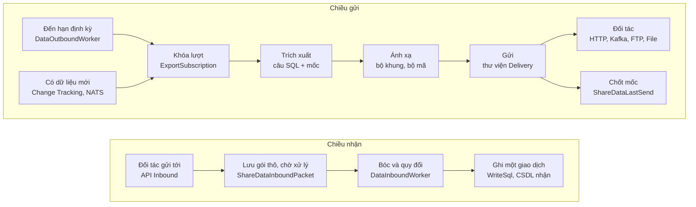

# Bàn giao mã nguồn ShareData

- **Bên giao:** Hoàng Quý Đạt, Nhân viên Phát triển phần mềm
- **Bên nhận:** Trần Hồng Sơn, Phó phòng Phát triển Phần mềm
- **Ngày lập:** 02/11/2026, cập nhật 05/11/2026
- **Đối chiếu với:** Nhánh `fix/20261101-sharedata-ra-lai-tinh-nang` của `TA-ITS015-WEBAPI-V1.0` và `TA-ITS015-WEBVUE-V1.0`
- **Bản HTML:** [BAN-GIAO-MA-NGUON-SHAREDATA.html](BAN-GIAO-MA-NGUON-SHAREDATA.html)

**Mục lục**

- [1. Mã nguồn và cách chạy](#ban-do)
- [2. Tổng quan](#sd-tong)
- [3. Bảng dữ liệu](#sd-bang)
- [4. Luồng xử lý](#sd-luong)
  - [4.1 Gửi định kỳ](#sd-gui)
  - [4.2 Nối đuôi theo mốc](#sd-moc)
  - [4.3 Gửi tức thì](#sd-tuc-thi)
  - [4.4 Nhận dữ liệu](#sd-nhan)
  - [4.5 Thư viện Delivery](#sd-delivery)
- [5. API quản lý](#sd-api)
- [6. Màn hình FE](#sd-fe)
- [7. Cấu hình vận hành](#sd-cau-hinh)
- [8. Nhật ký và mã lỗi](#sd-log)
- [9. Hạng mục chưa làm và lưu ý](#sd-chua-lam)

## 1. Mã nguồn và cách chạy

### Thư mục chính

| Thư mục | Vai trò |
| --- | --- |
| `src/Modules/ShareData/Module.ShareData` | API: `Controllers/` (Partner, Packet, Mapping, CodeSet, Subscription, Inbound, Session, ActivityLog, AlertLog) và `Infrastructure/Services/` |
| `src/Modules/ShareData/Module.ShareData.Core` | Entity, DTO, hằng số và bộ kiểm SQL `Helpers/` dùng chung cho API và Worker |
| `src/Services/ShareData/ShareDataWorker` | Windows Service: `Infrastructure/Workers/` và `Infrastructure/Services/` |
| `src/Services/ShareData/ShareDataWorker.Core` | Model, enum, ngoại lệ của Worker |
| `src/Modules/Integration/Delivery` | Thư viện gửi: HTTP, Kafka, FTP/FTPS, File; định dạng |

### Chạy và cấu hình Worker

- **Chạy:** service `ShareDataWorker`. Khi phát triển dùng `dotnet run --project src/Services/ShareData/ShareDataWorker`.
- **Tệp cấu hình:** `appsettings.json` gồm `ConnectionStrings:DefaultConnection`, `ConnectionStrings:InboundConnection`, `Nats:*`, `NasStorage:BasePath`. Tệp xác thực NATS: `Configuration/nats.creds`.
- **Tham số vận hành:** bảng `SysOpConfig` nhóm `sharedata_config`, xem [mục 8](#sd-cau-hinh).
- **Chạy nhiều Worker:** `ShareData:Role` nhận `SendOnly`, `ReceiveOnly`, không khai thì chạy cả hai chiều. `ShareData:SelfPartnerCode` giới hạn Worker chỉ gửi đăng ký của đúng đối tác đó. Mỗi dịch vụ là một bản clone thư mục publish, khai riêng các khóa này trong `appsettings.json`.

## 2. Tổng quan

Câu SQL trích xuất do người vận hành cấu hình trên giao diện, không viết cứng trong code. Worker chạy câu đó, dựng gói tin theo bộ khung ánh xạ rồi gửi đi, và chỉ tiến mốc sau khi gửi thành công.

Chỉ khi gửi thành công mốc mới tiến. Gửi lỗi thì mốc giữ nguyên và lượt sau gửi lại.

## 3. Bảng dữ liệu

| Bảng | Giữ gì |
| --- | --- |
| `ShareDataPartner` | Đối tác và cấu hình kết nối (`ConnectionType`, `ConnectionConfig` dạng JSON) |
| `ShareDataPacket` | Gói tin: mã, trạng thái, ghi chú |
| `ShareDataSql` | Câu SQL của gói. Dòng `PartnerId` trống là mẫu chung, có `PartnerId` là riêng đối tác. Gồm `ExtractSql`, `VariablesJson`, `FieldsJson`, `WriteSql`. |
| `ShareDataMapping` | Hồ sơ ánh xạ, bộ khung `TargetShapeJson` |
| `ShareDataCodeSet` | Bộ mã quy đổi giá trị nội bộ và giá trị đối tác |
| `ShareDataSubscription` | Đăng ký gửi hoặc nhận: `State`, `IntervalSeconds`, `NextTimeRun`, `LastTimeRun`, khóa lượt `ProcessingUntil` |
| `ShareDataLastSend` | Mốc gửi theo gói, đối tác và nhóm mốc (`CursorKey` trống cho nhóm mặc định, có tên cho câu SQL gộp nhiều nguồn): `LastTime`, `LastKey`, chữ ký công thức cột mốc |
| `ShareDataSourceTable` | Danh sách bảng được phép đọc (`IsQueryable`) và trạng thái Change Tracking (`LastVersion`, `LastIssue`) |
| `ShareDataInboundPacket` | Gói nhận về dạng thô, chờ Worker xử lý |
| `ShareDataSession` | Phiên kết nối đối tác |
| `ShareDataActivityLog` | Nhật ký thao tác và truyền nhận |
| `ShareDataAlertLog` | Cảnh báo theo mã ESH |

## 4. Luồng xử lý

### 4.1 Gửi định kỳ

Tệp chính là `DataOutboundService.cs`. Bắt đầu đọc từ `ExportSubscription`.

| Bước | Hàm | Tệp | Ghi chú |
| --- | --- | --- | --- |
| 1 | `ProcessSubscriptions()` | DataOutboundService.cs | Chọn các đăng ký đến hạn. Có khai `ShareData:SelfPartnerCode` thì chỉ lấy đăng ký của đối tác đó. |
| 2 | `ExportSubscription` | DataOutboundService.cs | Chiếm khóa qua `ProcessingUntil`, luôn nhả ở `ReleaseLock`. Câu nối đuôi có giới hạn dòng thì chạy nhiều trang một lượt, tối đa `OutboundMaxPagesPerRun`. |
| 3 | `GetExportConfig`, `ReadCursorSnapshot`, `GetLastSend`, `GetGroupCursors` | DataOutboundService.cs | Đọc cấu hình và mốc của lượt |
| 4 | `ExportPage` | DataOutboundService.cs | Một trang: trích xuất, ánh xạ, gửi, chốt mốc |
| 5 | `Extract`, `ExecuteDynamicQuery` | DataOutboundExtractionProcess.cs | Chạy câu SQL, đọc cột `__lastKey` của trang để làm mốc |
| 6 | `MapPage`, `Map`, `Transform`, `RenderShapeNode`, `MapCode`, `ConvertDataType` | DataMappingProcess.cs, DataMappingProcess.Expression.cs | Bộ khung hỗ trợ `$field`, `$extend`, `$each`, `$meta` |
| 7 | `Send` | DataOutboundTransport.cs | Định dạng, **lưu tệp bằng chứng trước**, rồi mới gửi. Lưu lỗi thì hủy gửi và giữ mốc (ESH-1402). Kênh File không khai `DirectoryPath` thì tệp bằng chứng chính là đầu ra. |
|  | `BuildRequest`, `Build`, `BuildContext` | DataOutboundTransport.cs | Dựng yêu cầu và ngữ cảnh gửi từ `ConnectionConfig` của đối tác. |
| 8 | `CommitPage`, `CommitSuccess`, `CommitGroupCursor` | DataOutboundService.cs | Mốc chỉ tiến, không lùi. Xem [luồng nối đuôi](#sd-moc). |
| 9 | `TryLogConfigWarning`, `ComputeConfigHash` | DataOutboundService.cs | Ghi cảnh báo ESH-1403 về cấu hình kết nối bị bỏ qua, mỗi đối tác và mỗi nội dung cấu hình một lần. |
| 10 | `ComputeNextTimeRun`, `ResolveVietnamTimeZone` | DataOutboundScheduler.cs | Tính lần chạy kế tiếp theo khung giờ |

### 4.2 Gửi tức thì khi có dữ liệu mới

Chuỗi xử lý: SQL Server Change Tracking phát hiện bảng đổi, phát NATS subject `ta.its.event.sharedata.newdata`, Worker nhận và chạy lại luồng gửi cho đúng mã gói.

| Bước | Hàm | Tệp | Ghi chú |
| --- | --- | --- | --- |
| 1 | `PollChanges`, `QueryChangedTables`, `GetTriggeredPackets`, `AdvanceTableVersions` | DataChangeTrackingService.cs | Chu kỳ `TrackingPollIntervalSec` |
|  | `BuildChangesSql`, `BuildPerTableChangesSql` | DataChangeTrackingService.Sql.cs | Chỉ tính thêm mới và cập nhật, bỏ qua xóa |
| 2 | `CheckAndReloadConfig`, `LoadTrackerMap`, `ReloadConfigInternal`, `AreMapsEqual` | DataChangeTrackingService.cs | Nạp lại danh sách bảng theo chu kỳ |
| 3 | `TryInitChangeTracking`, `EnsureDbTrackingEnabled`, `TryEnableTracking`, `TryEnsureTableReadyForInit` | DataChangeTrackingService.Init.cs | Tự bật Change Tracking và cắm mốc version gốc. Thiếu quyền thì không ném lỗi, chỉ ghi `LastIssue`. |
|  | `SqlEnableDbTracking`, `SqlEnableTableTracking` | DataChangeTrackingService.Sql.cs | Worker cần quyền chạy `ALTER DATABASE` và `ALTER TABLE`. |
| 4 | `InitSubscribe`, `HandleMessages` | DataNatsService.cs | Khóa cấu hình subject: `Nats:NewDataSubject`, rồi `Nats:Subject` |
| 5 | `ProcessSubscriptions(string packetCode)` | DataOutboundService.cs | Vào lại [luồng gửi](#sd-gui), không xét `NextTimeRun` |

### 4.3 Nhận dữ liệu

Văn Hiếu làm chính. API chỉ lưu gói thô, mọi xử lý nằm ở Worker. Hợp đồng header của đối tác (`PartnerCode`, `PacketCode`, `SerialNbr`) mô tả ở comment lớp `DataInboundService`.

| Bước | Hàm | Tệp | Ghi chú |
| --- | --- | --- | --- |
| 1 | `HandleAsync(ShareDataAddInboundInput)` | InboundCommandHandler.cs | Lưu `ShareDataInboundPacket` trạng thái Pending |
| 2 | `ProcessPendingPackets`, `ReleaseStuckPacketsAsync`, `ProcessGroupAsync`, `ProcessPacketAsync`, `ResolveContextAsync` | DataInboundService.cs | Lấy lô chờ, gỡ gói treo, tra đối tác và hồ sơ ánh xạ |
| 3 | `ParsePayloadRecords` | DataInboundService.Parse.cs | Không có bộ khung thì đoán khóa `payload` hoặc `data`, đây là đường lùi |
|  | `BuildShapeBinding`, `Walk`, `TryNavigate`, `JsonToObject`, `HasFieldBinding` | DataInboundService.Parse.cs | Đọc bộ khung chiều nhận và đi theo đường dẫn trong gói. `HasFieldBinding` phải giữ cùng ngữ nghĩa với hàm cùng tên ở `DataMappingProcess`. |
|  | `ReadRecord` | DataInboundService.Parse.cs | Gỡ ép kiểu rồi mới tra ngược bộ mã. **Đừng đổi thứ tự này.** |
| 4 | `WriteRecordsBySqlAsync`, `BuildWriteParameters`, `RollbackQuietly` | DataInboundService.WriteSql.cs | Chạy `ShareDataSql.WriteSql` trong một giao dịch. Tham số: `@records @now @tenantId @operator @partnerId @partnerCode @datatypeId @serialNbr @packetId` |
| 5 | `MarkPacketAsync`, `FailPacketAsync`, `LogInboundResult`, `LogAlertInbound` | DataInboundService.cs, DataInboundService.Logging.cs | Đánh trạng thái và ghi nhật ký |

`AddWorkerInfrastructure` chỉ tạo kết nối CSDL nhận khi có `ConnectionStrings:InboundConnection`. Xem [cấu hình vận hành](#sd-cau-hinh).

### 4.4 Thư viện Delivery

Đầu vào là `DeliveryRequest` và `DeliveryContext`, đầu ra là `DeliveryResult`. Hiện chỉ ShareData dùng thư viện này.

| Hàm | Tệp | Ghi chú |
| --- | --- | --- |
| `Dispatch` | DeliveryDispatcher.cs | Rẽ nhánh theo `ConnectionType` |
| `HttpDeliverySender.Send`, `TryDetectBusinessError` | HttpDeliverySender.cs | HTTP 2xx nhưng thân phản hồi báo lỗi nghiệp vụ thì vẫn tính là lỗi |
| `AddIdentityHeaders`, `TryBuildEndpointUri`, `FormatDetailedHttpException`, `LogFullRequest` | HttpDeliverySender.cs | Header định danh, ghép URL, câu lỗi chi tiết, log mức Debug. |
| `KafkaDeliverySender.Send` | KafkaDeliverySender.cs | Chỉ `Persisted` mới tính thành công. |
| `FtpDeliverySender.Send` | FtpDeliverySender.cs | Dùng `FtpWebRequest`, API .NET đã lỗi thời. |
| `FileDeliverySender.Send` | FileDeliverySender.cs | Thư mục tùy chỉnh phải nằm trong thư mục gốc cho phép. |
| `ToTransport`, `FromTransport` | PayloadFormatRegistry.cs | Chọn định dạng JSON, CSV, Kafka JSON |
| `ConnectConfigReader`, `ExportPathHelper` | ConnectConfigReader.cs, ExportPathHelper.cs | Đọc cấu hình không phân biệt hoa thường, sinh đường dẫn tệp bằng chứng |

## 5. Nối đuôi theo mốc

Mục này gom mọi thứ về nối đuôi: cách lưu mốc và hàm chính (trước là mục 4.2), cùng Sổ tay nối đuôi cho người cấu hình (trước là tệp riêng). Các phần của Sổ tay (kết luận, biến và mốc, luồng chảy, vận hành trên giao diện, mẫu câu, thông báo hay gặp, giới hạn, đối chiếu biên bản, hiệu năng) chỉ có ở bản HTML, mục 5, vì có sơ đồ.

### Mốc lưu ở đâu

Mỗi lượt chỉ lấy các dòng sau mốc đã gửi thành công. Câu mẫu và giao diện chỉ dùng một chuỗi ghép: `CONVERT(varchar(23), COALESCE(UpdateTime, CreateTime), 121) + '_' + <ID> AS __lastKey`, `WHERE` so đúng biểu thức đó với `@lastKey`, `ORDER BY __lastKey ASC`. Phải bọc `COALESCE` vì dòng mới thêm có `UpdateTime` trống; câu dùng `UpdateTime` trơn, cột mốc chỉ có ngày giờ, ghép ngày giờ sai định dạng, cột mốc khác công thức này (cột chuỗi trơn, số ép sang chuỗi, phần thời gian không có `CreateTime`, phần khóa không phải cột `ID` luôn có giá trị), so cột mốc bằng `>=`, có cột mốc mà không dùng biến mốc, có `OFFSET` khác 0, gộp `UNION` nhiều nguồn dùng chung một mốc hoặc câu con có `TOP` sắp theo cột khác cột mốc thì không lưu được. Nhiều dòng trùng giá trị cột mốc do `JOIN` nhân dòng thì Worker không gửi trang đó, giữ mốc, ghi ESH-1309. Câu gộp nhiều nguồn dùng mỗi nguồn một nhóm (`__lastKey_<nhóm>`, `@lastKey_<nhóm>`), `ORDER BY` ngoài cùng sắp theo cột có cùng công thức cột mốc ở nhánh của từng nhóm. Tham số cố định (`@pageSize`, biến Giá trị nhập) lưu ở `ShareDataSql.VariablesJson`, đi theo câu SQL (mẫu chung hoặc riêng đối tác); `ShareDataLastSend` chỉ lưu mốc, cột `LastTime` chỉ là giờ ghi mốc.

| Nơi lưu | Giá trị | Ghi khi nào |
| --- | --- | --- |
| `ShareDataLastSend.LastKey` | Chuỗi cột `__lastKey` của dòng cuối đã gửi, ví dụ `2026-10-21 07:58:45.487_1175a668…` | Sau mỗi trang gửi thành công, hoặc khi Đặt mốc |
| `ShareDataLastSend.CursorSignature` | Chữ ký công thức cột mốc | Cùng lúc ghi mốc. Câu đổi công thức thì chữ ký lệch, Worker bỏ mốc cũ |
| `ShareDataLastSend.LastTime` | Giờ Worker ghi mốc nhóm mặc định, không dùng để lọc | Khi Worker ghi mốc nhóm mặc định; nhóm có tên và Đặt mốc để trống |
| `ShareDataSql.VariablesJson`, trường `DefaultValue` của `@lastKey` | Mốc bắt đầu, ví dụ `2026-10-28 00:00:00.000_`; trống là lấy từ đầu | Khi lưu bảng tham số |

Mỗi dòng `ShareDataLastSend` là một bộ (`PartnerCode`, `PacketCode`, `CursorKey`), `CursorKey` trống với nhóm mặc định. Khi chạy, `@lastKey` nhận `LastKey`; chưa có mốc thì nhận `DefaultValue`; cả hai trống thì nhận chuỗi rỗng.

`CursorSignature` là mã băm SHA-256 của công thức cột mốc, bỏ qua khoảng trắng, chú thích, tiền tố bảng và hoa thường nên chỉ sửa cho gọn thì không đổi. Đổi công thức thì mốc cũ không còn so được (`2026...` và `abc` không cùng thứ tự): khi lưu, hệ thống hỏi xác nhận; chữ ký trên mốc lệch với câu đang chạy thì Worker bỏ mốc cũ, ghi ESH-1308 và gửi lại từ mốc khởi tạo, nên không dừng im lặng hoặc gửi sai.

Trang Trường gói tin (`sharedata/dataSource`) chỉ đặt Mốc bắt đầu, không hiện và không sửa mốc đang chạy; xem và sửa mốc ở trang Mốc gửi. Rê chuột lên dải Quy chuẩn mốc ở tiêu đề bảng tham số thì mở popup: mỗi mục chưa đạt nêu cách sửa kèm đoạn SQL; nút **Sửa câu** (`applyFixes`, `applyCursorFix` ở cursorSections.ts) sửa mọi mục chưa đạt trong khung soạn, ghép đúng `CONVERT(varchar(23), COALESCE(<cột cập nhật>, <cột tạo>), 121) + '_' + <khóa>` ở cả `SELECT` và `WHERE`, giữ các điều kiện khác của người dùng; câu gộp nhiều nguồn chỉ có nút Sao chép. Các nút này chỉ đổi câu trong khung soạn, bấm Lưu & phân tích thì máy chủ mới kiểm và lưu.

Worker so chuỗi, nên mốc phải cùng dạng với cột `__lastKey`. Giao diện vì vậy không có ô gõ tay: chọn ngày giờ thì máy ghép `yyyy-MM-dd HH:mm:ss.000_`, dấu `_` đứng sau để gửi cả dòng đúng thời điểm đó. Ô ngày chỉ có khi công thức là `CONVERT(varchar(23), …, 121) + '_' + …`. API `SetLastSend` nhận chuỗi bất kỳ, trừ chuỗi trống.

Ở màn Cấu hình gói tin (`cursorValueInput.vue`): tab Mẫu chung chỉ đặt mốc bắt đầu cho đối tác dùng mẫu chung mà chưa có mốc, vì mỗi đối tác chạy tới một mốc khác nhau. Tab đối tác cũng chỉ đặt mốc bắt đầu, không hiện và không sửa mốc đang chạy; đối tác đã có mốc thì khóa ô, ghi "Đã có mốc, gửi tiếp", vì Mốc lần đầu chỉ dùng khi chưa có mốc; Mốc lần đầu đã chọn có chữ "Từ" đứng trước, ô không có nhãn riêng (`hasCursor` của `cursorValueInput.vue`, `sqlVariablePanel.vue` lấy từ `savedValue` của API, không giữ giá trị mốc). Xem và sửa mốc ở trang Mốc gửi (`setCursorDialog.vue`). Cột Nguồn là ô chọn hai giá trị, tự điền theo tên biến: `@lastKey`, `@lastKey_<nhóm>` nối tiếp lần trước, biến khác là giá trị nhập; `@pageSize` bị khóa. Câu chưa đúng quy chuẩn thì khóa ô ngày, sửa bằng nút Sửa câu ở popup Quy chuẩn mốc. Câu có cột `__lastKey` mà lọc bằng biến tên khác thì giao diện chặn lưu, vì máy chủ nhận ra câu nối đuôi theo nguồn của biến và sẽ coi đó là câu gửi toàn bộ.

### Mốc ở mẫu chung và cấu hình riêng

Mẫu chung không có mốc đang chạy. Dòng `ShareDataSql` của mẫu chung chỉ giữ câu SQL, bộ tham số và Mốc lần đầu; mốc đang chạy lưu ở `ShareDataLastSend` theo từng đối tác. Các đối tác dùng chung câu SQL và Mốc lần đầu nhưng tiến độ riêng, nên không đè mốc của nhau. Ví dụ gói 108, mẫu chung đặt Mốc lần đầu là 01/10/2026, đối tác A và B đều dùng mẫu chung:

| Lượt | A | B |
| --- | --- | --- |
| A gửi lần đầu | Chưa có mốc nên lấy từ 01/10, gửi xong lưu mốc của A | Chưa đăng ký |
| A gửi tiếp | Đi tiếp từ mốc của A | Chưa đăng ký |
| B đăng ký, gửi lần đầu | Không ảnh hưởng | Chưa có mốc nên cũng lấy từ 01/10, rồi lưu mốc của B |

Khi sửa ở tab Mẫu chung (phải tắt mọi đăng ký gửi của gói thì mới lưu được):

| Thao tác | Đối tác dùng mẫu chung, chưa có mốc | Đối tác dùng mẫu chung, đã có mốc | Đối tác có cấu hình riêng |
| --- | --- | --- | --- |
| Đổi Mốc lần đầu | Lần gửi đầu dùng ngày mới | Không tác dụng, vẫn đi tiếp từ mốc | Không ảnh hưởng |
| Đổi `@pageSize` hoặc câu SQL, giữ công thức cột mốc | Dùng bản mới | Dùng bản mới, mốc giữ nguyên | Không ảnh hưởng |
| Đổi công thức cột mốc | Dùng bản mới | Hỏi xác nhận; đồng ý thì xóa mốc, gửi lại từ Mốc lần đầu | Không ảnh hưởng |

Khi đổi giữa mẫu chung và cấu hình riêng (phải tắt đăng ký gửi của đối tác): mốc gắn với đối tác và gói, không gắn với câu SQL, nên tạo cấu hình riêng thì mốc cũ vẫn đi theo. Chỉ khi công thức cột mốc khác với câu đối tác đang chạy thì mốc mới bị xóa (`FindCursorResets`, `ResetCursor`).

| Thao tác | Công thức cột mốc giống | Công thức cột mốc khác |
| --- | --- | --- |
| Tạo cấu hình riêng, chép từ mẫu chung | Mốc đi theo, gửi tiếp từ mốc cũ | Không xảy ra, vì chép nguyên câu mẫu chung |
| Tạo cấu hình riêng, chép từ đối tác khác | Mốc đi theo, gửi tiếp từ mốc cũ | Xóa mốc ngay, **không hỏi** (`handleConfirmPartnerSetup` gửi `force`), gửi lại từ Mốc lần đầu |
| Lưu & phân tích ở tab đối tác | Mốc giữ nguyên | Hỏi xác nhận; đồng ý thì xóa mốc, gửi lại từ Mốc lần đầu |
| Dùng lại mẫu chung | Mốc đi theo, gửi tiếp từ mốc cũ | Hỏi xác nhận; đồng ý thì xóa mốc, gửi lại từ Mốc lần đầu của mẫu chung |

Cấu hình riêng giữ bản chép bộ tham số lúc tạo, gồm cả Mốc lần đầu (`CopyCommonVariablesToPartner`), nên sau đó sửa mẫu chung không còn ảnh hưởng. Mẫu chung là câu gửi toàn bộ thì Dùng lại mẫu chung không xóa mốc: mốc còn trong CSDL nhưng câu không dùng tới.

### Hàm chính

#### Khi lưu câu SQL (API)

| Hàm | Tệp | Ghi chú |
| --- | --- | --- |
| `HandleAsync(UpdatePacketExtractSqlInput)` | PacketCommandHandler.cs | Lưu câu mẫu chung. Mất khóa đang được ánh xạ dùng hoặc đổi công thức cột mốc thì chưa lưu, trả `RequiresConfirm`. |
| `HandleAsync(UpdatePartnerExtractSqlInput)`, `HandleAsync(ResetPartnerExtractSqlInput)` | PacketCommandHandler.cs | Câu SQL riêng của đối tác và đặt lại về mẫu chung |
| `EnsureNoActiveSubscriptionAsync` | PacketCommandHandler.cs | Từ chối (ESH-2306) khi còn đăng ký bật |
| `ValidateSql`, `FindCursorResets`, `CursorFormulaChanged`, `FindMappingUsage` | PacketSqlService.cs |  |
| `ValidateAndExtractColumns`, `DescribeResultColumns` | SqlValidatorHelper.cs | Phân tích cú pháp bằng ScriptDom, chỉ cho một câu SELECT. Lấy cột bằng `sys.dm_exec_describe_first_result_set`. |
| `IsIncrementalSql`, `ValidateIncrementalStructure`, `ValidateDefaultCursor`, `ValidateCursorGroups`, `ValidateGroupOrder`, `ValidateCursorFilter`, `HasKeyFilter` | SqlValidatorHelper.cs | Từ chối câu chắc chắn làm mất dòng. Comment ở `ValidateCursorFilter` liệt kê đủ các dạng WHERE được chấp nhận, nên đọc trước khi sửa. |
| `ValidateCursorTime`, `BareUpdateTimeCursor`, `UnsortableDateCursor`, `InvalidFormulaCursor`, `HasNonEmptyIdKey`, `HasRowSkippingOffset`, `SharesCursorAcrossSources`, `HasInnerTopOffCursor`, `InclusiveCursorColumn` | SqlValidatorHelper.cs | Chỉ gọi khi lưu qua API: từ chối cột mốc dùng `UpdateTime` trơn (trừ câu có nhánh `UpdateTime IS NULL` như mẫu hai nhóm), cột mốc chỉ có ngày giờ, ghép ngày giờ sai định dạng, khác công thức PA1, phần thời gian không có `CreateTime`, phần khóa không phải cột `ID` luôn có giá trị, có `OFFSET` khác 0, gộp `UNION` nhiều nguồn dùng chung một mốc, câu con có `TOP` sắp theo cột khác cột mốc, và so đúng biểu thức cột mốc bằng `>=`. Câu đã lưu từ trước vẫn chạy, Worker ghi rủi ro vào nhật ký cấu hình qua `FindCursorRisks`. |
| `ValidateCursorColumnUsed` | SqlValidatorHelper.cs | Gọi khi lưu câu và khi đổi nguồn biến: từ chối câu có cột mốc mà không dùng biến mốc. Câu đã lưu từ trước vẫn gửi như câu gửi toàn bộ, không ghi mốc. |
| `GetCursorSignature` | SqlValidatorHelper.cs | Chữ ký công thức cột mốc, dùng để phát hiện đổi công thức |
| `HandleAsync(UpdatePacketSqlVariablesInput)` | PacketCommandHandler.cs | Lưu bảng tham số của câu SQL. |
| `HandleAsync(SetLastSendInput)`, `ClearLastTimeRun`, `ResetCursor` | PacketCommandHandler.cs | Đặt mốc thủ công và xóa mốc, gọi từ trang Mốc gửi. Mốc trống bị từ chối, bỏ mốc thì dùng Đặt lại |
| `HandleAsync(ResetLastSendInput)` | PacketCommandHandler.cs | Đặt lại mốc của một đối tác, gọi từ trang Mốc gửi. |
| `ClearCursorsAsync`, `ClearPacketCursors` | PartnerCommandHandler.cs, PacketCommandHandler.cs | Xóa hoặc tạo mới đối tác, gói tin thì xóa mốc theo mã, để đối tác, gói tạo lại cùng mã gửi từ đầu. API sửa đối tác từ chối đổi mã. |
| `ResolveVariables`, `ReadVariables`, `CopyCommonVariablesToPartner`, `SqlVariableSet` | SqlTextHelper.cs | Bộ biến đi theo câu SQL, lưu ở `ShareDataSql.VariablesJson` |

#### Khi Worker chạy

| Hàm | Tệp | Ghi chú |
| --- | --- | --- |
| `ValidateIncrementalSqlAsync` | DataOutboundService.cs | Kiểm lại câu đang chạy trước khi đọc mốc, vì câu có thể đã sửa ngoài màn hình. Sai thì không gửi, giữ mốc, ghi ESH-1306 |
| `LogCursorRisks`, `FindCursorRisks`, `WriteCursorRiskAsync` | DataOutboundService.cs, SqlValidatorHelper.cs, ShareDataTransferLog.cs | Câu lưu từ trước khi có các luật chặn mà có rủi ro thì ghi vào Nhật ký cấu hình, mỗi đăng ký và mỗi câu SQL một lần, không dừng gói. |
| `ResolveCursor`, `BuildParameters` | SqlParameterHelper.cs | Gán biến đã khai. Nguồn hỗ trợ: `lastKey`, `lastRunTime`, `startOfYear`, `partnerCode`; giao diện chỉ cho chọn `lastKey` và giá trị nhập. |
| `GetLastSend`, `WarnCursorFormulaChanged` | DataOutboundService.cs | Đã có mốc (`LastKey`) mà chữ ký khác câu đang chạy thì bỏ mốc cũ, ghi ESH-1308, gửi lại từ mốc khởi tạo |
| `ValidateCursor`, `IsTypedKey`, `IsKeyAfter` | DataOutboundService.cs | `ValidateCursor` hủy trang trước khi gửi khi mốc dài quá cột `LastKey` (ESH-1304), nhiều dòng trùng giá trị cột mốc (ESH-1309) hoặc thiếu cột mốc (ESH-1202); `IsTypedKey`, `IsKeyAfter` so khóa số nguyên, GUID đúng kiểu khi ghi mốc |
| `Extract`, `AskOneExtraRow`, `FindDuplicatedKey` | DataOutboundExtractionProcess.cs | Câu đặt số dòng bằng `TOP (@biến)` thì lấy dư một dòng để biết dòng đầu trang kế có trùng cột mốc với dòng cuối trang không; dòng dư không được gửi |
| `CommitPage`, `CommitSuccess` | DataOutboundService.cs | Không ghi đè nếu trong lúc gửi có người vừa Đặt lại hoặc Đặt mốc. Không bật lại đăng ký đã tắt. |

#### Màn hình

Đường dẫn tính từ `src/src/views/sharedata/` của WEBVUE, riêng `utils/sharedata/` tính từ `src/src/`.

| Hàm | Tệp | Ghi chú |
| --- | --- | --- |
| `checkCursorColumns`, `checkCursorFilter`, `checkOrderAsc`, `suggestedFormula`, `applyFixes` | dataSource/component/sqlVariablePanel.vue | Dải kiểm tra quy chuẩn câu nối đuôi (chỉ để gợi ý, máy chủ mới là nơi quyết định), nằm ở tiêu đề mục tham số, hiện khi câu SQL có biến mốc. Popup nêu cách sửa từng mục và có một nút Sửa câu; công thức gợi ý bọc `UpdateTime` trơn bằng `COALESCE` với `CreateTime`. |
| `handleQueryApi`, `loadPartnerCursor`, `loadLockedPartnerIds`, `handleReset` | cursor/index.vue | Trang **Mốc gửi** (chỉ SuperAdmin): chọn gói, xem mốc đang chạy của từng đối tác và nhóm mốc. Đối tác có đăng ký gửi đang bật (chiều gửi hoặc hai chiều) bị khóa Đặt mốc và Đặt lại, khớp chặn ESH-2306 phía BE. Đây là nơi duy nhất sửa mốc đang chạy. |
| `openDialog`, `submit`, `beforeClose` | cursor/component/setCursorDialog.vue | Hộp thoại Đặt mốc: ô chọn ngày giờ theo từng nhóm mốc của đối tác, chỉ gửi nhóm đã đổi, mỗi nhóm gọi `SetLastSend` một lần. Câu chưa ghép cột mốc theo thời gian thì chỉ báo cần sửa câu. |
| `onPickTime`, `pickedTime`, `customValue` | cursor/component/cursorValueInput.vue | Ô mốc dùng chung cho Mốc bắt đầu ở bảng tham số và hộp Đặt mốc: chọn ngày giờ thì ghép `yyyy-MM-dd HH:mm:ss.000_`; câu chưa đúng quy chuẩn hoặc đối tác đã có mốc thì khóa ô. |
| `buildCursorSections`, `cursorSavedText`, `applyCursorFix`, `hasTimeKeyFormula`, `isCursorFormula`, `withCreateTimeInFormula`, `hasBareUpdateTime`, `withCreateTimeFallback` | utils/sharedata/cursorSections.ts | Gom biến mốc theo nhóm, ghép chuỗi hiện mốc, tự sửa câu theo quy chuẩn mốc, nhận công thức kiểu 121, nhận đúng công thức PA1, bọc thêm `CreateTime`, nhận và bọc `UpdateTime` trơn. Dùng chung cho trang Mốc gửi và `sqlVariablePanel.vue`. |

## 6. API quản lý

| Chức năng | Lớp, hàm | Ghi chú |
| --- | --- | --- |
| Đối tác | `ShareDataPartnerController`, `PartnerCommandHandler`, `PartnerQueryHandler` | Văn Hiếu. Có thêm kết nối, ngắt kết nối (`ShareDataConnectPartnerInput`). |
| Gói tin, câu SQL | `ShareDataPacketController`, `PacketCommandHandler`, `PacketQueryHandler`, `PacketSqlService` | CRUD gói do Văn Hiếu làm; phần SQL do Đạt làm. `HandleAsync(DescribeColumnsInput)` dò cột không ghi dữ liệu. `HandleAsync(ExecutePacketSqlSampleInput)` chạy thử có giới hạn dòng. |
| Bảng được phép đọc | `GetAllowedTables`, `GetQueryableTableSet`, `LoadSourceTables` | Bảng chưa có dữ liệu thì trả rỗng và ghi log cảnh báo |
| Câu ghi chiều nhận | `WriteSqlService` (`Validate`, `TryRun`), `WriteSqlAnalyzer` | Chạy thử trên CSDL nhận rồi luôn quay lui. Chỉ cho MERGE, INSERT, UPDATE. |
| Ánh xạ | `ShareDataMappingController`, `ShareDataMappingResolver`, `ShapeReader` | Văn Hiếu |
| Đăng ký | `ShareDataSubscriptionController`, `SubscriptionCommandHandler` | Văn Hiếu. Thêm, sửa, xóa, tạm dừng, bật lại, duyệt, hủy, từ chối. Mỗi đối tác, gói, chiều chỉ một đăng ký đang chạy. |
| Bộ mã, nhật ký | `ShareDataCodeSetController`, `ShareDataActivityLogController`, `ShareDataAlertLogController` |  |
| Giới hạn vận hành | `ConfigService.Get`, `GetGroup` | Đọc `sharedata_config`, có giá trị dự phòng và khoảng an toàn ở `ShareDataConst` |

## 7. Màn hình FE

Màn phức tạp nhất là **Cấu hình nguồn dữ liệu** (`views/sharedata/dataSource`).

| Hàm | Tệp | Ghi chú |
| --- | --- | --- |
| `handleSaveSql`, `handleSavePartnerSql`, `handleResetPartnerSql`, `confirmSaveImpact` | dataSource/index.vue | Lưu câu mẫu chung, câu riêng đối tác và nút dùng lại mẫu chung. Máy chủ trả `requiresConfirm` thì hỏi rồi gửi lại với `force`. |
| `handleDescribeColumns`, `describeHasChanges` | dataSource/index.vue | Nút phân tích câu đang soạn, không ghi dữ liệu. |
| `collectSqlVariables` | dataSource/index.vue | Lấy bảng tham số gửi kèm câu SQL. |
| `checkPacketUsage`, `loadPacketActiveSubs`, `sqlScopeLocked` | dataSource/index.vue | Khóa thao tác sửa khi gói còn đăng ký bật, khớp với chặn ESH-2306 ở API. |
| `handleSqlTabChange`, `handleBeforeSqlTabLeave` | dataSource/index.vue | Chuyển tab mẫu chung và đối tác. Dễ phát sinh lỗi khi nạp chồng, nên giữ các biến đếm phiên bản như `scopeSwitchVersion`. |
| `analyzeFromSql`, `extractSqlVariables`, `buildDetectedRow` | component/sqlVariablePanel.vue | Dò biến trong câu SQL rồi đồng bộ bảng tham số. |
| `load`, `save`, `saveIfDirty`, `buildSaveItems` | component/sqlVariablePanel.vue | Đọc và lưu bảng tham số. |
| `sqlEditor.vue`, `sqlDiffDialog.vue`, `compareAllDialog.vue`, `partnerSetupDialog.vue`, `partnerSqlTable.vue`, `fieldEditDialog.vue`, `writeSqlPanel.vue`, `editPacket.vue` | dataSource/component/ | Trình soạn SQL, so khác biệt, thiết lập SQL riêng, sửa trường, câu ghi chiều nhận, sửa gói. |
| `sharing/`, `mapping/`, `history/`, `errorLog/`, `codeSet/`, `eventSource/` | views/sharedata/ | Đối tác và đăng ký, ánh xạ, lịch sử, nhật ký lỗi, bộ mã, bảng nguồn. |
| `packetUsage.ts`, `packetFields.ts`, `packetSqlPreload.ts`, `fieldCompare.ts`, `historyRange.ts`, `sourceTables.ts`, `labelHelper.ts` | utils/sharedata/ | Tiện ích dùng chung của các màn trên. |
| `useDialogCloseGuard.ts`, `useSharedataFeConfig.ts`, `components/scheduler/index.vue` | hooks/, components/ | Chặn đóng hộp thoại khi chưa lưu, đọc cấu hình FE, chọn lịch chạy. Hai thành phần đầu nằm ngoài thư mục ShareData, sửa cần kiểm nơi khác dùng. |

## 8. Cấu hình vận hành của Worker

Lấy từ `SysOpConfig` nhóm `sharedata_config`, gồm 18 khóa, đổi không cần khởi động lại Worker. Khoảng hợp lệ và giá trị mặc định khai ở `ShareDataConst`.

| Hàm | Tệp | Ghi chú |
| --- | --- | --- |
| `Get`, `Delay`, `ResolveGroupCode`, `LoadValuesFromDatabase` | DataWorkerConfigService.cs | Giá trị sai thì dùng mặc định; lỗi đọc CSDL thì giữ cấu hình đang dùng. |
| `AddWorkerInfrastructure`, `UseCustomEnvironment` | ShareDataWorkerExtensions.cs | Đăng ký tiến trình nền theo `ShareData:Role`, giá trị sai thì báo lỗi lúc khởi động. **Thiếu `DefaultConnection` thì tự dùng `localhost`, CSDL `dev_its10` chứ không báo lỗi; khi triển khai phải kiểm kỹ.** |

## 9. Nhật ký và mã lỗi

Worker ghi nhật ký tại một chỗ duy nhất là `ShareDataTransferLog`, API ghi qua `ShareDataActivityLogger`. Khi có sự cố, xem màn Nhật ký lỗi rồi tra mã ở `ShareDataAlertCode`.

| Nhóm | Mã |
| --- | --- |
| Gửi: dữ liệu | ESH-1201 đến 1204: thiếu bộ mã, thiếu trường bắt buộc, lỗi biểu thức, bộ khung sai |
| Gửi: truy vấn, mốc | ESH-1301 đến 1309: không thấy gói, lỗi truy vấn, thiếu ánh xạ, khóa quá dài, thiếu câu SQL, câu nối đuôi sai cấu trúc, mốc lùi (giữ mã, hiện không ghi), đổi công thức, nhiều dòng trùng giá trị cột mốc |
| Gửi: kênh truyền | ESH-1401 gửi lỗi, ESH-1402 lưu bằng chứng lỗi, ESH-1403 cấu hình bị bỏ qua |
| Nhận | ESH-1501 đến 1506: lỗi bóc gói, lỗi ghi, không thấy gói, đối tác sai, không có đăng ký, thiếu câu ghi |
| Hạ tầng | ESH-1601 đến 1604: tự khôi phục, lỗi truy vấn, Change Tracking chưa sẵn sàng, đặt lại version |
| API | ESH-2306: đang có đăng ký bật nên không được sửa |

## 10. Hạng mục chưa làm và lưu ý

| Hạng mục | Trạng thái | Vị trí liên quan | Hiện trạng và việc cần làm tiếp |
| --- | --- | --- | --- |
| Chạy nhiều tiến trình Worker tách vai trò | **Mới chạy ở máy phát triển** | ShareDataWorkerExtensions.cs, DataOutboundService.cs | Đã chạy 4 tiến trình `SendOnly` và 1 `ReceiveOnly` thật, dùng chung CSDL thử nghiệm, phía nhận API là bản giả lập (02/11/2026): mỗi đối tác nhận đủ dữ liệu, không trùng, cả theo chu kỳ lẫn theo tín hiệu NATS. Việc còn lại: trên máy chủ clone thư mục publish thành nhiều dịch vụ theo tệp `HUONG-DAN-CLONE-WORKER.md` cùng thư mục tài liệu này; chưa cần đo tải. |
