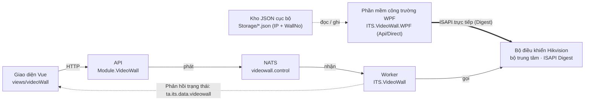

# Bàn giao mã nguồn VideoWall

Tài liệu bàn giao mã nguồn phân hệ VideoWall tập trung vào **Phần mềm công trường WPF (`ITS.VideoWall.WPF`)** cùng tầng giao tiếp trực tiếp bộ điều khiển Hikvision qua giao thức ISAPI và dịch vụ chạy nền (`ITS.VideoWall`, `ITS.VideoWall.Core`) do Hoàng Quý Đạt phụ trách chính. Trong các bảng tra cứu dưới đây, hàm đã có comment XML chỉ nêu tên; hàm chưa có comment được gắn nhãn và ghi rõ chức năng cùng lưu ý kỹ thuật.

- **Bên giao:** Hoàng Quý Đạt, Nhân viên Phát triển phần mềm
- **Bên nhận:** Trần Hồng Sơn, Phó phòng Phát triển Phần mềm
- **Ngày lập:** 02/11/2026
- **Đối chiếu với:** Nhánh `fix/20261101-sharedata-ra-lai-tinh-nang` của `TA-ITS015-WEBAPI-V1.0`
- **Bản HTML:** [BAN-GIAO-MA-NGUON-VIDEOWALL-2026-11-02.html](BAN-GIAO-MA-NGUON-VIDEOWALL-2026-11-02.html)

**Mục lục**

- [1. Mã nguồn và phạm vi bàn giao](#ban-do)
- [2. Tổng quan kiến trúc](#vw-tong)
- [3. Phần mềm công trường WPF — Trọng tâm bàn giao](#vw-wpf)
  - [3.1 Khởi động, kết nối thiết bị và khảo sát](#vw-wpf-ket-noi)
  - [3.2 Thiết lập kịch bản, bố cục cửa sổ và kéo thả trực quan](#vw-wpf-kich-ban)
  - [3.3 Bộ danh mục thử nghiệm trực tiếp 11 nhóm lệnh ISAPI](#vw-wpf-isapi)
  - [3.4 Lưu trữ cục bộ và ghi nhật ký phiên đo kiểm](#vw-wpf-luu-tru)
- [4. Dịch vụ chạy nền Worker và tầng giao tiếp ISAPI](#vw-worker)
  - [4.1 Bảng dữ liệu liên quan](#vw-bang)
  - [4.2 Xác thực Digest và ngắt mạch](#vw-xac-thuc)
  - [4.3 Chọn tường và quy đổi tọa độ](#vw-tuong)
  - [4.4 Nhận lệnh NATS, kích hoạt kịch bản và đồng bộ cửa sổ](#vw-luong)
  - [4.5 Đấu nối thiết bị và giám sát định kỳ](#vw-dau-noi)
- [5. Hạng mục chưa làm và lưu ý khi tiếp nhận](#vw-chua-lam)

## 1. Mã nguồn và phạm vi bàn giao

Phạm vi bàn giao của Hoàng Quý Đạt tập trung chính ở **Phần mềm công trường WPF (`src/Services/VideoWall/ITS.VideoWall.WPF`)** — ứng dụng chạy độc lập tại hiện trường để kết nối trực tiếp bộ điều khiển Hikvision, khảo sát cổng vào/ra, dựng kịch bản kéo thả cửa sổ và đo kiểm 11 nhóm lệnh ISAPI — cùng tầng giao tiếp thiết bị ISAPI / dịch vụ chạy nền (`src/Services/VideoWall/ITS.VideoWall`, `ITS.VideoWall.Core`). Phần API quản lý cấu hình tường, bố cục, phân quyền người dùng/vùng màn hình và lập lịch trên Web (`Module.VideoWall` và giao diện Vue) do Văn Hiếu phát triển chính nên tài liệu này chỉ điểm qua các điểm nối liên quan.

### Thư mục chính

| Thư mục | Vai trò và phạm vi bàn giao |
| --- | --- |
| `src/Services/VideoWall/ITS.VideoWall.WPF` | **Trọng tâm bàn giao:** Phần mềm desktop đấu nối, khảo sát phần cứng, thiết lập bố cục kịch bản trực quan và thử nghiệm trực tiếp lệnh ISAPI tại công trường |
| `src/Services/VideoWall/ITS.VideoWall` | Dịch vụ chạy nền (Windows Service / Worker): nhận lệnh qua NATS, gọi bộ điều khiển Hikvision qua ISAPI Digest, giám sát trạng thái thiết bị |
| `src/Services/VideoWall/ITS.VideoWall.Core` | Interface, hằng số và DTO giao thức ISAPI dùng cho Worker |
| `src/Modules/VideoWall/Module.VideoWall`, `Module.VideoWall.Core` | API quản lý cấu hình tường, phân quyền người dùng/vùng màn hình, lập lịch trên Web (Văn Hiếu phụ trách chính), kèm nhóm endpoint đấu nối `VwDeviceSetupController` và hàm hình học `VwGeometryHelper` |

### Chạy và cấu hình

| Thành phần | Cách chạy | Cấu hình cần biết |
| --- | --- | --- |
| Phần mềm WPF | Ứng dụng Windows (`net10.0-windows`): chạy độc lập tại công trường (`dotnet run --project src/Services/VideoWall/ITS.VideoWall.WPF` hoặc mở tệp `.exe`), không phụ thuộc WebAPI, NATS hay CSDL. | Nhập thẳng IP, cổng, tài khoản bộ điều khiển và chọn số tường (`WallNo`) ngay trên thanh kết nối. Tệp `appsettings.json` / `Configuration/Api.json` chỉ khai `Api:BaseUrl` dùng cho nhánh lập lịch thử nghiệm qua `VideoWallApiClient`. |
| Worker | Windows Service `TA-ITS015-VideoWall` (khi phát triển chạy `dotnet run --project src/Services/VideoWall/ITS.VideoWall`). | `appsettings.json`: `DbConnection`, `Nats:*`. Section `VideoWall:Device` (lớp `VwDeviceOptions`) hiện chỉ khai ở `appsettings.Development.json`; không khai thì IP và tài khoản đọc từ bảng `VwController`. Cờ `VideoWall:Device:IsLocal = true` ép ưu tiên IP và tài khoản trong tệp cấu hình khi phát triển. |

## 2. Tổng quan kiến trúc

Hệ thống có hai đường điều khiển bộ điều khiển VideoWall Hikvision, tách riêng hai tầng mã ISAPI để phần mềm công trường hoạt động hoàn toàn độc lập:

- **Đường công trường (nhánh chính bàn giao):** `ITS.VideoWall.WPF` sử dụng tầng `Api/Direct` gọi thẳng HTTP Digest ISAPI tới bộ điều khiển Hikvision và lưu kịch bản, nguồn tín hiệu, màn hình vào kho JSON cục bộ (`Storage/`) theo từng thiết bị. Kỹ thuật viên mang máy tính ra công trường có thể đấu nối, khảo sát và dựng bố cục tường ngay mà không cần hạ tầng máy chủ.
- **Đường vận hành trên Web (nhánh đối chiếu):** Giao diện Vue (`views/videoWall`) gửi yêu cầu HTTP vào `Module.VideoWall`; API phát gói lệnh qua NATS (`ta.its.data.videowall.control`) xuống Worker `ITS.VideoWall` để gọi thiết bị và phát kết quả ngược về kênh `ta.its.data.videowall`.

*Đường trên là nhánh công trường WPF gọi thẳng bộ điều khiển và lưu tệp JSON cục bộ. Đường dưới là nhánh vận hành qua API, NATS và Worker. Khi sửa giao thức Digest hoặc XML ISAPI cần đối chiếu cập nhật đồng bộ cả hai nơi.*

Với hệ ghép nối nhiều bộ điều khiển (cascade), cả phần mềm WPF lẫn Worker chỉ giao tiếp với **bộ trung tâm**; các bộ con chỉ dùng làm dữ liệu kiểm kê.

## 3. Phần mềm công trường WPF — Trọng tâm bàn giao

Cửa sổ chính `Views/MainWindow.xaml` được bố trí thành 3 khu vực làm việc:

1. **Thanh kết nối phía trên:** Chọn nhanh cấu hình thiết bị thật hoặc giả lập local, nhập `IP`, `Port`, `Account`, `Password`, chọn tường `WallNo`, nút *Kết nối & Khảo sát* và *Khảo sát lại*.
2. **Khung 12 tab chức năng ở giữa** (mở khóa sau khi kết nối thành công): Tab 1 là màn hình chính `SceneSetupTabView` (*Thiết lập Kịch bản & Bố cục*); Tab 2 đến Tab 12 là 11 nhóm lệnh ISAPI trực tiếp dùng chung `IsapiGroupTabView` kèm khung xem phản hồi XML tô màu cú pháp bên dưới.
3. **Bảng nhật ký hoạt động dưới đáy:** Ghi lại từng bước gọi thiết bị trong phiên, nhấp đúp dòng bất kỳ mở `ActivityDetailWindow` để đối chiếu chi tiết XML gửi/nhận, hỗ trợ xóa và xuất log ra tệp.

Các thuộc tính dữ liệu trên ViewModel đã có comment XML; các phương thức xử lý lệnh (`[RelayCommand]`) và điều phối nội bộ chưa có comment được gắn nhãn chi tiết theo từng tiểu mục dưới đây.

### 3.1 Khởi động, kết nối thiết bị và khảo sát

| Hàm, lớp | Tệp | Làm gì, lưu ý gì |
| --- | --- | --- |
| `OnStartup`, `BuildHost`, `AddVideoWallWpf` **(chưa comment)** | App.xaml.cs, Extensions/ServiceCollectionExtensions.cs | Khởi tạo Generic Host, nạp `appsettings.json` cùng `Configuration/*.json` và đăng ký DI cho toàn bộ ViewModel, cửa sổ. Lỗi khởi động ghi ra `startup_error.log`, `startup_catch.log`, `fatal_error.log` ngay cạnh tệp chạy. |
| `MainWindow`, `Connect`, `Probe`, `ApplyRealDevicePreset`, `ApplyLocalMockPreset` **(chưa comment)** | Views/MainWindow.xaml, ViewModels/ConnectionViewModel.cs | Xử lý thanh kết nối, điền nhanh cấu hình mẫu, kiểm tra kết nối lần đầu kèm khảo sát năng lực thiết bị và khảo sát lại; tự khóa nút thao tác qua cờ `IsBusy` khi đang gọi thiết bị. |
| `OnWallNoChanged` **(chưa comment)** | ViewModels/ConnectionViewModel.cs | Khi người dùng đổi số tường `WallNo`, tự đọc lại danh sách cổng ra của tường đó trong nền và cập nhật lại thông số khảo sát cho màn hình thiết lập kịch bản. |
| `BuildDirectClient`, `BuildDirectSetupOrchestrator`, `BuildDirectISAPIClient`, `CreateISAPIClient`, `IsLocalHost` **(chưa comment)** | ViewModels/ConnectionViewModel.cs, Api/Direct/VwDirectClientFactory.cs | Dựng bộ client gọi thẳng thiết bị từ thông số đang nhập trên thanh kết nối. Client gọi qua `http`, bỏ qua kiểm tra chứng chỉ SSL, thời gian chờ tối đa 30 giây mỗi lệnh. |
| `Probe`, `Ping`, `SendIsapi` **(chưa comment)** | Api/Direct/VwDirectDeviceConnectionClient.cs | Thực thi kiểm tra kết nối, khảo sát phần cứng (đăng nhập, đọc năng lực, danh sách tường, cổng ra, kênh vào, kịch bản đang chiếu) và gửi lệnh ISAPI lẻ. Bản WPF chỉ đọc trên thiết bị, không ghi CSDL (khác `ProbeCore` của Worker); mỗi bước đều phát `DeviceStepNotification` để hiển thị nhật ký. |
| `VwDirectDigestHandler` (`SendAsync`, `ParseChallenge`, `BuildAuthorizationHeader` **(chưa comment)**), `VwDirectISAPIClient`, `VwIsapiXmlCodec` | Api/Direct/VwDirectDigestHandler.cs, Api/Direct/VwDirectISAPIClient.cs, Api/Direct/Isapi/VwIsapiXmlCodec.cs | Tự thực thi xác thực HTTP Digest (hỗ trợ cả thuật toán băm MD5 và SHA-256 theo RFC 7616, xử lý đổi `nonce` khi `stale=TRUE`) và đóng/mở gói XML ISAPI trực tiếp với thiết bị. |

### 3.2 Thiết lập kịch bản, bố cục cửa sổ và kéo thả trực quan

| Hàm, lớp | Tệp | Làm gì, lưu ý gì |
| --- | --- | --- |
| `ProbeInputsGrid_PreviewMouseLeftButtonDown`, `ProbeInputsGrid_MouseMove` **(chưa comment)** | Views/SceneSetupTabView.xaml, Views/SceneSetupTabView.xaml.cs | Bắt thao tác kéo nguồn tín hiệu từ bảng khảo sát kênh đầu vào `ProbeInputsGrid` thả trực tiếp sang mặt tường ghép để tạo hoặc đổi nguồn cho cửa sổ. |
| `RedrawCanvas`, `DrawPhysicalScreens`, `SyncWindowCards`, `CreateWindowCard`, `UpdateWindowCardGeometryAndStyle`, `SnapToGrid`, `SnapSize`, `CalculateCardZIndex` **(chưa comment)** | Controls/VisualWallCanvas.xaml.cs | Vẽ ma trận màn hình vật lý theo tỷ lệ khung hình 16:9, đồng bộ danh sách thẻ cửa sổ, xử lý kéo thả di chuyển / co giãn kích thước bám dính lưới tọa độ thiết bị (`Tile`, mặc định 1920), quy đổi tọa độ vẽ theo hệ số thu phóng `_scale` và tính thứ tự lớp đè `ZIndex`. |
| `SyncFromProbeResult`, `ReloadScenesForCurrentWall`, `PopulateSources` **(chưa comment)** | ViewModels/SceneSetupViewModel.cs | Đổ kết quả khảo sát vào màn hình thiết lập: nạp kịch bản theo tường, đánh dấu kịch bản đang chiếu, trộn kênh vào phần cứng với nguồn luồng IP cục bộ, nạp cổng ra và đồng bộ cửa sổ của kịch bản đang chạy vào tệp JSON cục bộ. **Lưu ý:** kịch bản đang chọn có SID (`OutputId`) bằng `6` sẽ được giữ nguyên lựa chọn thay vì chuyển sang kịch bản đang chạy (số `6` đang viết cứng trong hàm). |
| `StartCreateNewScene`, `CreateScene`, `UpdateScene`, `DeleteScene`, `ActivateScene`, `SyncScenesFromDevice`, `PullWindowsFromDevice` **(chưa comment)** | ViewModels/SceneSetupViewModel.cs | Quản lý vòng đời kịch bản cục bộ, kích hoạt chiếu kịch bản trên tường, đồng bộ danh sách kịch bản và kéo bố cục cửa sổ đang mở từ thiết bị về máy. Xóa kịch bản hoặc cửa sổ có hộp thoại xác nhận qua `IUserConfirmation`. |
| `PushToDevice`, `PushWindowsOnlyToDevice`, `BuildDirectWindows`, `BuildDirectWindowFromRow` **(chưa comment)** | ViewModels/SceneSetupViewModel.cs | Lưu JSON cục bộ trước rồi đẩy bố cục xuống thiết bị. Bắt buộc đã chọn `WallNo`, không tự đoán tường để tránh ghi nhầm; SID không ép kiểu được số nguyên thì mặc định dùng `1`. **Lưu ý:** ô `DryRun` trên giao diện mặc định **tắt** nên bấm đẩy là ghi thật xuống thiết bị và không hỏi xác nhận; `PushWindowsOnlyToDevice` bỏ qua bước `saveData` nhưng vẫn kích hoạt nếu `ActivateAfterPush` đang bật. |
| `Execute`, `BuildWindowRequest` **(chưa comment)**, `VwDirectPushSceneInput` | Api/Direct/VwDirectSetupSceneOrchestrator.cs | Điều phối chuỗi bước đẩy kịch bản trực tiếp xuống thiết bị theo các cờ trên `VwDirectPushSceneInput` (`DryRun`, `ResetWindows`, `SaveData`, `Activate`, `SkipGuardrails`): đăng nhập, kiểm giới hạn an toàn, xóa cửa sổ cũ, tạo từng cửa sổ, gọi giải mã luồng nếu nguồn là `ip_stream`, tra lại `DeviceWindowId` còn thiếu, lưu kịch bản và kích hoạt. |
| `ApplyBigCenterTemplate`, `ApplyDual2x2Template`, `ApplyFullWallTemplate`, `ApplyIndividualWindows`, `ApplyOverlappingWindows` **(chưa comment)** | ViewModels/SceneSetupViewModel.cs | Sinh nhanh bố cục cửa sổ theo mẫu dựng sẵn. Ba mẫu đầu (trung tâm lớn, hai cụm 2×2, toàn tường) chỉ thay đổi trên màn hình, chưa lưu tệp; hai hàm sau áp dụng gán từng màn hình đơn lẻ hoặc cửa sổ phủ nhiều màn hình, ghi ngay vào tệp cục bộ và cộng nối vào cửa sổ đã có. |
| `ScheduleLiveWindowUpdate`, `TriggerImmediateLiveWindowUpdate`, `PushLiveWindowUpdate` **(chưa comment)** | ViewModels/SceneSetupViewModel.cs | Cập nhật trực tiếp cửa sổ lên thiết bị khi thao tác: sửa tọa độ trong bảng thì trễ 350 ms mới gửi lần cuối; thả chuột sau khi kéo trên canvas hoặc đổi nguồn thì gửi ngay. Cửa sổ chưa có `DeviceWindowId` sẽ được tạo mới rồi lưu lại mã. **Lưu ý:** thao tác này ghi thật lên thiết bị trừ khi bật `DryRun`. |
| `OpenSourceManagement`, `SaveSource`, `DeleteSource`, `RefreshList` **(chưa comment)** | ViewModels/SceneSetupViewModel.cs, ViewModels/SourceManagementViewModel.cs, Views/SourceManagementDialog.xaml | Hộp thoại thêm, sửa, xóa nguồn luồng IP (`RTSP`, `ONVIF`, `HIK_SDK`, `HTTP_STREAM`, giới hạn URL 256 ký tự) theo từng thiết bị; chặn không cho xóa các kênh HDMI vật lý đọc từ phần cứng. |

### 3.3 Bộ danh mục thử nghiệm trực tiếp 11 nhóm lệnh ISAPI

Từ Tab 2 đến Tab 12 trên `Views/MainWindow.xaml` dùng chung điều khiển `IsapiGroupTabView` cho 11 nhóm chức năng của bộ điều khiển Hikvision (`Board`, `Decoding`, `OutputChannel`, `SignalSource`, `VideoWall`, `Plan`, `Scene`, `Screen`, `TextLed`, `Wallpaper`, `Window` — tương ứng các mảng bo mạch, giải mã, cổng ra, nguồn tín hiệu, tường hình, kế hoạch, kịch bản, màn hình, chữ LED, ảnh nền và cửa sổ).

| Hàm, lớp | Tệp | Làm gì, lưu ý gì |
| --- | --- | --- |
| `UpdateItemsSource`, `SyncSelectionToConnection` **(chưa comment)** | Views/IsapiGroupTabView.xaml, Views/IsapiGroupTabView.xaml.cs | Lọc danh sách mẫu lệnh theo thuộc tính `Group` của từng tab, sắp xếp theo mã mục tài liệu và phương thức HTTP (`GET`, `POST`, `PUT`, `DELETE`), đồng bộ lệnh đang chọn sang `ConnectionViewModel`. |
| `VwIsapiPresetList`, `VwIsapiPresetItem`, `VwIsapiSchemaCatalog`, `VwIsapiApiSchema`, `VwIsapiFieldDef` | ViewModels/VwIsapiPresetItem.cs, ViewModels/Isapi/VwIsapiSchemaCatalog.*.cs | Kho mẫu lệnh dựng sẵn và 11 tệp partial khai báo lược đồ trường tham số theo từng nhóm. Khi cần bổ sung lệnh ISAPI mới, chỉ cần thêm preset vào `VwIsapiPresetList` và khai báo trường trong `VwIsapiSchemaCatalog.<Nhóm>.cs` để giao diện tự sinh biểu mẫu nhập. |
| `Validate`, `BuildPath` **(chưa comment)**, `TryExtractPathParameters`, `UpdateIsapiPathAndBody` **(chưa comment)** | ViewModels/Isapi/VwIsapiFormViewModel.cs, ViewModels/ConnectionViewModel.cs | Kiểm tra các trường tham số bắt buộc, dựng đường dẫn từ biểu mẫu và trích xuất ngược tham số khi người dùng sửa trực tiếp chuỗi URL (đồng bộ hai chiều giữa ô tham số và đường dẫn URL / thân thông điệp). |
| `SendIsapi`, `ResolveContentType`, `CopyIsapiResponse` **(chưa comment)** | ViewModels/ConnectionViewModel.cs | Chặn gửi nếu đường dẫn còn sót `{tham_số}` chưa điền, tự động chọn kiểu nội dung `application/json` cho mục `9.7.2.10` / `9.7.2.13` và `application/xml` cho toàn bộ các lệnh còn lại. **Lưu ý:** gửi thẳng lệnh thô tới thiết bị, lệnh ghi không bật hộp thoại xác nhận. |
| `VwIsapiResponseSummary`, `XmlSyntaxHighlighter` | ViewModels/Isapi/VwIsapiResponseSummary.cs, Interaction/XmlSyntaxHighlighter.cs | Phân tích phản hồi trả về thành các thẻ tóm tắt trạng thái nhanh (badges) và tô màu cú pháp XML trong khung kết quả dưới tab. |

### 3.4 Lưu trữ cục bộ và ghi nhật ký phiên đo kiểm

| Hàm, lớp | Tệp | Làm gì, lưu ý gì |
| --- | --- | --- |
| `LoadData`, `SaveData`, `PopulateSampleScenes`, `SeedSampleScenes`, `SyncScenesFromDevice`, `SyncWindowsFromDevice` **(chưa comment)** | Storage/VwLocalSceneStore.cs | Đọc/ghi danh sách kịch bản, cửa sổ và khởi tạo kịch bản mẫu ra tệp JSON riêng theo khóa thiết bị `DeviceKey` (`IP` + `WallNo`). **Lưu ý:** `LoadData` tự chuẩn hóa và ghi lại tệp khi gặp cấu trúc dữ liệu cũ; `SyncScenesFromDevice` sẽ xóa các kịch bản cục bộ không còn tồn tại trên thiết bị. |
| `VwLocalSourceStore`, `VwLocalScreenStore`, `VwScenarioStore` | Storage/VwLocalSourceStore.cs, Storage/VwLocalScreenStore.cs, Storage/VwScenarioStore.cs | Lưu trữ JSON cục bộ theo khóa thiết bị (`IP` + `WallNo`) cho danh sách nguồn luồng IP tự khai báo, cấu hình gán màn hình và các bộ kịch bản đo kiểm chuỗi bước. |
| `AppendCore`, `AppendSessionLogRecord`, `ResolveLogDirectory`, `ExportLog`, `ClearActivities` **(chưa comment)** | ViewModels/MainViewModel.cs | Giữ tối đa 500 dòng mới nhất trên bảng hoạt động dưới đáy cửa sổ, đồng thời tự động ghi nối chi tiết thông điệp request/response XML của mọi bước gọi thiết bị vào tệp `session_yyyyMMdd.json` (hàm `ResolveLogDirectory` tìm thư mục gốc không gian làm việc hoặc rơi về thư mục `logs` cạnh tệp chạy). Nút xuất log hỗ trợ lưu ra `.json` hoặc `.jsonl`. |
| `ActivityDetailWindow` | Views/ActivityDetailWindow.xaml, Views/ActivityDetailWindow.xaml.cs | Cửa sổ tra cứu chi tiết bước gọi HTTP/ISAPI (phương thức, đường dẫn, thời gian phản hồi, nguyên văn XML gửi đi và nhận về) khi nhấp đúp một dòng trên bảng hoạt động. |

## 4. Dịch vụ chạy nền Worker và tầng giao tiếp ISAPI

Phần này cô đọng các luồng xử lý ở dịch vụ chạy nền `ITS.VideoWall` và tầng giao tiếp ISAPI dùng trên máy chủ do Hoàng Quý Đạt xây dựng để đối chiếu với nhánh WPF ở trên.

### 4.1 Bảng dữ liệu liên quan

| Bảng | Vai trò dữ liệu |
| --- | --- |
| `VwController`, `VwControllerSlot`, `VwSlotPort` | Bộ điều khiển (`IP`, `Port`, tài khoản, `ParentControllerId`, kịch bản đang chạy), khe cắm và cổng |
| `VwScreen`, `VwSource` | Màn hình và nguồn tín hiệu (`SignalNo` là số kênh trên thiết bị) |
| `VwScene`, `VwWindowScene` | Kịch bản (`OutputId` là SID trên thiết bị) và cửa sổ thuộc kịch bản. Bảng `VwWindowScene` đã bỏ cột `DeviceWindowId` nên mã cửa sổ sinh trên thiết bị không lưu vào CSDL. |
| `VwEventTriggerLog` | Nhật ký từng bước gọi thiết bị từ Worker/API, lưu kèm thông điệp gửi và nhận |
| `VwSchedule`, `VwEventRule`, `VwWallTopology`, `VwWallBlock`, `VwWallPermission`, `VwWallPermissionMember` | Lập lịch, luật sự kiện, bố cục tường và phân quyền người dùng/vùng màn hình trên WebAPI (nhóm bảng này do Văn Hiếu phụ trách, liệt kê để phân biệt phạm vi). |

### 4.2 Xác thực Digest và ngắt mạch

Bộ điều khiển Hikvision khóa IP nếu đăng nhập sai liên tiếp nhiều lần, vì vậy tầng client của Worker kiểm soát chặt số lần thử lại và tự ngắt mạch khi gặp lỗi xác thực. Comment lớp `VwISAPIDigestHandler` giải thích chi tiết cơ chế Digest và cờ `stale`.

| Hàm | Tệp | Ghi chú |
| --- | --- | --- |
| `SendAsync`, `BuildAuthorizationHeader` **(chưa comment)**, `ParseChallenge`, `SelectQop`, `BufferContent` | VwISAPIDigestHandler.cs | Gửi lần đầu không kèm xác thực; nhận 401 thì tính `HA1`, `HA2`, `response` theo RFC 7616 và gửi lại. Nếu vẫn nhận 401 kèm `stale=TRUE` thì thử đúng một lần nữa, còn lại trả 401 ngay. |
| `Resolve` **(chưa comment)** | VwISAPICredentialResolver.cs | Mặc định đọc tài khoản từ bảng `VwController`, trống thì lấy cấu hình; khi `IsLocal = true` thì ưu tiên cấu hình trước. |
| `SendCoreAsync`, `ResolveDeviceUri` **(chưa comment)**, `IsMethodRetriable`, `IsTransientStatusCode`, `IsTransientException`, `CalculateBackoff` **(chưa comment)** | VwISAPIDeviceClient.cs | Khung gửi chung: chặn ngay bằng HTTP 429 khi đang ngắt mạch; dựng URI theo thứ tự cổng (`VwController.Port`, cổng trong IP, cấu hình, mặc định `80`); chỉ thử lại `GET`, `PUT`, `DELETE` khi gặp HTTP 408, 429 hoặc `>= 500` (không thử lại `POST` để tránh tạo trùng). |
| `RecordDeviceAuthFailure`, `IsDeviceAuthFailureBlocked`, `RecordAuthSuccess`, `ResetDeviceAuthFailure` **(chưa comment)** | VwISAPIDeviceService.cs | Đếm lỗi HTTP 401/403 liên tiếp; đủ `MaxConsecutiveFailures` thì khóa `BlockMinutes` phút trong `BaseCacheService` (cache bộ nhớ của Worker nên khởi động lại sẽ xóa), đăng nhập thành công hoặc gọi lệnh reset thì mở khóa. |

### 4.3 Chọn tường và quy đổi tọa độ

> **Tường 1 trên thiết bị thật là tường thử chưa gắn màn hình.** Lệnh gửi vào tường 1 vẫn trả HTTP 200 nhưng màn hình thực tế không đổi, nên mã nguồn chủ đích không mặc định chọn tường 1.

| Hàm | Tệp | Ghi chú |
| --- | --- | --- |
| `ResolveWall`, `ResolveWalls`, `Refresh`, `WithWall`, `ForgetWall` **(chưa comment)** | VwISAPIDeviceService.WallResolution.cs, VwISAPIDeviceClient.cs | Xác định tường thao tác và nhớ cache trong 30 phút; `ForgetWall` dùng để xóa cache khi đổi IP hoặc cấu hình tường. |
| `SliceWindowForControllers`, `ToIsapiLocalRect`, `ToCenterUniformRect` | VwGeometryHelper.cs | Các hàm thuần cắt vùng cửa sổ theo từng bộ điều khiển và quy đổi hệ tọa độ ISAPI. |
| `SliceForControllerAsync`, `GetWallCanvasAsync`, `EnsureWindowInsideSceneRegionAsync` **(chưa comment)** | VwSceneRegionService.cs | Đọc màn hình trong CSDL để cắt cửa sổ và tính kích thước toàn tường (ưu tiên `VwWallTopology` / `VwWallBlock`, sau đó lưới `VwScreen`, kích thước panel theo `VideoWall:Device:Profile` hoặc `VwWallProfile`). Riêng `EnsureWindowInsideSceneRegionAsync` hiện đang tạm ngắt (xem mục 5). |

### 4.4 Nhận lệnh NATS, kích hoạt kịch bản và đồng bộ cửa sổ

| Hàm | Tệp | Ghi chú |
| --- | --- | --- |
| `HandleAsync`, `ApplyActiveSceneOnServerAsync`, `BroadcastSceneActivatedAsync` | VwSceneWorkflowCommandHandler.cs | Văn Hiếu phụ trách phía API: phát lệnh `ACTIVATE_SCENE`; khi `ApplySceneOnServer = true` thì API tự ghi trạng thái ngay trên máy chủ. |
| `PublishCommandAsync`, `PublishCommand` **(chưa comment)** | VwPublisher.cs | Gói lệnh thành `VwCommandEnvelope` phát lên kênh `VideoWallControl`; lỗi phát chỉ ghi log và trả `false`. |
| `ProcessCommandAsync`, `PublishTelemetry` **(chưa comment)** | VwCommandConsumer.cs | Nhận gói lệnh Control từ NATS, rẽ nhánh theo `VwCommandActions` và phát kết quả về `ta.its.data.videowall` theo `MessageId`. |
| `HandleActivateSceneAsync` **(chưa comment)**, `ActivateScene`, `BroadcastHardwareOutOfSync` **(chưa comment)** | VwCommandConsumer.cs, VwISAPIDeviceService.cs | Kích hoạt `OutputId` trên bộ trung tâm qua từng tường của `ResolveWalls`, thành công mới ghi CSDL trong một giao dịch (`ActiveSceneId`, `ActiveSceneAt`) và phát `SceneActivated`. **Lưu ý:** lệnh cũ hơn `ActiveSceneAt` hoặc `TargetControllerIds` rỗng sẽ không ghi CSDL; nếu có tường lỗi giữa chừng thì phát `BroadcastHardwareOutOfSync`, các tường đã chuyển không tự hoàn tác. |
| `HandleSyncSceneWindowsAsync`, `HandleSetWindowLayerAsync`, `SyncSceneWindowsToDevice` **(chưa comment)** | VwCommandConsumer.cs, VwISAPIDeviceService.cs | Đồng bộ danh sách cửa sổ hoặc đổi thứ tự lớp hiển thị. **Lưu ý:** mỗi lần `SyncSceneWindowsToDevice` đều xóa toàn bộ cửa sổ trên tường rồi tạo lại (gây mất hình ngắn hạn nếu tường đang chiếu), sau đó gọi `saveData` (lỗi lưu thì tạo kịch bản mới và ghi đè `OutputId`). |
| `ResolveMissingDeviceWindowIds`, `ResolveTargetControllers`, `TryGetCenterController`, `BuildSignalNoMap`, `ResolveSignalNo`, `MatchDeviceWindowByRect`, `AssignDeviceWindowId` **(chưa comment)** | VwISAPIDeviceService.WindowTracking.cs | Tra `SignalNo` của nguồn và ghép lại ID cửa sổ theo tọa độ khi thiết bị không trả ngay sau lệnh tạo (3 hàm đầu đã có comment; `AssignDeviceWindowId` hiện để trống, xem mục 5). |

### 4.5 Đấu nối thiết bị và giám sát định kỳ

| Hàm, lớp | Tệp | Ghi chú |
| --- | --- | --- |
| `Ping`, `Probe`, `SyncSources`, `SyncActiveScene`, `SetupScene`, `Isapi`, `ResetDeviceAuthFailure`, `HandleAsync` **(chưa comment)** | VwDeviceSetupController.cs, VwDeviceSetupCommandHandler.cs | Nhóm API đấu nối từ Web trả ngay `{Accepted, MessageId}` và đẩy lệnh xuống NATS (lưu ý đối chiếu `MessageId` tại mục 5). |
| `TrackAndLog`, `WriteThrownFailure`, `WriteSteps`, `WriteStep`, `BuildRow` **(chưa comment)** | VwISAPIDeviceService.DeviceSetup.cs, VwEventTriggerLogService.cs | Khung bọc ghi nhật ký từng bước gọi thiết bị vào bảng `VwEventTriggerLog` (tự cắt chuỗi vừa cột và nuốt lỗi ghi log để bảo toàn lệnh chính). |
| `ProbeCore`, `SyncSourcesCore`, `SyncActiveSceneCore` **(chưa comment)** | VwISAPIDeviceService.DeviceSetup.cs | Khảo sát và đồng bộ từ Worker. **Lưu ý:** khác với WPF, `ProbeCore` của Worker **có ghi CSDL** (tắt `VwController` nếu đăng nhập lỗi, lưu năng lực, cập nhật khe/cổng và `VwSource.SignalNo`); `SyncSourcesCore` ghép phỏng đoán theo thứ tự cho các nguồn chưa khớp tên/mã và ghi ngay không xét cờ `Apply`. |
| `SetupSceneCore`, `Finish`, `ApplyWindows`, `ApplyScene`, `SendPassthroughCore` **(chưa comment)** | VwISAPIDeviceService.DeviceSetup.cs | Dựng kịch bản qua Worker (trình tự tương tự orchestrator của WPF; bật `DryRun` kèm `SyncSources` vẫn cập nhật `SignalNo` vào CSDL) và gửi lệnh ISAPI thô (`SendPassthroughCore` không tự kiểm quyền nên phải chặn quyền ở tầng API). |
| `VwDeviceHeartbeatService` (`PollAllControllers`, `PollOneController`, `MarkControllerScreensOffline`) | VwDeviceHeartbeatService.cs | Đã có comment đầy đủ. Quét định kỳ theo `HeartbeatIntervalSeconds` (mặc định 20 giây); bộ điều khiển nào lỗi thì đánh dấu `Offline` các màn hình thuộc bộ đó và chỉ phát phần trạng thái thay đổi lên NATS. |

## 5. Hạng mục chưa làm và lưu ý khi tiếp nhận

| Hạng mục | Trạng thái | Vị trí liên quan | Hiện trạng và việc cần làm tiếp |
| --- | --- | --- | --- |
| Tab Đo kiểm theo chuỗi kịch bản | **Chưa gắn giao diện** | Views/ScenarioTabView.xaml, ViewModels/ScenarioViewModel.cs | Đã viết View và logic chạy chuỗi bước ISAPI tự động (`RunSelectedScenario`, `ResumeScenario`, `RunScenarioCore`, `RunOverlappingSizeTest`, `RunErrorValidationSuite`, `InitializeBuiltInScenarios` **(chưa comment)** — dừng ở bước lỗi đầu tiên, nhớ `LastFailedStepIndex` để chạy tiếp, kèm bài kiểm hai nguồn chồng lấn và bộ kiểm mã lỗi khi bật `ErrorSuiteSendReal`), nhưng chưa gắn tab lên `MainWindow.xaml`. Lưu ý các lệnh ghi chạy thật xuống thiết bị, không hỏi xác nhận từng bước. |
| Tab Sơ đồ thiết bị | **Chưa gắn giao diện** | Views/DeviceTopologyTabView.xaml, Views/DeviceTopologyTabView.xaml.cs | Đã có UserControl hiển thị sơ đồ cấu trúc thiết bị nhưng chưa gắn tab lên `MainWindow.xaml`; cần kiểm tra lại binding dữ liệu khảo sát nếu muốn mở trên giao diện chính. |
| Lập lịch và tham số trên WPF | **Chưa gắn giao diện** | ViewModels/ScheduleViewModel.cs, ViewModels/ParametersViewModel.cs | Mới có lớp ViewModel (`SaveSchedule` gọi `VideoWallApiClient` qua cấu hình `Api:BaseUrl`, cùng `Refresh`, `DeleteSchedule`, `Load` **(chưa comment)**), chưa dựng màn hình View gắn vào `MainWindow.xaml`. |
| Kiểm tra biên vùng cửa sổ và lưu mã cửa sổ thiết bị trên Server | **Đang tạm ngắt** | VwSceneRegionService.cs, VwISAPIDeviceService.WindowTracking.cs, Module.VideoWall | Ở nhánh vận hành trên Server, hàm kiểm tra giới hạn vùng kịch bản (`EnsureWindowInsideSceneRegionAsync`) đang tạm khóa trong comment (`TODO: Needcheck`) và hàm gán mã cửa sổ thiết bị (`AssignDeviceWindowId`) đang để trống do bảng `VwWindowScene` đã bỏ cột `DeviceWindowId`, chờ chốt lại quy tắc nghiệp vụ. |
| Mã đối chiếu lệnh đấu nối bất đồng bộ | **Lưu ý đối chiếu** | VwDeviceSetupCommandHandler.cs | `MessageId` trả về từ API (`{Accepted, MessageId}`) hiện sinh mới cục bộ trong handler, chưa truyền xuống `PublishCommandAsync` khi phát gói lệnh NATS nên chưa đối chiếu được 1:1 ở thông báo trạng thái trả về từ Worker. |
